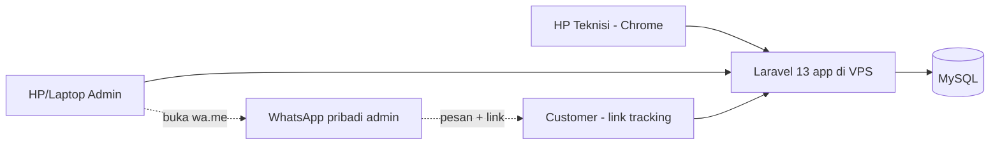
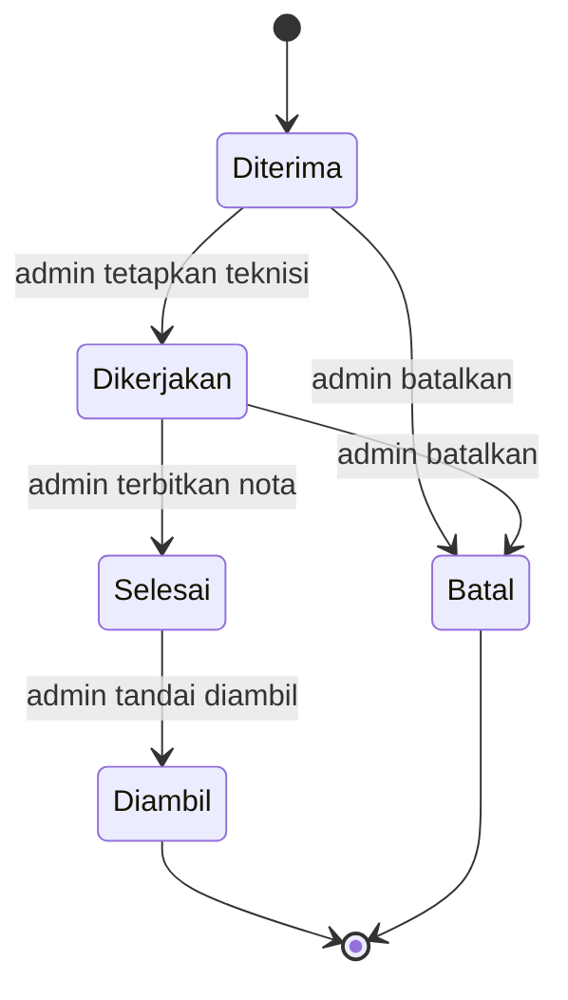
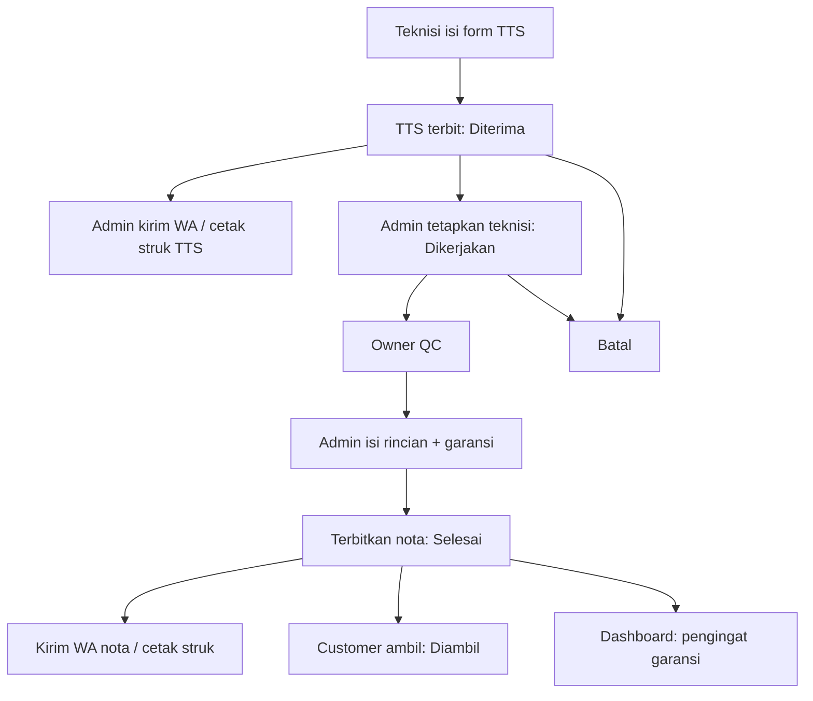

# PRD — Aplikasi Servis Anugerah (repair-app)

| Metadata | Isi |
|---|---|
| Produk | Aplikasi Servis Anugerah — aplikasi web internal toko servis elektronik (nama kerja proyek: `repair-app`) |
| Versi dokumen | 1.2 — §10.2 diselaraskan dengan mockup yang disetujui (D-19) |
| Tanggal | 11 November 2026 |
| Pemilik | Owner Toko Anugerah (klien); penyusun: muzib |
| Pembaca | Owner/klien, developer, tester, deployer |
| Status | v1.0 disetujui user 11 November 2026 (termasuk D-11–D-17). v1.1 menambah penekanan responsif/mobile-first. v1.2 (11 Nov 2026): §10.2 dan NFR-07 diselaraskan dengan mockup yang disetujui user (`mockup/`, `DESIGN.md`). Pertanyaan terbuka §19 tetap berlaku |
| Target rilis | Belum ditetapkan (Q-05) |
| Sumber keputusan | Transkrip wawancara klien `10-11-2026 22.24.txt`; sesi perencanaan 11 November 2026; dokumentasi rilis Laravel |

## Daftar Isi

1. Ringkasan
2. Latar Belakang dan Masalah
3. Tujuan dan Metrik Keberhasilan
4. Cakupan
5. Glosarium
6. Aktor dan Use Case
7. Arsitektur dan Teknologi
8. Model Domain dan Aturan Bisnis
9. Alur Utama
10. Spesifikasi Layar
11. Database
12. Kebutuhan Non-Fungsional
13. Keamanan
14. Operasional dan Deployment
15. Testing
16. Risiko dan Mitigasi
17. Rencana Rilis dan Prioritas
18. Definisi Selesai v1
19. Pertanyaan Terbuka
20. Lampiran

## 1. Ringkasan

Aplikasi Servis Anugerah adalah aplikasi web untuk **satu toko servis elektronik kecil** (Toko Anugerah) yang ownernya ikut bekerja langsung dan memiliki beberapa teknisi. Dua prinsip utamanya:

- **Input sesingkat mungkin.**
- **Mobile-first dan responsif.** Teknisi, owner, dan customer sebagian besar memakai HP. Karena itu **semua layar** — termasuk layar admin seperti rincian nota, stok, dan laporan — dirancang untuk layar HP terlebih dahulu, lalu menyesuaikan diri di tablet dan desktop (§10.2).

Alur inti:

1. **Teknisi** di lapangan (atau di toko) membuka aplikasi dari shortcut di HP Android, mengisi 4 data wajib — nama customer, nomor HP, kategori barang, keluhan — lalu menyimpan. Sistem menerbitkan **TTS (Tanda Terima Service)** bernomor `TTS-YYMM-NNN`.
2. **Admin/owner** mengirim TTS ke customer lewat WhatsApp pribadi (tombol yang membuka WA dengan pesan siap kirim) atau mencetak struk.
3. Admin **menetapkan teknisi** yang mengerjakan. Setelah QC oleh owner, admin mengisi **rincian biaya** (part/jasa, harga jual, modal) dan **menerbitkan nota** dengan garansi.
4. Nota tersedia sebagai **PDF A5** dan **struk 58mm**. Customer bisa memantau status lewat **link tracking unik**.
5. Saat barang diambil, admin menandai **Diambil**. Dashboard mengingatkan garansi yang hampir habis agar toko bisa menghubungi customer.

Selain servis, v1 mencakup **stok barang jualan + penjualan**, **pencatatan pengeluaran**, dan **laporan omzet serta laba bersih** untuk rentang tanggal bebas.

**Batas sistem:** pengiriman WhatsApp tetap manual dari WA pribadi admin (aplikasi hanya membuka WA dengan teks terisi). Aplikasi tidak mengirim WA/email otomatis, tidak menangani pembayaran online, dan tidak dipakai banyak toko.

**Keputusan utama:** Laravel 13 + MySQL dalam satu aplikasi web (monolith), dijalankan di VPS, zona waktu WITA, dua peran (Admin dan Teknisi), tanpa aplikasi Android native. Aplikasi web dibuat mobile-first dan dapat ditambahkan ke layar utama HP seperti aplikasi.

## 2. Latar Belakang dan Masalah

Saat ini teknisi melaporkan pekerjaan lewat **grup WhatsApp** (nama, alamat, barang, harga). Pencatat membaca grup lalu menyalin ke catatan, dan owner merekap modal/laba malam hari. Untuk servis di rumah customer (contoh: mesin cuci), teknisi tidak membawa nota atau TTS kertas.

| Masalah | Pengguna terdampak | Bukti/contoh nyata | Dampak | Tujuan |
|---|---|---|---|---|
| Tidak ada tanda terima saat barang diterima di lokasi customer | Teknisi, customer | Transkrip: "Mesin cuci… nggak mungkin bawa nota, nggak mungkin bawa TTS" | Barang sulit dilacak, customer tidak punya bukti | G-01, G-02 |
| Rekap manual dari grup WA | Owner, pencatat | Transkrip: pencatat menyalin dari grup, owner menghitung modal malam hari | Rawan terlewat/salah hitung, laba sulit dilihat | G-03 |
| Aplikasi servis yang pernah dilihat terlalu panjang | Teknisi, owner | Transkrip: "panjang… cocok untuk yang punya SOP, banyak karyawan" | Aplikasi tidak dipakai | G-01 |
| Garansi tidak dipantau | Owner, customer | Transkrip: customer malas kembali padahal garansi masih ada | Kehilangan kesempatan menjaga hubungan customer | G-04 |
| Stok barang jualan dan pengeluaran harian tidak tercatat rapi | Owner | Transkrip: printer second, bensin ±Rp15.000/hari, konsumsi | Laba bersih tidak diketahui | G-03, G-05 |

## 3. Tujuan dan Metrik Keberhasilan

| ID | Tujuan | Metrik | Baseline | Target | Cara dan waktu pengukuran |
|---|---|---|---|---|---|
| G-01 | Teknisi membuat TTS dengan cepat dari HP | Waktu dari membuka shortcut (sudah login) sampai nomor TTS tampil | Belum diukur | ≤ 60 detik (target awal) | Uji langsung bersama teknisi saat pilot |
| G-02 | Setiap barang servis tercatat dan dapat dilacak | Persentase barang servis yang punya TTS | Belum diukur | 100% selama pilot (target awal) | Owner mencocokkan barang di toko dengan daftar TTS setiap minggu selama pilot |
| G-03 | Owner melihat omzet dan laba tanpa rekap manual | Laporan rentang tanggal tersedia dan cocok dengan hitungan manual | Rekap manual malam hari | Selisih Rp0 pada sampel 1 minggu (target awal) | Owner membandingkan laporan dengan catatan manual pada minggu pertama pilot |
| G-04 | Garansi dimanfaatkan untuk menjaga customer | Garansi yang akan habis muncul di dashboard | Tidak ada | 100% garansi aktif muncul ≤ 3 hari sebelum habis | Uji fungsional (AC-09) |
| G-05 | Stok barang jualan akurat | Selisih stok sistem dengan fisik | Belum diukur | 0 selisih saat cek fisik bulanan (target awal) | Owner menghitung fisik di akhir bulan |

## 4. Cakupan

### 4.1 Termasuk v1

| REQ-ID | Kemampuan | Tujuan | Prioritas | AC utama |
|---|---|---|---|---|
| REQ-01 | Login dengan username dan password, opsi "ingat saya"; dua peran: Admin dan Teknisi; tanpa registrasi publik | G-01 | Wajib | AC-01, AC-04, AC-20 |
| REQ-02 | Admin mengelola akun pengguna: buat, ubah peran, nonaktifkan, reset password | G-01 | Wajib | AC-20 |
| REQ-03 | Form TTS: 4 wajib (nama, nomor HP, kategori, keluhan) + 2 opsional (keterangan barang, alamat) | G-01, G-02 | Wajib | AC-02 |
| REQ-04 | Nomor TTS otomatis `TTS-YYMM-NNN`, urutan reset tiap bulan (WITA) | G-02 | Wajib | AC-03 |
| REQ-05 | Daftar TTS dengan pencarian (nomor, nama, HP) dan filter status | G-02 | Wajib | AC-04, AC-05 |
| REQ-06 | Teknisi mengedit TTS buatannya selama status Diterima | G-02 | Wajib | AC-05 |
| REQ-07 | Admin menetapkan/mengganti teknisi; status menjadi Dikerjakan dan waktu penetapan tercatat | G-02 | Wajib | AC-06 |
| REQ-08 | Admin mengisi rincian biaya multi-baris (jenis Part/Jasa, deskripsi, qty, harga jual, modal) | G-03 | Wajib | AC-07, AC-08 |
| REQ-09 | Admin menerbitkan nota: tanggal nota, garansi (hari), tanda "tidak dapat diperbaiki"; status Selesai | G-03, G-04 | Wajib | AC-07, AC-22 |
| REQ-10 | Admin mengoreksi rincian nota yang sudah terbit; tanggal nota tetap | G-03 | Wajib | AC-21 |
| REQ-11 | Admin menandai Diambil beserta tanggal | G-02 | Wajib | AC-10 |
| REQ-12 | Admin membatalkan TTS (sebelum nota) dengan alasan opsional | G-02 | Wajib | AC-11 |
| REQ-13 | Dokumen TTS dan nota: struk 58mm (cetak) dan PDF A5 (unduh); harga modal tidak pernah tampil | G-02, G-03 | Wajib | AC-08, AC-14, AC-23 |
| REQ-14 | Tombol "Kirim WA" untuk TTS, nota, dan pengingat garansi: membuka `wa.me` dengan teks terisi | G-02, G-04 | Wajib | AC-13 |
| REQ-15 | Halaman tracking publik melalui link unik per TTS | G-02 | Wajib | AC-12 |
| REQ-16 | QR code link tracking pada struk TTS | G-02 | Diupayakan | AC-14 |
| REQ-17 | Dashboard admin: ringkasan hari ini, servis selesai belum diambil, garansi akan habis (servis dan penjualan) + tandai "sudah dihubungi" | G-04 | Wajib | AC-09 |
| REQ-18 | Master kategori barang (tambah, ubah, nonaktifkan) | G-02 | Wajib | AC-19 |
| REQ-19 | Stok barang jualan: tambah/ubah barang, restok (menambah jumlah dan memperbarui harga beli) | G-05 | Wajib | AC-16 |
| REQ-20 | Penjualan: nomor `JL-YYMM-NNN`, baris barang dari stok, garansi opsional, struk 58mm dan PDF A5, hapus penjualan | G-03, G-05 | Wajib | AC-15 |
| REQ-21 | Pencatatan pengeluaran (tanggal, kategori tetap, keterangan, nominal) | G-03 | Wajib | AC-18 |
| REQ-22 | Laporan rentang tanggal bebas: omzet, modal, laba kotor, pengeluaran, laba bersih, beserta rincian transaksi | G-03 | Wajib | AC-17 |
| REQ-23 | Pengaturan toko: nama, alamat, telepon, logo, teks syarat garansi, default hari garansi | G-03 | Wajib | AC-23 |
| REQ-24 | Semua layar responsif dan mobile-first sesuai aturan §10.2 dan tampilan yang disetujui (`DESIGN.md`, `mockup/`): navigasi bawah di HP, tabel menjadi daftar dua baris di HP, tombol aksi baris di kolom kiri, form satu kolom dengan tombol aksi mudah dijangkau, tanpa scroll horizontal | G-01 | Wajib | AC-24, AC-25 |
| REQ-25 | Aplikasi dapat ditambahkan ke layar utama Android dengan nama dan ikon toko, terbuka tanpa bilah alamat browser (web app manifest, tanpa mode offline) | G-01 | Wajib | AC-01, AC-26 |

### 4.2 Tidak termasuk v1

| Kemampuan/batasan | Alasan | Rencana setelah v1 |
|---|---|---|
| Modul proyek (CCTV) dan bagi hasil investor 50:50 | Aturan bagi hasil belum jelas; diputuskan "nanti dulu" | Dibahas setelah v1 (Q-08). Sementara proyek dicatat sebagai TTS/nota biasa dengan banyak baris |
| Email laporan harian jam 00.00 | Diputuskan "skip dulu" | Tambahkan setelah v1 bila diminta |
| Master kerusakan dan harga | Klien ingin mengumpulkan data 3–6 bulan dahulu | Petakan dari data rincian nota setelah 3–6 bulan |
| WhatsApp otomatis (API) | Klien memakai WA pribadi dan menghindari risiko spam/blokir | Tidak direncanakan |
| Stok sparepart servis | Dipilih stok barang jualan saja | Tinjau ulang bila stok sparepart mulai dikelola |
| DP/cicilan/metode pembayaran | Dipilih tanpa DP; omzet dihitung pada tanggal nota | Tinjau ulang bila ada kebutuhan nyata |
| Multi-toko/SaaS | Uji coba di satu toko dulu | Tinjau ulang setelah pilot berhasil |
| Aplikasi Android native, mode offline | Web + shortcut di layar utama sudah cukup | Tidak direncanakan |
| Riwayat perubahan (audit log) nota | Disetujui: admin boleh koreksi tanpa riwayat | Tinjau ulang bila ada kebutuhan audit |
| Ekspor Excel, edit penjualan | Tidak diminta | Penjualan yang salah dihapus lalu dibuat ulang |

Asumsi: owner/admin memiliki akses internet di HP atau laptop, dan teknisi memakai HP Android dengan Chrome.

## 5. Glosarium

| Istilah | Arti dalam produk ini | Format/catatan |
|---|---|---|
| TTS | Tanda Terima Service; catatan barang yang diterima untuk diservis. Satu TTS = satu barang/pekerjaan servis | `TTS-2611-001` |
| Nota | Bukti tagihan servis yang terbit dari TTS. Memakai nomor yang sama dengan TTS-nya | Tanggal nota = awal garansi |
| Baris rincian | Satu baris pada nota: jenis, deskripsi, qty, harga jual satuan, modal satuan | — |
| Part | Barang/sparepart yang dipasang; memiliki modal | — |
| Jasa | Ongkos pengerjaan; modal selalu 0 | — |
| Harga jual | Harga untuk customer; satu-satunya harga yang tampil di nota/struk/tracking | Rupiah bulat |
| Modal | Harga beli part/barang; hanya dilihat admin | Rupiah bulat |
| Omzet | Jumlah harga jual × qty pada nota servis dan penjualan | — |
| Laba kotor | Omzet − total modal | — |
| Laba bersih | Laba kotor − pengeluaran | — |
| Restok | Penambahan jumlah barang jualan; tidak dihitung sebagai pengeluaran | — |
| Mobile-first | Cara merancang tampilan untuk layar HP lebih dulu, lalu menambah penyesuaian untuk layar yang lebih lebar | §10.2 |
| Responsif | Tampilan menyesuaikan lebar layar (HP, tablet, desktop) tanpa versi aplikasi terpisah | §10.2 |
| Web app manifest | File kecil berisi nama, ikon, dan warna aplikasi agar web bisa dipasang di layar utama HP | Bukan aplikasi native; tanpa offline |
| Link tracking | URL publik berisi token acak untuk melihat status satu TTS | `https://<domain>/t/<token>` |
| WITA | Waktu Indonesia Tengah (`Asia/Makassar`, UTC+8); acuan semua tanggal | — |

## 6. Aktor dan Use Case

| Aktor | Tujuan | Hak dan batas |
|---|---|---|
| Admin (owner/pencatat) | Mengelola seluruh alur, harga, laporan | Akses penuh. Bisa membuat TTS juga |
| Teknisi | Mencatat barang masuk dengan cepat | Membuat TTS, melihat daftar TTS tanpa harga, mengedit TTS buatannya selama status Diterima |
| Customer | Mengetahui status servis | Tanpa login; hanya melihat TTS miliknya melalui link tracking |

### UC-01 — Teknisi membuat TTS

- Aktor dan pemicu: Teknisi menerima barang dari customer.
- Prasyarat: Teknisi sudah login (sesi "ingat saya").
- Alur utama: buka shortcut → langsung tampil form TTS → isi nama, HP, pilih kategori, keluhan (opsional: keterangan barang, alamat) → Simpan → tampil nomor TTS dan tombol Kirim WA/Cetak.
- Cabang/kegagalan: field wajib kosong atau nomor HP tidak valid → pesan di bawah field, data yang sudah diisi tidak hilang. Sesi habis → halaman login, lalu kembali ke form.
- Kondisi akhir: TTS berstatus Diterima, `created_by` = teknisi.
- Keterlacakan: REQ-03, REQ-04, BR-01, BR-02, AC-02, AC-03.

### UC-02 — Admin menetapkan teknisi

- Aktor dan pemicu: Admin membuka TTS berstatus Diterima.
- Alur utama: pilih teknisi → Simpan → status Dikerjakan, `assigned_at` tercatat. Admin bisa mengganti teknisi selama status Dikerjakan.
- Keterlacakan: REQ-07, BR-04, AC-06.

### UC-03 — Admin mengisi rincian dan menerbitkan nota

- Aktor dan pemicu: Pekerjaan sudah lolos QC oleh owner.
- Prasyarat: Status Dikerjakan dan teknisi sudah ditetapkan.
- Alur utama: tambah baris (+) → pilih Part/Jasa → isi deskripsi, qty, harga jual, modal (khusus Part) → isi garansi (default dari pengaturan) → opsional centang "tidak dapat diperbaiki" → Terbitkan nota → status Selesai.
- Cabang/kegagalan: tidak ada baris → ditolak. Qty < 1 atau harga negatif → ditolak.
- Kondisi akhir: nota terbit, tanggal nota = hari ini (WITA), garansi mulai berjalan.
- Keterlacakan: REQ-08, REQ-09, BR-05–BR-08, AC-07, AC-08, AC-22.

### UC-04 — Customer mengambil barang

- Alur utama: customer datang membawa struk/menyebut nomor TTS → admin mencari TTS → Tandai Diambil (tanggal default hari ini, bisa diubah).
- Keterlacakan: REQ-11, AC-10.

### UC-05 — Customer mengecek status

- Alur utama: customer membuka link dari WA atau memindai QR di struk → melihat status. Setelah nota terbit → melihat rincian harga jual, total, masa garansi, dan tombol unduh PDF.
- Cabang: token tidak dikenal → 404.
- Keterlacakan: REQ-15, BR-10, AC-12.

### UC-06 — Admin menindaklanjuti garansi

- Alur utama: dashboard menampilkan servis/penjualan yang garansinya habis ≤ 3 hari lagi → Kirim WA → Tandai sudah dihubungi → hilang dari daftar.
- Keterlacakan: REQ-17, BR-07, AC-09.

### UC-07 — Admin mencatat penjualan

- Alur utama: buat penjualan → tambah baris barang dari stok, qty, harga jual (default dari barang) → opsional nama/HP customer dan garansi → Simpan → stok berkurang → cetak struk/unduh PDF.
- Cabang: qty melebihi stok → ditolak. Garansi diisi tanpa nomor HP → ditolak.
- Keterlacakan: REQ-19, REQ-20, BR-11–BR-13, AC-15, AC-16.

### UC-08 — Admin mencatat pengeluaran dan melihat laporan

- Alur utama: catat pengeluaran harian. Buka laporan → pilih tanggal awal dan akhir (default awal bulan s.d. hari ini) → lihat ringkasan dan rincian.
- Keterlacakan: REQ-21, REQ-22, BR-14, AC-17, AC-18.

### UC-09 — Admin membatalkan TTS

- Alur utama: TTS berstatus Diterima/Dikerjakan → Batalkan (alasan opsional) → status Batal.
- Keterlacakan: REQ-12, BR-04, AC-11.

## 7. Arsitektur dan Teknologi

Satu aplikasi Laravel (monolith) yang merender halaman di server (Blade + Livewire), satu database MySQL, berjalan di satu VPS. Tidak ada API terpisah, antrean (queue), atau layanan eksternal wajib. WhatsApp hanya dibuka lewat tautan `https://wa.me/<nomor>?text=<pesan>` dari perangkat admin.

| Lapisan/kebutuhan | Teknologi | Alasan | Tradeoff/batasan | Status |
|---|---|---|---|---|
| Framework | Laravel 13 (PHP 8.3–8.5) | Versi stabil terbaru; dukungan bug fix sampai Q3 2027, keamanan sampai 17 Maret 2028 | PHP di VPS harus ≥ 8.3 | Disetujui user (stack); versi dipilih agent berdasarkan dokumentasi resmi |
| UI | Livewire starter kit resmi (Blade + Livewire) + Tailwind | Starter kit resmi berbasis Blade; form dinamis (tambah baris) tanpa SPA terpisah | Registrasi bawaan starter kit harus dimatikan; login diubah ke username | Disetujui (D-11, D-13) |
| Database | MySQL 8 | Disetujui user | — | Disetujui |
| PDF | `barryvdh/laravel-dompdf` | Umum dipakai di Laravel; mendukung ukuran kertas A5 | Dukungan CSS terbatas; layout harus sederhana | Disetujui (D-11) |
| Struk 58mm | Halaman HTML khusus cetak (`@page` lebar 58mm) + PDF 58mm | Bisa dicetak dari browser atau aplikasi printer di HP | Cara cetak ke printer thermal klien belum diverifikasi (Q-02, spike) | Disetujui (D-06); cara cetak terbuka (Q-02) |
| QR code | Pustaka QR berbasis PHP (keluaran SVG) | Ringan, tanpa layanan eksternal | Dipilih saat implementasi; render dalam PDF perlu diuji | Disetujui (D-16), Diupayakan |
| Hosting | VPS Linux, Nginx, PHP-FPM, MySQL, HTTPS (Let's Encrypt) | Disetujui user (VPS) | Pemeliharaan server menjadi tanggung jawab pemilik/pengelola (Q-03) | Disetujui; detail terbuka |
| Zona waktu | `Asia/Makassar` (WITA) sebagai timezone aplikasi | Satu toko, semua tanggal lokal | Tidak cocok bila kelak multi-zona | Disetujui user (WITA) |

## 8. Model Domain dan Aturan Bisnis

### 8.1 Entitas dan kepemilikan

| Entitas | Makna | Pemilik/sumber | Identitas | Siklus hidup |
|---|---|---|---|---|
| Pengguna | Akun admin/teknisi | Admin | `username` unik | Aktif ↔ Nonaktif |
| Kategori | Jenis barang servis | Admin | Nama unik | Aktif ↔ Nonaktif |
| TTS (service order) | Satu barang servis beserta notanya | Dibuat teknisi/admin; dikelola admin | `TTS-YYMM-NNN` + token tracking | Diterima → Dikerjakan → Selesai → Diambil; Batal |
| Baris rincian | Part/jasa pada nota | Admin | ID baris | Bisa diubah kapan saja oleh admin |
| Barang | Barang jualan dalam stok | Admin | ID | Aktif ↔ Nonaktif |
| Restok | Riwayat barang masuk | Admin | ID | Tetap |
| Penjualan | Transaksi penjualan barang stok | Admin | `JL-YYMM-NNN` | Dibuat; dapat dihapus |
| Pengeluaran | Biaya operasional | Admin | ID | Dapat diubah/dihapus |
| Pengaturan toko | Identitas toko pada dokumen | Admin | Satu baris | Dapat diubah |

Status TTS:

### 8.2 Aturan bisnis

| BR-ID | Aturan | Input dan kondisi | Hasil/penolakan | Contoh dan kasus batas |
|---|---|---|---|---|
| BR-01 | Penomoran TTS dan penjualan | Prefiks `TTS`/`JL`, periode `YYMM` dari tanggal pembuatan (WITA), urutan per prefiks per periode, minimal 3 digit | Nomor unik; dibuat dalam transaksi database dengan penguncian baris counter | TTS pertama 11-11-2026 → `TTS-2611-001`; TTS pertama 1-12-2026 00:05 WITA → `TTS-2612-001`; urutan ke-1000 → `TTS-2611-1000` |
| BR-02 | Normalisasi nomor HP | Hanya digit setelah membuang spasi/tanda hubung/`+`; awalan `0` → `62` | Disimpan `62…`; valid bila 10–15 digit setelah normalisasi | `0812-3456-7890` → `6281234567890`; `12345` → ditolak |
| BR-03 | Data wajib TTS | Nama, HP, kategori aktif, keluhan | Ditolak bila kosong | Keterangan barang dan alamat boleh kosong |
| BR-04 | Transisi status | Hanya sesuai diagram 8.1; hanya admin yang mengubah status | Transisi lain ditolak | Selesai → Batal ditolak |
| BR-05 | Syarat terbit nota | Status Dikerjakan, teknisi terisi, ≥ 1 baris rincian | Ditolak bila tidak terpenuhi | Total boleh Rp0 (mis. tidak dapat diperbaiki tanpa biaya cek) |
| BR-06 | Nilai baris | Qty bilangan bulat ≥ 1; harga jual dan modal bilangan bulat ≥ 0 (Rupiah); Jasa selalu modal 0 | Subtotal jual = qty × harga jual; subtotal modal = qty × modal | Jasa Rp100.000, modal yang dikirim 5.000 → disimpan 0 |
| BR-07 | Garansi | Hari garansi ≥ 0 (default dari pengaturan, awalnya 30). `berlaku_sampai = tanggal_nota + hari`. 0 = tanpa garansi | Muncul di dashboard bila hari ini (WITA) antara `berlaku_sampai − 3` dan `berlaku_sampai` dan belum ditandai dihubungi | Nota 11-11-2026, 30 hari → berlaku s.d. 11-12-2026; muncul 8–11 Desember 2026 |
| BR-08 | Tanggal nota | Diisi otomatis saat nota terbit (WITA); tidak berubah saat koreksi | Dasar garansi dan laporan | Nota dikoreksi 15-11-2026 → tanggal tetap 11-11-2026 |
| BR-09 | Hak teknisi | Teknisi hanya membuat TTS, melihat daftar/detail TTS tanpa angka harga, dan mengedit TTS buatannya selama Diterima | Akses lain → 403 | Teknisi membuka `/laporan` → 403 |
| BR-10 | Tracking | Token acak ≥ 32 karakter, unik, dibuat bersama TTS | Token salah → 404. Tidak menampilkan nomor HP, alamat, modal | — |
| BR-11 | Stok tidak minus | Qty penjualan ≤ stok saat disimpan (dalam transaksi) | Ditolak bila melebihi | Stok 1, jual 2 → ditolak |
| BR-12 | Snapshot penjualan | Nama barang, harga jual, dan harga beli disalin ke baris penjualan saat disimpan | Laba penjualan lama tidak berubah saat harga barang diubah | — |
| BR-13 | Restok dan hapus penjualan | Restok menambah stok dan memperbarui harga beli barang; tidak masuk pengeluaran. Menghapus penjualan mengembalikan stok | — | Modal diakui saat barang terjual, mencegah dihitung dua kali |
| BR-14 | Rumus laporan | Rentang tanggal inklusif (WITA). Servis: nota berstatus Selesai/Diambil menurut tanggal nota. Penjualan menurut tanggal jual. Pengeluaran menurut tanggalnya | Omzet = Σ subtotal jual; Laba kotor = Omzet − Σ subtotal modal; Laba bersih = Laba kotor − Σ pengeluaran. Batal tidak dihitung. Restok ditampilkan sebagai info, tidak dikurangkan | Contoh hitung di §20.1 |
| BR-15 | Kategori/pengguna nonaktif | Tidak muncul di pilihan baru | Data lama tetap menampilkan nama | — |
| BR-16 | Pengeluaran | Kategori tetap: Bensin, Konsumsi, Gaji, Lainnya; nominal > 0 | — | — |

## 9. Alur Utama

Pesan WA (template tetap di v1, isi diambil dari data):

- TTS: `Halo {nama}, barang {kategori} {keterangan} sudah kami terima dengan nomor {nomor_tts}. Cek status: {link_tracking} — {nama_toko}`
- Nota: `Halo {nama}, servis {nomor_tts} sudah selesai. Total {total}. Garansi s.d. {berlaku_sampai}. Nota: {link_tracking} — {nama_toko}`
- Garansi: `Halo {nama}, garansi {nomor} untuk {barang} berlaku s.d. {berlaku_sampai}. Apakah barangnya masih baik? — {nama_toko}`

Pekerjaan latar belakang: tidak ada di aplikasi. Hanya backup database harian lewat cron sistem (§14.4).

## 10. Spesifikasi Layar

### 10.1 Daftar layar dan navigasi

| Layar/rute | Pengguna | Tujuan | Data dan tindakan | REQ-ID |
|---|---|---|---|---|
| `/login` | Semua | Masuk | Username, password, ingat saya. Setelah login: teknisi → `/tts/baru`, admin → `/` | REQ-01 |
| `/` Dashboard | Admin | Ringkasan | TTS masuk hari ini, jumlah per status, omzet hari ini, daftar Selesai belum diambil, daftar garansi akan habis (Kirim WA, Tandai dihubungi) | REQ-17 |
| `/tts/baru` | Admin, Teknisi | Buat TTS | Form 4 wajib + 2 opsional → halaman sukses (nomor, Kirim WA, Cetak struk, Buat TTS lagi) | REQ-03, REQ-04 |
| `/tts` | Admin, Teknisi | Daftar TTS | Cari nomor/nama/HP, filter status; teknisi tanpa kolom harga | REQ-05 |
| `/tts/{id}` | Admin, Teknisi | Detail TTS | Admin: tetapkan teknisi, rincian/nota, tandai diambil, batal, cetak/PDF, Kirim WA. Teknisi: lihat data, Edit (bila diizinkan) | REQ-06–REQ-14 |
| `/tts/{id}/edit` | Admin, Teknisi (milik sendiri, Diterima) | Ubah data TTS | Field sama dengan form TTS | REQ-06 |
| `/tts/{id}/rincian` | Admin | Isi/koreksi rincian dan terbitkan nota | Baris dinamis (+/hapus), total jual, total modal, laba; garansi; tidak dapat diperbaiki | REQ-08–REQ-10 |
| `/tts/{id}/struk`, `/tts/{id}/pdf` | Admin, Teknisi (struk TTS saja) | Cetak/unduh | Struk 58mm; PDF A5. Isi menyesuaikan status (TTS atau nota) | REQ-13, REQ-16 |
| `/t/{token}`, `/t/{token}/pdf` | Publik | Tracking | Status, tanggal, rincian harga jual setelah nota terbit, unduh PDF | REQ-15 |
| `/penjualan`, `/penjualan/baru`, `/penjualan/{id}` (+ struk/pdf) | Admin | Penjualan | Daftar, buat, detail, hapus, cetak | REQ-20 |
| `/stok`, `/stok/baru`, `/stok/{id}/edit`, `/stok/{id}/restok` | Admin | Barang jualan | Nama, harga beli, harga jual, jumlah; riwayat restok | REQ-19 |
| `/pengeluaran` | Admin | Pengeluaran | Daftar per rentang tanggal, tambah/ubah/hapus | REQ-21 |
| `/laporan` | Admin | Laporan | Pilih tanggal awal–akhir; ringkasan dan rincian per transaksi | REQ-22 |
| `/pengaturan/toko`, `/pengaturan/kategori`, `/pengaturan/pengguna` | Admin | Pengaturan | Identitas toko, kategori, akun | REQ-02, REQ-18, REQ-23 |
| `/profil` | Semua | Ganti password | — | REQ-01 |

Isi dokumen:

- **TTS (struk/PDF):** header toko, nomor TTS, tanggal terima, nama dan HP customer, kategori + keterangan, keluhan, QR tracking (Diupayakan), catatan "Simpan struk ini untuk pengambilan barang".
- **Nota (struk/PDF):** header toko, nomor, tanggal terima, tanggal nota, teknisi, baris rincian (deskripsi, qty, harga jual, subtotal), total, "Tidak dapat diperbaiki" bila dicentang, garansi dan tanggal berlaku, teks syarat garansi. **Tanpa modal.**
- **Penjualan (struk/PDF):** header toko, nomor JL, tanggal, baris barang, total, garansi bila ada.

### 10.2 Desain responsif dan mobile-first

Aturan ini berlaku untuk **semua layar** (REQ-24). Setiap layar dirancang dan diuji di lebar HP terlebih dahulu.

**Acuan visual yang disetujui (11 Nov 2026):** `mockup/` (12 layar yang bisa diklik) dan `DESIGN.md` (token warna, huruf IBM Plex Sans/Mono, komponen). Gaya "lembar berbingkai": bingkai abu-biru tipis berbentuk L, kerja di atas lembar putih, tombol utama hitam, satu warna teal hanya untuk data/tab aktif/tahapan, status sebagai pil berlabel. Bila tabel di bawah dan `DESIGN.md` berbeda, `DESIGN.md` yang berlaku untuk detail visual.

**Ukuran layar acuan:**

| Kelas | Lebar | Perangkat contoh | Tata letak |
|---|---|---|---|
| HP | < 640px | HP Android teknisi/owner/customer | Satu kolom, bilah atas 52px, navigasi bawah |
| Tablet | 640–1023px | Tablet, HP mode lanskap | Seperti HP dengan konten lebih lebar |
| Desktop | ≥ 1024px | Laptop/PC di toko | Sidebar kiri 228px, bilah atas berisi pencarian, tabel penuh |

**Aturan tata letak:**

| Aspek | Di HP | Di tablet/desktop |
|---|---|---|
| Navigasi | Bilah navigasi bawah, maksimal 5 ikon berlabel. Teknisi: Buat TTS, Daftar TTS, Profil. Admin: Beranda, Servis, Buat TTS, Laporan, Menu (berisi Penjualan, Stok, Pengeluaran, Pengaturan, Profil) | Sidebar kiri berisi semua menu |
| Daftar data (TTS, stok, penjualan, pengeluaran, rincian laporan) | Daftar dua baris tanpa kartu: nomor + status/jumlah, lalu nama dan keterangan abu | Tabel tanpa kartu di sekelilingnya, angka rata kanan |
| Tombol aksi di tabel dan daftar baris | Di kolom paling kiri (44px). Satu aksi: tombol bertulisan langsung. Lebih dari satu aksi: satu tombol pilihan `···` yang membuka menu dropdown | Sama, tombol 32px di kolom kiri |
| Form | Satu kolom, label di atas field, tombol aksi utama (Simpan/Terbitkan) menempel di bawah layar dan selalu terlihat | Boleh dua kolom untuk field pendek; tombol di akhir form |
| Rincian nota (baris dinamis) | Setiap baris bertumpuk dan dipisah garis (hapus di kiri, Part/Jasa, deskripsi, qty, harga jual, modal); total menempel di bawah di samping tombol Terbitkan | Baris tabel yang dapat diedit dengan tombol hapus di kolom kiri; ringkasan dan tombol Terbitkan di panel kanan |
| Ringkasan dashboard dan laporan | Beranda: jalur servis 2 × 2, angka KPI sebagai daftar label–nilai. Laporan: laba rugi, grafik omzet per hari, tabel transaksi | Beranda: jalur servis 4 sel, KPI sebagai tab grafik. Laporan: laba rugi dan grafik berdampingan, tabel transaksi selebar halaman dengan baris total |
| Aksi pada detail TTS | Tombol utama sesuai status tampil paling atas (mis. "Tetapkan teknisi", "Isi rincian"); aksi lain (Kirim WA, Cetak, PDF, Batal) dalam baris tombol/menu di bawahnya | Sama, tata letak dua kolom: data di kiri, aksi di kanan |
| Pencarian dan filter | Tab status bergaris bawah yang bisa digeser horizontal (satu-satunya scroll horizontal yang diizinkan), kotak cari di bawahnya | Tab status di atas, kotak cari dan jumlah hasil dalam satu baris |
| Halaman tracking customer | Satu kolom, status besar di atas, tombol unduh PDF selebar layar | Konten di tengah dengan lebar maksimum ±640px |

**Aturan interaksi:**

- Target sentuh di HP (tombol, ikon, baris daftar) minimal **44 × 44px** dengan jarak antar target yang cukup.
- Teks isi minimal **16px di HP dan tablet (< 1024px)** dan **14px di laptop/PC**; field input di HP minimal 16px agar browser tidak memperbesar halaman otomatis. Keterangan sekunder (baris kedua, tanggal) boleh 13–14px di HP.
- Keyboard sesuai isi field: nomor HP `type="tel"`, nominal dan qty `inputmode="numeric"`, tanggal memakai pemilih tanggal bawaan browser.
- Nominal ditampilkan dengan pemisah ribuan saat diketik (contoh `1.000.000`) namun disimpan sebagai angka bulat.
- Tidak ada fungsi yang hanya bisa diakses dengan hover (arahkan kursor) atau klik kanan.
- Teks panjang (nama, keluhan, alamat) dibungkus ke baris berikutnya, tidak memotong tata letak.
- Dialog konfirmasi (mis. Batal, Hapus penjualan) tampil sebagai panel bawah atau dialog penuh lebar di HP.
- Kontras teks memenuhi WCAG AA (rasio minimal 4,5:1 untuk teks biasa); status tidak hanya dibedakan dengan warna, tetapi juga label teks.
- Halaman memakai meta viewport `width=device-width, initial-scale=1`; zoom pengguna tidak dimatikan.

**Pasang ke layar utama (REQ-25):** aplikasi memiliki web app manifest (nama toko, ikon 192px dan 512px, warna tema, `display: standalone`, `start_url` ke halaman setelah login). Tidak ada service worker dan tidak ada mode offline (lihat §4.2).

**Di luar aturan responsif:** struk 58mm dan PDF A5 adalah dokumen cetak berukuran tetap, bukan layar (§10.1).

### 10.3 State layar dan form

| Layar/komponen | Loading | Empty | Error | Success |
|---|---|---|---|---|
| Form TTS | Tombol Simpan nonaktif selama proses (mencegah dobel simpan) | — | Pesan per field; isian tetap | Halaman sukses dengan nomor TTS |
| Daftar TTS | — | "Belum ada TTS" + tombol Buat TTS | — | — |
| Rincian nota | — | Satu baris kosong siap diisi | Pesan per baris | Status Selesai + tombol cetak/WA |
| Dashboard garansi | — | "Tidak ada garansi yang akan habis" | — | Baris hilang setelah ditandai |
| Laporan | — | Semua angka Rp0 + "Tidak ada transaksi" | Tanggal akhir < awal → pesan | — |
| Tracking | — | — | 404 sederhana | — |

| Field form TTS | Tipe/default | Validasi | Sumber aturan |
|---|---|---|---|
| Nama customer | Teks | Wajib, ≤ 100 karakter | BR-03 |
| Nomor HP | Teks `type="tel"` (keyboard angka) | Wajib, BR-02 | BR-02 |
| Kategori | Pilihan kategori aktif | Wajib | BR-03, BR-15 |
| Keluhan/kerusakan | Teks area | Wajib, ≤ 500 karakter | BR-03 |
| Keterangan barang | Teks (mis. merek/tipe) | Opsional, ≤ 100 karakter | D-12 |
| Alamat | Teks area | Opsional, ≤ 255 karakter | D-05 |

## 11. Database

Semua uang disimpan sebagai bilangan bulat Rupiah (`unsigned int`). Tanggal disimpan dalam WITA.

| Tabel dan field utama | Constraint/relasi | Makna |
|---|---|---|
| `users`: id, name, username, password, role (`admin`/`teknisi`), is_active, remember_token, timestamps | `username` unique | Akun |
| `categories`: id, name, is_active, timestamps | `name` unique | Kategori barang |
| `number_sequences`: prefix, period (`YYMM`), last_seq | PK (prefix, period) | Counter nomor (BR-01) |
| `service_orders`: id, number, customer_name, customer_phone, customer_address?, category_id, item_description?, complaint, status, created_by, technician_id?, assigned_at?, invoiced_on?, warranty_days?, warranty_until?, unrepairable (default false), picked_up_on?, cancelled_at?, cancel_reason?, warranty_contacted_at?, tracking_token, timestamps | `number` unique, `tracking_token` unique; FK category_id, created_by, technician_id → users; index status, invoiced_on, warranty_until, customer_phone | TTS dan nota |
| `service_order_items`: id, service_order_id, type (`part`/`jasa`), description, qty, price, cost, timestamps | FK cascade delete | Baris rincian |
| `products`: id, name, cost_price, sell_price, stock, is_active, timestamps | stock ≥ 0 | Barang jualan |
| `stock_entries`: id, product_id, qty, cost_price, entry_date, note?, created_by, timestamps | FK | Riwayat restok |
| `sales`: id, number, sold_on, customer_name?, customer_phone?, warranty_days?, warranty_until?, warranty_contacted_at?, created_by, timestamps | `number` unique; index sold_on, warranty_until | Penjualan |
| `sale_items`: id, sale_id, product_id, product_name, qty, price, cost, timestamps | FK cascade delete | Baris penjualan (snapshot, BR-12) |
| `expenses`: id, spent_on, category (`bensin`/`konsumsi`/`gaji`/`lainnya`), description?, amount, created_by, timestamps | index spent_on | Pengeluaran |
| `store_settings`: id, name, address, phone, logo_path?, warranty_terms?, default_warranty_days | Satu baris | Pengaturan toko |

`?` = boleh kosong. Seed awal: satu akun admin, kategori awal (Q-06), pengaturan toko kosong. Data uji memakai data sintetis.

## 12. Kebutuhan Non-Fungsional

| NFR-ID | Aspek | Target dan kondisi | Cara ukur | Prioritas | Status |
|---|---|---|---|---|---|
| NFR-01 | Responsif dan mobile-first | **Semua layar** (teknisi, admin, tracking) dapat dipakai penuh di lebar 360px, 768px, dan 1280px tanpa scroll horizontal, tanpa konten terpotong atau tumpang tindih, mengikuti aturan §10.2 | Uji AC-24 di DevTools Chrome (3 lebar) dan di minimal satu HP Android nyata | Wajib | Disetujui |
| NFR-02 | Kecepatan form TTS | Halaman form tampil ≤ 2 detik pada jaringan 4G | Uji manual saat pilot | Wajib | Disetujui |
| NFR-03 | Bahasa dan format | UI bahasa Indonesia; uang `Rp1.100.000`; tanggal `11 Nov 2026`; zona WITA | Review | Wajib | Disetujui |
| NFR-04 | Browser | Chrome Android terbaru; Chrome/Edge desktop terbaru | Uji manual | Wajib | Disetujui |
| NFR-05 | Backup | Backup database harian, simpan 14 hari di VPS + salinan di luar VPS (Q-04) | Uji restore satu kali sebelum go-live | Wajib | Disetujui |
| NFR-06 | Kapasitas | Satu toko, ≤ 10 pengguna, ≤ 50 TTS/hari | — | — | Asumsi |
| NFR-07 | Kenyamanan sentuh dan baca | Di HP/tablet (< 1024px): target sentuh ≥ 44 × 44px, teks isi dan input ≥ 16px. Di laptop/PC: teks isi ≥ 14px. Semua lebar: kontras teks WCAG AA, tepi kolom isian ≥ 3:1 | Inspeksi DevTools + pemeriksaan kontras pada layar utama | Wajib | Disetujui |

## 13. Keamanan

- Login username + password (hash bawaan Laravel), pembatasan percobaan login bawaan, CSRF aktif, HTTPS wajib.
- Tidak ada registrasi publik; akun dibuat admin. Minimal selalu ada satu admin aktif.
- Otorisasi dicek di server pada setiap rute/aksi, bukan hanya menyembunyikan menu.
- Halaman tracking: token acak ≥ 32 karakter, header `noindex`, tidak menampilkan HP/alamat/modal.
- Rahasia (`APP_KEY`, kredensial database) hanya di file `.env` server; tidak masuk Git.

| Peran | Resource | Aksi diizinkan | Ditolak |
|---|---|---|---|
| Admin | Semua | Semua | — |
| Teknisi | TTS | Buat; lihat daftar/detail tanpa harga; edit milik sendiri saat Diterima; cetak struk TTS | Ubah status, rincian, nota, edit TTS orang lain → 403 |
| Teknisi | Stok, penjualan, pengeluaran, laporan, pengaturan, dashboard | — | 403 |
| Publik | Tracking | Lihat satu TTS via token | Token salah → 404 |

## 14. Operasional dan Deployment

### 14.1 Lingkungan

| Lingkungan | Tujuan | Target | Pemilik | Status |
|---|---|---|---|---|
| Lokal | Pengembangan dan uji | Laptop developer | Developer | Siap |
| Produksi | Dipakai toko | VPS Linux + domain + HTTPS | Pemilik VPS (Q-03) | Belum siap (Q-03) |

Staging terpisah tidak dibuat di v1. Uji dilakukan di lokal, lalu smoke test di produksi.

### 14.2 Konfigurasi

| Variabel | Tujuan | Rahasia? |
|---|---|---|
| `APP_KEY` | Enkripsi Laravel | Rahasia |
| `APP_URL` | Dasar link tracking | Publik |
| `APP_TIMEZONE` = `Asia/Makassar` | Zona waktu | Publik |
| `DB_HOST`, `DB_DATABASE`, `DB_USERNAME`, `DB_PASSWORD` | Database | Password rahasia |

### 14.3 Rilis dan pemulihan

| Tahap | Penanggung jawab | Bukti selesai | Jika gagal |
|---|---|---|---|
| Preflight | Developer | PHP ≥ 8.3, MySQL, HTTPS aktif, backup terakhir ada | Stop |
| Deploy | Developer (dengan izin pemilik) | Commit yang dirilis tercatat; `composer install --no-dev`, aset build, `php artisan migrate --force`, cache config/route/view | Kembali ke commit sebelumnya; restore backup bila migrasi merusak data |
| Verifikasi | Developer + owner | Smoke test: login, buat TTS, nota, PDF, struk, tracking, laporan | Rollback |

### 14.4 Operasional berkelanjutan

- Cron harian 03.00 WITA: `mysqldump` terkompresi, simpan 14 hari, salin ke lokasi di luar VPS (Q-04).
- Log Laravel harian dirotasi. Pemeriksaan error dilakukan manual oleh developer bila ada laporan masalah.
- Pembaruan keamanan OS/PHP menjadi tanggung jawab pengelola VPS (Q-03).

## 15. Testing

### 15.1 Strategi

- **Feature test otomatis (Pest/PHPUnit)** untuk aturan bisnis dan akses: penomoran, transisi status, hak teknisi, rumus laporan, stok, garansi, tracking.
- **Uji responsif setiap layar** sebelum layar dianggap selesai: lebar 360px, 768px, dan 1280px di DevTools Chrome, dengan screenshot sebagai bukti. Layar teknisi, rincian nota, dan tracking juga diuji di HP Android nyata.
- **Uji manual** di HP Android: kecepatan form TTS, pasang ke layar utama, tombol WA, cetak struk di printer klien, tampilan PDF.
- Semua data uji sintetis.

### 15.2 Acceptance criteria

| AC-ID | Skenario dan hasil yang diharapkan | Jenis uji |
|---|---|---|
| AC-01 | Teknisi login dengan "ingat saya", menutup browser, membuka shortcut → langsung tampil form TTS tanpa login ulang | Manual |
| AC-02 | Simpan TTS dengan nama/HP/kategori/keluhan kosong → ditolak dengan pesan per field, isian lain tetap. HP `0812-3456-7890` tersimpan `6281234567890` | Feature |
| AC-03 | TTS pertama November 2026 = `TTS-2611-001`, berikutnya `-002`; TTS pertama 1 Des 2026 WITA = `TTS-2612-001`. Dua penyimpanan bersamaan tidak menghasilkan nomor sama | Feature |
| AC-04 | Teknisi mengakses rute nota/laporan/stok/penjualan/pengeluaran/pengaturan/dashboard → 403. Halaman TTS yang dilihat teknisi tidak memuat angka harga/modal | Feature |
| AC-05 | Teknisi bisa mengedit TTS buatannya saat Diterima; saat Dikerjakan atau TTS milik teknisi lain → 403 | Feature |
| AC-06 | Admin menetapkan teknisi → status Dikerjakan, `assigned_at` terisi, nama teknisi tampil di detail | Feature |
| AC-07 | Terbitkan nota tanpa teknisi atau tanpa baris → ditolak. Baris Jasa dengan modal 5.000 → tersimpan 0 | Feature |
| AC-08 | Rincian: Part "LCD" 1 × 1.000.000 (modal 700.000) + Jasa 1 × 100.000 → total nota Rp1.100.000; struk, PDF, dan tracking tidak memuat "700.000" | Feature + manual |
| AC-09 | Nota 11-11-2026 garansi 30 hari → berlaku s.d. 11-12-2026; tampil di dashboard pada 8–11 Des 2026; hilang setelah ditandai dihubungi atau setelah 11 Des. Berlaku juga untuk penjualan bergaransi | Feature |
| AC-10 | Tandai Diambil → status Diambil dengan tanggal; tracking menampilkan "Sudah diambil" | Feature |
| AC-11 | Batal dari Diterima/Dikerjakan berhasil; dari Selesai ditolak; TTS Batal tidak masuk laporan | Feature |
| AC-12 | `/t/token-salah` → 404. Token benar → status tampil; setelah nota terbit tampil rincian harga jual, total, garansi, tombol PDF; tidak ada HP/alamat/modal | Feature |
| AC-13 | Tombol Kirim WA membuka `https://wa.me/6281234567890?text=…` berisi nomor TTS dan link tracking | Feature + manual |
| AC-14 | Struk 58mm dan PDF A5 untuk TTS, nota, dan penjualan berhasil dibuat; struk tercetak terbaca di printer klien (bukti foto). QR (bila dibuat) dapat dipindai ke link tracking | Manual |
| AC-15 | Stok 3, jual 2 → stok 1; jual 2 lagi → ditolak; hapus penjualan → stok kembali. Penjualan pertama November 2026 = `JL-2611-001`. Garansi tanpa HP → ditolak | Feature |
| AC-16 | Restok 2 unit harga beli baru → stok bertambah 2, harga beli barang diperbarui, laba penjualan lama tidak berubah, restok tidak masuk pengeluaran | Feature |
| AC-17 | Data contoh §20.1 untuk rentang 11–11 Nov 2026 → omzet Rp2.600.000, modal Rp1.800.000, laba kotor Rp800.000, pengeluaran Rp65.000, laba bersih Rp735.000 | Feature |
| AC-18 | Pengeluaran tanggal 11-11-2026 mengurangi laba bersih rentang yang mencakup tanggal itu, tidak untuk rentang lain | Feature |
| AC-19 | Kategori nonaktif tidak muncul di form TTS; TTS lama tetap menampilkan nama kategorinya | Feature |
| AC-20 | Akun nonaktif tidak bisa login; TTS lama tetap menampilkan namanya. Admin terakhir tidak bisa dinonaktifkan | Feature |
| AC-21 | Admin mengubah harga baris nota yang sudah terbit → total dan laporan berubah; tanggal nota tetap | Feature |
| AC-22 | Nota "tidak dapat diperbaiki" dengan Jasa "Biaya cek" Rp50.000 → masuk omzet; dokumen menampilkan "Tidak dapat diperbaiki" | Feature |
| AC-23 | Nama, alamat, telepon, logo, dan syarat garansi dari pengaturan tampil di header/footer dokumen | Manual |
| AC-24 | Setiap layar di §10.1 dibuka pada lebar 360px, 768px, dan 1280px: tidak ada scroll horizontal halaman, tidak ada teks/tombol terpotong atau bertumpuk, semua aksi dapat dijangkau. Di 360px daftar tampil sebagai daftar dua baris dengan tombol aksi di kiri dan navigasi di bawah; di 1280px daftar tampil sebagai tabel dan navigasi di samping; tampilan sesuai `mockup/` dan `DESIGN.md` | Manual (screenshot 3 lebar per layar) |
| AC-25 | Di HP 360px: tombol Simpan form TTS dan Terbitkan nota selalu terlihat tanpa scroll; field HP memunculkan keyboard angka; field nominal/qty memunculkan keyboard angka dan menampilkan pemisah ribuan; semua target sentuh ≥ 44 × 44px | Manual (HP Android nyata) |
| AC-26 | Dari Chrome Android, "Tambahkan ke layar utama" memasang ikon dengan nama toko; membukanya menampilkan aplikasi tanpa bilah alamat dan langsung ke halaman sesuai peran | Manual (HP Android nyata) |

### 15.3 Penerimaan dan regresi

Fitur dianggap lulus bila AC terkait lulus pada hasil gabungan (bukan hanya di cabang implementasi). Bug dicatat dengan langkah reproduksi. Seluruh feature test dijalankan ulang sebelum setiap rilis.

## 16. Risiko dan Mitigasi

| Risiko | Dasar | Dampak | Mitigasi | Pemilik |
|---|---|---|---|---|
| Struk tidak tercetak rapi di printer thermal klien | Model printer dan cara cetak belum diketahui | Sedang | Spike cetak di awal M2 dengan printer klien (Q-02); PDF A5 sebagai cadangan | Developer + klien |
| Teknisi tidak mau memakai aplikasi | Transkrip: aplikasi panjang ditolak | Tinggi | Form 4 wajib, langsung tampil setelah login, uji dengan teknisi saat pilot | Owner |
| Layar admin yang padat (rincian nota, laporan, stok) sulit dipakai di HP | Owner sering bekerja dari HP; layar ini berisi banyak angka | Sedang | Pola daftar dua baris dan tombol menempel di bawah (§10.2, `mockup/`); layout dasar dan navigasi dibuat di M1 sehingga semua layar berikutnya memakai pola yang sama; AC-24 wajib per layar | Developer |
| Cakupan "semua fitur" memperpanjang waktu sebelum dipakai | Keputusan cakupan v1 | Sedang | Urutan milestone memprioritaskan alur servis; opsi pilot setelah M2 (Q-07) | Owner + developer |
| Data hilang di VPS | VPS dikelola sendiri | Tinggi | Backup harian + salinan di luar VPS + uji restore (NFR-05) | Pengelola VPS |
| Koreksi nota tanpa riwayat menyembunyikan kesalahan | Keputusan D-15 | Rendah | Hanya admin yang bisa mengoreksi; tinjau ulang setelah pilot | Owner |

## 17. Rencana Rilis dan Prioritas

Semua kebutuhan v1 berprioritas Wajib kecuali REQ-16 (Diupayakan).

| Milestone | Hasil | Kebutuhan | Ketergantungan | Kriteria keluar |
|---|---|---|---|---|
| M1 Fondasi | Login, peran, pengguna, kategori, pengaturan toko; layout responsif dasar sesuai `DESIGN.md` (bingkai L/sidebar, navigasi bawah, tabel ↔ daftar dua baris, aksi baris + menu pilihan, form, tombol menempel) dan web app manifest | REQ-01, REQ-02, REQ-18, REQ-23, REQ-24, REQ-25 | — | AC-04 (bagian akses), AC-19, AC-20, AC-24 untuk layar M1, AC-26 |
| M2 Alur servis | TTS sampai Diambil, dokumen, WA, tracking | REQ-03–REQ-16 | M1; Q-02 untuk struk | AC-01–AC-14, AC-21–AC-23 |
| M3 Dashboard dan garansi | Ringkasan harian dan pengingat garansi | REQ-17 | M2 | AC-09 |
| M4 Stok, penjualan, pengeluaran | Barang jualan, penjualan, pengeluaran | REQ-19–REQ-21 | M1 | AC-15, AC-16, AC-18 |
| M5 Laporan | Laporan rentang tanggal | REQ-22 | M2, M4 | AC-17 |
| M6 Rilis | Aplikasi berjalan di VPS dan dipakai toko | Semua | Q-03, Q-04 | Definisi Selesai §18 |

M4 tidak bergantung pada M2 sehingga dapat dikerjakan paralel. Bila Q-07 disetujui, M2 dirilis lebih dulu untuk pilot.

REQ-24 berlaku lintas milestone: setiap layar baru di M2–M5 baru dianggap selesai bila lulus AC-24 (dan AC-25 untuk form TTS dan rincian nota).

## 18. Definisi Selesai v1

- [ ] REQ-01–REQ-25 memenuhi AC-01–AC-26 (REQ-16 boleh ditunda dengan keputusan owner).
- [ ] Semua layar lulus uji responsif di 360px, 768px, dan 1280px (AC-24) dengan screenshot sebagai bukti; form TTS, rincian nota, dan tracking lulus di HP Android nyata (AC-25).
- [ ] Aplikasi terpasang di layar utama HP teknisi dan owner (AC-26).
- [ ] Aturan BR-01–BR-16 terverifikasi oleh feature test yang lulus pada hasil gabungan.
- [ ] Teknisi membuat TTS di HP Android ≤ 60 detik dalam uji langsung.
- [ ] Struk 58mm tercetak terbaca di printer klien; PDF A5 rapi.
- [ ] Aplikasi berjalan di VPS dengan HTTPS; smoke test produksi lulus.
- [ ] Backup harian berjalan dan restore berhasil diuji satu kali.
- [ ] Owner menerima akun admin, panduan singkat (buat TTS, terbitkan nota, laporan), dan daftar akun teknisi.

## 19. Pertanyaan Terbuka

| Q-ID | Pertanyaan | Saran | Dampak jika belum dijawab | Menghambat | Pemilik | Sebelum |
|---|---|---|---|---|---|---|
| Q-01 | Data toko untuk dokumen: nama resmi, alamat, telepon, logo, teks syarat garansi | Klien kirim teks + logo PNG | Header dokumen kosong | Tidak (bisa diisi via pengaturan) | Klien | Pilot |
| Q-02 | Merek/model printer thermal dan cara cetak (Bluetooth dari HP? aplikasi apa?) | Klien kirim foto/model printer; developer lakukan spike cetak | Layout struk bisa tidak cocok | Penyelesaian struk (AC-14) | Klien | Akhir M2 |
| Q-03 | VPS: penyedia, OS, domain, siapa yang merawat server | Ubuntu LTS + domain milik toko | Tidak bisa deploy | M6 | Owner | M6 |
| Q-04 | Lokasi salinan backup di luar VPS | Object storage murah atau Google Drive owner | Risiko kehilangan data | M6 | Owner | M6 |
| Q-05 | Target tanggal pilot/rilis | Tetapkan setelah TODO dibuat | Tidak ada tenggat | Tidak | Owner | Pembuatan TODO |
| Q-06 | Kategori awal dan daftar akun teknisi | Mesin cuci, TV, Laptop, Komputer, Monitor, Printer, Catokan, HP, Lainnya | Seed data | Tidak | Klien | Pilot |
| Q-07 | Pilot alur servis setelah M2 sebelum M3–M5 selesai? | Ya, agar teknisi mulai terbiasa lebih cepat | Waktu sampai dipakai lebih lama | Tidak | Owner | Akhir M2 |
| Q-08 | Modul proyek dan bagi hasil investor | Dibahas setelah v1 | — | Tidak (di luar v1) | Owner | Setelah v1 |

## 20. Lampiran

### 20.1 Contoh data dan perhitungan laporan

Tanggal 11 November 2026 (WITA):

| Transaksi | Rincian | Omzet | Modal |
|---|---|---|---|
| Nota `TTS-2611-001` (laptop) | Part LCD 1 × Rp1.000.000 (modal Rp700.000); Jasa ganti LCD 1 × Rp100.000 | Rp1.100.000 | Rp700.000 |
| Penjualan `JL-2611-001` | Printer second 1 × Rp1.500.000 (harga beli Rp1.100.000) | Rp1.500.000 | Rp1.100.000 |
| Pengeluaran | Bensin Rp15.000; Konsumsi Rp50.000 | — | — |
| TTS `TTS-2611-002` (Batal) | — | Tidak dihitung | — |

Ringkasan: Omzet Rp2.600.000 − Modal Rp1.800.000 = Laba kotor Rp800.000 − Pengeluaran Rp65.000 = **Laba bersih Rp735.000**.

### 20.2 Referensi

| Sumber | Klaim yang didukung | Tanggal diperiksa |
|---|---|---|
| Transkrip wawancara klien `10-11-2026 22.24.txt` | Kebutuhan bisnis, alur, contoh harga | 11 Nov 2026 |
| https://laravel.com/framework/docs/releases | Laravel 13 rilis 17 Mar 2026, PHP 8.3–8.5, dukungan keamanan s.d. 17 Mar 2028 | 11 Nov 2026 |
| https://laravel.com/framework/docs/12.x/releases | Breeze/Jetstream tidak lagi diperbarui; diganti starter kit baru | 11 Nov 2026 |

Belum diverifikasi: dukungan render SVG/QR di dompdf dan cara cetak ke printer thermal klien (dibuktikan lewat spike).

### 20.3 Riwayat keputusan

| ID | Keputusan | Alasan | Pengusul | Status |
|---|---|---|---|---|
| D-01 | v1 mencakup semua fitur kecuali proyek/investor, email harian, master kerusakan | Pilihan user lalu dipersempit di putaran kedua | User | Disetujui |
| D-02 | Dua peran: Admin dan Teknisi | Teknisi tidak boleh melihat modal | User | Disetujui |
| D-03 | Laravel + MySQL di VPS | Satu aplikasi, sederhana | User | Disetujui |
| D-04 | Nomor `TTS-YYMM-NNN` reset per bulan | Pilihan user | User | Disetujui |
| D-05 | Alamat customer opsional | Servis di rumah | User | Disetujui |
| D-06 | Dokumen PDF A5 + struk 58mm | Pilihan user | User | Disetujui |
| D-07 | Satu toko | Pilot di Anugerah | User | Disetujui |
| D-08 | Stok barang jualan saja; tracking link unik; kerusakan/harga teks bebas, master hanya kategori; tanpa DP, omzet per tanggal nota | Pilihan user | User | Disetujui |
| D-09 | Zona WITA; teknisi buat/lihat TTS tanpa harga; penjualan dengan struk + garansi opsional; tracking status + nota; admin boleh koreksi nota; servis gagal bisa berbiaya | Pilihan user | User | Disetujui |
| D-10 | Nomor nota = nomor TTS; status Diterima/Dikerjakan/Selesai/Diambil/Batal; garansi default 30 hari, pengingat H-3; tombol wa.me; tanpa aplikasi native/offline; kategori pengeluaran tetap; rumus laporan; snapshot harga penjualan | Default usulan agent | Agent | Disetujui user ("pakai default") |
| D-11 | Laravel 13 + Livewire starter kit + dompdf | Versi stabil terbaru; starter kit resmi berbasis Blade | Agent | Disetujui user 11 Nov 2026 |
| D-12 | Field "barang" = kategori (wajib, dari master) + keterangan barang (opsional) | Klien ingin kategori + keterangan; teknisi tetap mengisi 4 field wajib | Agent | Disetujui user 11 Nov 2026 |
| D-13 | Login memakai username, bukan email | Teknisi belum tentu punya email | Agent | Disetujui user 11 Nov 2026 |
| D-14 | Baris rincian memiliki qty | Pekerjaan proyek seperti CCTV 8 titik | Agent | Disetujui user 11 Nov 2026 |
| D-15 | Teknisi wajib ditetapkan sebelum nota terbit; Batal tidak masuk laporan; restok bukan pengeluaran; penjualan tidak bisa diedit (hapus lalu buat ulang); pesan WA berupa template tetap | Menjaga data konsisten dan sederhana | Agent | Disetujui user 11 Nov 2026 |
| D-16 | QR tracking di struk TTS | Link token panjang sulit diketik dari kertas | Agent | Disetujui user 11 Nov 2026 — prioritas Diupayakan |
| D-17 | Tanpa staging; backup harian 14 hari | Skala satu toko | Agent | Disetujui user 11 Nov 2026 |
| D-18 | Semua layar wajib responsif dan mobile-first; aturan konkret di §10.2 (navigasi bawah, kartu di HP, tombol menempel, target sentuh 44px, keyboard sesuai isi); web app manifest tanpa service worker/offline | Teknisi, owner, dan customer sebagian besar memakai HP | User (penekanan); rincian aturan oleh agent | Disetujui user 11 Nov 2026; rincian diperbarui oleh D-19 |
| D-19 | Tampilan mengikuti mockup yang disetujui (`mockup/`, `DESIGN.md`): gaya lembar berbingkai, IBM Plex Sans; teks 16px di HP dan 14px di laptop; menu bawah admin Beranda/Servis/Buat TTS/Laporan/Menu; tabel menjadi daftar dua baris di HP; tombol aksi baris di kolom paling kiri, lebih dari satu aksi memakai menu pilihan | Hasil review mockup bersama user; versi pertama (hijau, kartu) ditolak | User | Disetujui user 11 Nov 2026 (mengubah §10.2, REQ-24, NFR-07) |
| D-20 | Deploy demo ke `muzib@202.10.40.165`, `/var/www/demo-repair-app`, domain `demo-repair-app.scannara.asia`, SSL Let’s Encrypt; database `demo_repair_app`, user `new_gym`, password diisi owner secara privat | Target diberikan user; izin hanya target ini, tanpa hapus data | User | Disetujui user 14 Nov 2026 |
| D-21 | Khusus deployment demo D-20, gunakan MariaDB 10.11 existing dan uji kompatibilitas; kebutuhan awal MySQL 8 tetap sebagai riwayat | Menggunakan layanan yang tersedia tanpa mengganti database aplikasi lain | User | Disetujui user 14 Nov 2026 melalui jawaban async call_92a3f86afce040759f23a9968dab36d4 |

### 20.4 Validasi diagram

| Diagram | Bagian | Renderer/versi | Revisi PRD | Hasil parse | Hasil render | Catatan visual |
|---|---|---|---|---|---|---|
| Arsitektur (flowchart) | §7 | `@mermaid-js/mermaid-cli` 12.2.0 + Chrome for Testing (headless) | v1.0, 11 Nov 2026 | Lulus (setelah label panah diperbaiki) | Lulus (PNG) | Terbaca, arah panah benar |
| Status TTS (stateDiagram-v2) | §8.1 | Sama | v1.0 | Lulus | Lulus (PNG) | Terbaca, transisi sesuai BR-04 |
| Alur utama (flowchart) | §9 | Sama | v1.0 | Lulus | Lulus (PNG) | Terbaca |

Ditemukan 3 diagram, sesuai inventaris. Percobaan pertama, diagram arsitektur gagal parse karena sintaks label panah putus-putus (`-. teks .->`). Label diubah ke format `-.->|"teks"|`, lalu ketiga diagram dirender ulang dan lulus. Validasi dijalankan di folder sementara di luar proyek. Setelah revisi v1.1 (diagram tidak berubah), ketiga diagram dirender ulang dan tetap lulus.
