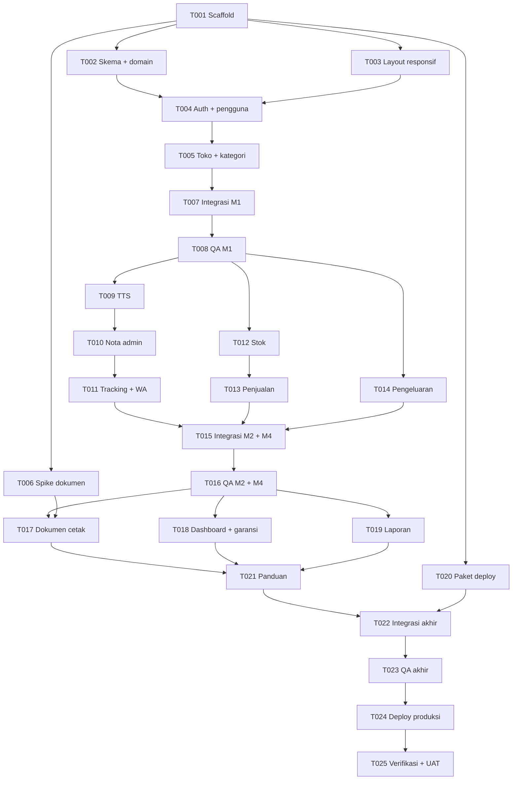

# TODO — Aplikasi Servis Anugerah (repair-app)

## Tujuan dan cara pakai

Rencana kerja untuk membangun v1 sesuai `PRD.md` (v1.1). PRD adalah sumber kebutuhan; setiap task merujuk bagian PRD.

**Sumber status tunggal adalah ledger JSON di bawah.** Coordinator memperbaruinya setelah memeriksa bukti worker, lalu membuat ulang overview dengan:

```sh
python3 ~/.agents/skills/project-delivery/scripts/validate_todo.py TODO.md --write-overview --check-prd
```

- Maksimal **dua worker aktif** (tester/integrator/deployer ikut dihitung).
- Maksimal **dua attempt implementasi** per task; perubahan kode setelah itu perlu keputusan user.
- Task implementation `done` = siap QA, **bukan** fitur diterima. Fitur diterima setelah QA atas hasil integrasi lulus.
- Status eksekusi saat ini: **running**, sesuai instruksi user 12 November 2026. T001–T025 dalam cakupan eksekusi; dependensi, akses, QA, dan izin deployment tetap menjadi gate. Belum ada izin push atau deployment produksi.

## Overview pekerjaan

<!-- GENERATED VIEW: regenerate from canonical JSON; do not edit statuses here. -->
| ID | Hasil | Petugas / model | Kesulitan / risiko | Dependensi | Calon paralel | Status |
|---|---|---|---|---|---|---|
| T001 | Scaffold Laravel 13 + Livewire starter kit, MySQL, WITA, Git | developer / 6.1-sol | medium / medium | — | — | done |
| T002 | Skema database, model, enum, seeder, dan layanan domain inti | developer / 6.1-sol | complex / high | T001 | T003, T006, T020 | blocked |
| T003 | Layout lembar berbingkai, komponen UI dasar, dan web app manifest sesuai DESIGN.md | developer / 6.1-terra | medium / medium | T001 | T002, T006, T020 | done |
| T004 | Login username, peran Admin/Teknisi, kelola pengguna, ganti password | developer / 6.1-sol | medium / high | T002, T003 | T006, T020 | pending |
| T005 | Pengaturan toko dan master kategori | developer / 6-luna | easy / low | T004 | T006, T020 | pending |
| T006 | Spike dokumen: PDF A5, struk 58mm, dan QR di dompdf | developer / 6.1-sol | medium / medium | T001 | T002, T003, T004, T005, T020 | running |
| T007 | Integrasi fondasi M1 ke main | integrator / 6.1-sol | medium / medium | T002, T003, T004, T005 | — | pending |
| T008 | QA independen fondasi M1 | tester / 6.1-sol | medium / high | T007 | T006, T020 | pending |
| T009 | TTS: form buat/edit, daftar dengan cari/filter, detail sesuai peran | developer / 6.1-sol | medium / high | T008 | T012, T013, T014, T020 | pending |
| T010 | Alur admin servis: tetapkan teknisi, rincian dan terbitkan nota, koreksi, diambil, batal | developer / 6.1-sol | complex / high | T009 | T012, T013, T014, T020 | pending |
| T011 | Halaman tracking publik dan tombol Kirim WA | developer / 6.1-terra | medium / medium | T010 | T012, T013, T014, T020 | pending |
| T012 | Stok barang jualan dan restok | developer / 6.1-sol | medium / medium | T008 | T009, T010, T011, T014, T020 | pending |
| T013 | Penjualan barang dengan garansi opsional | developer / 6.1-sol | medium / high | T012 | T009, T010, T011, T014, T020 | pending |
| T014 | Pencatatan pengeluaran | developer / 6-luna | easy / low | T008 | T009, T010, T011, T012, T013, T020 | pending |
| T015 | Integrasi alur servis (M2) dan stok/penjualan/pengeluaran (M4) | integrator / 6.1-sol | medium / medium | T011, T013, T014 | — | pending |
| T016 | QA independen alur servis, penjualan, dan pengeluaran | tester / 6.1-sol | medium / high | T015 | T020 | pending |
| T017 | Dokumen cetak: struk 58mm dan PDF A5 untuk TTS, nota, penjualan (+ QR) | developer / 6.1-terra | medium / medium | T016, T006 | T018, T019, T020 | pending |
| T018 | Dashboard admin dan pengingat garansi | developer / 6.1-sol | medium / medium | T016 | T017, T019, T020 | pending |
| T019 | Laporan omzet, modal, pengeluaran, dan laba per rentang tanggal | developer / 6.1-sol | medium / high | T016 | T017, T018, T020 | pending |
| T020 | Paket deploy VPS: konfigurasi contoh, skrip deploy, backup dan restore | developer / 6.1-sol | medium / high | T001 | T002, T003, T004, T005, T006, T009, T012, T017, T018, T019 | pending |
| T021 | Panduan pengguna singkat untuk owner dan teknisi | developer / 6-luna | easy / low | T017, T018, T019 | T020 | pending |
| T022 | Integrasi akhir v1 | integrator / 6.1-sol | medium / medium | T017, T018, T019, T020, T021 | — | pending |
| T023 | QA akhir v1: regresi penuh dan uji responsif semua layar | tester / 6.1-sol | medium / high | T022 | — | pending |
| T024 | Deploy v1 ke VPS produksi | deployer / 6.1-sol | medium / high | T022, T023 | — | pending |
| T025 | Verifikasi produksi dan uji di HP dan printer klien | tester / 6.1-sol | medium / high | T024 | — | pending |
<!-- END GENERATED VIEW -->

## Alur dan gelombang kerja



Panah menunjukkan dependensi utama (beberapa dependensi langsung tambahan ada di ledger). Ringkasnya:

| Gelombang | Isi | Paralel yang mungkin (maks. 2 worker) |
|---|---|---|
| 1. Fondasi (M1) | T001 → T002 ∥ T003 → T004 → T005 → T007 → T008 | T002 ∥ T003; T006 dan T020 mengisi slot kosong |
| 2. Servis + jual (M2, M4) | Jalur servis T009 → T010 → T011; jalur jual T012 → T013, T014 → T015 → T016 | Satu task jalur servis ∥ satu task jalur jual |
| 3. Dokumen, dashboard, laporan (M3, M5) | T017 ∥ T018 ∥ T019 → T021 → T022 → T023 | Dua dari T017/T018/T019 sekaligus |
| 4. Rilis (M6) | T024 → T025 | Berurutan |

## Konvensi kerja untuk semua worker

Berlaku untuk semua task kecuali kontrak task menyatakan lain. Brief worker mencantumkan mode **Ponytail full**.

| Topik | Konvensi |
|---|---|
| Stack | Laravel 13 (PHP ≥ 8.3), Livewire starter kit resmi, Tailwind, MySQL 8, `barryvdh/laravel-dompdf` (PRD §7). Huruf IBM Plex Sans/Mono di-host sendiri (bukan Google Fonts), ikon Lucide (`DESIGN.md`) |
| Bahasa dan format | UI bahasa Indonesia; uang integer Rupiah ditampilkan `Rp1.100.000`; zona `Asia/Makassar` (PRD §12 NFR-03) |
| Struktur modul | Komponen di `app/Livewire/<Modul>/`, view di `resources/views/livewire/<modul>/`, rute di `routes/modules/<modul>.php` (dimuat otomatis oleh `routes/web.php`), test di `tests/Feature/<Modul>/`. Bila starter kit memakai struktur berbeda, T001 mencatat pemetaannya di log keputusan dan coordinator menyesuaikan `write_scope` sebelum dispatch |
| Skema database | **Hanya T002** yang membuat migrasi. Task lain yang butuh perubahan skema melapor ke coordinator sebelum menulis |
| Dependency Composer/NPM | Hanya T001 dan T017 yang mengubah `composer.json`/lockfile. Kebutuhan lain dilaporkan dulu |
| Tampilan | Wajib mengikuti `DESIGN.md` (token, komponen, aturan) dan layar acuan di `mockup/` yang disetujui user, serta PRD §10.2. Pakai komponen dari T003 (bingkai L/sidebar, navigasi bawah, tabel ↔ daftar dua baris, tombol aksi di kolom kiri + menu pilihan `···`, form, bilah aksi menempel). Setiap layar baru dibandingkan dengan layar mockup yang sama dan dicek di 360px, 768px, dan 1280px sebelum handoff |
| Akses | Otorisasi dicek di server per rute/aksi (PRD §13). Teknisi tidak boleh menerima angka harga/modal di HTML |
| Test | Feature test Pest/PHPUnit memakai SQLite in-memory (default). Test konkurensi (penomoran, stok) memakai database MySQL test (`db:mysql-test`, eksklusif) |
| Data uji | Sintetis; tidak memakai data customer nyata |
| Git | Repo lokal dibuat di T001. Satu branch per task (`task/T0xx-...`) dalam worktree terpisah; commit memuat ID task. Merge ke `main` hanya oleh task integrasi. Belum ada remote; push tidak diizinkan |
| Rahasia | `.env` tidak masuk Git; tidak menulis kredensial ke laporan/bukti |
| Bukti | Disimpan di `docs/evidence/<ID task>/` (laporan ringkas, output test, screenshot penting) |

## Ledger canonical

```json
{
  "schema": "project-delivery.todo.v1",
  "project": {
    "id": "repair-app",
    "prd_file": "PRD.md",
    "prd_revision": "sha256:474d11fc266bbb8a028f44fa9e8e7a4dde816d67fade00c78b33f69e6d73d1b0",
    "max_workers": 2,
    "max_implementation_attempts": 2,
    "execution": {
      "state": "running",
      "allowed_tasks": [
        "T001",
        "T002",
        "T003",
        "T004",
        "T005",
        "T006",
        "T007",
        "T008",
        "T009",
        "T010",
        "T011",
        "T012",
        "T013",
        "T014",
        "T015",
        "T016",
        "T017",
        "T018",
        "T019",
        "T020",
        "T021",
        "T022",
        "T023",
        "T024",
        "T025"
      ],
      "stop_after_tasks": [],
      "source_ref": "Instruksi user 2026-11-12: coordinator; lanjutkan pekerjaan, QA, integrasi sesuai dependensi, maksimal dua worker; deployment mengikuti kewenangan yang berlaku."
    },
    "exclusive_resources": [
      "branch:main",
      "db:mysql-test"
    ],
    "artifact_retention": {
      "authorization_source_ref": null,
      "generated_paths": [],
      "preserve_paths": [
        "docs/evidence/**"
      ],
      "worktree_retirement_authorized": false
    },
    "model_catalog": {
      "status": "verified",
      "available": [
        "gpt-6.1-sol",
        "gpt-6.1-terra",
        "gpt-6-luna"
      ],
      "evidence_ref": "docs/evidence/coordinator/runtime-2026-11-12.json"
    },
    "authorizations": []
  },
  "deliverables": [
    {
      "id": "F001",
      "title": "Fondasi: login, peran, pengguna, kategori, pengaturan toko, layout responsif, pasang ke layar utama",
      "kind": "feature",
      "prd_refs": [
        "PRD.md §4.1 REQ-01, REQ-02, REQ-18, REQ-23, REQ-24, REQ-25",
        "PRD.md §17 M1"
      ],
      "acceptance_tasks": [
        "T008"
      ],
      "status": "pending"
    },
    {
      "id": "F002",
      "title": "Alur servis: TTS sampai Diambil, nota, tracking customer, tombol Kirim WA",
      "kind": "feature",
      "prd_refs": [
        "PRD.md §4.1 REQ-03–REQ-12, REQ-14, REQ-15",
        "PRD.md §17 M2"
      ],
      "acceptance_tasks": [
        "T016"
      ],
      "status": "pending"
    },
    {
      "id": "F003",
      "title": "Stok barang jualan, penjualan, dan pengeluaran",
      "kind": "feature",
      "prd_refs": [
        "PRD.md §4.1 REQ-19–REQ-21",
        "PRD.md §17 M4"
      ],
      "acceptance_tasks": [
        "T016"
      ],
      "status": "pending"
    },
    {
      "id": "F004",
      "title": "Dokumen cetak: struk 58mm dan PDF A5 untuk TTS, nota, penjualan (+ QR tracking)",
      "kind": "feature",
      "prd_refs": [
        "PRD.md §4.1 REQ-13, REQ-16",
        "PRD.md §10.1 Isi dokumen"
      ],
      "acceptance_tasks": [
        "T023"
      ],
      "status": "pending"
    },
    {
      "id": "F005",
      "title": "Dashboard admin dan pengingat garansi",
      "kind": "feature",
      "prd_refs": [
        "PRD.md §4.1 REQ-17",
        "PRD.md §17 M3"
      ],
      "acceptance_tasks": [
        "T023"
      ],
      "status": "pending"
    },
    {
      "id": "F006",
      "title": "Laporan omzet dan laba per rentang tanggal",
      "kind": "feature",
      "prd_refs": [
        "PRD.md §4.1 REQ-22",
        "PRD.md §17 M5"
      ],
      "acceptance_tasks": [
        "T023"
      ],
      "status": "pending"
    },
    {
      "id": "R001",
      "title": "v1 berjalan di VPS produksi dan terverifikasi di HP dan printer klien",
      "kind": "release",
      "environment": "production",
      "prd_refs": [
        "PRD.md §14",
        "PRD.md §18"
      ],
      "acceptance_tasks": [
        "T025"
      ],
      "status": "pending"
    }
  ],
  "tasks": [
    {
      "id": "T001",
      "title": "Scaffold Laravel 13 + Livewire starter kit, MySQL, WITA, Git",
      "kind": "implementation",
      "responsible_role": "developer",
      "work_type": "backend",
      "deliverable_id": null,
      "prd_refs": [
        "PRD.md §7",
        "PRD.md §12 NFR-03",
        "PRD.md §14.2"
      ],
      "priority": "must",
      "difficulty": "medium",
      "risk": "medium",
      "uncertainty": "medium",
      "triage_reason": "Struktur starter kit Laravel 13 belum diperiksa langsung; keputusan di sini (struktur folder, registrasi dimatikan, pemuatan rute modul) dipakai semua task berikutnya.",
      "model_hint": "gpt-6.1-sol",
      "model_reason": "Sol untuk membaca dokumentasi versi aktual dan menetapkan konvensi proyek yang konsisten.",
      "depends_on": {
        "hard": [],
        "contracts": []
      },
      "write_scope": [
        "**"
      ],
      "shared_resources": [],
      "conflicts_with": [],
      "parallel_candidates": [],
      "acceptance_criteria": [
        "Repo Git lokal dibuat dengan commit awal; .env tidak ter-commit, .env.example berisi APP_TIMEZONE=Asia/Makassar dan konfigurasi MySQL tanpa nilai rahasia.",
        "Aplikasi Laravel 13 + Livewire starter kit berjalan lokal; locale id; registrasi publik dimatikan.",
        "routes/web.php memuat semua file routes/modules/*.php.",
        "barryvdh/laravel-dompdf terpasang; Pest/PHPUnit berjalan dengan SQLite in-memory dan test contoh lulus.",
        "Pemetaan struktur folder starter kit ke konvensi modul dicatat di laporan handoff."
      ],
      "verification_plan": [
        "Catat versi PHP, Laravel, Livewire dari output perintah nyata; jalankan test suite dan buka halaman login di browser.",
        "Periksa git status dan isi commit tidak memuat .env."
      ],
      "status": "done",
      "workspace": "/Users/muzib/Projects/web/repair-app",
      "attempts": [
        {
          "id": "A1",
          "kind": "implementation",
          "worker_id": "task_6fb31d8819e8",
          "model_requested": "gpt-6.1-sol",
          "model_effective": null,
          "dispatch_ref": "ctx_5ce119d82763",
          "outcome": "pass",
          "receipt_ref": "docs/evidence/coordinator/T001-start.json"
        }
      ],
      "runtime_assignment": {
        "run_id": "run_729e02cff091",
        "task_id": "task_6fb31d8819e8",
        "dispatch_id": "ctx_5ce119d82763",
        "receipt_ref": "docs/evidence/coordinator/T001-start.json",
        "model_observation": "Start receipt records requested model gpt-6.1-sol; effective backend model not independently observed."
      },
      "result": {
        "verdict": "pass",
        "artifact_ref": "docs/evidence/T001/HANDOFF.md",
        "revision": "4107c49d9098ab47c465773857fd5ee2811eb1b4",
        "inputs": {},
        "checked_revision": "4107c49d9098ab47c465773857fd5ee2811eb1b4",
        "evidence": [
          "docs/evidence/T001/final-checks.log",
          "docs/evidence/T001/build.log",
          "docs/evidence/T001/scaffold-final-config.log",
          "docs/evidence/T001/login.png",
          "docs/evidence/T001/dashboard-after-login.png"
        ],
        "summary": "Candidate scaffold siap untuk task dependen: Laravel 13.42.0/Livewire 4.4.8, build/Pint/PHPStan/40 tes 109 assertion lulus; browser login dan registrasi 404 terbukti. Coordinator memeriksa laporan/log, diff acuan utuh dan .env tidak tracked. Belum QA independen; MySQL, username dan desain final tetap gate T002/T003/T004/T008."
      }
    },
    {
      "id": "T002",
      "title": "Skema database, model, enum, seeder, dan layanan domain inti",
      "kind": "implementation",
      "responsible_role": "developer",
      "work_type": "backend",
      "deliverable_id": null,
      "prd_refs": [
        "PRD.md §8",
        "PRD.md §11",
        "PRD.md §8.2 BR-01, BR-02, BR-06, BR-10"
      ],
      "priority": "must",
      "difficulty": "complex",
      "risk": "high",
      "uncertainty": "low",
      "triage_reason": "Satu-satunya pemilik migrasi; kesalahan penomoran atau tipe uang merusak data semua modul. Penomoran harus aman saat dua penyimpanan bersamaan.",
      "model_hint": "gpt-6.1-sol",
      "model_reason": "Sol untuk transaksi, penguncian baris, dan integritas data.",
      "depends_on": {
        "hard": [
          "T001"
        ],
        "contracts": []
      },
      "write_scope": [
        "database/**",
        "app/Models/**",
        "app/Enums/**",
        "app/Services/**",
        "app/Support/**",
        "tests/Unit/**",
        "tests/Feature/Domain/**",
        "docs/evidence/T002/**",
        "config/repair.php"
      ],
      "shared_resources": [
        {
          "name": "db:mysql-test",
          "mode": "exclusive"
        }
      ],
      "conflicts_with": [],
      "parallel_candidates": [
        "T003",
        "T006",
        "T020"
      ],
      "acceptance_criteria": [
        "Semua tabel PRD §11 dibuat dengan constraint/indeks yang disebutkan; uang integer, tanggal sesuai WITA.",
        "Layanan penomoran menghasilkan TTS-YYMM-NNN dan JL-YYMM-NNN, reset per bulan WITA; dua penyimpanan bersamaan di MySQL tidak menghasilkan nomor sama (AC-03 bagian domain).",
        "Normalisasi HP sesuai BR-02 (0812-3456-7890 → 6281234567890; 12345 ditolak).",
        "Token tracking acak ≥ 32 karakter dan unik; enum status TTS dan aturan transisi BR-04 tersedia untuk dipakai modul lain.",
        "Seeder: satu admin (password dari env, bukan hardcode), kategori awal PRD Q-06, pengaturan toko kosong dengan garansi default 30 hari."
      ],
      "verification_plan": [
        "Unit/feature test untuk penomoran (termasuk pergantian bulan 30 Nov → 1 Des WITA dan uji bersamaan di MySQL test), normalisasi HP, transisi status.",
        "Jalankan migrate:fresh --seed di MySQL lokal dan periksa skema."
      ],
      "status": "blocked",
      "workspace": "/Users/muzib/orca/workspaces/repair-app/repair-t002-domain",
      "attempts": [
        {
          "id": "A1",
          "kind": "implementation",
          "worker_id": "task_5396149f0f67",
          "model_requested": "gpt-6.1-sol",
          "model_effective": null,
          "dispatch_ref": "ctx_15263c49ff79",
          "outcome": "blocked",
          "receipt_ref": "docs/evidence/coordinator/T002-start.json"
        }
      ],
      "runtime_assignment": {
        "run_id": "run_729e02cff091",
        "task_id": "task_5396149f0f67",
        "dispatch_id": "ctx_15263c49ff79",
        "receipt_ref": "docs/evidence/coordinator/T002-start.json",
        "base_revision": "8601b54a1302f03bea98b51e7e033b097599dc7c",
        "model_observation": "Requested model in launch receipt; effective backend model not independently observed."
      },
      "next_attempt_kind": "verification",
      "verification_revision": "e59bf7c1ccd98a7165da04c91b6b522d4c374a79",
      "result": {
        "verdict": "blocked",
        "artifact_ref": "/Users/muzib/orca/workspaces/repair-app/repair-t002-domain/docs/evidence/T002/handoff.json",
        "revision": "a199051700c613b5f1993e97cd9ba3a10c6b1db6",
        "checked_revision": "e59bf7c1ccd98a7165da04c91b6b522d4c374a79",
        "inputs": {
          "T001": "4107c49d9098ab47c465773857fd5ee2811eb1b4"
        },
        "evidence": [
          "/Users/muzib/orca/workspaces/repair-app/repair-t002-domain/docs/evidence/T002/handoff.json",
          "/Users/muzib/orca/workspaces/repair-app/repair-t002-domain/docs/evidence/T002/suite-final.log",
          "/Users/muzib/orca/workspaces/repair-app/repair-t002-domain/docs/evidence/T002/mysql-final-blocked.log"
        ],
        "failure_class": "environment",
        "summary": "Candidate domain A1 siap, 55 tes SQLite/regresi 396 assertion lulus (1 MySQL skipped), seed final 3/22 lulus, build/Pint/PHPStan lulus menurut laporan. MySQL eksplisit berhenti aman karena DB_USERNAME kosong sebelum koneksi/migrasi. T002 belum done dan T004/T007 tetap terkunci. Setelah konfigurasi user tersedia, verifikasi source sama tanpa attempt perubahan kode baru; MySQL hanya database repair_app_test khusus proyek yang kosong."
      },
      "prior_results": [
        {
          "verdict": "blocked",
          "artifact_ref": "/Users/muzib/orca/workspaces/repair-app/repair-t002-domain/docs/evidence/T002/handoff.json",
          "revision": "a199051700c613b5f1993e97cd9ba3a10c6b1db6",
          "checked_revision": "e59bf7c1ccd98a7165da04c91b6b522d4c374a79",
          "inputs": {
            "T001": "4107c49d9098ab47c465773857fd5ee2811eb1b4"
          },
          "evidence": [
            "/Users/muzib/orca/workspaces/repair-app/repair-t002-domain/docs/evidence/T002/handoff.json",
            "/Users/muzib/orca/workspaces/repair-app/repair-t002-domain/docs/evidence/T002/suite-final.log",
            "/Users/muzib/orca/workspaces/repair-app/repair-t002-domain/docs/evidence/T002/mysql-final-blocked.log"
          ],
          "failure_class": "environment",
          "summary": "Candidate domain A1 siap, 55 tes SQLite/regresi 396 assertion lulus (1 MySQL skipped), seed final 3/22 lulus, build/Pint/PHPStan lulus menurut laporan. MySQL eksplisit berhenti aman karena DB_USERNAME kosong sebelum koneksi/migrasi. T002 belum done dan T004/T007 tetap terkunci. Setelah konfigurasi user tersedia, verifikasi source sama tanpa attempt perubahan kode baru; MySQL hanya database repair_app_test khusus proyek yang kosong."
        }
      ]
    },
    {
      "id": "T003",
      "title": "Layout lembar berbingkai, komponen UI dasar, dan web app manifest sesuai DESIGN.md",
      "kind": "implementation",
      "responsible_role": "developer",
      "work_type": "frontend",
      "deliverable_id": "F001",
      "prd_refs": [
        "PRD.md §10.2",
        "PRD.md §12 NFR-01, NFR-07",
        "PRD.md §4.1 REQ-24, REQ-25",
        "DESIGN.md",
        "mockup/ (acuan visual yang disetujui)"
      ],
      "priority": "must",
      "difficulty": "medium",
      "risk": "medium",
      "uncertainty": "low",
      "triage_reason": "Pola tampilan dipakai semua layar berikutnya; token, komponen, dan layar acuan sudah ada di DESIGN.md dan mockup/ sehingga ketidakpastian rendah.",
      "model_hint": "gpt-6.1-terra",
      "model_reason": "Terra untuk pekerjaan visual/UI dengan kriteria terukur (lebar layar, ukuran target sentuh).",
      "depends_on": {
        "hard": [
          "T001"
        ],
        "contracts": []
      },
      "write_scope": [
        "resources/views/layouts/**",
        "resources/views/components/**",
        "resources/css/**",
        "resources/js/**",
        "public/manifest.webmanifest",
        "public/icons/**",
        "tests/Feature/Layout/**",
        "public/fonts/**",
        "docs/evidence/T003/**",
        "routes/modules/layout-preview.php",
        "resources/views/pages/layout-preview.blade.php"
      ],
      "shared_resources": [
        {
          "name": "browser:repair-app-visual",
          "mode": "exclusive"
        }
      ],
      "conflicts_with": [],
      "parallel_candidates": [
        "T002",
        "T006",
        "T020"
      ],
      "acceptance_criteria": [
        "Token DESIGN.md (warna, IBM Plex Sans/Mono self-host, radius, jarak) tersedia di Tailwind/CSS; tidak ada warna atau huruf di luar token.",
        "Shell: desktop bingkai L (sidebar 228px + bilah atas 48px dengan pencarian) dan lembar putih inset 8px; < 1024px bilah atas 52px + navigasi bawah, isi menu per peran sesuai PRD §10.2 (admin: Beranda, Servis, Buat TTS, Laporan, Menu); tautan memakai path PRD §10.1.",
        "Komponen siap pakai sesuai mockup/: tabel desktop ↔ daftar dua baris di HP, kolom aksi paling kiri (1 aksi = tombol, >1 aksi = tombol ··· dengan menu dropdown yang bisa dipakai keyboard), pil status berlabel, tab status (HP: baris geser), field form, input nominal dengan pemisah ribuan + inputmode numeric, input HP type=tel, bilah aksi menempel, dialog, toast, empty state.",
        "HP: target sentuh ≥ 44×44px, teks isi dan input ≥ 16px; laptop: teks isi ≥ 14px; kontras WCAG AA, tepi kolom isian ≥ 3:1; meta viewport tanpa mematikan zoom.",
        "Web app manifest (nama toko, ikon tiket 192/512, theme color #f2f5f6, display standalone, start_url) tertaut di layout; tanpa service worker.",
        "Halaman contoh komponen tidak memiliki scroll horizontal di 360px, 768px, 1280px dan tampak sama dengan komponen padanannya di mockup/."
      ],
      "verification_plan": [
        "Screenshot halaman contoh di 360/768/1280px disandingkan dengan screenshot mockup/ yang sama; selisih visual dicatat.",
        "Periksa manifest di tab Application Chrome DevTools (installable, ikon terbaca); uji menu ··· dengan mouse, sentuh, dan keyboard (Esc, panah)."
      ],
      "status": "done",
      "workspace": "/Users/muzib/orca/workspaces/repair-app/repair-t003-layout",
      "attempts": [
        {
          "id": "A1",
          "kind": "implementation",
          "worker_id": "task_95fae78ebc88",
          "model_requested": "gpt-6.1-terra",
          "model_effective": null,
          "dispatch_ref": "ctx_203bd11773d4",
          "outcome": "fail",
          "receipt_ref": "docs/evidence/coordinator/T003-start.json"
        },
        {
          "id": "A2",
          "kind": "implementation",
          "worker_id": "task_ab2f4f674517",
          "model_requested": "gpt-6.1-terra",
          "model_effective": null,
          "dispatch_ref": "ctx_f5237bf01a3e",
          "outcome": "pass",
          "receipt_ref": "docs/evidence/coordinator/T003-A2-start.json"
        }
      ],
      "runtime_assignment": {
        "run_id": "run_729e02cff091",
        "task_id": "task_ab2f4f674517",
        "dispatch_id": "ctx_f5237bf01a3e",
        "receipt_ref": "docs/evidence/coordinator/T003-A2-start.json",
        "base_revision": "e8f0553ccf64dab23dab4866e23fd8f17697c691",
        "follow_up_of": "ctx_203bd11773d4",
        "model_observation": "Same Terra worker reused; follow-up receipt does not prove new model selection or effective backend identity."
      },
      "result": {
        "verdict": "pass",
        "artifact_ref": "/Users/muzib/orca/workspaces/repair-app/repair-t003-layout/docs/evidence/T003/A2/handoff.md",
        "revision": "a08d1d785b72199e1000840ea8e2afe1d7f38fbd",
        "checked_revision": "fb7fc2ad1bf5619c119a00f31522842d17205054",
        "inputs": {
          "T001": "4107c49d9098ab47c465773857fd5ee2811eb1b4"
        },
        "evidence": [
          "/Users/muzib/orca/workspaces/repair-app/repair-t003-layout/docs/evidence/T003/A2/handoff.md",
          "/Users/muzib/orca/workspaces/repair-app/repair-t003-layout/docs/evidence/T003/A2/browser-results.json",
          "/Users/muzib/orca/workspaces/repair-app/repair-t003-layout/docs/evidence/T003/A2/target-results.json",
          "/Users/muzib/orca/workspaces/repair-app/repair-t003-layout/docs/evidence/T003/A2/contrast.json",
          "/Users/muzib/orca/workspaces/repair-app/repair-t003-layout/docs/evidence/T003/A2/contact-360.jpg",
          "/Users/muzib/orca/workspaces/repair-app/repair-t003-layout/docs/evidence/T003/A2/contact-768.jpg",
          "/Users/muzib/orca/workspaces/repair-app/repair-t003-layout/docs/evidence/T003/A2/contact-1280.jpg"
        ],
        "summary": "Implementer A2 lulus: build, 3 layout tests/22 assertion, 32 auth/settings tests/87 assertion, 23 browser checks termasuk trusted CDP touch dan manifest, perbandingan enam komponen 360/768/1280. Coordinator membaca laporan/JSON dan melihat ketiga contact sheet. Tautan starter dihapus dan role/nav aktif diperbaiki. Hanya komponen/shared shell yang diterima sebagai candidate, bukan seluruh layar domain; F001 belum accepted sampai T008, Android fisik tetap T025."
      },
      "prior_results": [
        {
          "verdict": "fail",
          "artifact_ref": "/Users/muzib/orca/workspaces/repair-app/repair-t003-layout/docs/evidence/T003/handoff.md",
          "revision": "e8f0553ccf64dab23dab4866e23fd8f17697c691",
          "inputs": {
            "T001": "4107c49d9098ab47c465773857fd5ee2811eb1b4"
          },
          "checked_revision": "e8f0553ccf64dab23dab4866e23fd8f17697c691",
          "evidence": [
            "/Users/muzib/orca/workspaces/repair-app/repair-t003-layout/docs/evidence/T003/handoff.md",
            "/Users/muzib/orca/workspaces/repair-app/repair-t003-layout/docs/evidence/T003/compare-360.png"
          ],
          "failure_class": "product",
          "summary": "A1 belum memenuhi kontrak: bukti sentuh/manifest dan perbandingan form/dialog/toast/empty belum lengkap; beberapa screenshot mendahului edit akhir. Review coordinator juga menemukan tautan Repository/Documentation starter di menu produk dan penanda menu aktif bawah belum diimplementasikan. Build/tests yang tercatat lulus tidak meluluskan kontrak. A2 diizinkan dalam budget dua attempt untuk koreksi dan bukti akhir."
        }
      ]
    },
    {
      "id": "T004",
      "title": "Login username, peran Admin/Teknisi, kelola pengguna, ganti password",
      "kind": "implementation",
      "responsible_role": "developer",
      "work_type": "backend",
      "deliverable_id": "F001",
      "prd_refs": [
        "PRD.md §4.1 REQ-01, REQ-02",
        "PRD.md §13",
        "PRD.md §15.2 AC-04, AC-20",
        "DESIGN.md + layar padanan di mockup/"
      ],
      "priority": "must",
      "difficulty": "medium",
      "risk": "high",
      "uncertainty": "low",
      "triage_reason": "Kontrol akses melindungi harga modal dan laporan; kesalahan menyebabkan kebocoran data ke teknisi.",
      "model_hint": "gpt-6.1-sol",
      "model_reason": "Sol untuk otorisasi server-side dan test akses negatif.",
      "depends_on": {
        "hard": [
          "T002",
          "T003"
        ],
        "contracts": []
      },
      "write_scope": [
        "app/Http/Middleware/**",
        "app/Policies/**",
        "app/Livewire/Auth/**",
        "app/Livewire/Users/**",
        "app/Livewire/Profile/**",
        "resources/views/livewire/auth/**",
        "resources/views/livewire/users/**",
        "resources/views/livewire/profile/**",
        "routes/modules/auth.php",
        "routes/modules/users.php",
        "bootstrap/app.php",
        "config/auth.php",
        "tests/Feature/Auth/**",
        "tests/Feature/Users/**"
      ],
      "shared_resources": [],
      "conflicts_with": [],
      "parallel_candidates": [
        "T006",
        "T020"
      ],
      "acceptance_criteria": [
        "Login dengan username + password, opsi ingat saya; teknisi diarahkan ke /tts/baru, admin ke /.",
        "Middleware/policy peran tersedia untuk modul lain; rute khusus admin mengembalikan 403 untuk teknisi.",
        "Admin membuat akun, mengubah peran, menonaktifkan, reset password; akun nonaktif tidak bisa login; admin aktif terakhir tidak bisa dinonaktifkan (AC-20).",
        "Semua pengguna bisa ganti password di /profil.",
        "Layar login, pengguna, profil lulus aturan responsif PRD §10.2 di 360/768/1280px."
      ],
      "verification_plan": [
        "Feature test login, redirect per peran, 403 untuk teknisi, akun nonaktif, admin terakhir.",
        "Screenshot 3 lebar untuk layar login, daftar pengguna, form pengguna.",
        "Bandingkan screenshot layar dengan layar padanan di mockup/ (360 dan 1280px); tombol aksi baris di kolom kiri."
      ],
      "status": "pending"
    },
    {
      "id": "T005",
      "title": "Pengaturan toko dan master kategori",
      "kind": "implementation",
      "responsible_role": "developer",
      "work_type": "fullstack",
      "deliverable_id": "F001",
      "prd_refs": [
        "PRD.md §4.1 REQ-18, REQ-23",
        "PRD.md §8.2 BR-15",
        "PRD.md §15.2 AC-19",
        "DESIGN.md + layar padanan di mockup/"
      ],
      "priority": "must",
      "difficulty": "easy",
      "risk": "low",
      "uncertainty": "low",
      "triage_reason": "CRUD sederhana dengan field jelas memakai komponen T003 dan middleware T004.",
      "model_hint": "gpt-6-luna",
      "model_reason": "Luna cukup untuk form CRUD terlokalisasi dengan test sederhana.",
      "depends_on": {
        "hard": [
          "T004"
        ],
        "contracts": []
      },
      "write_scope": [
        "app/Livewire/Settings/**",
        "resources/views/livewire/settings/**",
        "routes/modules/settings.php",
        "tests/Feature/Settings/**"
      ],
      "shared_resources": [],
      "conflicts_with": [],
      "parallel_candidates": [
        "T006",
        "T020"
      ],
      "acceptance_criteria": [
        "Admin mengubah nama, alamat, telepon, logo (unggah gambar), teks syarat garansi, default hari garansi.",
        "Admin menambah, mengubah, menonaktifkan kategori; nama unik; kategori nonaktif tidak muncul di pilihan baru (AC-19 bagian master).",
        "Hanya admin yang dapat mengakses; layar lulus aturan responsif di 360/768/1280px."
      ],
      "verification_plan": [
        "Feature test CRUD kategori, validasi unik, akses teknisi 403, unggah logo.",
        "Screenshot 3 lebar untuk pengaturan toko dan kategori.",
        "Bandingkan screenshot layar dengan layar padanan di mockup/ (360 dan 1280px); tombol aksi baris di kolom kiri."
      ],
      "status": "pending"
    },
    {
      "id": "T006",
      "title": "Spike dokumen: PDF A5, struk 58mm, dan QR di dompdf",
      "kind": "discovery",
      "responsible_role": "developer",
      "work_type": "research",
      "deliverable_id": null,
      "prd_refs": [
        "PRD.md §7",
        "PRD.md §16",
        "PRD.md §19 Q-02",
        "PRD.md §20.2"
      ],
      "priority": "must",
      "difficulty": "medium",
      "risk": "medium",
      "uncertainty": "high",
      "triage_reason": "Belum diketahui apakah dompdf merender QR SVG dan ukuran 58mm dengan baik, serta cara cetak terbaik dari HP; hasilnya menentukan pendekatan T017.",
      "model_hint": "gpt-6.1-sol",
      "model_reason": "Sol untuk eksperimen terarah dan membandingkan opsi dengan bukti.",
      "depends_on": {
        "hard": [
          "T001"
        ],
        "contracts": []
      },
      "write_scope": [
        "docs/spikes/**",
        "spikes/**",
        "docs/evidence/T006/**"
      ],
      "shared_resources": [],
      "conflicts_with": [],
      "parallel_candidates": [
        "T002",
        "T003",
        "T004",
        "T005",
        "T020"
      ],
      "acceptance_criteria": [
        "Contoh PDF A5 dan PDF/HTML 58mm dengan data sintetis berhasil dibuat; screenshot/berkas disimpan.",
        "Pustaka QR dipilih (lisensi dan versi dicatat) dan QR di PDF dapat dipindai ke URL contoh.",
        "Rekomendasi cara cetak struk dari HP Android (dialog cetak browser vs aplikasi printer thermal) beserta batasannya; pengujian di printer fisik klien dicatat sebagai belum dilakukan bila printer belum tersedia (Q-02)."
      ],
      "verification_plan": [
        "Hasilkan berkas contoh, pindai QR dengan HP/kamera atau decoder, tulis temuan di docs/spikes/documents.md."
      ],
      "status": "running",
      "workspace": "/Users/muzib/orca/workspaces/repair-app/repair-t006-documents",
      "attempts": [
        {
          "id": "A1",
          "kind": "implementation",
          "worker_id": "task_11f8dbf5dc5e",
          "model_requested": "gpt-6.1-sol",
          "model_effective": null,
          "dispatch_ref": "ctx_9250f1c11cfd",
          "outcome": "running",
          "receipt_ref": "docs/evidence/coordinator/T006-start.json",
          "experiment_history": [
            {
              "local_label": "draft A1",
              "scope": "initial renderer experiment within logical A1",
              "observed": "58mm 210/270mm overflow; A5 long note two pages",
              "evidence_ref": "/Users/muzib/orca/workspaces/repair-app/repair-t006-documents/docs/evidence/T006/A1-failure.log"
            },
            {
              "local_label": "draft A2",
              "scope": "initial renderer experiment within logical A1, not a second correction assignment",
              "observed": "58mm 280/400mm one page; A5 long note two pages; one-page assertion fails",
              "evidence_ref": "/Users/muzib/orca/workspaces/repair-app/repair-t006-documents/docs/evidence/T006/generate.log"
            }
          ]
        }
      ],
      "runtime_assignment": {
        "run_id": "run_729e02cff091",
        "task_id": "task_11f8dbf5dc5e",
        "dispatch_id": "ctx_9250f1c11cfd",
        "receipt_ref": "docs/evidence/coordinator/T006-start.json",
        "base_revision": "cd41c80c2b37be84b737470c92ab2f684a87db9f",
        "model_observation": "Launch records requested Sol; effective backend model unverified. Discovery includes new spike code so attempt kind implementation is retained honestly."
      }
    },
    {
      "id": "T007",
      "title": "Integrasi fondasi M1 ke main",
      "kind": "integration",
      "responsible_role": "integrator",
      "work_type": "integration",
      "deliverable_id": null,
      "prd_refs": [
        "PRD.md §17 M1"
      ],
      "priority": "must",
      "difficulty": "medium",
      "risk": "medium",
      "uncertainty": "low",
      "triage_reason": "Menggabungkan skema, layout, auth, dan pengaturan yang dikerjakan di branch terpisah; semua modul berikutnya dibangun di atas hasil ini.",
      "model_hint": "gpt-6.1-sol",
      "model_reason": "Sol menilai konflik gabungan dan menjalankan pemeriksaan integrasi.",
      "depends_on": {
        "hard": [
          "T002",
          "T003",
          "T004",
          "T005"
        ],
        "contracts": []
      },
      "write_scope": [
        "**"
      ],
      "shared_resources": [
        {
          "name": "branch:main",
          "mode": "exclusive"
        }
      ],
      "conflicts_with": [],
      "parallel_candidates": [],
      "acceptance_criteria": [
        "main memuat candidate T002–T005 pada satu revisi; migrate:fresh --seed dan seluruh test lulus.",
        "Login admin dan teknisi berjalan di atas layout T003."
      ],
      "verification_plan": [
        "Cocokkan revisi input dengan hasil task; jalankan test suite penuh dan smoke login di browser."
      ],
      "status": "pending"
    },
    {
      "id": "T008",
      "title": "QA independen fondasi M1",
      "kind": "qa",
      "responsible_role": "tester",
      "work_type": "testing",
      "deliverable_id": null,
      "prd_refs": [
        "PRD.md §15.2 AC-04, AC-19, AC-20, AC-24, AC-26",
        "PRD.md §13"
      ],
      "priority": "must",
      "difficulty": "medium",
      "risk": "high",
      "uncertainty": "low",
      "triage_reason": "Fondasi akses dan layout menjadi dasar semua modul; kebocoran akses berisiko tinggi.",
      "model_hint": "gpt-6.1-sol",
      "model_reason": "Sol untuk uji akses negatif dan pemeriksaan responsif yang sistematis.",
      "depends_on": {
        "hard": [
          "T007"
        ],
        "contracts": []
      },
      "write_scope": [
        "docs/evidence/T008/**"
      ],
      "shared_resources": [],
      "conflicts_with": [],
      "parallel_candidates": [
        "T006",
        "T020"
      ],
      "acceptance_criteria": [
        "Teknisi mendapat 403 pada semua rute admin yang sudah ada (AC-04 bagian M1); akun nonaktif dan admin terakhir sesuai AC-20; kategori nonaktif sesuai AC-19.",
        "Semua layar M1 lulus AC-24 di 360/768/1280px dengan screenshot.",
        "Manifest installable di Chrome (emulasi Android) dan start_url mengarah ke halaman sesuai peran (AC-26 bagian yang bisa diuji tanpa HP nyata; HP nyata di T025)."
      ],
      "verification_plan": [
        "Sesi tester terpisah memeriksa revisi T007: jalankan test suite, uji manual akses negatif, screenshot 3 lebar, cek manifest di DevTools."
      ],
      "status": "pending",
      "qa_for": "T007"
    },
    {
      "id": "T009",
      "title": "TTS: form buat/edit, daftar dengan cari/filter, detail sesuai peran",
      "kind": "implementation",
      "responsible_role": "developer",
      "work_type": "backend",
      "deliverable_id": "F002",
      "prd_refs": [
        "PRD.md §4.1 REQ-03–REQ-06",
        "PRD.md §6 UC-01",
        "PRD.md §8.2 BR-01–BR-03, BR-09",
        "PRD.md §10.1",
        "PRD.md §10.3",
        "DESIGN.md + layar padanan di mockup/"
      ],
      "priority": "must",
      "difficulty": "medium",
      "risk": "high",
      "uncertainty": "low",
      "triage_reason": "Layar paling sering dipakai teknisi; harus cepat dan teknisi tidak boleh menerima data harga.",
      "model_hint": "gpt-6.1-sol",
      "model_reason": "Sol untuk alur form + otorisasi per peran dan kepemilikan.",
      "depends_on": {
        "hard": [
          "T008"
        ],
        "contracts": []
      },
      "write_scope": [
        "app/Livewire/Tts/**",
        "resources/views/livewire/tts/**",
        "routes/modules/tts.php",
        "tests/Feature/Tts/**"
      ],
      "shared_resources": [],
      "conflicts_with": [],
      "parallel_candidates": [
        "T012",
        "T013",
        "T014",
        "T020"
      ],
      "acceptance_criteria": [
        "Form 4 wajib + 2 opsional dengan validasi per field, isian tidak hilang saat error, tombol Simpan nonaktif selama proses (AC-02).",
        "Simpan menghasilkan nomor dari layanan T002 dan halaman sukses (nomor, Buat TTS lagi; slot tombol Kirim WA/Cetak disiapkan untuk T011/T017).",
        "Daftar: cari nomor/nama/HP, filter status; kartu di HP, tabel di desktop.",
        "Teknisi mengedit TTS buatannya hanya saat Diterima; selain itu 403 (AC-05). Detail untuk teknisi tidak memuat angka harga/modal (AC-04).",
        "Form TTS memenuhi AC-25 untuk keyboard HP dan tombol Simpan selalu terlihat di 360px; layar lulus AC-24."
      ],
      "verification_plan": [
        "Feature test validasi, normalisasi HP, nomor berurutan, edit milik sendiri, 403, HTML teknisi tanpa angka harga.",
        "Screenshot 3 lebar untuk form, daftar, detail; uji emulasi HP untuk tombol menempel.",
        "Bandingkan screenshot layar dengan layar padanan di mockup/ (360 dan 1280px); tombol aksi baris di kolom kiri."
      ],
      "status": "pending"
    },
    {
      "id": "T010",
      "title": "Alur admin servis: tetapkan teknisi, rincian dan terbitkan nota, koreksi, diambil, batal",
      "kind": "implementation",
      "responsible_role": "developer",
      "work_type": "backend",
      "deliverable_id": "F002",
      "prd_refs": [
        "PRD.md §4.1 REQ-07–REQ-12",
        "PRD.md §6 UC-02, UC-03, UC-04, UC-09",
        "PRD.md §8.2 BR-04–BR-08",
        "PRD.md §10.2 Rincian nota",
        "DESIGN.md + layar padanan di mockup/"
      ],
      "priority": "must",
      "difficulty": "complex",
      "risk": "high",
      "uncertainty": "low",
      "triage_reason": "Inti uang dan status: form baris dinamis, perhitungan total, transisi status, dan garansi memengaruhi nota dan laporan.",
      "model_hint": "gpt-6.1-sol",
      "model_reason": "Sol untuk logika status, perhitungan uang, dan komponen Livewire dinamis.",
      "depends_on": {
        "hard": [
          "T009"
        ],
        "contracts": []
      },
      "write_scope": [
        "app/Livewire/Tts/**",
        "app/Livewire/Invoice/**",
        "app/Actions/ServiceOrders/**",
        "resources/views/livewire/tts/**",
        "resources/views/livewire/invoice/**",
        "routes/modules/invoice.php",
        "tests/Feature/Invoice/**"
      ],
      "shared_resources": [],
      "conflicts_with": [],
      "parallel_candidates": [
        "T012",
        "T013",
        "T014",
        "T020"
      ],
      "acceptance_criteria": [
        "Tetapkan/ganti teknisi → Dikerjakan dengan assigned_at (AC-06).",
        "Rincian multi-baris Part/Jasa dengan qty, harga jual, modal; Jasa modal 0; terbitkan ditolak tanpa teknisi/baris (AC-07); contoh LCD menghasilkan total Rp1.100.000 (AC-08 bagian data).",
        "Nota: tanggal nota WITA, garansi hari (default pengaturan), berlaku_sampai, tidak dapat diperbaiki (AC-22); koreksi mengubah total tanpa mengubah tanggal (AC-21).",
        "Diambil dengan tanggal (AC-10); batal hanya dari Diterima/Dikerjakan (AC-11).",
        "Rincian nota di 360px: baris berupa kartu, total dan tombol Terbitkan menempel (AC-25 bagian nota); lulus AC-24."
      ],
      "verification_plan": [
        "Feature test setiap transisi legal/ilegal, perhitungan total, garansi, koreksi, Jasa modal 0.",
        "Screenshot 3 lebar layar detail dan rincian; uji emulasi HP penambahan/penghapusan baris.",
        "Bandingkan screenshot layar dengan layar padanan di mockup/ (360 dan 1280px); tombol aksi baris di kolom kiri."
      ],
      "status": "pending"
    },
    {
      "id": "T011",
      "title": "Halaman tracking publik dan tombol Kirim WA",
      "kind": "implementation",
      "responsible_role": "developer",
      "work_type": "frontend",
      "deliverable_id": "F002",
      "prd_refs": [
        "PRD.md §4.1 REQ-14, REQ-15",
        "PRD.md §6 UC-05",
        "PRD.md §8.2 BR-10",
        "PRD.md §9 Pesan WA",
        "PRD.md §13",
        "DESIGN.md + layar padanan di mockup/"
      ],
      "priority": "must",
      "difficulty": "medium",
      "risk": "medium",
      "uncertainty": "low",
      "triage_reason": "Halaman publik sederhana, tetapi tidak boleh membocorkan HP/alamat/modal; template WA sudah ditentukan PRD.",
      "model_hint": "gpt-6.1-terra",
      "model_reason": "Terra untuk halaman publik mobile-first dan tombol aksi dengan aturan data yang jelas.",
      "depends_on": {
        "hard": [
          "T010"
        ],
        "contracts": []
      },
      "write_scope": [
        "app/Http/Controllers/TrackingController.php",
        "app/Support/WhatsApp.php",
        "resources/views/tracking/**",
        "resources/views/livewire/tts/**",
        "routes/modules/tracking.php",
        "tests/Feature/Tracking/**"
      ],
      "shared_resources": [],
      "conflicts_with": [],
      "parallel_candidates": [
        "T012",
        "T013",
        "T014",
        "T020"
      ],
      "acceptance_criteria": [
        "/t/{token} menampilkan status dan tanggal; setelah nota terbit menampilkan rincian harga jual, total, garansi; token salah 404; noindex; tanpa HP/alamat/modal (AC-12; tombol PDF ditambahkan T017).",
        "Tombol Kirim WA (TTS dan nota) membuka https://wa.me/<62...>?text=... sesuai template PRD §9 dengan link tracking (AC-13). Helper WA dapat dipakai ulang untuk pengingat garansi.",
        "Halaman tracking lulus AC-24; tombol selebar layar di HP."
      ],
      "verification_plan": [
        "Feature test 404, isi halaman sebelum/sesudah nota, tidak ada HP/alamat/modal di HTML, URL wa.me ter-encode benar.",
        "Screenshot 3 lebar halaman tracking.",
        "Bandingkan screenshot layar dengan layar padanan di mockup/ (360 dan 1280px); tombol aksi baris di kolom kiri."
      ],
      "status": "pending"
    },
    {
      "id": "T012",
      "title": "Stok barang jualan dan restok",
      "kind": "implementation",
      "responsible_role": "developer",
      "work_type": "backend",
      "deliverable_id": "F003",
      "prd_refs": [
        "PRD.md §4.1 REQ-19",
        "PRD.md §8.2 BR-13",
        "PRD.md §15.2 AC-16",
        "DESIGN.md + layar padanan di mockup/"
      ],
      "priority": "must",
      "difficulty": "medium",
      "risk": "medium",
      "uncertainty": "low",
      "triage_reason": "CRUD dengan aturan stok dan harga beli yang memengaruhi laba penjualan.",
      "model_hint": "gpt-6.1-sol",
      "model_reason": "Sol untuk menjaga konsistensi stok dan harga beli dalam transaksi.",
      "depends_on": {
        "hard": [
          "T008"
        ],
        "contracts": []
      },
      "write_scope": [
        "app/Livewire/Stock/**",
        "resources/views/livewire/stock/**",
        "routes/modules/stock.php",
        "tests/Feature/Stock/**"
      ],
      "shared_resources": [],
      "conflicts_with": [],
      "parallel_candidates": [
        "T009",
        "T010",
        "T011",
        "T014",
        "T020"
      ],
      "acceptance_criteria": [
        "Admin menambah/mengubah/menonaktifkan barang (nama, harga beli, harga jual, stok awal).",
        "Restok menambah stok, memperbarui harga beli, tercatat di riwayat, dan tidak masuk pengeluaran (AC-16 bagian stok).",
        "Stok tidak bisa negatif; layar lulus AC-24."
      ],
      "verification_plan": [
        "Feature test restok, riwayat, validasi, akses teknisi 403.",
        "Screenshot 3 lebar daftar stok dan form restok.",
        "Bandingkan screenshot layar dengan layar padanan di mockup/ (360 dan 1280px); tombol aksi baris di kolom kiri."
      ],
      "status": "pending"
    },
    {
      "id": "T013",
      "title": "Penjualan barang dengan garansi opsional",
      "kind": "implementation",
      "responsible_role": "developer",
      "work_type": "backend",
      "deliverable_id": "F003",
      "prd_refs": [
        "PRD.md §4.1 REQ-20",
        "PRD.md §6 UC-07",
        "PRD.md §8.2 BR-11–BR-13",
        "PRD.md §15.2 AC-15, AC-16",
        "DESIGN.md + layar padanan di mockup/"
      ],
      "priority": "must",
      "difficulty": "medium",
      "risk": "high",
      "uncertainty": "low",
      "triage_reason": "Mengurangi stok dalam transaksi dan menyimpan snapshot harga; kesalahan merusak stok dan laba.",
      "model_hint": "gpt-6.1-sol",
      "model_reason": "Sol untuk transaksi dengan penguncian stok dan test konkurensi.",
      "depends_on": {
        "hard": [
          "T012"
        ],
        "contracts": []
      },
      "write_scope": [
        "app/Livewire/Sales/**",
        "app/Actions/Sales/**",
        "resources/views/livewire/sales/**",
        "routes/modules/sales.php",
        "tests/Feature/Sales/**"
      ],
      "shared_resources": [
        {
          "name": "db:mysql-test",
          "mode": "exclusive"
        }
      ],
      "conflicts_with": [],
      "parallel_candidates": [
        "T009",
        "T010",
        "T011",
        "T014",
        "T020"
      ],
      "acceptance_criteria": [
        "Penjualan bernomor JL-YYMM-NNN, baris dari barang aktif, harga jual default dari barang; snapshot nama/harga/modal tersimpan (BR-12).",
        "Stok berkurang saat simpan; qty melebihi stok ditolak; hapus penjualan mengembalikan stok (AC-15).",
        "Garansi opsional wajib disertai nomor HP; berlaku_sampai dihitung seperti BR-07.",
        "Form penjualan memakai kartu baris di HP dan lulus AC-24 (struk/PDF dikerjakan T017)."
      ],
      "verification_plan": [
        "Feature test stok, penolakan, hapus, snapshot; uji dua penjualan bersamaan pada stok 1 di MySQL test.",
        "Screenshot 3 lebar daftar dan form penjualan.",
        "Bandingkan screenshot layar dengan layar padanan di mockup/ (360 dan 1280px); tombol aksi baris di kolom kiri."
      ],
      "status": "pending"
    },
    {
      "id": "T014",
      "title": "Pencatatan pengeluaran",
      "kind": "implementation",
      "responsible_role": "developer",
      "work_type": "fullstack",
      "deliverable_id": "F003",
      "prd_refs": [
        "PRD.md §4.1 REQ-21",
        "PRD.md §8.2 BR-16",
        "DESIGN.md + layar padanan di mockup/"
      ],
      "priority": "must",
      "difficulty": "easy",
      "risk": "low",
      "uncertainty": "low",
      "triage_reason": "CRUD satu tabel dengan kategori tetap; pengaruh ke laporan diuji ulang di T019/T023.",
      "model_hint": "gpt-6-luna",
      "model_reason": "Luna cukup untuk CRUD sederhana dengan validasi jelas.",
      "depends_on": {
        "hard": [
          "T008"
        ],
        "contracts": []
      },
      "write_scope": [
        "app/Livewire/Expenses/**",
        "resources/views/livewire/expenses/**",
        "routes/modules/expenses.php",
        "tests/Feature/Expenses/**"
      ],
      "shared_resources": [],
      "conflicts_with": [],
      "parallel_candidates": [
        "T009",
        "T010",
        "T011",
        "T012",
        "T013",
        "T020"
      ],
      "acceptance_criteria": [
        "Admin menambah/mengubah/menghapus pengeluaran (tanggal, kategori Bensin/Konsumsi/Gaji/Lainnya, keterangan, nominal > 0).",
        "Daftar difilter rentang tanggal dengan total; kartu di HP, tabel di desktop; lulus AC-24."
      ],
      "verification_plan": [
        "Feature test validasi, filter tanggal, akses teknisi 403.",
        "Screenshot 3 lebar daftar dan form.",
        "Bandingkan screenshot layar dengan layar padanan di mockup/ (360 dan 1280px); tombol aksi baris di kolom kiri."
      ],
      "status": "pending"
    },
    {
      "id": "T015",
      "title": "Integrasi alur servis (M2) dan stok/penjualan/pengeluaran (M4)",
      "kind": "integration",
      "responsible_role": "integrator",
      "work_type": "integration",
      "deliverable_id": null,
      "prd_refs": [
        "PRD.md §17 M2, M4"
      ],
      "priority": "must",
      "difficulty": "medium",
      "risk": "medium",
      "uncertainty": "low",
      "triage_reason": "Dua jalur dikerjakan paralel di branch berbeda; hasil gabungan harus konsisten sebelum dokumen, dashboard, dan laporan dibangun.",
      "model_hint": "gpt-6.1-sol",
      "model_reason": "Sol menilai konflik gabungan dan menjalankan pemeriksaan integrasi.",
      "depends_on": {
        "hard": [
          "T011",
          "T013",
          "T014"
        ],
        "contracts": []
      },
      "write_scope": [
        "**"
      ],
      "shared_resources": [
        {
          "name": "branch:main",
          "mode": "exclusive"
        }
      ],
      "conflicts_with": [],
      "parallel_candidates": [],
      "acceptance_criteria": [
        "main memuat candidate T009–T014 pada satu revisi; seluruh test lulus; tidak ada migrasi baru di luar T002."
      ],
      "verification_plan": [
        "Cocokkan revisi input; jalankan test suite penuh dan smoke alur TTS → nota → tracking serta penjualan."
      ],
      "status": "pending"
    },
    {
      "id": "T016",
      "title": "QA independen alur servis, penjualan, dan pengeluaran",
      "kind": "qa",
      "responsible_role": "tester",
      "work_type": "testing",
      "deliverable_id": null,
      "prd_refs": [
        "PRD.md §15.2 AC-02–AC-13, AC-15, AC-16, AC-18, AC-21, AC-22, AC-24, AC-25"
      ],
      "priority": "must",
      "difficulty": "medium",
      "risk": "high",
      "uncertainty": "low",
      "triage_reason": "Alur uang, status, stok, dan akses teknisi harus terbukti pada kode gabungan sebelum dibangun lebih lanjut.",
      "model_hint": "gpt-6.1-sol",
      "model_reason": "Sol untuk skenario end-to-end, kasus batas, dan akses negatif.",
      "depends_on": {
        "hard": [
          "T015"
        ],
        "contracts": []
      },
      "write_scope": [
        "docs/evidence/T016/**"
      ],
      "shared_resources": [
        {
          "name": "db:mysql-test",
          "mode": "exclusive"
        }
      ],
      "conflicts_with": [],
      "parallel_candidates": [
        "T020"
      ],
      "acceptance_criteria": [
        "AC-02–AC-13, AC-15, AC-16, AC-21, AC-22 lulus pada revisi T015 (AC-08 bagian struk/PDF dan AC-12 tombol PDF diuji di T023).",
        "Semua layar M2/M4 lulus AC-24 di 360/768/1280px; form TTS dan rincian nota lulus AC-25 di emulasi HP (HP nyata di T025).",
        "Penomoran dan stok bersamaan diuji di MySQL test."
      ],
      "verification_plan": [
        "Sesi tester terpisah: jalankan test suite, skenario manual end-to-end dengan data sintetis, screenshot 3 lebar per layar, simpan laporan di docs/evidence/T016/."
      ],
      "status": "pending",
      "qa_for": "T015"
    },
    {
      "id": "T017",
      "title": "Dokumen cetak: struk 58mm dan PDF A5 untuk TTS, nota, penjualan (+ QR)",
      "kind": "implementation",
      "responsible_role": "developer",
      "work_type": "visual",
      "deliverable_id": "F004",
      "prd_refs": [
        "PRD.md §4.1 REQ-13, REQ-16",
        "PRD.md §10.1 Isi dokumen",
        "PRD.md §15.2 AC-08, AC-14, AC-23",
        "DESIGN.md + layar padanan di mockup/"
      ],
      "priority": "must",
      "difficulty": "medium",
      "risk": "medium",
      "uncertainty": "low",
      "triage_reason": "Layout cetak berukuran tetap; pendekatan sudah ditentukan spike T006. Risiko utama: modal tidak boleh tampil.",
      "model_hint": "gpt-6.1-terra",
      "model_reason": "Terra untuk layout visual cetak dengan kriteria isi yang jelas.",
      "depends_on": {
        "hard": [
          "T016",
          "T006"
        ],
        "contracts": []
      },
      "write_scope": [
        "app/Http/Controllers/DocumentController.php",
        "app/Services/Documents/**",
        "resources/views/documents/**",
        "resources/views/livewire/tts/**",
        "resources/views/livewire/sales/**",
        "resources/views/tracking/**",
        "routes/modules/documents.php",
        "tests/Feature/Documents/**",
        "composer.json",
        "composer.lock"
      ],
      "shared_resources": [],
      "conflicts_with": [],
      "parallel_candidates": [
        "T018",
        "T019",
        "T020"
      ],
      "acceptance_criteria": [
        "Struk 58mm (HTML cetak + PDF) dan PDF A5 untuk TTS, nota, penjualan berisi field PRD §10.1 dengan identitas toko dari pengaturan (AC-23).",
        "Tidak ada nilai modal di dokumen mana pun (AC-08); 'Tidak dapat diperbaiki' dan garansi tampil bila relevan.",
        "Tombol Cetak/PDF di detail TTS, detail penjualan, dan unduh PDF di tracking (AC-12 bagian PDF); teknisi hanya bisa cetak struk TTS.",
        "QR di struk TTS mengarah ke link tracking (REQ-16, Diupayakan)."
      ],
      "verification_plan": [
        "Feature test respons PDF/HTML, akses per peran, dan teks dokumen tidak memuat nilai modal.",
        "Simpan contoh PDF/struk dan screenshot; pindai QR. Uji printer fisik klien dilakukan di T025.",
        "Bandingkan screenshot layar dengan layar padanan di mockup/ (360 dan 1280px); tombol aksi baris di kolom kiri."
      ],
      "status": "pending"
    },
    {
      "id": "T018",
      "title": "Dashboard admin dan pengingat garansi",
      "kind": "implementation",
      "responsible_role": "developer",
      "work_type": "backend",
      "deliverable_id": "F005",
      "prd_refs": [
        "PRD.md §4.1 REQ-17",
        "PRD.md §6 UC-06",
        "PRD.md §8.2 BR-07",
        "PRD.md §15.2 AC-09",
        "DESIGN.md + layar padanan di mockup/"
      ],
      "priority": "must",
      "difficulty": "medium",
      "risk": "medium",
      "uncertainty": "low",
      "triage_reason": "Logika jendela tanggal garansi WITA untuk servis dan penjualan; kesalahan membuat pengingat terlewat.",
      "model_hint": "gpt-6.1-sol",
      "model_reason": "Sol untuk query tanggal dan test kasus batas.",
      "depends_on": {
        "hard": [
          "T016"
        ],
        "contracts": []
      },
      "write_scope": [
        "app/Livewire/Dashboard/**",
        "resources/views/livewire/dashboard/**",
        "resources/views/dashboard.blade.php",
        "routes/modules/dashboard.php",
        "tests/Feature/Dashboard/**"
      ],
      "shared_resources": [],
      "conflicts_with": [],
      "parallel_candidates": [
        "T017",
        "T019",
        "T020"
      ],
      "acceptance_criteria": [
        "Ringkasan hari ini (TTS masuk, jumlah per status, omzet hari ini) dan daftar Selesai belum diambil.",
        "Daftar garansi H-3 sampai hari terakhir untuk nota dan penjualan, dengan Kirim WA (helper T011) dan Tandai dihubungi (AC-09).",
        "Kartu angka satu kolom di HP; lulus AC-24."
      ],
      "verification_plan": [
        "Feature test dengan waktu dibekukan (8, 11, 12 Des 2026 WITA) untuk servis dan penjualan.",
        "Screenshot 3 lebar dashboard.",
        "Bandingkan screenshot layar dengan layar padanan di mockup/ (360 dan 1280px); tombol aksi baris di kolom kiri."
      ],
      "status": "pending"
    },
    {
      "id": "T019",
      "title": "Laporan omzet, modal, pengeluaran, dan laba per rentang tanggal",
      "kind": "implementation",
      "responsible_role": "developer",
      "work_type": "backend",
      "deliverable_id": "F006",
      "prd_refs": [
        "PRD.md §4.1 REQ-22",
        "PRD.md §8.2 BR-14",
        "PRD.md §20.1",
        "PRD.md §15.2 AC-17, AC-18",
        "DESIGN.md + layar padanan di mockup/"
      ],
      "priority": "must",
      "difficulty": "medium",
      "risk": "high",
      "uncertainty": "low",
      "triage_reason": "Angka laba dipakai owner untuk keputusan bisnis; rumus dan batas tanggal harus tepat.",
      "model_hint": "gpt-6.1-sol",
      "model_reason": "Sol untuk agregasi uang dan test contoh PRD §20.1.",
      "depends_on": {
        "hard": [
          "T016"
        ],
        "contracts": []
      },
      "write_scope": [
        "app/Livewire/Reports/**",
        "app/Services/Reports/**",
        "resources/views/livewire/reports/**",
        "routes/modules/reports.php",
        "tests/Feature/Reports/**"
      ],
      "shared_resources": [],
      "conflicts_with": [],
      "parallel_candidates": [
        "T017",
        "T018",
        "T020"
      ],
      "acceptance_criteria": [
        "Pilih tanggal awal–akhir (default awal bulan s.d. hari ini, WITA, inklusif); tanggal akhir < awal ditolak.",
        "Data contoh PRD §20.1 menghasilkan omzet Rp2.600.000, modal Rp1.800.000, laba kotor Rp800.000, pengeluaran Rp65.000, laba bersih Rp735.000 (AC-17); TTS Batal dan restok tidak dihitung; pengeluaran sesuai AC-18.",
        "Rincian per transaksi; kartu di HP, tabel di desktop; lulus AC-24."
      ],
      "verification_plan": [
        "Feature test dengan data §20.1 dan rentang yang tidak mencakup tanggal tersebut.",
        "Screenshot 3 lebar laporan.",
        "Bandingkan screenshot layar dengan layar padanan di mockup/ (360 dan 1280px); tombol aksi baris di kolom kiri."
      ],
      "status": "pending"
    },
    {
      "id": "T020",
      "title": "Paket deploy VPS: konfigurasi contoh, skrip deploy, backup dan restore",
      "kind": "implementation",
      "responsible_role": "developer",
      "work_type": "ops",
      "deliverable_id": null,
      "prd_refs": [
        "PRD.md §14",
        "PRD.md §12 NFR-05",
        "PRD.md §19 Q-03, Q-04"
      ],
      "priority": "must",
      "difficulty": "medium",
      "risk": "high",
      "uncertainty": "medium",
      "triage_reason": "Backup yang salah berarti kehilangan data; detail VPS (Q-03) dan lokasi backup (Q-04) belum diketahui sehingga paket dibuat untuk Ubuntu LTS + Nginx dan disesuaikan saat T024.",
      "model_hint": "gpt-6.1-sol",
      "model_reason": "Sol untuk prosedur operasional, backup, dan rollback.",
      "depends_on": {
        "hard": [
          "T001"
        ],
        "contracts": []
      },
      "write_scope": [
        "deploy/**",
        "docs/DEPLOYMENT.md",
        "docs/evidence/T020/**"
      ],
      "shared_resources": [],
      "conflicts_with": [],
      "parallel_candidates": [
        "T002",
        "T003",
        "T004",
        "T005",
        "T006",
        "T009",
        "T012",
        "T017",
        "T018",
        "T019"
      ],
      "acceptance_criteria": [
        "docs/DEPLOYMENT.md memuat preflight, langkah deploy, migrasi, cache, rollback ke commit sebelumnya, dan smoke test sesuai PRD §14.3.",
        "Contoh konfigurasi Nginx + PHP-FPM dengan HTTPS (Let's Encrypt) tanpa nilai rahasia.",
        "Skrip backup mysqldump harian 03.00 WITA, retensi 14 hari, langkah salin ke luar VPS (tujuan menunggu Q-04), dan prosedur restore."
      ],
      "verification_plan": [
        "Jalankan skrip backup dan restore terhadap MySQL lokal dengan data sintetis; shellcheck bila tersedia.",
        "Review dokumen terhadap PRD §14."
      ],
      "status": "pending"
    },
    {
      "id": "T021",
      "title": "Panduan pengguna singkat untuk owner dan teknisi",
      "kind": "implementation",
      "responsible_role": "developer",
      "work_type": "docs",
      "deliverable_id": null,
      "prd_refs": [
        "PRD.md §18"
      ],
      "priority": "must",
      "difficulty": "easy",
      "risk": "low",
      "uncertainty": "low",
      "triage_reason": "Dokumen teks berdasarkan layar yang sudah jadi.",
      "model_hint": "gpt-6-luna",
      "model_reason": "Luna cukup untuk dokumentasi terlokalisasi yang mudah dicek.",
      "depends_on": {
        "hard": [
          "T017",
          "T018",
          "T019"
        ],
        "contracts": []
      },
      "write_scope": [
        "docs/PANDUAN.md"
      ],
      "shared_resources": [],
      "conflicts_with": [],
      "parallel_candidates": [
        "T020"
      ],
      "acceptance_criteria": [
        "Panduan bahasa Indonesia sederhana: pasang ke layar utama, buat TTS, kirim WA/cetak, tetapkan teknisi, terbitkan nota, tandai diambil, garansi, penjualan, pengeluaran, laporan, kelola akun.",
        "Tidak memuat kredensial."
      ],
      "verification_plan": [
        "Cocokkan setiap langkah dengan layar di branch terbaru."
      ],
      "status": "pending"
    },
    {
      "id": "T022",
      "title": "Integrasi akhir v1",
      "kind": "integration",
      "responsible_role": "integrator",
      "work_type": "integration",
      "deliverable_id": null,
      "prd_refs": [
        "PRD.md §17",
        "PRD.md §18"
      ],
      "priority": "must",
      "difficulty": "medium",
      "risk": "medium",
      "uncertainty": "low",
      "triage_reason": "Menggabungkan dokumen, dashboard, laporan, paket deploy, dan panduan menjadi kandidat rilis.",
      "model_hint": "gpt-6.1-sol",
      "model_reason": "Sol menilai konflik gabungan dan kesiapan kandidat rilis.",
      "depends_on": {
        "hard": [
          "T017",
          "T018",
          "T019",
          "T020",
          "T021"
        ],
        "contracts": []
      },
      "write_scope": [
        "**"
      ],
      "shared_resources": [
        {
          "name": "branch:main",
          "mode": "exclusive"
        }
      ],
      "conflicts_with": [],
      "parallel_candidates": [],
      "acceptance_criteria": [
        "main memuat candidate T017–T021 pada satu revisi; seluruh test lulus; build aset produksi berhasil."
      ],
      "verification_plan": [
        "Cocokkan revisi input; jalankan test suite penuh, build aset, dan smoke alur utama."
      ],
      "status": "pending"
    },
    {
      "id": "T023",
      "title": "QA akhir v1: regresi penuh dan uji responsif semua layar",
      "kind": "qa",
      "responsible_role": "tester",
      "work_type": "testing",
      "deliverable_id": null,
      "prd_refs": [
        "PRD.md §15",
        "PRD.md §18"
      ],
      "priority": "must",
      "difficulty": "medium",
      "risk": "high",
      "uncertainty": "low",
      "triage_reason": "Gerbang terakhir sebelum produksi; mencakup semua AC yang bisa diuji tanpa perangkat fisik klien.",
      "model_hint": "gpt-6.1-sol",
      "model_reason": "Sol untuk regresi menyeluruh dan penilaian kesiapan rilis.",
      "depends_on": {
        "hard": [
          "T022"
        ],
        "contracts": []
      },
      "write_scope": [
        "docs/evidence/T023/**"
      ],
      "shared_resources": [
        {
          "name": "db:mysql-test",
          "mode": "exclusive"
        }
      ],
      "conflicts_with": [],
      "parallel_candidates": [],
      "acceptance_criteria": [
        "AC-02–AC-24 lulus pada revisi T022, kecuali bagian yang membutuhkan HP/printer fisik (dicatat untuk T025).",
        "Setiap layar PRD §10.1 lulus AC-24 dengan screenshot 360/768/1280px.",
        "BR-01–BR-16 tercakup test yang lulus; tidak ada defect penghambat rilis."
      ],
      "verification_plan": [
        "Sesi tester terpisah: test suite penuh, skenario manual end-to-end, screenshot semua layar 3 lebar, contoh PDF/struk, laporan di docs/evidence/T023/."
      ],
      "status": "pending",
      "qa_for": "T022"
    },
    {
      "id": "T024",
      "title": "Deploy v1 ke VPS produksi",
      "kind": "deployment",
      "responsible_role": "deployer",
      "work_type": "release",
      "deliverable_id": null,
      "prd_refs": [
        "PRD.md §14.3",
        "PRD.md §19 Q-03, Q-04"
      ],
      "priority": "must",
      "difficulty": "medium",
      "risk": "high",
      "uncertainty": "medium",
      "triage_reason": "Server dan domain belum diketahui (Q-03); deployment pertama membuat data produksi dan backup.",
      "model_hint": "gpt-6.1-sol",
      "model_reason": "Sol untuk konfigurasi server, migrasi, dan rollback.",
      "depends_on": {
        "hard": [
          "T022",
          "T023"
        ],
        "contracts": []
      },
      "write_scope": [
        "docs/evidence/T024/**"
      ],
      "shared_resources": [
        {
          "name": "env:production",
          "mode": "exclusive"
        }
      ],
      "conflicts_with": [],
      "parallel_candidates": [],
      "acceptance_criteria": [
        "VPS menjalankan source_revision T022 dengan HTTPS, PHP ≥ 8.3, MySQL; .env produksi tidak masuk Git atau laporan.",
        "Backup harian aktif dan salinan di luar VPS berjalan; satu restore uji berhasil (NFR-05).",
        "Receipt mencatat revisi, langkah, hasil migrasi, dan cara rollback."
      ],
      "verification_plan": [
        "Ikuti docs/DEPLOYMENT.md; cocokkan izin deployment produksi yang dicatat di authorizations sebelum mulai."
      ],
      "status": "pending",
      "deployment": {
        "environment": "production",
        "source_task": "T022",
        "source_revision": null,
        "authorization_ref": null
      }
    },
    {
      "id": "T025",
      "title": "Verifikasi produksi dan uji di HP dan printer klien",
      "kind": "post_deploy",
      "responsible_role": "tester",
      "work_type": "testing",
      "deliverable_id": "R001",
      "prd_refs": [
        "PRD.md §15.2 AC-01, AC-14, AC-25, AC-26",
        "PRD.md §18",
        "PRD.md §3 G-01"
      ],
      "priority": "must",
      "difficulty": "medium",
      "risk": "high",
      "uncertainty": "low",
      "triage_reason": "Rilis diterima hanya bila aplikasi live benar dan bisa dipakai di HP teknisi serta printer klien.",
      "model_hint": "gpt-6.1-sol",
      "model_reason": "Sol memandu smoke test produksi dan menilai bukti UAT dari owner/teknisi.",
      "depends_on": {
        "hard": [
          "T024"
        ],
        "contracts": []
      },
      "write_scope": [
        "docs/evidence/T025/**"
      ],
      "shared_resources": [
        {
          "name": "env:production",
          "mode": "shared"
        }
      ],
      "conflicts_with": [],
      "parallel_candidates": [],
      "acceptance_criteria": [
        "Versi live cocok dengan source_revision T024; smoke: login, buat TTS, nota, PDF, struk, tracking, laporan.",
        "Di HP Android nyata: pasang ke layar utama dan buka tanpa login ulang (AC-01, AC-26); keyboard dan tombol menempel sesuai AC-25; teknisi membuat TTS ≤ 60 detik (G-01).",
        "Struk tercetak terbaca di printer klien dengan bukti foto (AC-14).",
        "Owner menerima akun admin, akun teknisi, dan docs/PANDUAN.md."
      ],
      "verification_plan": [
        "Tester menjalankan smoke produksi dengan data uji yang kemudian dibatalkan/dihapus sesuai persetujuan owner; langkah HP dan printer dilakukan bersama owner/teknisi, bukti foto/video disimpan."
      ],
      "status": "pending",
      "qa_for": "T024"
    }
  ]
}
```

## Checkpoint dan definisi selesai rilis

Pemetaan Definisi Selesai v1 (PRD §18) ke gate di ledger. Status tetap dibaca dari ledger.

| Butir Definisi Selesai | Gate |
|---|---|
| REQ-01–REQ-25 memenuhi AC-01–AC-26 | T008, T016, T023, T025 |
| BR-01–BR-16 terverifikasi oleh test pada hasil gabungan | T016, T023 |
| Semua layar lulus uji responsif 3 lebar; form TTS, rincian nota, tracking di HP nyata | T008, T016, T023 (emulasi); T025 (HP nyata) |
| Aplikasi terpasang di layar utama HP teknisi dan owner | T025 |
| Teknisi membuat TTS ≤ 60 detik | T025 |
| Struk 58mm tercetak di printer klien; PDF A5 rapi | T023 (berkas), T025 (printer fisik) |
| VPS dengan HTTPS, smoke produksi lulus | T024, T025 |
| Backup harian dan restore teruji | T020 (lokal), T024 (produksi) |
| Panduan dan akun diserahkan ke owner | T021, T025 |
| Fitur diterima / rilis diterima | F001–F006 / R001 |

**Git:** repo lokal dibuat di T001, branch tujuan `main`. Belum ada remote; push, PR, dan merge ke remote tidak diizinkan sampai user memberi izin. Commit lokal per task dan merge ke `main` oleh task integrasi diperbolehkan sebagai bagian eksekusi yang nanti diotorisasi.

## Retensi workspace dan artifact

- Satu worktree per task penulis; worktree QA boleh memakai ulang checkout revisi yang diuji.
- `docs/evidence/**` dipertahankan (masuk Git). Screenshot besar dan contoh PDF disimpan di folder bukti task.
- Belum ada izin membersihkan cache atau menghapus worktree; tindakan itu menunggu izin user dan baru dievaluasi setelah konsumen terakhir (QA/integrasi) selesai.

## Backlog setelah v1

Ide dari PRD §4.2 yang belum ditriase menjadi task:

- Modul proyek (CCTV) dan bagi hasil investor 50:50 (Q-08).
- Email laporan harian jam 00.00.
- Master kerusakan dan harga dari data 3–6 bulan.
- Stok sparepart servis, DP/cicilan, riwayat perubahan nota, ekspor Excel, multi-toko.

## Pertanyaan terbuka dan blocker

| Q-ID PRD | Dampak ke task | Penanganan sementara |
|---|---|---|
| Q-01 Data toko | Header dokumen T017 | Diisi lewat pengaturan (T005); dokumen tetap bisa diuji dengan data sintetis |
| Q-02 Printer thermal | T006 rekomendasi, T025 uji fisik | Spike memakai dialog cetak browser/PDF; uji fisik menunggu printer |
| Q-03 VPS dan domain | T020 disesuaikan, **T024 tidak bisa jalan** | T020 dibuat untuk Ubuntu LTS + Nginx |
| Q-04 Lokasi backup di luar VPS | T020, T024 | Skrip menyiapkan langkah salin; tujuan diisi saat T024 |
| Q-05 Target tanggal | Tidak memblokir | Urutan mengikuti dependensi, bukan tanggal |
| Q-06 Kategori awal dan akun teknisi | Seed T002, akun di T025 | Seed memakai daftar usulan PRD |
| Q-07 Pilot lebih awal | Bila disetujui, perlu task deploy tambahan setelah T016 | Saat ini pilot setelah R001 |
| Izin deployment produksi | T024 | Belum ada; dicatat di `authorizations` saat user memberi izin |

## Log keputusan

| Tanggal | Keputusan / perubahan scope | Alasan | Task terdampak | Sumber |
|---|---|---|---|---|
| 2026-11-11 | TODO dibuat dari PRD v1.1 (sha256 dipin di ledger) | PRD disetujui user | Semua | Instruksi user "oke setuju buat TODO nya" |
| 2026-11-11 | Hanya T002 yang membuat migrasi; hanya T001/T017 yang mengubah lockfile Composer | Menghindari konflik urutan migrasi dan lockfile antar worker paralel | T002, T017, semua task modul | Aturan project-delivery (pemilik tunggal resource bersama) |
| 2026-11-11 | Layanan penomoran dan normalisasi HP masuk T002 | Dipakai jalur servis dan jalur penjualan yang berjalan paralel | T002, T009, T013 | Keputusan planner |
| 2026-11-11 | Rute per modul di `routes/modules/*.php` | Worker paralel tidak menulis `routes/web.php` yang sama | T001 dan semua modul | Keputusan planner |
| 2026-11-11 | Dokumen cetak dibuat setelah integrasi M2+M4 (T017), bukan di dalam M2 | Satu task untuk semua dokumen (TTS, nota, penjualan) setelah spike; pilot dengan struk baru bisa setelah T017 | T017, Q-07 | Keputusan planner |
| 2026-11-11 | Uji HP nyata dan printer fisik ditempatkan di T025 | Agent hanya bisa menguji emulasi; perangkat fisik ada di klien | T008, T016, T023, T025 | Keputusan planner |
| 2026-11-11 | Model: Luna untuk CRUD sederhana/dokumen (T005, T014, T021), Terra untuk layout/halaman visual (T003, T011, T017), Sol untuk sisanya | Kebijakan routing project-delivery; katalog terverifikasi | Semua | OpenCode model catalog 2026-11-11 |
| 2026-11-11 | Eksekusi tetap `planning`; tidak ada izin push atau deployment | Belum ada instruksi menjalankan TODO | Semua | — |
| 2026-11-11 | Tampilan mengikuti mockup yang disetujui (`mockup/`, `DESIGN.md`); PRD v1.2 (D-19): teks 16px HP / 14px laptop, menu bawah admin Beranda/Servis/Buat TTS/Laporan/Menu, tombol aksi baris di kolom kiri + menu pilihan. T003 dan task tampilan merujuk keduanya; hash PRD dipin ulang | User menyetujui mockup | T003, T004, T005, T009–T014, T017–T019 | Instruksi user "sudah oke tampilan nya" + jawaban pertanyaan 11 Nov |

| 2026-11-12 | Eksekusi dilanjutkan untuk T001–T025 sesuai dependensi, maksimal dua worker. T001 menjadi satu-satunya penulis root untuk bootstrap repo sebelum worktree tersedia. Tidak ada izin baru push/deployment produksi. | Instruksi eksekusi user; repo belum ada | Semua | Instruksi user 12 Nov 2026 |

| 2026-11-12 | T001 candidate diterima untuk dependency (4107c49); T002/T003 dibuka. T003 boleh menulis satu route + view contoh komponen lokal untuk membuktikan kontraknya; evidence task masuk write_scope. | Pemetaan folder kit nyata; QA fondasi tetap T008 | T001–T004 | Handoff T001 + review coordinator |

| 2026-11-12 | Scope T002 ditambah config/repair.php untuk ADMIN_INITIAL_PASSWORD melalui config() agar seed tetap valid saat config dicache; tanpa dependency/lockfile baru atau rahasia hardcode. Masih A1 yang sama. | Permintaan worker msg_01062130ebec; tidak konflik T003 | T002 | Keputusan coordinator dalam scope seed admin PRD §11 |

| 2026-11-12 | T003 A1 gagal kontrak pada e8f0553: bukti belum lengkap dan menu shell belum sepenuhnya sesuai mockup. T003 dibuka kembali untuk A2 di worktree sama; bukti A1 tetap disimpan. | Handoff worker msg_e5461cd246bc + review kode/gambar coordinator | T003 | Budget dua attempt project-delivery |

| 2026-11-12 | T002 A1 candidate e59bf7c (bukti a199051) terblokir environment MySQL, belum PASS; lanjut kelak dengan verification-only source sama. Slot kosong dialokasikan T006, tanpa mengganggu browser T003. | DB_USERNAME kosong; tes berhenti sebelum koneksi/migrasi | T002, T006 | Handoff msg_ddaae50a5ed6 |

| 2026-11-12 | Dua draft renderer T006 adalah eksperimen lokal dalam logical A1 spike awal, bukan dua putaran koreksi kandidat setelah handoff/QA; label dan kegagalan asli dipertahankan di experiment_history. A5 multipage boleh jika paginasi terbaca, dimensi benar, QR decode dan semua halaman dirender/diperiksa; kontrak tidak mensyaratkan satu halaman. | Klarifikasi msg_ed0eff509963; bukan reset budget atau penurunan acceptance | T006 | Interpretasi coordinator atas kontrak spike dan riwayat assignment |

| 2026-11-12 | T003 A2 candidate a08d1d7 (source fb7fc2a) selesai implementasi; bukti komponen/browser direview coordinator, F001 tetap pending T008. T020 mengisi slot kosong untuk persiapan operasional; tidak ada izin deploy baru. | Gate implementasi lengkap, MySQL masih mengunci T002/T004 | T003, T020 | Handoff msg_2913e2be850a + review coordinator |
