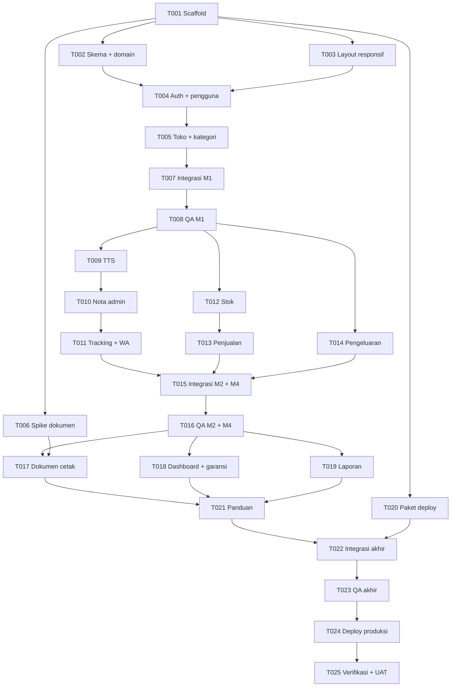

# TODO — Aplikasi Servis Anugerah (repair-app)

## Tujuan dan cara pakai

Rencana kerja untuk membangun v1 sesuai `PRD.md` (v1.2). PRD adalah sumber kebutuhan; setiap task merujuk bagian PRD.

**Sumber status tunggal adalah ledger JSON di bawah.** Coordinator memperbaruinya setelah memeriksa bukti worker, lalu membuat ulang overview dengan:

```sh
python3 ~/.agents/skills/project-delivery/scripts/validate_todo.py TODO.md --write-overview --check-prd
```

- Maksimal **dua worker aktif** (tester/integrator/deployer ikut dihitung).
- Maksimal **dua attempt implementasi** per task; perubahan kode setelah itu perlu keputusan user.
- Task implementation `done` = siap QA, **bukan** fitur diterima. Fitur diterima setelah QA atas hasil integrasi lulus.
- Status eksekusi saat ini: **running T024–T025 untuk target demo D-20** atas permintaan user 14 November 2026. Goal T001–T023 tetap selesai; riwayat PASS/FAIL dipertahankan. Deployment demo dan smoke web diizinkan; akses sudo, password privat, lokasi backup dan uji perangkat fisik mengikuti bukti/keputusan aktual.

## Overview pekerjaan

<!-- GENERATED VIEW: regenerate from canonical JSON; do not edit statuses here. -->
| ID | Hasil | Petugas / model | Kesulitan / risiko | Dependensi | Calon paralel | Status |
|---|---|---|---|---|---|---|
| T001 | Scaffold Laravel 13 + Livewire starter kit, MySQL, WITA, Git | developer / 6.1-sol | medium / low | — | — | done |
| T002 | Skema database, model, enum, seeder, dan layanan domain inti | developer / 6.1-sol | complex / high | T001 | T003, T006, T020 | done |
| T003 | Layout lembar berbingkai, komponen UI dasar, dan web app manifest sesuai DESIGN.md | developer / 6.1-terra | medium / medium | T001 | T002, T006, T020 | done |
| T004 | Login username, peran Admin/Teknisi, kelola pengguna, ganti password | developer / 6.1-sol | medium / high | T002, T003 | T006, T020 | done |
| T005 | Pengaturan toko dan master kategori | developer / 6-luna | easy / low | T004 | T006, T020 | done |
| T006 | Spike dokumen: PDF A5, struk 58mm, dan QR di dompdf | developer / 6.1-sol | medium / medium | T001 | T002, T003, T004, T005, T020 | done |
| T007 | Integrasi fondasi M1 pada branch candidate sebelum QA dan merge main | integrator / 6.1-sol | medium / medium | T002, T003, T004, T005 | — | done |
| T008 | QA independen fondasi M1 | tester / 6.1-sol | medium / high | T007 | T006, T020 | done |
| T009 | TTS: form buat/edit, daftar dengan cari/filter, detail sesuai peran | developer / 6.1-sol | medium / high | T008 | T012, T013, T014, T020 | done |
| T010 | Alur admin servis: tetapkan teknisi, rincian dan terbitkan nota, koreksi, diambil, batal | developer / 6.1-sol | complex / high | T009 | T012, T013, T014, T020 | done |
| T011 | Halaman tracking publik dan tombol Kirim WA | developer / 6.1-terra | medium / medium | T010 | T012, T013, T014, T020 | done |
| T012 | Stok barang jualan dan restok | developer / 6.1-sol | medium / medium | T008 | T009, T010, T011, T014, T020 | done |
| T013 | Penjualan barang dengan garansi opsional | developer / 6.1-sol | medium / high | T012 | T009, T010, T011, T014, T020 | done |
| T014 | Pencatatan pengeluaran | developer / 6-luna | easy / low | T008 | T009, T010, T011, T012, T013, T020 | done |
| T015 | Integrasi alur servis (M2) dan stok/penjualan/pengeluaran (M4) | integrator / 6.1-sol | medium / medium | T011, T013, T014 | — | done |
| T016 | QA independen alur servis, penjualan, dan pengeluaran | tester / 6.1-sol | medium / high | T015 | T020 | done |
| T017 | Dokumen cetak: struk 58mm dan PDF A5 untuk TTS, nota, penjualan (+ QR) | developer / 6.1-terra | medium / medium | T016, T006 | T018, T019, T020 | done |
| T018 | Dashboard admin dan pengingat garansi | developer / 6.1-sol | medium / medium | T016 | T017, T019, T020 | done |
| T019 | Laporan omzet, modal, pengeluaran, dan laba per rentang tanggal | developer / 6.1-sol | medium / high | T016 | T017, T018, T020 | done |
| T020 | Paket deploy VPS: konfigurasi contoh, skrip deploy, backup dan restore | developer / 6.1-sol | medium / high | T001, T002 (artifact) | T002, T003, T004, T005, T006, T009, T012, T017, T018, T019 | done |
| T021 | Panduan pengguna singkat untuk owner dan teknisi | developer / 6-luna | easy / low | T017, T018, T019 | T020 | done |
| T022 | Integrasi akhir v1 | integrator / 6.1-sol | medium / medium | T017, T018, T019, T020, T021 | — | done |
| T023 | QA akhir v1: regresi penuh dan uji responsif semua layar | tester / 6.1-sol | medium / high | T022 | — | done |
| T024 | Deploy v1 ke VPS produksi | deployer / 6.1-sol | medium / high | T022, T023 | — | done |
| T025 | Verifikasi produksi dan uji di HP dan printer klien | tester / 6.1-sol | medium / high | T024 | — | blocked |
| T026 | GitHub CI/CD demo: workflow, artefak dan SSH deploy terbatas | developer / 6.1-sol | medium / high | — | — | done |
| T027 | Integrasi konfigurasi CI/CD dengan main | integrator / 6.1-sol | medium / high | T026 | — | done |
| T028 | QA independen hasil integrasi CI/CD | tester / 6.1-sol | medium / high | T027 | — | done |
| T029 | Aktifkan dan verifikasi auto-deploy GitHub nyata | deployer / 6.1-sol | medium / high | T027, T028 | — | done |
| T030 | Aturan password9karakter dan petunjuk seragam | developer / 6.1-sol | medium / high | — | — | done |
| T031 | Integrasi perubahan password | integrator / 6.1-sol | medium / high | T030 | — | done |
| T032 | QA independen aturan password | tester / 6.1-sol | medium / high | T031 | — | done |
| T033 | Deploy aturan dan reset hanya admin demo | deployer / 6.1-sol | medium / high | T031, T032 | — | done |
| T034 | Tambahkan placeholder seluruh form dan tahan push | developer / 6.1-sol | medium / medium | — | — | done |
| T035 | QA independen placeholder seluruh form | tester / 6.1-sol | medium / medium | T034 | — | done |
| T036 | Push dan integrasi setelah aba-aba user | integrator / 6.1-sol | easy / medium | T034, T035, T037, T038, T039, T041, T045, T046 | — | done |
| T037 | Selectbox pencarian untuk pilihan dinamis atau lebih dari tiga | developer / 6.1-terra | medium / medium | T035 | — | done |
| T038 | QA independen selectbox pencarian | tester / 6.1-terra | medium / medium | T037 | — | done |
| T039 | Datepicker bersama untuk seluruh kontrol tanggal | developer / 6.1-terra | medium / medium | T038 | — | done |
| T040 | QA independen datepicker seluruh form | tester / 6.1-terra | medium / medium | T039 | — | blocked |
| T041 | Perjelas hierarki dan layout dashboard | developer / 6.1-terra | medium / medium | T039 | — | done |
| T042 | QA independen layout dashboard | tester / 6.1-terra | medium / medium | T041 | — | blocked |
| T043 | Perjelas dan percantik halaman tracking customer | developer / 6.1-terra | medium / medium | — | — | done |
| T044 | QA independen halaman tracking customer | tester / 6.1-terra | medium / medium | T043 | — | done |
| T045 | Perbaiki ikon aksi yang hilang pada sprite bersama | developer / 6-luna | easy / low | — | — | done |
| T046 | QA independen kelengkapan ikon aksi | tester / 6-luna | easy / low | T045 | — | done |
| T047 | Perbaiki layout mobile laporan dan empty state servis | developer / 6.1-terra | easy / medium | T036 | — | done |
| T048 | QA independen perbaikan responsif laporan dan servis | tester / 6.1-terra | easy / medium | T047 | — | done |
| T049 | Tambahkan pembayaran sederhana dan filter laporan | developer / 6.1-sol | medium / medium | T048 | — | done |
| T050 | QA independen pembayaran dan filter laporan | tester / 6.1-sol | medium / medium | T049 | — | done |
| T051 | Perbaiki daftar bank yang terpotong di dialog pembayaran | developer / 6.1-terra | easy / low | T050 | — | done |
| T052 | QA independen daftar bank dalam dialog pembayaran | tester / 6.1-terra | easy / low | T051 | — | done |
| T053 | Data pelanggan sederhana dan pilihan pelanggan TTS baru | developer / 6.1-sol | medium / medium | — | — | done |
| T054 | QA independen data pelanggan dan kompatibilitas TTS lama | tester / 6.1-sol | medium / medium | T053 | — | done |
| T055 | Menu aksi pelanggan dan halaman riwayat servis | developer / 6.1-sol | medium / medium | — | — | done |
| T056 | QA independen aksi dan history pelanggan | tester / 6.1-sol | medium / medium | T055 | — | done |
| T057 | Permudah pencarian dan pergantian pelanggan TTS | developer / 6.1-sol | easy / medium | — | — | done |
| T058 | Relasi customer_id nullable pada TTS dan penjualan | developer / 6.1-sol | medium / medium | — | — | done |
| T059 | QA independen relasi pelanggan transaksi | tester / 6.1-sol | medium / medium | T058 | — | done |
| T060 | Kelola bank pembayaran per tenant | developer / 6.1-sol | medium / medium | — | — | done |
| T061 | QA independen bank per toko | tester / 6.1-sol | medium / medium | T060 | — | done |
| T062 | Rekap pembayaran, diskon servis dan WA tidak dapat diperbaiki | developer / 6.1-sol | medium / high | — | — | done |
| T063 | QA independen tiga revisi transaksi servis | tester / 6.1-sol | medium / high | T062 | — | done |
| T064 | Pengecekan opsional sebelum pengerjaan dan hasil cek via WA | developer / 6.1-sol | medium / high | — | — | done |
| T065 | QA independen pengecekan opsional | tester / 6.1-sol | medium / high | T064 | — | done |
| T066 | Satu catatan hasil pengecekan dan rencana tindakan | developer / 6.1-sol | medium / medium | — | — | done |
| T067 | QA independen catatan pengecekan tunggal | tester / 6.1-sol | medium / medium | T066 | — | done |
| T068 | Poles tampilan detail TTS dengan UI UX Pro Max | developer / 6.1-sol | medium / low | — | — | done |
| T069 | QA independen tampilan detail TTS | tester / 6.1-sol | medium / low | T068 | — | done |
| T070 | Detail TTS mengikuti pekerjaan per status | developer / 6.1-sol | medium / medium | — | — | done |
| T071 | QA independen alur kerja detail TTS | tester / 6.1-sol | medium / medium | T070 | — | done |
| T072 | Detail TTS terbuka dan terbaca dalam satu halaman | developer / 6.1-sol | medium / medium | — | — | done |
| T073 | QA independen detail TTS terbuka | tester / 6.1-sol | medium / medium | T072 | — | done |
| T074 | Ringkas panel hasil pengecekan | developer / 6.1-sol | easy / low | — | — | done |
| T075 | QA panel pengecekan ringkas | tester / 6.1-sol | easy / low | T074 | — | done |
| T076 | Aksi dokumen TTS di menu titik tiga | developer / 6.1-sol | easy / low | — | — | done |
| T077 | QA menu dokumen TTS | tester / 6.1-sol | easy / low | T076 | — | done |
| T078 | Tombol titik tiga detail TTS hitam | developer / 6.1-sol | easy / low | — | — | done |
| T079 | Selaraskan detail penjualan pelanggan dan restok dengan TTS | developer / 6.1-sol | medium / medium | — | — | done |
| T080 | QA independen keseragaman detail menu | tester / 6.1-sol | medium / medium | T079 | — | done |
| T081 | Ringkas TTS diambil dan pindahkan catatan ke penanganan | developer / 6.1-sol | easy / low | — | — | done |
| T082 | Seragamkan banner feedback seluruh menu | developer / 6.1-sol | medium / medium | — | — | done |
| T083 | QA independen banner feedback bersama | tester / 6.1-sol | medium / medium | T082 | — | done |
| T084 | Ringkas banner dan tombol tutup melingkar | developer / 6.1-sol | easy / low | — | — | done |
| T085 | Rombak form tambah penjualan | developer / 6.1-sol | easy / low | — | — | done |
| T086 | Master kategori pengeluaran per toko | developer / 6.1-sol | medium / medium | — | — | done |
| T087 | Diskon nominal tambah penjualan dan output akhir | developer / 6.1-sol | medium / medium | — | — | done |
| T088 | Rombak laporan dengan panel terbuka | developer / 6.1-sol | medium / low | — | — | done |
| T089 | Rapikan daftar siap diserahkan dan garansi dashboard | developer / 6.1-sol | easy / low | — | — | done |
| T090 | Seragamkan pencarian dan pagination semua daftar index | developer / 6.1-sol | medium / medium | — | — | done |
| T091 | Tampilkan alasan dan WA pembatalan TTS | developer / 6.1-sol | easy / medium | — | — | done |
| T092 | Samakan logo dan subtitle tracking pelanggan | developer / 6.1-sol | easy / low | — | — | done |
| T093 | Integrasikan dan rilis revisi tertahan ke demo melalui CI/CD | integrator / 6.1-sol | medium / high | T090, T091, T092 | — | done |
| T094 | Catat pengambilan barang untuk TTS Batal tanpa mengubah status | developer / 6.1-sol | easy / medium | — | — | done |
<!-- END GENERATED VIEW -->

## Alur dan gelombang kerja



Panah menunjukkan dependensi utama (beberapa dependensi langsung tambahan ada di ledger). Ringkasnya:

| Gelombang | Isi | Paralel yang mungkin (maks. 2 worker) |
|---|---|---|
| 1. Fondasi (M1) | T001 → T002 ∥ T003 → T004 → T005 → T007 → T008 | T002 ∥ T003; T006 dan T020 mengisi slot kosong |
| 2. Servis + jual (M2, M4) | Jalur servis T009 → T010 → T011; jalur jual T012 → T013, T014 → T015 → T016 | Satu task jalur servis ∥ satu task jalur jual |
| 3. Dokumen, dashboard, laporan (M3, M5) | T017 ∥ T018 ∥ T019 → T021 → T022 → T023 | Dua dari T017/T018/T019 sekaligus |
| 4. Rilis (M6) | T024 → T025 | Berurutan |

## Konvensi kerja untuk semua worker

Berlaku untuk semua task kecuali kontrak task menyatakan lain. Brief worker mencantumkan mode **Ponytail full**.

| Topik | Konvensi |
|---|---|
| Stack | Laravel 13 (PHP ≥ 8.3), Livewire starter kit resmi, Tailwind, MySQL 8, `barryvdh/laravel-dompdf` (PRD §7). Huruf IBM Plex Sans/Mono di-host sendiri (bukan Google Fonts), ikon Lucide (`DESIGN.md`) |
| Bahasa dan format | UI bahasa Indonesia; uang integer Rupiah ditampilkan `Rp1.100.000`; zona `Asia/Makassar` (PRD §12 NFR-03) |
| Struktur modul | Komponen di `app/Livewire/<Modul>/`, view di `resources/views/livewire/<modul>/`, rute di `routes/modules/<modul>.php` (dimuat otomatis oleh `routes/web.php`), test di `tests/Feature/<Modul>/`. Bila starter kit memakai struktur berbeda, T001 mencatat pemetaannya di log keputusan dan coordinator menyesuaikan `write_scope` sebelum dispatch |
| Skema database | **Hanya T002** yang membuat migrasi. Task lain yang butuh perubahan skema melapor ke coordinator sebelum menulis |
| Dependency Composer/NPM | Hanya T001 dan T017 yang mengubah `composer.json`/lockfile. Kebutuhan lain dilaporkan dulu |
| Tampilan | Wajib mengikuti `DESIGN.md` (token, komponen, aturan) dan layar acuan di `mockup/` yang disetujui user, serta PRD §10.2. Pakai komponen dari T003 (bingkai L/sidebar, navigasi bawah, tabel ↔ daftar dua baris, tombol aksi di kolom kiri + menu pilihan `···`, form, bilah aksi menempel). Setiap layar baru dibandingkan dengan layar mockup yang sama dan dicek di 360px, 768px, dan 1280px sebelum handoff |
| Akses | Otorisasi dicek di server per rute/aksi (PRD §13). Teknisi tidak boleh menerima angka harga/modal di HTML |
| Test | Feature test Pest/PHPUnit memakai SQLite in-memory (default). Test konkurensi (penomoran, stok) memakai database MySQL test (`db:mysql-test`, eksklusif) |
| Data uji | Sintetis; tidak memakai data customer nyata |
| Git | Repo lokal dibuat di T001. Satu branch per task (`task/T0xx-...`) dalam worktree terpisah; commit memuat ID task. Merge ke `main` hanya oleh task integrasi. Remote origin: https://github.com/BatuBata/repair-app.git; commit dan push setiap pekerjaan selesai diizinkan user 12 Nov 2026 |
| Rahasia | `.env` tidak masuk Git; tidak menulis kredensial ke laporan/bukti |
| Bukti | Disimpan di `docs/evidence/<ID task>/` (laporan ringkas, output test, screenshot penting) |

## Ledger canonical

```json
{
  "schema": "project-delivery.todo.v1",
  "project": {
    "id": "repair-app",
    "prd_file": "PRD.md",
    "prd_revision": "sha256:09006877ef26fb7dc878b726f530919362b0b5edb1a2782ad0eb8c4fa313d86a",
    "max_workers": 2,
    "max_implementation_attempts": 2,
    "execution": {
      "state": "stopped",
      "allowed_tasks": [],
      "stop_after_tasks": ["T094"],
      "source_ref": "D57 selesai main lokal independentQA PASS; tanpa push/deploy.",
      "phase_history": [
        {
          "state": "paused",
          "allowed_tasks": [],
          "stop_after_tasks": [
            "T023"
          ],
          "source_ref": "User 13 November 2026 menjawab opsi 2 pada pertanyaan async: siapkan hasil kajian dan satu prompt Goal dahulu; tidak lanjut implementasi. Goal native telah paused.",
          "resume_allowed_tasks": [
            "T001",
            "T002",
            "T003",
            "T004",
            "T005",
            "T006",
            "T007",
            "T008",
            "T009",
            "T010",
            "T011",
            "T012",
            "T013",
            "T014",
            "T015",
            "T016",
            "T017",
            "T018",
            "T019",
            "T020",
            "T021",
            "T022",
            "T023"
          ]
        },
        {
          "state": "running",
          "allowed_tasks": [
            "T001",
            "T002",
            "T003",
            "T004",
            "T005",
            "T006",
            "T007",
            "T008",
            "T009",
            "T010",
            "T011",
            "T012",
            "T013",
            "T014",
            "T015",
            "T016",
            "T017",
            "T018",
            "T019",
            "T020",
            "T021",
            "T022",
            "T023"
          ],
          "stop_after_tasks": [
            "T023"
          ],
          "source_ref": "Native Goal reactivated 13 Nov 2026 updatedAt1794541380, current goal continuation explicitly requests T001–T023; verified get_goal status active after planning pause. Resume from latest checkpoint, not completed T004.",
          "resume_allowed_tasks": [
            "T001",
            "T002",
            "T003",
            "T004",
            "T005",
            "T006",
            "T007",
            "T008",
            "T009",
            "T010",
            "T011",
            "T012",
            "T013",
            "T014",
            "T015",
            "T016",
            "T017",
            "T018",
            "T019",
            "T020",
            "T021",
            "T022",
            "T023"
          ]
        },
        {
          "state": "paused",
          "allowed_tasks": [
            "T001",
            "T002",
            "T003",
            "T004",
            "T005",
            "T006",
            "T007",
            "T008",
            "T009",
            "T010",
            "T011",
            "T012",
            "T013",
            "T014",
            "T015",
            "T016",
            "T017",
            "T018",
            "T019",
            "T020",
            "T021",
            "T022",
            "T023"
          ],
          "stop_after_tasks": [
            "T023"
          ],
          "source_ref": "User latest async reply call_f572e2779218488d81f1de4a09316c94 memilih 2: siapkan hasil kajian dan satu prompt Goal dahulu. Native Goal paused dan dua worker interrupted; tidak ada implementasi baru sampai user resume.",
          "resume_allowed_tasks": [
            "T001",
            "T002",
            "T003",
            "T004",
            "T005",
            "T006",
            "T007",
            "T008",
            "T009",
            "T010",
            "T011",
            "T012",
            "T013",
            "T014",
            "T015",
            "T016",
            "T017",
            "T018",
            "T019",
            "T020",
            "T021",
            "T022",
            "T023"
          ]
        },
        {
          "state": "running",
          "allowed_tasks": [
            "T001",
            "T002",
            "T003",
            "T004",
            "T005",
            "T006",
            "T007",
            "T008",
            "T009",
            "T010",
            "T011",
            "T012",
            "T013",
            "T014",
            "T015",
            "T016",
            "T017",
            "T018",
            "T019",
            "T020",
            "T021",
            "T022",
            "T023"
          ],
          "stop_after_tasks": [
            "T023"
          ],
          "source_ref": "Native Goal reactivated 13 Nov 2026 updatedAt1794550614; latest goal continuation explicitly resumes T001–T023, verified active via get_goal. Resume latest T017/T018 A1 checkpoint, retain completed T004 and history.",
          "resume_allowed_tasks": [
            "T001",
            "T002",
            "T003",
            "T004",
            "T005",
            "T006",
            "T007",
            "T008",
            "T009",
            "T010",
            "T011",
            "T012",
            "T013",
            "T014",
            "T015",
            "T016",
            "T017",
            "T018",
            "T019",
            "T020",
            "T021",
            "T022",
            "T023"
          ]
        },
        {
          "state": "stopped",
          "allowed_tasks": [],
          "stop_after_tasks": [
            "T023"
          ],
          "source_ref": "Goal user13Nov2026 T001–T023 boundary achieved with independentT023A2softwarePASS14Nov2026. Stop further task dispatch; T024–T025/deployment notauthorized. Coordinator closes Git main/CI handoff; Goalcomplete only after requiredclosingchecks.",
          "resume_allowed_tasks": [
            "T001",
            "T002",
            "T003",
            "T004",
            "T005",
            "T006",
            "T007",
            "T008",
            "T009",
            "T010",
            "T011",
            "T012",
            "T013",
            "T014",
            "T015",
            "T016",
            "T017",
            "T018",
            "T019",
            "T020",
            "T021",
            "T022",
            "T023"
          ]
        },
        {
          "state": "running",
          "allowed_tasks": [
            "T024",
            "T025"
          ],
          "stop_after_tasks": [
            "T025"
          ],
          "source_ref": "User14Nov2026 explicitly requests deployment to muzib@202.10.40.165 /var/www/newfolder, demo-repair-app.scannara.asia SSL LetsEncrypt, DB demo_repair_app/new_gym with private owner password; D-20/D-21. Previous Goal T001-T023 remains complete. T025 live software smoke implied; physical acceptance remains dependent on actual owner devices."
        },
        {
          "state": "stopped",
          "allowed_tasks": [],
          "stop_after_tasks": [
            "T025"
          ],
          "source_ref": "Authorized demo D20/D21/D22 deployed and independent read-only web verification completed14Nov2026. stop_after_tasks T025 reached blocked because full production UAT/physical HP/printer/owner acceptance unavailable. T024done; R001notaccepted. No further dispatch; retain user deployment authorization and wait for concrete remaining acceptance work."
        },
        {
          "state": "running",
          "allowed_tasks": [
            "T026",
            "T027",
            "T028",
            "T029"
          ],
          "stop_after_tasks": [
            "T029"
          ],
          "source_ref": "User14Nov2026 new instruction D23: implement, independently review, integrate and prove GitHub CI/CD for demo. T025 physical/fullUAT remains blocked, not resumed."
        },
        {
          "state": "stopped",
          "allowed_tasks": [],
          "stop_after_tasks": [
            "T029"
          ],
          "source_ref": "D23 setup T026-T029 completed14Nov2026 with actual main CI and auto-deploy43564251943 plus independent livePASS. Stop further agent dispatch at T029 boundary. Ongoing authorized main-push CI/CD policy remains active; T025 physical/fullUAT remains blocked."
        },
        {
          "state": "running",
          "allowed_tasks": [
            "T030",
            "T031",
            "T032",
            "T033"
          ],
          "stop_after_tasks": [
            "T033"
          ],
          "source_ref": "User15Nov2026 D24 requests9char simplepassword and reset admin demo to supplied value; implement/review and deploy under ongoing D23. T025 physical UAT remains blocked."
        },
        {
          "state": "stopped",
          "allowed_tasks": [],
          "stop_after_tasks": [
            "T033"
          ],
          "source_ref": "UserD24 password workT030–T033 completed15Nov2026: policy9chars,actualmainCI/deploy43620442091,singleadminreset andindependentliveLOGIN/POLICY/LOGOUTPASS. StopatT033; ongoing D23CI/CD authorization remains active. T025physical/fullUATnotresumed."
        },
        {
          "state": "running",
          "allowed_tasks": [
            "T034",
            "T035"
          ],
          "stop_after_tasks": [
            "T035"
          ],
          "source_ref": "User15Nov2026 requests placeholders on every supported empty form control and clarifies revision must remain local until a later push instruction; GitHub Actions/auto-deploy D-23 remains active. PRD D-25/D-26."
        },
        {
          "state": "stopped",
          "allowed_tasks": [],
          "stop_after_tasks": [
            "T035"
          ],
          "source_ref": "T034 implementation and T035 independent QA completed locally15Nov2026 at snapshot sha256:2d31e5b2...; stop_after T035 reached. Per user D-25, no commit/push/merge/deploy; T036 remains pending until explicit user signal. GitHub Actions D-23 remains active; T025 physical UAT remains blocked."
        },
        {
          "state": "running",
          "allowed_tasks": [
            "T037",
            "T038"
          ],
          "stop_after_tasks": [
            "T038"
          ],
          "source_ref": "User15Nov2026 requests searchable selectbox for every dynamic choice or fixed choice with more than3 options. Work remains local under D25; no commit/push/merge/deploy."
        },
        {
          "state": "stopped",
          "allowed_tasks": [],
          "stop_after_tasks": [
            "T038"
          ],
          "source_ref": "T037 implementation and T038 independent QA completed locally15Nov2026 at pinned snapshot sha256:aa4cc7ca...; stop_after T038 reached. Per D25 no commit/push/merge/deploy; T036 remains pending explicit user signal. GitHub Actions remains active and unchanged."
        },
        {
          "state": "running",
          "allowed_tasks": [
            "T039",
            "T040"
          ],
          "stop_after_tasks": [
            "T040"
          ],
          "source_ref": "User15Nov2026 requests every date control use a visually polished datepicker. T039 implementation and T040 independent QA allowed locally under D25; no commit/push/merge/deploy."
        },
        {
          "state": "stopped",
          "allowed_tasks": [],
          "stop_after_tasks": [
            "T040"
          ],
          "source_ref": "T039/A2 candidate complete at sha256:aa571baa...; T040/A1 found defects, A2/A3 independent retest blocked by unavailable visible browser in subagent. Candidate remains local and unaccepted; no third implementation attempt or integration authorized."
        },
        {
          "state": "running",
          "allowed_tasks": [
            "T041",
            "T042"
          ],
          "stop_after_tasks": [
            "T042"
          ],
          "source_ref": "User15Nov2026 D29 requests dashboard hierarchy/layout polish and purposeful existing icons. Work remains local under D25; no commit/push/merge/deploy. T040 remains blocked."
        },
        {
          "state": "running",
          "allowed_tasks": [
            "T045",
            "T046"
          ],
          "stop_after_tasks": [
            "T046"
          ],
          "source_ref": "User15Nov2026 reports missing icons in row-action menus. T045 root sprite repair and T046 independent QA are authorized locally under D25; no commit/push/merge/deploy."
        },
        {
          "state": "stopped",
          "allowed_tasks": [],
          "stop_after_tasks": [
            "T046"
          ],
          "source_ref": "T045 and T046 completed PASS locally: all static view icon references resolve in the shared sprite and the TTS row-action menu renders eye and pencil icons. No commit/push/merge/deploy."
        },
        {
          "state": "running",
          "allowed_tasks": [
            "T036"
          ],
          "stop_after_tasks": [
            "T036"
          ],
          "source_ref": "User15Nov2026 explicitly says push to main. Integrate the held local revisions once, then observe the existing main CI/CD through deployment."
        },
        {
          "state": "stopped",
          "allowed_tasks": [],
          "stop_after_tasks": [
            "T036"
          ],
          "source_ref": "T036 completed PASS: candidate merged to main at d6fb3941eb1aa25583580248cdb27dd1e27136bb, GitHub Actions run 43636268111 passed CI and deploy, and production /up plus /login returned HTTP 200."
        },
        {
          "state": "running",
          "allowed_tasks": [
            "T047",
            "T048"
          ],
          "stop_after_tasks": [
            "T048"
          ],
          "source_ref": "User15Nov2026 reports broken mobile layout on reports and TTS pages. T047 repair and T048 independent QA are authorized locally; user explicitly says wait for a new signal before push/deploy."
        },
        {
          "state": "stopped",
          "allowed_tasks": [],
          "stop_after_tasks": [
            "T048"
          ],
          "source_ref": "T047 implementation and T048 independent QA completed PASS on pinned candidate sha256:4422b4f35ceb521f09e81cbc9289993645aa25f9f41d6696c073d659f3234fd2. Responsive report dates and TTS empty state verified at 360/768/1280; changes remain local pending user push signal."
        }
      ]
    },
    "exclusive_resources": [
      "branch:main",
      "db:mysql-test",
      "db:mysql-qa-m1"
    ],
    "artifact_retention": {
      "authorization_source_ref": null,
      "generated_paths": [],
      "preserve_paths": [
        "docs/evidence/**"
      ],
      "worktree_retirement_authorized": false
    },
    "model_catalog": {
      "status": "verified",
      "available": [
        "gpt-6.1-sol",
        "gpt-6.1-terra",
        "gpt-6-luna"
      ],
      "evidence_ref": "docs/evidence/coordinator/codex-resume-2026-11-13.json"
    },
    "authorizations": [
      {
        "id": "deploy-demo-2026-11-14",
        "environment": "production",
        "scope": "deployment",
        "source_ref": "User14Nov2026 explicit server/path/domain/SSL/database deployment request; PRD D-20 and MariaDB decision D-21. No destructive database rollback authorized."
      },
      {
        "id": "autodeploy-demo-2026-11-14",
        "environment": "production",
        "scope": "deployment",
        "source_ref": "User14Nov2026 asks GitHub Actions auto-update server on push and CI/CD tester; PRD D-23. Main-only after passing CI, demo D-20, preserve private configuration/uploads/business data, no destructive DB rollback. User15Nov2026 D-25 retains this automation but directs current revisions not be pushed until a later signal."
      }
    ],
    "git": {
      "remote": "origin",
      "url": "https://github.com/BatuBata/repair-app.git",
      "push_authorized": true,
      "source_ref": "Instruksi user 12 Nov 2026: push ke GitHub BatuBata/repair-app, setiap pekerjaan selesai buat commit dan push",
      "policy": "Commit pekerjaan selesai dan push branch task/checkpoint setelah periksa perubahan; merge ke main tetap setelah QA/review relevan; tanpa force-push. Kandidat blocked disimpan sebagai checkpoint, bukan fitur diterima.",
      "coordination_branch": "codex/form-placeholders"
    },
    "browser_isolation_policy": {
      "source_ref": "Coordinator13Nov2026 verified existing scripts/lib/cdp.mjs Browser.launch: fresh headless Chrome process, unique user-data-dir and remote-debugging-port0; T010 uses private TASTE_SKILL_TMP.",
      "headless": "Each task may hold its own exclusive headless resource only with independent Chrome process/profile/CDP session, task-owned TASTE_SKILL_TMP, distinct localhost port, private SQLite/config/session/view/storage paths. Maximum2activeworkers unchanged. No shared OS mouse/CUA/native window input under this mode.",
      "interactive": "Physical/native UI/browser context remains global exclusive browser:repair-app-visual; do not substitute shared GUI for parallel headless."
    }
  },
  "deliverables": [
    {
      "id": "F001",
      "title": "Fondasi: login, peran, pengguna, kategori, pengaturan toko, layout responsif, pasang ke layar utama",
      "kind": "feature",
      "prd_refs": [
        "PRD.md §4.1 REQ-01, REQ-02, REQ-18, REQ-23, REQ-24, REQ-25",
        "PRD.md §17 M1"
      ],
      "acceptance_tasks": [
        "T008"
      ],
      "status": "accepted"
    },
    {
      "id": "F002",
      "title": "Alur servis: TTS sampai Diambil, nota, tracking customer, tombol Kirim WA",
      "kind": "feature",
      "prd_refs": [
        "PRD.md §4.1 REQ-03–REQ-12, REQ-14, REQ-15",
        "PRD.md §17 M2"
      ],
      "acceptance_tasks": [
        "T016"
      ],
      "status": "accepted"
    },
    {
      "id": "F003",
      "title": "Stok barang jualan, penjualan, dan pengeluaran",
      "kind": "feature",
      "prd_refs": [
        "PRD.md §4.1 REQ-19–REQ-21",
        "PRD.md §17 M4"
      ],
      "acceptance_tasks": [
        "T016"
      ],
      "status": "accepted"
    },
    {
      "id": "F004",
      "title": "Dokumen cetak: struk 58mm dan PDF A5 untuk TTS, nota, penjualan (+ QR tracking)",
      "kind": "feature",
      "prd_refs": [
        "PRD.md §4.1 REQ-13, REQ-16",
        "PRD.md §10.1 Isi dokumen"
      ],
      "acceptance_tasks": [
        "T023"
      ],
      "status": "accepted"
    },
    {
      "id": "F005",
      "title": "Dashboard admin dan pengingat garansi",
      "kind": "feature",
      "prd_refs": [
        "PRD.md §4.1 REQ-17",
        "PRD.md §17 M3"
      ],
      "acceptance_tasks": [
        "T023"
      ],
      "status": "accepted"
    },
    {
      "id": "F006",
      "title": "Laporan omzet dan laba per rentang tanggal",
      "kind": "feature",
      "prd_refs": [
        "PRD.md §4.1 REQ-22",
        "PRD.md §17 M5"
      ],
      "acceptance_tasks": [
        "T023"
      ],
      "status": "accepted"
    },
    {
      "id": "R001",
      "title": "v1 berjalan di VPS produksi dan terverifikasi di HP dan printer klien",
      "kind": "release",
      "environment": "production",
      "prd_refs": [
        "PRD.md §14",
        "PRD.md §18"
      ],
      "acceptance_tasks": [
        "T025"
      ],
      "status": "blocked"
    }
  ],
  "tasks": [
    {
      "id": "T001",
      "title": "Scaffold Laravel 13 + Livewire starter kit, MySQL, WITA, Git",
      "kind": "implementation",
      "responsible_role": "developer",
      "work_type": "backend",
      "deliverable_id": null,
      "prd_refs": [
        "PRD.md §7",
        "PRD.md §12 NFR-03",
        "PRD.md §14.2"
      ],
      "priority": "must",
      "difficulty": "medium",
      "risk": "low",
      "uncertainty": "medium",
      "triage_reason": "Struktur starter kit Laravel 13 belum diperiksa langsung; keputusan di sini (struktur folder, registrasi dimatikan, pemuatan rute modul) dipakai semua task berikutnya.",
      "model_hint": "gpt-6.1-sol",
      "model_reason": "Sol untuk membaca dokumentasi versi aktual dan menetapkan konvensi proyek yang konsisten.",
      "depends_on": {
        "hard": [],
        "contracts": []
      },
      "write_scope": [
        "**"
      ],
      "shared_resources": [],
      "conflicts_with": [],
      "parallel_candidates": [],
      "acceptance_criteria": [
        "Repo Git lokal dibuat dengan commit awal; .env tidak ter-commit, .env.example berisi APP_TIMEZONE=Asia/Makassar dan konfigurasi MySQL tanpa nilai rahasia.",
        "Aplikasi Laravel 13 + Livewire starter kit berjalan lokal; locale id; registrasi publik dimatikan.",
        "routes/web.php memuat semua file routes/modules/*.php.",
        "barryvdh/laravel-dompdf terpasang; Pest/PHPUnit berjalan dengan SQLite in-memory dan test contoh lulus.",
        "Pemetaan struktur folder starter kit ke konvensi modul dicatat di laporan handoff."
      ],
      "verification_plan": [
        "Catat versi PHP, Laravel, Livewire dari output perintah nyata; jalankan test suite dan buka halaman login di browser.",
        "Periksa git status dan isi commit tidak memuat .env."
      ],
      "status": "done",
      "workspace": "/Users/muzib/Projects/web/repair-app",
      "attempts": [
        {
          "id": "A1",
          "kind": "implementation",
          "worker_id": "task_6fb31d8819e8",
          "model_requested": "gpt-6.1-sol",
          "model_effective": null,
          "dispatch_ref": "ctx_5ce119d82763",
          "outcome": "pass",
          "receipt_ref": "docs/evidence/coordinator/T001-start.json"
        }
      ],
      "runtime_assignment": {
        "run_id": "run_729e02cff091",
        "task_id": "task_6fb31d8819e8",
        "dispatch_id": "ctx_5ce119d82763",
        "receipt_ref": "docs/evidence/coordinator/T001-start.json",
        "model_observation": "Start receipt records requested model gpt-6.1-sol; effective backend model not independently observed."
      },
      "result": {
        "verdict": "pass",
        "artifact_ref": "docs/evidence/T001/HANDOFF.md",
        "revision": "4107c49d9098ab47c465773857fd5ee2811eb1b4",
        "inputs": {},
        "checked_revision": "4107c49d9098ab47c465773857fd5ee2811eb1b4",
        "evidence": [
          "docs/evidence/T001/final-checks.log",
          "docs/evidence/T001/build.log",
          "docs/evidence/T001/scaffold-final-config.log",
          "docs/evidence/T001/login.png",
          "docs/evidence/T001/dashboard-after-login.png"
        ],
        "summary": "Candidate scaffold siap untuk task dependen: Laravel 13.42.0/Livewire 4.4.8, build/Pint/PHPStan/40 tes 109 assertion lulus; browser login dan registrasi 404 terbukti. Coordinator memeriksa laporan/log, diff acuan utuh dan .env tidak tracked. Belum QA independen; MySQL, username dan desain final tetap gate T002/T003/T004/T008."
      }
    },
    {
      "id": "T002",
      "title": "Skema database, model, enum, seeder, dan layanan domain inti",
      "kind": "implementation",
      "responsible_role": "developer",
      "work_type": "backend",
      "deliverable_id": null,
      "prd_refs": [
        "PRD.md §8",
        "PRD.md §11",
        "PRD.md §8.2 BR-01, BR-02, BR-06, BR-10"
      ],
      "priority": "must",
      "difficulty": "complex",
      "risk": "high",
      "uncertainty": "low",
      "triage_reason": "Satu-satunya pemilik migrasi; kesalahan penomoran atau tipe uang merusak data semua modul. Penomoran harus aman saat dua penyimpanan bersamaan.",
      "model_hint": "gpt-6.1-sol",
      "model_reason": "Sol untuk transaksi, penguncian baris, dan integritas data.",
      "depends_on": {
        "hard": [
          "T001"
        ],
        "contracts": []
      },
      "write_scope": [
        "database/**",
        "app/Models/**",
        "app/Enums/**",
        "app/Services/**",
        "app/Support/**",
        "tests/Unit/**",
        "tests/Feature/Domain/**",
        "docs/evidence/T002/**",
        "config/repair.php"
      ],
      "shared_resources": [
        {
          "name": "db:mysql-test",
          "mode": "exclusive"
        }
      ],
      "conflicts_with": [],
      "parallel_candidates": [
        "T003",
        "T006",
        "T020"
      ],
      "acceptance_criteria": [
        "Semua tabel PRD §11 dibuat dengan constraint/indeks yang disebutkan; uang integer, tanggal sesuai WITA.",
        "Layanan penomoran menghasilkan TTS-YYMM-NNN dan JL-YYMM-NNN, reset per bulan WITA; dua penyimpanan bersamaan di MySQL tidak menghasilkan nomor sama (AC-03 bagian domain).",
        "Normalisasi HP sesuai BR-02 (0812-3456-7890 → 6281234567890; 12345 ditolak).",
        "Token tracking acak ≥ 32 karakter dan unik; enum status TTS dan aturan transisi BR-04 tersedia untuk dipakai modul lain.",
        "Seeder: satu admin (password dari env, bukan hardcode), kategori awal PRD Q-06, pengaturan toko kosong dengan garansi default 30 hari."
      ],
      "verification_plan": [
        "Unit/feature test untuk penomoran (termasuk pergantian bulan 30 Nov → 1 Des WITA dan uji bersamaan di MySQL test), normalisasi HP, transisi status.",
        "Jalankan migrate:fresh --seed di MySQL lokal dan periksa skema."
      ],
      "status": "done",
      "workspace": "/Users/muzib/orca/workspaces/repair-app/repair-t002-domain",
      "attempts": [
        {
          "id": "A1",
          "kind": "implementation",
          "worker_id": "task_5396149f0f67",
          "model_requested": "gpt-6.1-sol",
          "model_effective": null,
          "dispatch_ref": "ctx_15263c49ff79",
          "outcome": "blocked",
          "receipt_ref": "docs/evidence/coordinator/T002-start.json"
        },
        {
          "id": "A2",
          "kind": "verification",
          "worker_id": "task_1048dad74721",
          "model_requested": "gpt-6.1-sol",
          "model_effective": null,
          "dispatch_ref": "ctx_9cb9e1a0e185",
          "outcome": "fail",
          "receipt_ref": "docs/evidence/coordinator/T002-mysql-verification-start.json"
        },
        {
          "id": "A3",
          "kind": "implementation",
          "worker_id": "task_593a1385cc0e",
          "model_requested": "gpt-6.1-sol",
          "model_effective": null,
          "dispatch_ref": "ctx_9ced09cfe782",
          "outcome": "fail",
          "receipt_ref": "docs/evidence/coordinator/T002-A3-start.json"
        },
        {
          "id": "A4",
          "kind": "implementation",
          "worker_id": "task_792cb6f022fa",
          "model_requested": "gpt-6.1-sol",
          "model_effective": null,
          "dispatch_ref": "ctx_4ad437bf88ba",
          "outcome": "pass",
          "receipt_ref": "docs/evidence/coordinator/T002-A4-start.json"
        }
      ],
      "runtime_assignment": {
        "run_id": "run_729e02cff091",
        "task_id": "task_792cb6f022fa",
        "dispatch_id": "ctx_4ad437bf88ba",
        "receipt_ref": "docs/evidence/coordinator/T002-A4-start.json",
        "base_revision": "e5706f31321d7540cdcaec5f2792248b9c324841",
        "follow_up_of": "ctx_9ced09cfe782",
        "model_observation": "Same Sol session reused; effective model identity not proven by follow-up receipt."
      },
      "result": {
        "verdict": "pass",
        "artifact_ref": "/Users/muzib/orca/workspaces/repair-app/repair-t002-domain/docs/evidence/T002/A4-handoff.json",
        "revision": "4a0667c302c979ab40641459bf9e7afac0655e09",
        "checked_revision": "4a0667c302c979ab40641459bf9e7afac0655e09",
        "inputs": {
          "T001": "4107c49d9098ab47c465773857fd5ee2811eb1b4"
        },
        "evidence": [
          "/Users/muzib/orca/workspaces/repair-app/repair-t002-domain/docs/evidence/T002/A4-handoff.json",
          "/Users/muzib/orca/workspaces/repair-app/repair-t002-domain/docs/evidence/T002/A4-mysql-result.json",
          "/Users/muzib/orca/workspaces/repair-app/repair-t002-domain/docs/evidence/T002/A4-timings.json",
          "/Users/muzib/orca/workspaces/repair-app/repair-t002-domain/docs/evidence/T002/A4-fixture-reset.json",
          "/Users/muzib/orca/workspaces/repair-app/repair-t002-domain/docs/evidence/T002/A4-mysql-inventory.json"
        ],
        "summary": "PASS developer domain checks: uji MySQL nyata 1 test/41 assertion/16 writes/4 ronde overlap,33 attempts17 retries; diagnostic last-attempt timestamp membuktikan bug pengukuran sebelumnya. Semua nomor/token unik, counter dan indeks/unsigned sesuai. Domain source e59bf7c tetap, hanya harness diperbaiki dalam izin limit3, FAIL lama utuh. Bukti dipush4a0667c. Coordinator membaca handoff/results/timing. Belum QA integrasi; repair_app tetap tidak disentuh, DBtest20 tabel8TTS8sales sintetis, backup T020 privat dipertahankan."
      },
      "prior_results": [
        {
          "verdict": "blocked",
          "artifact_ref": "/Users/muzib/orca/workspaces/repair-app/repair-t002-domain/docs/evidence/T002/handoff.json",
          "revision": "a199051700c613b5f1993e97cd9ba3a10c6b1db6",
          "checked_revision": "e59bf7c1ccd98a7165da04c91b6b522d4c374a79",
          "inputs": {
            "T001": "4107c49d9098ab47c465773857fd5ee2811eb1b4"
          },
          "evidence": [
            "/Users/muzib/orca/workspaces/repair-app/repair-t002-domain/docs/evidence/T002/handoff.json",
            "/Users/muzib/orca/workspaces/repair-app/repair-t002-domain/docs/evidence/T002/suite-final.log",
            "/Users/muzib/orca/workspaces/repair-app/repair-t002-domain/docs/evidence/T002/mysql-final-blocked.log"
          ],
          "failure_class": "environment",
          "summary": "Candidate domain A1 siap, 55 tes SQLite/regresi 396 assertion lulus (1 MySQL skipped), seed final 3/22 lulus, build/Pint/PHPStan lulus menurut laporan. MySQL eksplisit berhenti aman karena DB_USERNAME kosong sebelum koneksi/migrasi. T002 belum done dan T004/T007 tetap terkunci. Setelah konfigurasi user tersedia, verifikasi source sama tanpa attempt perubahan kode baru; MySQL hanya database repair_app_test khusus proyek yang kosong."
        },
        {
          "verdict": "fail",
          "artifact_ref": "/Users/muzib/orca/workspaces/repair-app/repair-t002-domain/docs/evidence/T002/mysql-verification-handoff.json",
          "revision": "b517ebedd31c0c8f9b013736b2f14d5c666be055",
          "checked_revision": "a199051700c613b5f1993e97cd9ba3a10c6b1db6",
          "inputs": {
            "T001": "4107c49d9098ab47c465773857fd5ee2811eb1b4"
          },
          "evidence": [
            "/Users/muzib/orca/workspaces/repair-app/repair-t002-domain/docs/evidence/T002/mysql-verification-handoff.json",
            "/Users/muzib/orca/workspaces/repair-app/repair-t002-domain/docs/evidence/T002/mysql-verification-result.json",
            "/Users/muzib/orca/workspaces/repair-app/repair-t002-domain/docs/evidence/T002/mysql-verification-inventory.json"
          ],
          "failure_class": "product",
          "summary": "Verification source sama gagal pada guard tes getTables/getViews tanpa parameter schema (Laravel 13 menginventaris lintas schema). Pemeriksaan PDO terbatas target memastikan repair_app_test 0 tabel/view, belum ada migrasi/seed/writes. Source tidak berubah dan bukti dipush b517ebe. Coordinator memeriksa API builder Laravel: dropAllTables sudah dibatasi current schema. Perbaikan test guard diperlukan; tersisa 1 dari 2 code attempts (A2 adalah verification-only)."
        },
        {
          "verdict": "fail",
          "artifact_ref": "/Users/muzib/orca/workspaces/repair-app/repair-t002-domain/docs/evidence/T002/A3-handoff.json",
          "revision": "e5706f31321d7540cdcaec5f2792248b9c324841",
          "checked_revision": "e5706f31321d7540cdcaec5f2792248b9c324841",
          "inputs": {
            "T001": "4107c49d9098ab47c465773857fd5ee2811eb1b4"
          },
          "evidence": [
            "/Users/muzib/orca/workspaces/repair-app/repair-t002-domain/docs/evidence/T002/A3-handoff.json",
            "/Users/muzib/orca/workspaces/repair-app/repair-t002-domain/docs/evidence/T002/A3-mysql-result.json",
            "/Users/muzib/orca/workspaces/repair-app/repair-t002-domain/docs/evidence/T002/A3-mysql-inventory.json"
          ],
          "failure_class": "evidence",
          "summary": "A3 guard schema terarah/Pint/lint PASS; MySQL migrate+seed dan 4 TTS child sukses dengan 4 nomor/token unik. Tes FAIL assertion overlap sebelum 12 writes berikut dan pemeriksaan akhir. Budget 2 code attempts habis (A1,A3; A2 verification-only). Dugaan timestamp entered di-reset callback retry belum dibuktikan. Source koreksi e5706f3 telah dipush; proposal koreksi harness tersedia tetapi belum diterapkan, perlu keputusan user. T002 belum done, T004 tetap terkunci."
        }
      ],
      "implementation_attempt_limit": 3,
      "implementation_attempt_limit_source_ref": "User 12 Nov 2026: setuju, menjawab permintaan satu attempt tambahan T002 khusus koreksi harness waktu/diagnostik retry dan bukti MySQL (proposal docs/evidence/coordinator/T002-proposed-overlap-check.diff)."
    },
    {
      "id": "T003",
      "title": "Layout lembar berbingkai, komponen UI dasar, dan web app manifest sesuai DESIGN.md",
      "kind": "implementation",
      "responsible_role": "developer",
      "work_type": "frontend",
      "deliverable_id": "F001",
      "prd_refs": [
        "PRD.md §10.2",
        "PRD.md §12 NFR-01, NFR-07",
        "PRD.md §4.1 REQ-24, REQ-25",
        "DESIGN.md",
        "mockup/ (acuan visual yang disetujui)"
      ],
      "priority": "must",
      "difficulty": "medium",
      "risk": "medium",
      "uncertainty": "low",
      "triage_reason": "Pola tampilan dipakai semua layar berikutnya; token, komponen, dan layar acuan sudah ada di DESIGN.md dan mockup/ sehingga ketidakpastian rendah.",
      "model_hint": "gpt-6.1-terra",
      "model_reason": "Terra untuk pekerjaan visual/UI dengan kriteria terukur (lebar layar, ukuran target sentuh).",
      "depends_on": {
        "hard": [
          "T001"
        ],
        "contracts": []
      },
      "write_scope": [
        "resources/views/layouts/**",
        "resources/views/components/**",
        "resources/css/**",
        "resources/js/**",
        "public/manifest.webmanifest",
        "public/icons/**",
        "tests/Feature/Layout/**",
        "public/fonts/**",
        "docs/evidence/T003/**",
        "routes/modules/layout-preview.php",
        "resources/views/pages/layout-preview.blade.php"
      ],
      "shared_resources": [
        {
          "name": "browser:repair-app-visual",
          "mode": "exclusive"
        }
      ],
      "conflicts_with": [],
      "parallel_candidates": [
        "T002",
        "T006",
        "T020"
      ],
      "acceptance_criteria": [
        "Token DESIGN.md (warna, IBM Plex Sans/Mono self-host, radius, jarak) tersedia di Tailwind/CSS; tidak ada warna atau huruf di luar token.",
        "Shell: desktop bingkai L (sidebar 228px + bilah atas 48px dengan pencarian) dan lembar putih inset 8px; < 1024px bilah atas 52px + navigasi bawah, isi menu per peran sesuai PRD §10.2 (admin: Beranda, Servis, Buat TTS, Laporan, Menu); tautan memakai path PRD §10.1.",
        "Komponen siap pakai sesuai mockup/: tabel desktop ↔ daftar dua baris di HP, kolom aksi paling kiri (1 aksi = tombol, >1 aksi = tombol ··· dengan menu dropdown yang bisa dipakai keyboard), pil status berlabel, tab status (HP: baris geser), field form, input nominal dengan pemisah ribuan + inputmode numeric, input HP type=tel, bilah aksi menempel, dialog, toast, empty state.",
        "HP: target sentuh ≥ 44×44px, teks isi dan input ≥ 16px; laptop: teks isi ≥ 14px; kontras WCAG AA, tepi kolom isian ≥ 3:1; meta viewport tanpa mematikan zoom.",
        "Web app manifest (nama toko, ikon tiket 192/512, theme color #f2f5f6, display standalone, start_url) tertaut di layout; tanpa service worker.",
        "Halaman contoh komponen tidak memiliki scroll horizontal di 360px, 768px, 1280px dan tampak sama dengan komponen padanannya di mockup/."
      ],
      "verification_plan": [
        "Screenshot halaman contoh di 360/768/1280px disandingkan dengan screenshot mockup/ yang sama; selisih visual dicatat.",
        "Periksa manifest di tab Application Chrome DevTools (installable, ikon terbaca); uji menu ··· dengan mouse, sentuh, dan keyboard (Esc, panah)."
      ],
      "status": "done",
      "workspace": "/Users/muzib/orca/workspaces/repair-app/repair-t003-layout",
      "attempts": [
        {
          "id": "A1",
          "kind": "implementation",
          "worker_id": "task_95fae78ebc88",
          "model_requested": "gpt-6.1-terra",
          "model_effective": null,
          "dispatch_ref": "ctx_203bd11773d4",
          "outcome": "fail",
          "receipt_ref": "docs/evidence/coordinator/T003-start.json"
        },
        {
          "id": "A2",
          "kind": "implementation",
          "worker_id": "task_ab2f4f674517",
          "model_requested": "gpt-6.1-terra",
          "model_effective": null,
          "dispatch_ref": "ctx_f5237bf01a3e",
          "outcome": "pass",
          "receipt_ref": "docs/evidence/coordinator/T003-A2-start.json"
        }
      ],
      "runtime_assignment": {
        "run_id": "run_729e02cff091",
        "task_id": "task_ab2f4f674517",
        "dispatch_id": "ctx_f5237bf01a3e",
        "receipt_ref": "docs/evidence/coordinator/T003-A2-start.json",
        "base_revision": "e8f0553ccf64dab23dab4866e23fd8f17697c691",
        "follow_up_of": "ctx_203bd11773d4",
        "model_observation": "Same Terra worker reused; follow-up receipt does not prove new model selection or effective backend identity."
      },
      "result": {
        "verdict": "pass",
        "artifact_ref": "/Users/muzib/orca/workspaces/repair-app/repair-t003-layout/docs/evidence/T003/A2/handoff.md",
        "revision": "a08d1d785b72199e1000840ea8e2afe1d7f38fbd",
        "checked_revision": "fb7fc2ad1bf5619c119a00f31522842d17205054",
        "inputs": {
          "T001": "4107c49d9098ab47c465773857fd5ee2811eb1b4"
        },
        "evidence": [
          "/Users/muzib/orca/workspaces/repair-app/repair-t003-layout/docs/evidence/T003/A2/handoff.md",
          "/Users/muzib/orca/workspaces/repair-app/repair-t003-layout/docs/evidence/T003/A2/browser-results.json",
          "/Users/muzib/orca/workspaces/repair-app/repair-t003-layout/docs/evidence/T003/A2/target-results.json",
          "/Users/muzib/orca/workspaces/repair-app/repair-t003-layout/docs/evidence/T003/A2/contrast.json",
          "/Users/muzib/orca/workspaces/repair-app/repair-t003-layout/docs/evidence/T003/A2/contact-360.jpg",
          "/Users/muzib/orca/workspaces/repair-app/repair-t003-layout/docs/evidence/T003/A2/contact-768.jpg",
          "/Users/muzib/orca/workspaces/repair-app/repair-t003-layout/docs/evidence/T003/A2/contact-1280.jpg"
        ],
        "summary": "Implementer A2 lulus: build, 3 layout tests/22 assertion, 32 auth/settings tests/87 assertion, 23 browser checks termasuk trusted CDP touch dan manifest, perbandingan enam komponen 360/768/1280. Coordinator membaca laporan/JSON dan melihat ketiga contact sheet. Tautan starter dihapus dan role/nav aktif diperbaiki. Hanya komponen/shared shell yang diterima sebagai candidate, bukan seluruh layar domain; F001 belum accepted sampai T008, Android fisik tetap T025."
      },
      "prior_results": [
        {
          "verdict": "fail",
          "artifact_ref": "/Users/muzib/orca/workspaces/repair-app/repair-t003-layout/docs/evidence/T003/handoff.md",
          "revision": "e8f0553ccf64dab23dab4866e23fd8f17697c691",
          "inputs": {
            "T001": "4107c49d9098ab47c465773857fd5ee2811eb1b4"
          },
          "checked_revision": "e8f0553ccf64dab23dab4866e23fd8f17697c691",
          "evidence": [
            "/Users/muzib/orca/workspaces/repair-app/repair-t003-layout/docs/evidence/T003/handoff.md",
            "/Users/muzib/orca/workspaces/repair-app/repair-t003-layout/docs/evidence/T003/compare-360.png"
          ],
          "failure_class": "product",
          "summary": "A1 belum memenuhi kontrak: bukti sentuh/manifest dan perbandingan form/dialog/toast/empty belum lengkap; beberapa screenshot mendahului edit akhir. Review coordinator juga menemukan tautan Repository/Documentation starter di menu produk dan penanda menu aktif bawah belum diimplementasikan. Build/tests yang tercatat lulus tidak meluluskan kontrak. A2 diizinkan dalam budget dua attempt untuk koreksi dan bukti akhir."
        }
      ]
    },
    {
      "id": "T004",
      "title": "Login username, peran Admin/Teknisi, kelola pengguna, ganti password",
      "kind": "implementation",
      "responsible_role": "developer",
      "work_type": "backend",
      "deliverable_id": "F001",
      "prd_refs": [
        "PRD.md §4.1 REQ-01, REQ-02",
        "PRD.md §13",
        "PRD.md §15.2 AC-04, AC-20",
        "DESIGN.md + layar padanan di mockup/"
      ],
      "priority": "must",
      "difficulty": "medium",
      "risk": "high",
      "uncertainty": "low",
      "triage_reason": "Kontrol akses melindungi harga modal dan laporan; kesalahan menyebabkan kebocoran data ke teknisi.",
      "model_hint": "gpt-6.1-sol",
      "model_reason": "Sol untuk otorisasi server-side dan test akses negatif.",
      "depends_on": {
        "hard": [
          "T002",
          "T003"
        ],
        "contracts": []
      },
      "write_scope": [
        "app/Http/Middleware/**",
        "app/Policies/**",
        "app/Livewire/Auth/**",
        "app/Livewire/Users/**",
        "app/Livewire/Profile/**",
        "resources/views/livewire/auth/**",
        "resources/views/livewire/users/**",
        "resources/views/livewire/profile/**",
        "routes/modules/auth.php",
        "routes/modules/users.php",
        "bootstrap/app.php",
        "config/auth.php",
        "tests/Feature/Auth/**",
        "tests/Feature/Users/**",
        "app/Providers/FortifyServiceProvider.php",
        "app/Http/Responses/**",
        "app/Models/User.php",
        "app/Actions/Fortify/**",
        "app/Concerns/**",
        "config/fortify.php",
        "resources/views/pages/auth/**",
        "resources/views/pages/settings/**",
        "resources/views/layouts/auth.blade.php",
        "resources/views/layouts/auth/**",
        "resources/views/components/auth-header.blade.php",
        "resources/views/dashboard.blade.php",
        "resources/views/welcome.blade.php",
        "routes/modules/scaffold.php",
        "routes/modules/settings.php",
        "routes/modules/profile.php",
        "tests/Feature/Profile/**",
        "tests/Feature/Settings/**",
        "tests/Feature/DashboardTest.php",
        "tests/Feature/ScaffoldTest.php",
        "docs/evidence/T004/**",
        "tests/Feature/ExampleTest.php",
        "public/manifest.webmanifest",
        "config/livewire.php"
      ],
      "shared_resources": [
        {
          "name": "browser:repair-app-visual",
          "mode": "exclusive"
        }
      ],
      "conflicts_with": [],
      "parallel_candidates": [
        "T006",
        "T020"
      ],
      "acceptance_criteria": [
        "Login dengan username + password, opsi ingat saya; teknisi diarahkan ke /tts/baru, admin ke /.",
        "Middleware/policy peran tersedia untuk modul lain; rute khusus admin mengembalikan 403 untuk teknisi.",
        "Admin membuat akun, mengubah peran, menonaktifkan, reset password; akun nonaktif tidak bisa login; admin aktif terakhir tidak bisa dinonaktifkan (AC-20).",
        "Semua pengguna bisa ganti password di /profil.",
        "Layar login, pengguna, profil lulus aturan responsif PRD §10.2 di 360/768/1280px."
      ],
      "verification_plan": [
        "Feature test login, redirect per peran, 403 untuk teknisi, akun nonaktif, admin terakhir.",
        "Screenshot 3 lebar untuk layar login, daftar pengguna, form pengguna.",
        "Bandingkan screenshot layar dengan layar padanan di mockup/ (360 dan 1280px); tombol aksi baris di kolom kiri."
      ],
      "status": "done",
      "workspace": "/Users/muzib/Projects/web/repair-app",
      "attempts": [
        {
          "id": "A1",
          "kind": "implementation",
          "worker_id": "task_c45ef17a8450",
          "model_requested": "gpt-6.1-sol",
          "model_effective": null,
          "dispatch_ref": "ctx_0166b401edc1",
          "outcome": "pass",
          "receipt_ref": "docs/evidence/coordinator/T004-start.json"
        },
        {
          "id": "A2",
          "kind": "implementation",
          "worker_id": "/root/t004_resume",
          "model_requested": "gpt-6.1-sol",
          "model_effective": null,
          "dispatch_ref": "native:collaboration.spawn_agent:/root/t004_resume",
          "outcome": "pass",
          "receipt_ref": "docs/evidence/coordinator/codex-resume-2026-11-13.json",
          "phase_history": [
            {
              "id": "A2",
              "kind": "implementation",
              "worker_id": "task_72f0c571e239",
              "model_requested": "gpt-6.1-sol",
              "model_effective": null,
              "dispatch_ref": "ctx_68d80e45bfe3",
              "outcome": "cancelled",
              "receipt_ref": "docs/evidence/coordinator/T004-A2-start.json"
            }
          ]
        }
      ],
      "runtime_assignment": {
        "runtime": "Codex native collaboration",
        "task_id": "/root/t004_resume",
        "base_revision": "9a7117b952b2232791405a6121a1d36b061baa01",
        "receipt_ref": "docs/evidence/coordinator/codex-resume-2026-11-13.json",
        "model_observation": "spawn_agent requested gpt-6.1-sol high, receipt returns canonical task name; effective backend identity not independently exposed. Same logical A2 resumed."
      },
      "result": {
        "verdict": "pass",
        "artifact_ref": "docs/evidence/T004/A2/codex-handoff.md",
        "revision": "db5de005a345de644a7aa9056ea93f5a81117a3d",
        "checked_revision": "db5de005a345de644a7aa9056ea93f5a81117a3d",
        "inputs": {
          "T002": "4a0667c302c979ab40641459bf9e7afac0655e09",
          "T003": "a08d1d785b72199e1000840ea8e2afe1d7f38fbd"
        },
        "evidence": [
          "docs/evidence/T004/A2/codex-handoff.md",
          "docs/evidence/T004/A2/checks.json",
          "docs/evidence/T004/A2/source-manifest.json"
        ],
        "summary": "Logical A2 resumed native Codex: F01/F02/F03 fixed, 63 tests/527 assertions PASS, Pint/PHPStan debug PASS. Coordinator reviewed diff, framework/default preservation and report. Browser/independent integrated QA remains T008; no MySQL/build repeated; old / launcher shortcut may require reinstall."
      },
      "prior_results": [
        {
          "verdict": "pass",
          "artifact_ref": "/Users/muzib/orca/workspaces/repair-app/repair-t004-auth/docs/evidence/T004/README.md",
          "revision": "ebeb0b62f1a39720091026c1c3a0e8ec535c818e",
          "checked_revision": "ebeb0b62f1a39720091026c1c3a0e8ec535c818e",
          "inputs": {
            "T002": "4a0667c302c979ab40641459bf9e7afac0655e09",
            "T003": "a08d1d785b72199e1000840ea8e2afe1d7f38fbd"
          },
          "evidence": [
            "/Users/muzib/orca/workspaces/repair-app/repair-t004-auth/docs/evidence/T004/README.md",
            "/Users/muzib/orca/workspaces/repair-app/repair-t004-auth/docs/evidence/T004/report.json",
            "/Users/muzib/orca/workspaces/repair-app/repair-t004-auth/docs/evidence/T004/source-manifest.json",
            "/Users/muzib/orca/workspaces/repair-app/repair-t004-auth/docs/evidence/T004/suite-final-source.log",
            "/Users/muzib/orca/workspaces/repair-app/repair-t004-auth/docs/evidence/T004/browser-checks.json",
            "/Users/muzib/orca/workspaces/repair-app/repair-t004-auth/docs/evidence/T004/visual-review.md",
            "/Users/muzib/orca/workspaces/repair-app/repair-t004-auth/docs/evidence/T004/login-360.png",
            "/Users/muzib/orca/workspaces/repair-app/repair-t004-auth/docs/evidence/T004/users-list-360.png",
            "/Users/muzib/orca/workspaces/repair-app/repair-t004-auth/docs/evidence/T004/users-create-1280.png",
            "/Users/muzib/orca/workspaces/repair-app/repair-t004-auth/docs/evidence/T004/profile-technician-768.png"
          ],
          "summary": "Developer A1 PASS: username/role/active-session guard, users/profile, last-admin protections;61PASS1SKIP612assertions,static/Pint/build/browser proof. Coordinator read reports/source and inspected main screenshots. Commitebeb0b6 pushed. MySQL/InnoDB admin-race not tested (SQLite races covered), planned for independent T008; /tts/baru module still T009/404, no TTS behavior claimed. F001 awaits T007/T008; real app initialization/production not done."
        },
        {
          "verdict": "blocked",
          "artifact_ref": "docs/evidence/coordinator/stop-2026-11-13.json",
          "revision": "sha256:7ef5286719030018ee1dd0177cd341eaf9f774cd1514dda35d959f1737288289",
          "checked_revision": null,
          "inputs": {
            "T002": "4a0667c302c979ab40641459bf9e7afac0655e09",
            "T003": "a08d1d785b72199e1000840ea8e2afe1d7f38fbd"
          },
          "evidence": [
            "docs/evidence/coordinator/stop-2026-11-13.json"
          ],
          "summary": "User stop pekerjaan: active T004A2 cancelled, runtime stopped/process_stopped/exited confirmed. HEAD remainsf6b23c9 on fix/m1-auth-qa, tracked source unchanged; partial untracked A2 evidence and 2 auth tests preserved locally with hashes. No complete A2 verdict/tests claimed, no source cleanup/commit of partial work or budget reset. Project stopped; no new tasks/retries until explicit resume."
        }
      ],
      "source_context": {
        "note": "Historical downstream snapshots for reproducing QA findings; not DAG prerequisites or accepted current results. Original hard inputs T002/T003 unchanged. Static task-ID edges here would create a cycle when reopening T004.",
        "artifacts": {
          "T007": {
            "revision": "f6b23c974b319520b80991d67200c05ddd5562f4",
            "artifact_ref": "/Users/muzib/orca/workspaces/repair-app/repair-t005-settings/docs/evidence/T007/README.md",
            "purpose": "candidate"
          },
          "T008": {
            "revision": "b5919d1ed35a3c7fd5702d877a2a80574e3d3529",
            "artifact_ref": "/Users/muzib/orca/workspaces/repair-app/repair-t005-settings/docs/evidence/T008/README.md",
            "purpose": "reference"
          }
        }
      }
    },
    {
      "id": "T005",
      "title": "Pengaturan toko dan master kategori",
      "kind": "implementation",
      "responsible_role": "developer",
      "work_type": "fullstack",
      "deliverable_id": "F001",
      "prd_refs": [
        "PRD.md §4.1 REQ-18, REQ-23",
        "PRD.md §8.2 BR-15",
        "PRD.md §15.2 AC-19",
        "DESIGN.md + layar padanan di mockup/"
      ],
      "priority": "must",
      "difficulty": "easy",
      "risk": "low",
      "uncertainty": "low",
      "triage_reason": "CRUD sederhana dengan field jelas memakai komponen T003 dan middleware T004.",
      "model_hint": "gpt-6-luna",
      "model_reason": "Luna cukup untuk form CRUD terlokalisasi dengan test sederhana.",
      "depends_on": {
        "hard": [
          "T004"
        ],
        "contracts": []
      },
      "write_scope": [
        "app/Livewire/Settings/**",
        "resources/views/livewire/settings/**",
        "routes/modules/settings.php",
        "tests/Feature/Settings/**",
        "docs/evidence/T005/**"
      ],
      "shared_resources": [
        {
          "name": "browser:repair-app-visual",
          "mode": "exclusive"
        }
      ],
      "conflicts_with": [],
      "parallel_candidates": [
        "T006",
        "T020"
      ],
      "acceptance_criteria": [
        "Admin mengubah nama, alamat, telepon, logo (unggah gambar), teks syarat garansi, default hari garansi.",
        "Admin menambah, mengubah, menonaktifkan kategori; nama unik; kategori nonaktif tidak muncul di pilihan baru (AC-19 bagian master).",
        "Hanya admin yang dapat mengakses; layar lulus aturan responsif di 360/768/1280px."
      ],
      "verification_plan": [
        "Feature test CRUD kategori, validasi unik, akses teknisi 403, unggah logo.",
        "Screenshot 3 lebar untuk pengaturan toko dan kategori.",
        "Bandingkan screenshot layar dengan layar padanan di mockup/ (360 dan 1280px); tombol aksi baris di kolom kiri."
      ],
      "status": "done",
      "workspace": "/Users/muzib/Projects/web/repair-app",
      "attempts": [
        {
          "id": "A1",
          "kind": "implementation",
          "worker_id": "task_71ec6a9aa256",
          "model_requested": "gpt-6-luna",
          "model_effective": null,
          "dispatch_ref": "ctx_d2cbaa553e71",
          "outcome": "pass",
          "receipt_ref": "docs/evidence/coordinator/T005-start.json"
        }
      ],
      "runtime_assignment": {
        "run_id": "run_729e02cff091",
        "task_id": "task_71ec6a9aa256",
        "dispatch_id": "ctx_d2cbaa553e71",
        "receipt_ref": "docs/evidence/coordinator/T005-start.json",
        "base_revision": "971b164a79b544279bc5b2a53a50db383e7f7301",
        "model_observation": "Launch receipt records requested Luna high; effective backend identity not independently observed."
      },
      "result": {
        "verdict": "pass",
        "artifact_ref": "docs/evidence/T005/README.md",
        "revision": "db5de005a345de644a7aa9056ea93f5a81117a3d",
        "checked_revision": "db5de005a345de644a7aa9056ea93f5a81117a3d",
        "inputs": {
          "T004": "db5de005a345de644a7aa9056ea93f5a81117a3d"
        },
        "evidence": [
          "docs/evidence/T005/README.md",
          "docs/evidence/T004/A2/checks.json",
          "docs/evidence/T004/A2/codex-handoff.md"
        ],
        "summary": "Revalidated against T004 A2: git diff ede491e..db5de00 on owned Settings source/views/routes/tests is empty; T004 shared auth/upload checks include existing Settings tests and new real signed-upload boundary/preview checks PASS. Reuse prior visual evidence for unchanged rendered settings source; no new implementation attempt, F001 awaits independent integrated QA T008."
      },
      "prior_results": [
        {
          "verdict": "pass",
          "artifact_ref": "/Users/muzib/orca/workspaces/repair-app/repair-t005-settings/docs/evidence/T005/README.md",
          "revision": "ede491e76cbed8000aaee6e86392dc58d2741210",
          "checked_revision": "ede491e76cbed8000aaee6e86392dc58d2741210",
          "inputs": {
            "T004": "ebeb0b62f1a39720091026c1c3a0e8ec535c818e"
          },
          "evidence": [
            "/Users/muzib/orca/workspaces/repair-app/repair-t005-settings/docs/evidence/T005/README.md",
            "/Users/muzib/orca/workspaces/repair-app/repair-t005-settings/docs/evidence/T005/tests-final.log",
            "/Users/muzib/orca/workspaces/repair-app/repair-t005-settings/docs/evidence/T005/pint-final.log",
            "/Users/muzib/orca/workspaces/repair-app/repair-t005-settings/docs/evidence/T005/phpstan-final.log",
            "/Users/muzib/orca/workspaces/repair-app/repair-t005-settings/docs/evidence/T005/routes.json",
            "/Users/muzib/orca/workspaces/repair-app/repair-t005-settings/docs/evidence/T005/store-form-360.png",
            "/Users/muzib/orca/workspaces/repair-app/repair-t005-settings/docs/evidence/T005/store-form-1280.png",
            "/Users/muzib/orca/workspaces/repair-app/repair-t005-settings/docs/evidence/T005/categories-list-768.png",
            "/Users/muzib/orca/workspaces/repair-app/repair-t005-settings/docs/evidence/T005/categories-form-360.png"
          ],
          "summary": "Developer A1 PASS: toko/logo raster tervalidasi/kategori, guard per-route/action dan properti locked;24tes366assertions,Pint/PHPStan/build/browser proof. Coordinator membaca source/report dan melihat form/list penting; codepush ede491e tersedia. Belum QA integrasi/F001 accepted, suite full M1 masih T007, MySQL admin-race T008. Tidak ada MySQL/rahasia/data aplikasi yang disentuh."
        }
      ]
    },
    {
      "id": "T006",
      "title": "Spike dokumen: PDF A5, struk 58mm, dan QR di dompdf",
      "kind": "discovery",
      "responsible_role": "developer",
      "work_type": "research",
      "deliverable_id": null,
      "prd_refs": [
        "PRD.md §7",
        "PRD.md §16",
        "PRD.md §19 Q-02",
        "PRD.md §20.2"
      ],
      "priority": "must",
      "difficulty": "medium",
      "risk": "medium",
      "uncertainty": "high",
      "triage_reason": "Belum diketahui apakah dompdf merender QR SVG dan ukuran 58mm dengan baik, serta cara cetak terbaik dari HP; hasilnya menentukan pendekatan T017.",
      "model_hint": "gpt-6.1-sol",
      "model_reason": "Sol untuk eksperimen terarah dan membandingkan opsi dengan bukti.",
      "depends_on": {
        "hard": [
          "T001"
        ],
        "contracts": []
      },
      "write_scope": [
        "docs/spikes/**",
        "spikes/**",
        "docs/evidence/T006/**"
      ],
      "shared_resources": [],
      "conflicts_with": [],
      "parallel_candidates": [
        "T002",
        "T003",
        "T004",
        "T005",
        "T020"
      ],
      "acceptance_criteria": [
        "Contoh PDF A5 dan PDF/HTML 58mm dengan data sintetis berhasil dibuat; screenshot/berkas disimpan.",
        "Pustaka QR dipilih (lisensi dan versi dicatat) dan QR di PDF dapat dipindai ke URL contoh.",
        "Rekomendasi cara cetak struk dari HP Android (dialog cetak browser vs aplikasi printer thermal) beserta batasannya; pengujian di printer fisik klien dicatat sebagai belum dilakukan bila printer belum tersedia (Q-02)."
      ],
      "verification_plan": [
        "Hasilkan berkas contoh, pindai QR dengan HP/kamera atau decoder, tulis temuan di docs/spikes/documents.md."
      ],
      "status": "done",
      "workspace": "/Users/muzib/orca/workspaces/repair-app/repair-t006-documents",
      "attempts": [
        {
          "id": "A1",
          "kind": "implementation",
          "worker_id": "task_11f8dbf5dc5e",
          "model_requested": "gpt-6.1-sol",
          "model_effective": null,
          "dispatch_ref": "ctx_9250f1c11cfd",
          "outcome": "pass",
          "receipt_ref": "docs/evidence/coordinator/T006-start.json",
          "experiment_history": [
            {
              "local_label": "draft A1",
              "scope": "initial renderer experiment within logical A1",
              "observed": "58mm 210/270mm overflow; A5 long note two pages",
              "evidence_ref": "/Users/muzib/orca/workspaces/repair-app/repair-t006-documents/docs/evidence/T006/A1-failure.log"
            },
            {
              "local_label": "draft A2",
              "scope": "initial renderer experiment within logical A1, not a second correction assignment",
              "observed": "58mm 280/400mm one page; A5 long note two pages; one-page assertion fails",
              "evidence_ref": "/Users/muzib/orca/workspaces/repair-app/repair-t006-documents/docs/evidence/T006/generate.log"
            }
          ]
        }
      ],
      "runtime_assignment": {
        "run_id": "run_729e02cff091",
        "task_id": "task_11f8dbf5dc5e",
        "dispatch_id": "ctx_9250f1c11cfd",
        "receipt_ref": "docs/evidence/coordinator/T006-start.json",
        "base_revision": "cd41c80c2b37be84b737470c92ab2f684a87db9f",
        "model_observation": "Launch records requested Sol; effective backend model unverified. Discovery includes new spike code so attempt kind implementation is retained honestly."
      },
      "result": {
        "verdict": "pass",
        "artifact_ref": "/Users/muzib/orca/workspaces/repair-app/repair-t006-documents/docs/spikes/documents.md",
        "revision": "be717f38926cdb6cc0281c013882c0e204dbb86f",
        "checked_revision": "be717f38926cdb6cc0281c013882c0e204dbb86f",
        "inputs": {
          "T001": "4107c49d9098ab47c465773857fd5ee2811eb1b4"
        },
        "evidence": [
          "/Users/muzib/orca/workspaces/repair-app/repair-t006-documents/docs/evidence/T006/self-check.json",
          "/Users/muzib/orca/workspaces/repair-app/repair-t006-documents/docs/evidence/T006/render-check.json",
          "/Users/muzib/orca/workspaces/repair-app/repair-t006-documents/docs/evidence/T006/manifest.json",
          "/Users/muzib/orca/workspaces/repair-app/repair-t006-documents/docs/evidence/T006/versions.json",
          "/Users/muzib/orca/workspaces/repair-app/repair-t006-documents/docs/evidence/T006/source-hashes.json",
          "/Users/muzib/orca/workspaces/repair-app/repair-t006-documents/docs/evidence/T006/tts-a5-1.png",
          "/Users/muzib/orca/workspaces/repair-app/repair-t006-documents/docs/evidence/T006/tts-58mm-1.png",
          "/Users/muzib/orca/workspaces/repair-app/repair-t006-documents/docs/evidence/T006/nota-a5-1.png",
          "/Users/muzib/orca/workspaces/repair-app/repair-t006-documents/docs/evidence/T006/nota-a5-2.png",
          "/Users/muzib/orca/workspaces/repair-app/repair-t006-documents/docs/evidence/T006/nota-58mm-1.png",
          "/Users/muzib/orca/workspaces/repair-app/repair-t006-documents/docs/evidence/T006/A1-failure.log",
          "/Users/muzib/orca/workspaces/repair-app/repair-t006-documents/docs/evidence/T006/A1-experiment2-failure.log"
        ],
        "summary": "PASS discovery sintetis: 4 PDF+HTML dibuat, 5 halaman dirender dan dilihat coordinator, dimensi/konten lengkap/tanpa modal diperiksa; QR raster dari tiap PDF cocok ke URL contoh. BaconQrCode 3.1.1 existing dipilih. Bukan penerimaan dokumen produk: DejaVu belum Plex, thermal 280/400mm khusus fixture, nota A5 2 halaman dengan halaman lanjutan tanpa identitas ulang, Android/printer/browser HTML NOT_RUN. Temuan wajib dibawa T017/T023/T025."
      }
    },
    {
      "id": "T007",
      "title": "Integrasi fondasi M1 pada branch candidate sebelum QA dan merge main",
      "kind": "integration",
      "responsible_role": "integrator",
      "work_type": "integration",
      "deliverable_id": null,
      "prd_refs": [
        "PRD.md §17 M1"
      ],
      "priority": "must",
      "difficulty": "medium",
      "risk": "medium",
      "uncertainty": "low",
      "triage_reason": "Menggabungkan skema, layout, auth, dan pengaturan yang dikerjakan di branch terpisah; semua modul berikutnya dibangun di atas hasil ini.",
      "model_hint": "gpt-6.1-sol",
      "model_reason": "Sol menilai konflik gabungan dan menjalankan pemeriksaan integrasi.",
      "depends_on": {
        "hard": [
          "T002",
          "T003",
          "T004",
          "T005"
        ],
        "contracts": []
      },
      "write_scope": [
        "**"
      ],
      "shared_resources": [
        {
          "name": "branch:main",
          "mode": "exclusive"
        },
        {
          "name": "browser:repair-app-visual",
          "mode": "exclusive"
        }
      ],
      "conflicts_with": [],
      "parallel_candidates": [],
      "acceptance_criteria": [
        "Branch candidate memuat T002–T005 pada satu revisi; migrasi/seed fixture sintetis dan seluruh test lulus. Merge aplikasi ke main setelah QA independen T008 PASS pada candidate yang sama.",
        "Login admin dan teknisi berjalan di atas layout T003."
      ],
      "verification_plan": [
        "Cocokkan revisi input dengan hasil task; jalankan test suite penuh dan smoke login di browser."
      ],
      "status": "done",
      "workspace": "/Users/muzib/Projects/web/repair-app",
      "attempts": [
        {
          "id": "A1",
          "kind": "verification",
          "worker_id": "task_ad597c68c480",
          "model_requested": "gpt-6.1-sol",
          "model_effective": null,
          "dispatch_ref": "ctx_823381684830",
          "outcome": "pass",
          "receipt_ref": "docs/evidence/coordinator/T007-start.json"
        },
        {
          "id": "A2",
          "kind": "verification",
          "worker_id": "/root/t004_resume",
          "model_requested": "gpt-6.1-sol",
          "model_effective": null,
          "dispatch_ref": "native:collaboration.followup_task:/root/t004_resume:T007",
          "outcome": "pass",
          "receipt_ref": "docs/evidence/coordinator/codex-resume-2026-11-13.json"
        }
      ],
      "runtime_assignment": {
        "runtime": "Codex native collaboration",
        "task_id": "/root/t004_resume",
        "base_revision": "db5de005a345de644a7aa9056ea93f5a81117a3d",
        "receipt_ref": "docs/evidence/coordinator/codex-resume-2026-11-13.json",
        "model_observation": "Existing requested Sol high native session, effective backend identity not exposed; new task contract after T004 settled. Independent T008 will use different agent."
      },
      "result": {
        "verdict": "pass",
        "artifact_ref": "docs/evidence/T007/A2/handoff.md",
        "revision": "db5de005a345de644a7aa9056ea93f5a81117a3d",
        "checked_revision": "db5de005a345de644a7aa9056ea93f5a81117a3d",
        "inputs": {
          "T002": "4a0667c302c979ab40641459bf9e7afac0655e09",
          "T003": "a08d1d785b72199e1000840ea8e2afe1d7f38fbd",
          "T004": "db5de005a345de644a7aa9056ea93f5a81117a3d",
          "T005": "db5de005a345de644a7aa9056ea93f5a81117a3d"
        },
        "evidence": [
          "docs/evidence/T007/A2/handoff.md",
          "docs/evidence/T007/A2/integration-proof.json",
          "docs/evidence/T007/A2/suite.log",
          "docs/evidence/T007/A2/suite.xml",
          "docs/evidence/T007/A2/browser-results.json",
          "docs/evidence/T007/A2/build-restoration.json",
          "docs/evidence/T007/A2/source-after.json"
        ],
        "summary": "80 tests PASS,817 assertions,1 guarded MySQL skip;13 real Chrome observations PASS after verified generated-asset restore;source/.env unchanged. Integrator verification only;T008 independent QA pending. Coordinator inspected code/pins, source/artifact restoration proof, Chrome results and guest screenshot; evidence commit255d805."
      },
      "prior_results": [
        {
          "verdict": "pass",
          "artifact_ref": "/Users/muzib/orca/workspaces/repair-app/repair-t005-settings/docs/evidence/T007/README.md",
          "revision": "f6b23c974b319520b80991d67200c05ddd5562f4",
          "checked_revision": "f6b23c974b319520b80991d67200c05ddd5562f4",
          "inputs": {
            "T002": "4a0667c302c979ab40641459bf9e7afac0655e09",
            "T003": "a08d1d785b72199e1000840ea8e2afe1d7f38fbd",
            "T004": "ebeb0b62f1a39720091026c1c3a0e8ec535c818e",
            "T005": "ede491e76cbed8000aaee6e86392dc58d2741210"
          },
          "evidence": [
            "/Users/muzib/orca/workspaces/repair-app/repair-t005-settings/docs/evidence/T007/README.md",
            "/Users/muzib/orca/workspaces/repair-app/repair-t005-settings/docs/evidence/T007/result.json",
            "/Users/muzib/orca/workspaces/repair-app/repair-t005-settings/docs/evidence/T007/integration-proof.json",
            "/Users/muzib/orca/workspaces/repair-app/repair-t005-settings/docs/evidence/T007/source-manifest.json",
            "/Users/muzib/orca/workspaces/repair-app/repair-t005-settings/docs/evidence/T007/suite-summary.json",
            "/Users/muzib/orca/workspaces/repair-app/repair-t005-settings/docs/evidence/T007/fixture-proof.json",
            "/Users/muzib/orca/workspaces/repair-app/repair-t005-settings/docs/evidence/T007/browser-results.json",
            "/Users/muzib/orca/workspaces/repair-app/repair-t005-settings/docs/evidence/T007/resource-release.json"
          ],
          "summary": "PASS integrasi candidate/m1 finalf6b23c9; empat input ancestor,164 source hashes sama denganede491e;71PASS1MySQLSKIP698assertions,SQLite migrate/seed baru dan browser admin/teknisi/profile403 lulus. result.json mem-pin evidence commitdfcd5c3 sebelumnya; handoff/remote finalf6b23c9 berbeda hanya dokumen, kode/manifest identik. Coordinator membaca bukti dan remotehash. Satu pointerwaittimeout dicatat, full responsive/manifest/InnoDB adminrace tetapT008. Main belum digabung/F001 belum accepted; /tts/baru tetapM2/T009."
        }
      ]
    },
    {
      "id": "T008",
      "title": "QA independen fondasi M1",
      "kind": "qa",
      "responsible_role": "tester",
      "work_type": "testing",
      "deliverable_id": null,
      "prd_refs": [
        "PRD.md §15.2 AC-04, AC-19, AC-20, AC-24, AC-26",
        "PRD.md §13"
      ],
      "priority": "must",
      "difficulty": "medium",
      "risk": "high",
      "uncertainty": "low",
      "triage_reason": "Fondasi akses dan layout menjadi dasar semua modul; kebocoran akses berisiko tinggi.",
      "model_hint": "gpt-6.1-sol",
      "model_reason": "Sol untuk uji akses negatif dan pemeriksaan responsif yang sistematis.",
      "depends_on": {
        "hard": [
          "T007"
        ],
        "contracts": []
      },
      "write_scope": [
        "docs/evidence/T008/**"
      ],
      "shared_resources": [
        {
          "name": "browser:repair-app-visual",
          "mode": "exclusive"
        },
        {
          "name": "db:mysql-qa-m1",
          "mode": "exclusive"
        }
      ],
      "conflicts_with": [],
      "parallel_candidates": [
        "T006",
        "T020"
      ],
      "acceptance_criteria": [
        "Teknisi mendapat 403 pada semua rute admin yang sudah ada (AC-04 bagian M1); akun nonaktif dan admin terakhir sesuai AC-20; kategori nonaktif sesuai AC-19.",
        "Semua layar M1 lulus AC-24 di 360/768/1280px dengan screenshot.",
        "Manifest installable di Chrome (emulasi Android) dan start_url mengarah ke halaman sesuai peran (AC-26 bagian yang bisa diuji tanpa HP nyata; HP nyata di T025)."
      ],
      "verification_plan": [
        "Sesi tester terpisah mem-pin revisi T007, meninjau dan memakai ulang suite penuh integrator pada source/artifact sama, lalu menjalankan pemeriksaan independen kasus akses negatif/akun/kategori/unggah yang kritis, screenshot nyata 3 lebar, pointer, dan manifest termasuk tujuan start_url sesuai peran. Kasus baru/fail tetap diuji, bukan diasumsikan PASS.",
        "Uji race mutasi admin terakhir pada MySQL/InnoDB dengan fixture terisolasi dan resource db:mysql-qa-m1 eksklusif (database baru repair_app_qa_m1, wajib kosong sebelum fixture): T004 membuktikan empat pasangan race di SQLite, bukan engine produksi. Pertahankan guard/provenance fixture dan jangan menyentuh repair_app; laporan failure tetap jika belum terbukti."
      ],
      "status": "done",
      "qa_for": "T007",
      "workspace": "/Users/muzib/Projects/web/repair-app",
      "attempts": [
        {
          "id": "A1",
          "kind": "verification",
          "worker_id": "task_a7fb2081803a",
          "model_requested": "gpt-6.1-sol",
          "model_effective": null,
          "dispatch_ref": "ctx_dd91a4362474",
          "outcome": "fail",
          "receipt_ref": "docs/evidence/coordinator/T008-start.json"
        },
        {
          "id": "A2",
          "kind": "verification",
          "worker_id": "/root/t008_qa",
          "model_requested": "gpt-6.1-sol",
          "model_effective": null,
          "dispatch_ref": "native:collaboration.spawn_agent:/root/t008_qa",
          "outcome": "pass",
          "receipt_ref": "docs/evidence/coordinator/codex-resume-2026-11-13.json"
        }
      ],
      "runtime_assignment": {
        "runtime": "Codex native collaboration",
        "task_id": "/root/t008_qa",
        "base_revision": "db5de005a345de644a7aa9056ea93f5a81117a3d",
        "receipt_ref": "docs/evidence/coordinator/codex-resume-2026-11-13.json",
        "model_observation": "Independent native Sol high requested; receipt canonical task name, backend identity not independently exposed. T007 producer settled, browser/server released."
      },
      "result": {
        "verdict": "pass",
        "artifact_ref": "docs/evidence/T008/A2/README.md",
        "revision": "3610253be1dedb1d9abad958059f52e33377f320",
        "checked_revision": "db5de005a345de644a7aa9056ea93f5a81117a3d",
        "inputs": {
          "T007": "db5de005a345de644a7aa9056ea93f5a81117a3d"
        },
        "evidence": [
          "docs/evidence/T008/A2/README.md",
          "docs/evidence/T008/A2/http-boundaries.json",
          "docs/evidence/T008/A2/browser-results.json",
          "docs/evidence/T008/A2/targeted.xml",
          "docs/evidence/T008/A2/provenance-before.json",
          "docs/evidence/T008/A2/source-final.json",
          "docs/evidence/T008/A2/reused-evidence.json",
          "docs/evidence/T008/A2/resource-release.json",
          "docs/evidence/T008/A2/privacy-check.json"
        ],
        "summary": "Independent T008 A2 PASS: F01/F02/F03 closed on canonicalT007db5de00;30targeted tests284assert;13actualHTTPboundary cases including actual Store grant/Users demote+deactivate403/no files;27Chrome observations9manifest diagnostics3width11screenshots reviewed. Reused23unchanged A1independent caseIDs incl12screensx3width4InnoDBraces;14assets27designinputs equal; T00780PASS817assert1MySQLskip reused. Source/.env unchanged;server8188+Chrome released;private SQLite retained. No build/full-suite/MySQL rerun,physicalAndroid/printer/VPS/CI/deploy. Coordinator reviewed HTTP boundary/result, immutable reuse/source/artifact proof, screenshots and resource release; F001 accepted."
      },
      "prior_results": [
        {
          "verdict": "fail",
          "artifact_ref": "/Users/muzib/orca/workspaces/repair-app/repair-t005-settings/docs/evidence/T008/README.md",
          "revision": "b5919d1ed35a3c7fd5702d877a2a80574e3d3529",
          "checked_revision": "f6b23c974b319520b80991d67200c05ddd5562f4",
          "inputs": {
            "T007": "f6b23c974b319520b80991d67200c05ddd5562f4"
          },
          "evidence": [
            "/Users/muzib/orca/workspaces/repair-app/repair-t005-settings/docs/evidence/T008/README.md",
            "/Users/muzib/orca/workspaces/repair-app/repair-t005-settings/docs/evidence/T008/cases.json",
            "/Users/muzib/orca/workspaces/repair-app/repair-t005-settings/docs/evidence/T008/browser-results.json",
            "/Users/muzib/orca/workspaces/repair-app/repair-t005-settings/docs/evidence/T008/upload-boundary.json",
            "/Users/muzib/orca/workspaces/repair-app/repair-t005-settings/docs/evidence/T008/mysql-races.json",
            "/Users/muzib/orca/workspaces/repair-app/repair-t005-settings/docs/evidence/T008/source-proof.json",
            "/Users/muzib/orca/workspaces/repair-app/repair-t005-settings/docs/evidence/T008/resource-release.json"
          ],
          "failure_class": "product",
          "summary": "Independent QA overall FAIL3findings: F01 manifest start technician root403; F02 login no manifest/Chrome no-manifest; F03 pre-demotion signed temp upload still200/file written though Store save403. PASS43tests363assertions,10HTTPsession cases,4actualInnoDB races,12screensx3width and extra input checks; T007suite reuse valid. Source164/build14unchanged; evidencefinalb5919d1pushed, core resultjson pins earliera5b34b6. Native worker reporting succeeded does not make productPASS. M1notaccepted. Follow-up reruns affected subsets on new integration pin, keep prior PASS/FAIL history."
        }
      ]
    },
    {
      "id": "T009",
      "title": "TTS: form buat/edit, daftar dengan cari/filter, detail sesuai peran",
      "kind": "implementation",
      "responsible_role": "developer",
      "work_type": "backend",
      "deliverable_id": "F002",
      "prd_refs": [
        "PRD.md §4.1 REQ-03–REQ-06",
        "PRD.md §6 UC-01",
        "PRD.md §8.2 BR-01–BR-03, BR-09",
        "PRD.md §10.1",
        "PRD.md §10.3",
        "DESIGN.md + layar padanan di mockup/"
      ],
      "priority": "must",
      "difficulty": "medium",
      "risk": "high",
      "uncertainty": "low",
      "triage_reason": "Layar paling sering dipakai teknisi; harus cepat dan teknisi tidak boleh menerima data harga.",
      "model_hint": "gpt-6.1-sol",
      "model_reason": "Sol untuk alur form + otorisasi per peran dan kepemilikan.",
      "depends_on": {
        "hard": [
          "T008"
        ],
        "contracts": []
      },
      "write_scope": [
        "app/Livewire/Tts/**",
        "resources/views/livewire/tts/**",
        "routes/modules/tts.php",
        "tests/Feature/Tts/**",
        "docs/evidence/T009/**",
        "tests/Feature/Auth/RoleLauncherTest.php",
        "tests/Feature/Auth/AuthenticationTest.php"
      ],
      "shared_resources": [],
      "conflicts_with": [],
      "parallel_candidates": [
        "T012",
        "T013",
        "T014",
        "T020"
      ],
      "acceptance_criteria": [
        "Form 4 wajib + 2 opsional dengan validasi per field, isian tidak hilang saat error, tombol Simpan nonaktif selama proses (AC-02).",
        "Simpan menghasilkan nomor dari layanan T002 dan halaman sukses (nomor, Buat TTS lagi; slot tombol Kirim WA/Cetak disiapkan untuk T011/T017).",
        "Daftar: cari nomor/nama/HP, filter status; kartu di HP, tabel di desktop.",
        "Teknisi mengedit TTS buatannya hanya saat Diterima; selain itu 403 (AC-05). Detail untuk teknisi tidak memuat angka harga/modal (AC-04).",
        "Form TTS memenuhi AC-25 untuk keyboard HP dan tombol Simpan selalu terlihat di 360px; layar lulus AC-24."
      ],
      "verification_plan": [
        "Feature test validasi, normalisasi HP, nomor berurutan, edit milik sendiri, 403, HTML teknisi tanpa angka harga.",
        "Screenshot 3 lebar untuk form, daftar, detail; uji emulasi HP untuk tombol menempel.",
        "Bandingkan screenshot layar dengan layar padanan di mockup/ (360 dan 1280px); tombol aksi baris di kolom kiri."
      ],
      "status": "done",
      "resource_phase_policy": "Coding/host tests do not hold browser. Before visual QA request coordinator reservation browser:repair-app-visual exclusive; only one task at a time. Private SQLite per task; existing MySQL untouched.",
      "attempts": [
        {
          "id": "A1",
          "kind": "implementation",
          "worker_id": "/root/t004_resume",
          "model_requested": "gpt-6.1-sol",
          "model_effective": null,
          "dispatch_ref": "native:collaboration:/root/t004_resume:T009",
          "outcome": "pass",
          "receipt_ref": "docs/evidence/coordinator/codex-resume-2026-11-13.json"
        }
      ],
      "workspace": "/Users/muzib/Projects/web/repair-app",
      "runtime_assignment": {
        "runtime": "Codex native collaboration",
        "task_id": "/root/t004_resume",
        "base_revision": "1d831380cd89b601c67321298eff07f686d8f010",
        "phase": "settled",
        "browser_reservation": "released after long-category check; browser runner exit0, server8189 exit130",
        "receipt_ref": "docs/evidence/coordinator/codex-resume-2026-11-13.json",
        "model_observation": "Sol high requested; backend effective identity not independently exposed."
      },
      "result": {
        "verdict": "pass",
        "artifact_ref": "docs/evidence/T009/A1/handoff.md",
        "revision": "12124a71bd24b30b7f343941bacd41315a4281f7",
        "checked_revision": "12124a71bd24b30b7f343941bacd41315a4281f7",
        "inputs": {
          "T008": "3610253be1dedb1d9abad958059f52e33377f320"
        },
        "evidence": [
          "docs/evidence/T009/A1/handoff.md",
          "docs/evidence/T009/A1/source-manifest.json",
          "docs/evidence/T009/A1/browser-results.json",
          "docs/evidence/T009/A1/long-category.json",
          "docs/evidence/T009/A1/resource-release.json"
        ],
        "summary": "Developer A1 PASS form/edit/list/detail/success, fresh locked transaction+role privacy;32tests262assert and affected subsets PASS, fullPHPStan/PintPASS;browser360/768/1280/privacyJSON/long255category checksPASS. Coordinator reviewed source and important form/list/screens+report. No actual MySQL or physicalAndroid; integrated independent QA remains T016/F002 not accepted."
      }
    },
    {
      "id": "T010",
      "title": "Alur admin servis: tetapkan teknisi, rincian dan terbitkan nota, koreksi, diambil, batal",
      "kind": "implementation",
      "responsible_role": "developer",
      "work_type": "backend",
      "deliverable_id": "F002",
      "prd_refs": [
        "PRD.md §4.1 REQ-07–REQ-12",
        "PRD.md §6 UC-02, UC-03, UC-04, UC-09",
        "PRD.md §8.2 BR-04–BR-08",
        "PRD.md §10.2 Rincian nota",
        "DESIGN.md + layar padanan di mockup/"
      ],
      "priority": "must",
      "difficulty": "complex",
      "risk": "high",
      "uncertainty": "low",
      "triage_reason": "Inti uang dan status: form baris dinamis, perhitungan total, transisi status, dan garansi memengaruhi nota dan laporan.",
      "model_hint": "gpt-6.1-sol",
      "model_reason": "Sol untuk logika status, perhitungan uang, dan komponen Livewire dinamis.",
      "depends_on": {
        "hard": [
          "T009"
        ],
        "contracts": []
      },
      "write_scope": [
        "app/Livewire/Tts/**",
        "app/Livewire/Invoice/**",
        "app/Actions/ServiceOrders/**",
        "resources/views/livewire/tts/**",
        "resources/views/livewire/invoice/**",
        "routes/modules/invoice.php",
        "tests/Feature/Invoice/**",
        "docs/evidence/T010/**"
      ],
      "shared_resources": [],
      "conflicts_with": [],
      "parallel_candidates": [
        "T012",
        "T013",
        "T014",
        "T020"
      ],
      "acceptance_criteria": [
        "Tetapkan/ganti teknisi → Dikerjakan dengan assigned_at (AC-06).",
        "Rincian multi-baris Part/Jasa dengan qty, harga jual, modal; Jasa modal 0; terbitkan ditolak tanpa teknisi/baris (AC-07); contoh LCD menghasilkan total Rp1.100.000 (AC-08 bagian data).",
        "Nota: tanggal nota WITA, garansi hari (default pengaturan), berlaku_sampai, tidak dapat diperbaiki (AC-22); koreksi mengubah total tanpa mengubah tanggal (AC-21).",
        "Diambil dengan tanggal (AC-10); batal hanya dari Diterima/Dikerjakan (AC-11).",
        "Rincian nota di 360px: baris berupa kartu, total dan tombol Terbitkan menempel (AC-25 bagian nota); lulus AC-24."
      ],
      "verification_plan": [
        "Feature test setiap transisi legal/ilegal, perhitungan total, garansi, koreksi, Jasa modal 0.",
        "Screenshot 3 lebar layar detail dan rincian; uji emulasi HP penambahan/penghapusan baris.",
        "Bandingkan screenshot layar dengan layar padanan di mockup/ (360 dan 1280px); tombol aksi baris di kolom kiri."
      ],
      "status": "done",
      "resource_phase_policy": "Coding/host tests hold no browser. Dedicated exclusive headless task resource permits at most2workers only with verified independent process/profile/CDP, localhost port and private data/cache/session/storage; shared/native browser remains globally exclusive.",
      "workspace": "/Users/muzib/Projects/web/repair-app",
      "attempts": [
        {
          "id": "A1",
          "kind": "implementation",
          "worker_id": "/root/t004_resume",
          "model_requested": "gpt-6.1-sol",
          "model_effective": null,
          "dispatch_ref": "native:collaboration.followup_task:/root/t004_resume:T010",
          "outcome": "pass",
          "receipt_ref": "docs/evidence/coordinator/codex-resume-2026-11-13.json"
        },
        {
          "id": "A2",
          "kind": "implementation",
          "worker_id": "/root/t004_resume",
          "model_requested": "gpt-6.1-sol",
          "model_effective": null,
          "dispatch_ref": "native:collaboration.followup_task:/root/t004_resume:T010A2",
          "outcome": "pass",
          "receipt_ref": "docs/evidence/coordinator/codex-resume-2026-11-13.json"
        }
      ],
      "runtime_assignment": {
        "runtime": "Codex native collaboration",
        "task_id": "/root/t004_resume",
        "base_revision": "ffb4e0975e20a22e948749580aaf0901006fef33",
        "phase": "settled",
        "browser_reservation": "released verified8189false/ownedChrome0/profile0",
        "receipt_ref": "docs/evidence/coordinator/codex-resume-2026-11-13.json",
        "model_observation": "Reuse settled Sol high implementer session; native effective backend not exposed. A2 is final default implementation attempt; independent QA remains different session."
      },
      "pause_checkpoint": {
        "source_ref": "User 13 November 2026 menjawab opsi 2 pada pertanyaan async: siapkan hasil kajian dan satu prompt Goal dahulu; tidak lanjut implementasi. Goal native telah paused.",
        "resume_policy": "Periksa hash/source dan hasil checkpoint; lanjutkan logical A1 bila sesuai, tanpa reset atau attempt baru hanya karena pause.",
        "candidate_revision": "7542a9697f3646d16d12d151bdddab000c120e2c",
        "handoff": "docs/evidence/T010/A1/handoff.md",
        "summary": "Worker melaporkan developer PASS:54 kasus unik terarah lintas log, Pint/PHPStan PASS,29 observasi browser+5privasi PASS. Belum diselesaikan penerimaan coordinator/QA gabungan; tidak dipush. Review dan rekonsiliasi laporan saat resume sebelum T011.",
        "limits": "Android fisik, race MySQL dan visual total ekstrem belum terbukti; QA independen T016 tetap wajib."
      },
      "prior_results": [
        {
          "verdict": "pass",
          "artifact_ref": "docs/evidence/T010/A1/handoff.md",
          "revision": "7542a9697f3646d16d12d151bdddab000c120e2c",
          "checked_revision": "7542a9697f3646d16d12d151bdddab000c120e2c",
          "inputs": {
            "T009": "12124a71bd24b30b7f343941bacd41315a4281f7"
          },
          "evidence": [
            "docs/evidence/T010/A1/handoff.md",
            "docs/evidence/T010/A1/source-manifest.json",
            "docs/evidence/T010/A1/browser-results.json",
            "docs/evidence/T010/A1/resource-release.json"
          ],
          "summary": "Developer self-check accepted as candidate after coordinator source/hash/report and screenshot review:54 unique directed tests evidenced across logs; Pint/PHPStan0;29 browser observations+5privacy PASS. Guards/atomic correction/old invoice and pickup dates preserved. No fresh build; T015 must build combined source. Android physical, MySQL race, extreme-total visual remain unproven and independent T016 required; F002 not accepted."
        }
      ],
      "revalidation_reason": "T016A1 productFAIL F01 requires T010 A2; preserve prior completed source/evidence, revalidate affected downstream against new source and build before reuse.",
      "source_context": {
        "note": "Historical downstream snapshots for F01 reproduction, not DAG dependency edges; original hard input T009 unchanged. Do not create repair→failedQA→integration→repair cycle.",
        "snapshots": [
          {
            "task_id": "T016",
            "revision": "ffb4e0975e20a22e948749580aaf0901006fef33",
            "checked_revision": "545b52a275687703e6046270afb45e01a0334922",
            "artifact_ref": "docs/evidence/T016/A1/README.md"
          },
          {
            "task_id": "T015",
            "revision": "545b52a275687703e6046270afb45e01a0334922",
            "artifact_ref": "docs/evidence/T015/A1/handoff.md"
          }
        ]
      },
      "result": {
        "verdict": "pass",
        "artifact_ref": "docs/evidence/T010/A2/handoff.md",
        "revision": "291fa2451c012c2d07097b8166a8c4317305aa97",
        "checked_revision": "291fa2451c012c2d07097b8166a8c4317305aa97",
        "inputs": {
          "T009": "12124a71bd24b30b7f343941bacd41315a4281f7"
        },
        "evidence": [
          "docs/evidence/T010/A2/handoff.md",
          "docs/evidence/T010/A2/source-after.json",
          "docs/evidence/T010/A2/final-grand-results.json",
          "docs/evidence/T010/A2/breakpoint-final-results.json",
          "docs/evidence/T010/A2/final-render-tests.log",
          "docs/evidence/T010/A2/resource-release.json"
        ],
        "summary": "F01 candidate fixed in3views only: exact whole grand using container/text length capnormal28/floor16; responsive bar/button48; published numericnowrap/phonegrid; stacking breakpoint1279. Coordinator source/hash/report/actualafterimages reviewPASS. Earlier42tests328assert and finaloverlapping5tests85assert accurately labeled; 27initialstates, final15states315probes and breakpoint6states126probes verified. No backend/moneyformatter/range/globalstyle/dependency/schema change. T011logic/guard unchanged. Fullsuite/PHPStan/MySQL/build not rerun; new T015build +independentT016A2 required. Default2implementationattempts now consumed."
      }
    },
    {
      "id": "T011",
      "title": "Halaman tracking publik dan tombol Kirim WA",
      "kind": "implementation",
      "responsible_role": "developer",
      "work_type": "frontend",
      "deliverable_id": "F002",
      "prd_refs": [
        "PRD.md §4.1 REQ-14, REQ-15",
        "PRD.md §6 UC-05",
        "PRD.md §8.2 BR-10",
        "PRD.md §9 Pesan WA",
        "PRD.md §13",
        "DESIGN.md + layar padanan di mockup/"
      ],
      "priority": "must",
      "difficulty": "medium",
      "risk": "medium",
      "uncertainty": "low",
      "triage_reason": "Halaman publik sederhana, tetapi tidak boleh membocorkan HP/alamat/modal; template WA sudah ditentukan PRD.",
      "model_hint": "gpt-6.1-terra",
      "model_reason": "Terra untuk halaman publik mobile-first dan tombol aksi dengan aturan data yang jelas.",
      "depends_on": {
        "hard": [
          "T010"
        ],
        "contracts": []
      },
      "write_scope": [
        "app/Http/Controllers/TrackingController.php",
        "app/Support/WhatsApp.php",
        "resources/views/tracking/**",
        "resources/views/livewire/tts/**",
        "routes/modules/tracking.php",
        "tests/Feature/Tracking/**",
        "docs/evidence/T011/**"
      ],
      "shared_resources": [],
      "conflicts_with": [],
      "parallel_candidates": [
        "T012",
        "T013",
        "T014",
        "T020"
      ],
      "acceptance_criteria": [
        "/t/{token} menampilkan status dan tanggal; setelah nota terbit menampilkan rincian harga jual, total, garansi; token salah 404; noindex; tanpa HP/alamat/modal (AC-12; tombol PDF ditambahkan T017).",
        "Tombol Kirim WA (TTS dan nota) membuka https://wa.me/<62...>?text=... sesuai template PRD §9 dengan link tracking (AC-13). Helper WA dapat dipakai ulang untuk pengingat garansi.",
        "Halaman tracking lulus AC-24; tombol selebar layar di HP."
      ],
      "verification_plan": [
        "Feature test 404, isi halaman sebelum/sesudah nota, tidak ada HP/alamat/modal di HTML, URL wa.me ter-encode benar.",
        "Screenshot 3 lebar halaman tracking.",
        "Bandingkan screenshot layar dengan layar padanan di mockup/ (360 dan 1280px); tombol aksi baris di kolom kiri."
      ],
      "status": "done",
      "resource_phase_policy": "Coding/host tests no browser reservation. Visual uses exclusive browser:headless:T011 port8189 only with separate process/profile/CDP/TASTE_SKILL_TMP, private SQLite/config/cache/session/views/storage; max2 workers. No shared GUI/native mouse.",
      "workspace": "/Users/muzib/Projects/web/repair-app",
      "attempts": [
        {
          "id": "A1",
          "kind": "implementation",
          "worker_id": "/root/t011_tracking",
          "model_requested": "gpt-6.1-terra",
          "model_effective": null,
          "dispatch_ref": "native:collaboration.spawn_agent:/root/t011_tracking",
          "outcome": "pass",
          "receipt_ref": "docs/evidence/coordinator/codex-resume-2026-11-13.json"
        }
      ],
      "runtime_assignment": {
        "runtime": "Codex native collaboration",
        "task_id": "/root/t011_tracking",
        "base_revision": "2df388b",
        "phase": "settled",
        "browser_reservation": "released; worker Browser.close/server stopped, port8189 absent/profile empty; independent pgrep unavailable sysmondfailure noted",
        "receipt_ref": "docs/evidence/coordinator/codex-resume-2026-11-13.json",
        "model_observation": "Native tool catalog verifies Terra/Luna/Sol available; spawn requested gpt-6.1-terra high and returned canonical taskname only. Effective backend not independently exposed."
      },
      "prior_results": [
        {
          "verdict": "pass",
          "artifact_ref": "docs/evidence/T011/README.md",
          "revision": "0736515bb5f673febfe293604166bad46308954a",
          "checked_revision": "0736515bb5f673febfe293604166bad46308954a",
          "inputs": {
            "T010": "7542a9697f3646d16d12d151bdddab000c120e2c"
          },
          "evidence": [
            "docs/evidence/T011/README.md",
            "docs/evidence/T011/source-sha256.txt",
            "docs/evidence/T011/final-check-output.txt",
            "docs/evidence/T011/measurements.json",
            "docs/evidence/T011/after.json",
            "docs/evidence/T011/final-normal-360.png"
          ],
          "summary": "Candidate self-check accepted after coordinator source/hash/report and screenshots review. Public exact-token guard, no customerphone/address/cost, noindex/no-store and admin-only WA; zero-warranty and reusable reminder template.2 tests44assert/Pint/scopedPHPStan PASS before subsequent Blade-only CSS. Normal3width/screens and maxint/255description browser3width proven; initial386px overflow on360 retained and fixed. No MySQL case-insensitive or physicalphone/WA messaging/build repeated. T015freshbuild+T016independentQA remain required; F002 pending."
        }
      ],
      "revalidation_reason": "T016A1 productFAIL F01 requires T010 A2; preserve prior completed source/evidence, revalidate affected downstream against new source and build before reuse.",
      "result": {
        "verdict": "pass",
        "artifact_ref": "docs/evidence/T011/revalidation-after-T010-A2.json",
        "revision": "291fa2451c012c2d07097b8166a8c4317305aa97",
        "checked_revision": "291fa2451c012c2d07097b8166a8c4317305aa97",
        "inputs": {
          "T010": "291fa2451c012c2d07097b8166a8c4317305aa97"
        },
        "evidence": [
          "docs/evidence/T011/revalidation-after-T010-A2.json",
          "docs/evidence/T011/README.md",
          "docs/evidence/T010/A2/source-after.json",
          "docs/evidence/T010/A2/final-render-tests.log"
        ],
        "summary": "Revalidated against T010A2 without new implementation: controller/helper/route/publictracking/tests byte-identical to original T011, TTS detail outside style including adminWA hook identical. Final5test85assert subset includes Tracking/WA currenttestsPASS. Reuse public visual proofs for unchanged source/artifact; reassembled build and independent QA still required."
      }
    },
    {
      "id": "T012",
      "title": "Stok barang jualan dan restok",
      "kind": "implementation",
      "responsible_role": "developer",
      "work_type": "backend",
      "deliverable_id": "F003",
      "prd_refs": [
        "PRD.md §4.1 REQ-19",
        "PRD.md §8.2 BR-13",
        "PRD.md §15.2 AC-16",
        "DESIGN.md + layar padanan di mockup/"
      ],
      "priority": "must",
      "difficulty": "medium",
      "risk": "medium",
      "uncertainty": "low",
      "triage_reason": "CRUD dengan aturan stok dan harga beli yang memengaruhi laba penjualan.",
      "model_hint": "gpt-6.1-sol",
      "model_reason": "Sol untuk menjaga konsistensi stok dan harga beli dalam transaksi.",
      "depends_on": {
        "hard": [
          "T008"
        ],
        "contracts": []
      },
      "write_scope": [
        "app/Livewire/Stock/**",
        "resources/views/livewire/stock/**",
        "routes/modules/stock.php",
        "tests/Feature/Stock/**",
        "docs/evidence/T012/**"
      ],
      "shared_resources": [],
      "conflicts_with": [],
      "parallel_candidates": [
        "T009",
        "T010",
        "T011",
        "T014",
        "T020"
      ],
      "acceptance_criteria": [
        "Admin menambah/mengubah/menonaktifkan barang (nama, harga beli, harga jual, stok awal).",
        "Restok menambah stok, memperbarui harga beli, tercatat di riwayat, dan tidak masuk pengeluaran (AC-16 bagian stok).",
        "Stok tidak bisa negatif; layar lulus AC-24."
      ],
      "verification_plan": [
        "Feature test restok, riwayat, validasi, akses teknisi 403.",
        "Screenshot 3 lebar daftar stok dan form restok.",
        "Bandingkan screenshot layar dengan layar padanan di mockup/ (360 dan 1280px); tombol aksi baris di kolom kiri."
      ],
      "status": "done",
      "resource_phase_policy": "Coding/host tests do not hold browser. Before visual QA request coordinator reservation browser:repair-app-visual exclusive; only one task at a time. Private SQLite per task; existing MySQL untouched.",
      "attempts": [
        {
          "id": "A1",
          "kind": "implementation",
          "worker_id": "/root/t012_stock",
          "model_requested": "gpt-6.1-sol",
          "model_effective": null,
          "dispatch_ref": "native:collaboration:/root/t012_stock:T012",
          "outcome": "pass",
          "receipt_ref": "docs/evidence/coordinator/codex-resume-2026-11-13.json"
        }
      ],
      "workspace": "/Users/muzib/.codex/worktrees/v1-stock/repair-app",
      "runtime_assignment": {
        "runtime": "Codex native collaboration",
        "task_id": "/root/t012_stock",
        "base_revision": "1d831380cd89b601c67321298eff07f686d8f010",
        "phase": "settled",
        "browser_reservation": "released; server8190 stopped, listener absent, CDP browser closed per worker",
        "receipt_ref": "docs/evidence/coordinator/codex-resume-2026-11-13.json",
        "model_observation": "Sol high requested; backend effective identity not independently exposed."
      },
      "result": {
        "verdict": "pass",
        "artifact_ref": "/Users/muzib/.codex/worktrees/v1-stock/repair-app/docs/evidence/T012/A1/README.md",
        "revision": "2ce3ca3c46bcaab19c334240ff4fd3e72add85ac",
        "checked_revision": "2ce3ca3c46bcaab19c334240ff4fd3e72add85ac",
        "inputs": {
          "T008": "3610253be1dedb1d9abad958059f52e33377f320"
        },
        "evidence": [
          "/Users/muzib/.codex/worktrees/v1-stock/repair-app/docs/evidence/T012/A1/README.md",
          "/Users/muzib/.codex/worktrees/v1-stock/repair-app/docs/evidence/T012/A1/checks.json",
          "/Users/muzib/.codex/worktrees/v1-stock/repair-app/docs/evidence/T012/A1/browser-results.json",
          "/Users/muzib/.codex/worktrees/v1-stock/repair-app/docs/evidence/T012/A1/inspector-results.json",
          "/Users/muzib/.codex/worktrees/v1-stock/repair-app/docs/evidence/T012/A1/source-manifest.json"
        ],
        "summary": "Developer A1 PASS: stock CRUD/restock/history, current-admin guard, snapshots/Expense preserved;69tests695assert then12Stock201assert after equivalent lookup typing fixes;Pint/staticPASS;19Chrome observations and12authenticated visual probes0FAIL,24screens reviewed. Coordinator read source, checks and main mobile screenshots. No actual MySQL/concurrency or independent/integrated QA yet; F003 awaits T016. Browser8190 released; no new build/dependency."
      }
    },
    {
      "id": "T013",
      "title": "Penjualan barang dengan garansi opsional",
      "kind": "implementation",
      "responsible_role": "developer",
      "work_type": "backend",
      "deliverable_id": "F003",
      "prd_refs": [
        "PRD.md §4.1 REQ-20",
        "PRD.md §6 UC-07",
        "PRD.md §8.2 BR-11–BR-13",
        "PRD.md §15.2 AC-15, AC-16",
        "DESIGN.md + layar padanan di mockup/"
      ],
      "priority": "must",
      "difficulty": "medium",
      "risk": "high",
      "uncertainty": "low",
      "triage_reason": "Mengurangi stok dalam transaksi dan menyimpan snapshot harga; kesalahan merusak stok dan laba.",
      "model_hint": "gpt-6.1-sol",
      "model_reason": "Sol untuk transaksi dengan penguncian stok dan test konkurensi.",
      "depends_on": {
        "hard": [
          "T012"
        ],
        "contracts": []
      },
      "write_scope": [
        "app/Livewire/Sales/**",
        "app/Actions/Sales/**",
        "resources/views/livewire/sales/**",
        "routes/modules/sales.php",
        "tests/Feature/Sales/**",
        "docs/evidence/T013/**"
      ],
      "shared_resources": [],
      "conflicts_with": [],
      "parallel_candidates": [
        "T009",
        "T010",
        "T011",
        "T014",
        "T020"
      ],
      "acceptance_criteria": [
        "Penjualan bernomor JL-YYMM-NNN, baris dari barang aktif, harga jual default dari barang; snapshot nama/harga/modal tersimpan (BR-12).",
        "Stok berkurang saat simpan; qty melebihi stok ditolak; hapus penjualan mengembalikan stok (AC-15).",
        "Garansi opsional wajib disertai nomor HP; berlaku_sampai dihitung seperti BR-07.",
        "Form penjualan memakai kartu baris di HP dan lulus AC-24 (struk/PDF dikerjakan T017)."
      ],
      "verification_plan": [
        "Feature test stok, penolakan, hapus, snapshot; uji dua penjualan bersamaan pada stok 1 di MySQL test.",
        "Screenshot 3 lebar daftar dan form penjualan.",
        "Bandingkan screenshot layar dengan layar padanan di mockup/ (360 dan 1280px); tombol aksi baris di kolom kiri."
      ],
      "status": "done",
      "resource_phase_policy": "Coding/private SQLite first. Request db:mysql-test exclusive for actual concurrency, preserving existing repair_app_test schema/data and task-owned fixture provenance; no fresh/drop/truncate. Browser exclusive reserved only when visual phase starts.",
      "workspace": "/Users/muzib/.codex/worktrees/v1-stock/repair-app",
      "attempts": [
        {
          "id": "A1",
          "kind": "implementation",
          "worker_id": "/root/t012_stock",
          "model_requested": "gpt-6.1-sol",
          "model_effective": null,
          "dispatch_ref": "native:collaboration.followup_task:/root/t012_stock:T013",
          "outcome": "pass",
          "receipt_ref": "docs/evidence/coordinator/codex-resume-2026-11-13.json"
        }
      ],
      "runtime_assignment": {
        "runtime": "Codex native collaboration",
        "task_id": "/root/t012_stock",
        "base_revision": "2ce3ca3c46bcaab19c334240ff4fd3e72add85ac",
        "phase": "settled",
        "browser_reservation": "released8190; serverexit0/listenerabsent/profile0 per evidence",
        "mysql_reservation": "released after real two-admin race PASS; preexisting20-table baseline retained, expected JLcounter+1 and owned fixture additions only",
        "receipt_ref": "docs/evidence/coordinator/codex-resume-2026-11-13.json",
        "model_observation": "Existing Sol high native session resumed after T012 settled; effective backend not exposed."
      },
      "result": {
        "verdict": "pass",
        "artifact_ref": "/Users/muzib/.codex/worktrees/v1-stock/repair-app/docs/evidence/T013/A1/README.md",
        "revision": "3c35dd1118121d02cca7abb0ae99b78baeb30634",
        "checked_revision": "3c35dd1118121d02cca7abb0ae99b78baeb30634",
        "inputs": {
          "T012": "2ce3ca3c46bcaab19c334240ff4fd3e72add85ac"
        },
        "evidence": [
          "/Users/muzib/.codex/worktrees/v1-stock/repair-app/docs/evidence/T013/A1/README.md",
          "/Users/muzib/.codex/worktrees/v1-stock/repair-app/docs/evidence/T013/A1/checks.json",
          "/Users/muzib/.codex/worktrees/v1-stock/repair-app/docs/evidence/T013/A1/mysql-proof.json",
          "/Users/muzib/.codex/worktrees/v1-stock/repair-app/docs/evidence/T013/A1/browser-results.json",
          "/Users/muzib/.codex/worktrees/v1-stock/repair-app/docs/evidence/T013/A1/summary-final.json",
          "/Users/muzib/.codex/worktrees/v1-stock/repair-app/docs/evidence/T013/A1/source-manifest.json"
        ],
        "summary": "Developer A1 PASS atomic sales/delete/stock snapshots/warranty/numbering;53tests604assert plus timestamp boundary1/2 and final5/49 focusedPASS;Pint/staticPASS. Actual two-admin MySQL stock1 race one success/one shortage,baseline20tables preserved except authorized JLcounter+1+ownedrows.22core browser observations+10viewport+4summaryPASS/32screens reviewed;14buildunchanged. Coordinator read actions/reports/race and final numeric screenshot. F003 still pending independent integrated T016; no physical/deploy. Resources released."
      }
    },
    {
      "id": "T014",
      "title": "Pencatatan pengeluaran",
      "kind": "implementation",
      "responsible_role": "developer",
      "work_type": "fullstack",
      "deliverable_id": "F003",
      "prd_refs": [
        "PRD.md §4.1 REQ-21",
        "PRD.md §8.2 BR-16",
        "DESIGN.md + layar padanan di mockup/"
      ],
      "priority": "must",
      "difficulty": "easy",
      "risk": "low",
      "uncertainty": "low",
      "triage_reason": "CRUD satu tabel dengan kategori tetap; pengaruh ke laporan diuji ulang di T019/T023.",
      "model_hint": "gpt-6-luna",
      "model_reason": "Luna cukup untuk CRUD sederhana dengan validasi jelas.",
      "depends_on": {
        "hard": [
          "T008"
        ],
        "contracts": []
      },
      "write_scope": [
        "app/Livewire/Expenses/**",
        "resources/views/livewire/expenses/**",
        "routes/modules/expenses.php",
        "tests/Feature/Expenses/**",
        "docs/evidence/T014/**"
      ],
      "shared_resources": [],
      "conflicts_with": [],
      "parallel_candidates": [
        "T009",
        "T010",
        "T011",
        "T012",
        "T013",
        "T020"
      ],
      "acceptance_criteria": [
        "Admin menambah/mengubah/menghapus pengeluaran (tanggal, kategori Bensin/Konsumsi/Gaji/Lainnya, keterangan, nominal > 0).",
        "Daftar difilter rentang tanggal dengan total; kartu di HP, tabel di desktop; lulus AC-24."
      ],
      "verification_plan": [
        "Feature test validasi, filter tanggal, akses teknisi 403.",
        "Screenshot 3 lebar daftar dan form.",
        "Bandingkan screenshot layar dengan layar padanan di mockup/ (360 dan 1280px); tombol aksi baris di kolom kiri."
      ],
      "status": "done",
      "resource_phase_policy": "Coding/host tests hold no browser. Dedicated exclusive headless task resource permits at most2workers only with verified independent process/profile/CDP, localhost port and private data/cache/session/storage; shared/native browser remains globally exclusive.",
      "workspace": "/Users/muzib/.codex/worktrees/v1-stock/repair-app",
      "attempts": [
        {
          "id": "A1",
          "kind": "implementation",
          "worker_id": "/root/t014_expenses",
          "model_requested": "gpt-6-luna",
          "model_effective": null,
          "dispatch_ref": "native:collaboration.spawn_agent:/root/t014_expenses",
          "outcome": "pass",
          "receipt_ref": "docs/evidence/coordinator/codex-resume-2026-11-13.json",
          "phase_history": [
            {
              "id": "A1",
              "kind": "implementation",
              "worker_id": "/root/t014_expenses",
              "model_requested": "gpt-6-luna",
              "model_effective": null,
              "dispatch_ref": "native:collaboration.spawn_agent:/root/t014_expenses",
              "outcome": "cancelled",
              "receipt_ref": "docs/evidence/coordinator/codex-resume-2026-11-13.json"
            }
          ]
        }
      ],
      "runtime_assignment": {
        "runtime": "Codex native collaboration",
        "task_id": "/root/t014_expenses",
        "base_revision": "3c35dd1118121d02cca7abb0ae99b78baeb30634",
        "phase": "settled",
        "browser_reservation": "released; own headless profile closed/server stopped per worker, port8190 checked by coordinator",
        "receipt_ref": "docs/evidence/coordinator/codex-resume-2026-11-13.json",
        "model_observation": "Native spawn requested gpt-6-luna medium per triage, receipt returns canonical taskname only; backend identity not independently exposed."
      },
      "pause_checkpoint": {
        "source_ref": "User 13 November 2026 menjawab opsi 2 pada pertanyaan async: siapkan hasil kajian dan satu prompt Goal dahulu; tidak lanjut implementasi. Goal native telah paused.",
        "resume_policy": "Periksa hash/source dan hasil checkpoint; lanjutkan logical A1 bila sesuai, tanpa reset atau attempt baru hanya karena pause.",
        "base_revision": "3c35dd1118121d02cca7abb0ae99b78baeb30634",
        "source_sha256": {
          "app/Livewire/Expenses/Index.php": "7a6d56ee237e738d7aafe4bbebcc809be673661c0ee81fae7944cc37122f0ae0",
          "resources/views/livewire/expenses/index.blade.php": "7a6f646d50b8590871977e2f0b3f41383a516d651391b9dcf1cd42c06dd88f82",
          "routes/modules/expenses.php": "2b8a632151e57e708579dc4d165c40d13a39bbe4735ea72b26864433c9444a7a",
          "tests/Feature/Expenses/ExpensesTest.php": "f384c736b20f0a128a9eee7532cf622e7646989ae3d00c0c532285855f9aa277",
          "docs/evidence/T014/A1/browser-check.mjs": "37f1c9530e034d12267fbf5b2da2ff414175c35641203626f9f71e5caf2a4e80"
        },
        "summary": "Worker stopped; partial untracked source/evidence retained. Expenses4tes42assert PASS; earlier Expenses+Settings13tes120assert PASS; Pint/PHPStan/syntax/routes/diff PASS per worker. Browser harness incomplete; screenshots awal bukan bukti alur/visual PASS. No commit/push/database reset.",
        "resume_next": "Periksa file parsial cocok hash, perbaiki harness tanpa reset attempt, selesaikan browser flow/privacy dan perbandingan mockup3lebar. Simpan helper/fixture privat; no active owned process."
      },
      "result": {
        "verdict": "pass",
        "artifact_ref": "/Users/muzib/.codex/worktrees/v1-stock/repair-app/docs/evidence/T014/A1/README.md",
        "revision": "aef8ffc75b11344b10ddaabe9ccae4a7e1776e45",
        "checked_revision": "aef8ffc75b11344b10ddaabe9ccae4a7e1776e45",
        "inputs": {
          "T008": "3610253be1dedb1d9abad958059f52e33377f320"
        },
        "evidence": [
          "/Users/muzib/.codex/worktrees/v1-stock/repair-app/docs/evidence/T014/A1/README.md",
          "/Users/muzib/.codex/worktrees/v1-stock/repair-app/docs/evidence/T014/A1/browser-delete-results.json",
          "/Users/muzib/.codex/worktrees/v1-stock/repair-app/docs/evidence/T014/A1/screens/list-final-1280.png",
          "/Users/muzib/.codex/worktrees/v1-stock/repair-app/docs/evidence/T014/A1/screens/list-final-360.png",
          "/Users/muzib/.codex/worktrees/v1-stock/repair-app/docs/evidence/T014/A1/screens/form-final-360.png"
        ],
        "summary": "Coordinator source/report/screenshot review accepted developer candidate. Developer reports5tests57assert/Pint/scopedPHPStan PASS; dateformat/MySQL bounds tested and date-dependent fixture corrected. Browser trusted input/create150000, edit175000/persistence/filter endpoints/same-day/reversed/clear/recover/total; portal menu calls fixed using existing Stock pattern, cancellation/Escape promise focus and confirmed synthetic deletion/tech403 proven. Nearest mockup references used (no expenses-specific screen). Final scoped CSS fixed adjacent desktop text;360/1280 refreshed,768 prior mobile rule equivalent. No fullsuite/build/MySQL/physical device; T015/T016 remain required; F003 not yet accepted."
      }
    },
    {
      "id": "T015",
      "title": "Integrasi alur servis (M2) dan stok/penjualan/pengeluaran (M4)",
      "kind": "integration",
      "responsible_role": "integrator",
      "work_type": "integration",
      "deliverable_id": null,
      "prd_refs": [
        "PRD.md §17 M2, M4"
      ],
      "priority": "must",
      "difficulty": "medium",
      "risk": "medium",
      "uncertainty": "low",
      "triage_reason": "Dua jalur dikerjakan paralel di branch berbeda; hasil gabungan harus konsisten sebelum dokumen, dashboard, dan laporan dibangun.",
      "model_hint": "gpt-6.1-sol",
      "model_reason": "Sol menilai konflik gabungan dan menjalankan pemeriksaan integrasi.",
      "depends_on": {
        "hard": [
          "T011",
          "T013",
          "T014"
        ],
        "contracts": []
      },
      "write_scope": [
        "**"
      ],
      "shared_resources": [],
      "conflicts_with": [],
      "parallel_candidates": [],
      "acceptance_criteria": [
        "Branch candidate gabungan memuat hasil T009–T014 pada satu revisi; seluruh test lulus; tidak ada migrasi baru di luar T002. Merge main hanya sesudah QA independen T016 PASS dan review relevan, sesuai AGENTS.md; integrasi tidak melepas gate QA."
      ],
      "verification_plan": [
        "Cocokkan revisi input; jalankan test suite penuh dan smoke alur TTS → nota → tracking serta penjualan.",
        "Build produksi sekali pada sumber gabungan karena Blade baru memengaruhi scanner Tailwind; pin manifest/hash artifact yang sama untuk QA T016. Jangan memakai bundle M1 sebagai bukti build sumber gabungan."
      ],
      "status": "done",
      "workspace": "/Users/muzib/Projects/web/repair-app",
      "attempts": [
        {
          "id": "A1",
          "kind": "verification",
          "worker_id": "/root/t004_resume",
          "model_requested": "gpt-6.1-sol",
          "model_effective": null,
          "dispatch_ref": "native:collaboration.followup_task:/root/t004_resume:T015",
          "outcome": "pass",
          "receipt_ref": "docs/evidence/coordinator/codex-resume-2026-11-13.json"
        },
        {
          "id": "A2",
          "kind": "verification",
          "worker_id": "/root/t004_resume",
          "model_requested": "gpt-6.1-sol",
          "model_effective": null,
          "dispatch_ref": "native:collaboration.followup_task:/root/t004_resume:T015A2",
          "outcome": "pass",
          "receipt_ref": "docs/evidence/coordinator/codex-resume-2026-11-13.json"
        }
      ],
      "runtime_assignment": {
        "runtime": "Codex native collaboration",
        "task_id": "/root/t004_resume",
        "base_revision": "291fa2451c012c2d07097b8166a8c4317305aa97",
        "phase": "settled",
        "browser_reservation": "none during checks/build; private headless8189 phase afterpreflight if actually needed",
        "receipt_ref": "docs/evidence/coordinator/codex-resume-2026-11-13.json",
        "model_observation": "Reuse settled Sol high session integrator, backend effective unknown. Candidate source includes unchanged T013/T014 plus T010A2/T011adoption; no main merge before T016A2."
      },
      "prior_results": [
        {
          "verdict": "pass",
          "artifact_ref": "docs/evidence/T015/A1/handoff.md",
          "revision": "545b52a275687703e6046270afb45e01a0334922",
          "checked_revision": "545b52a275687703e6046270afb45e01a0334922",
          "inputs": {
            "T011": "0736515bb5f673febfe293604166bad46308954a",
            "T013": "3c35dd1118121d02cca7abb0ae99b78baeb30634",
            "T014": "aef8ffc75b11344b10ddaabe9ccae4a7e1776e45"
          },
          "evidence": [
            "docs/evidence/T015/A1/handoff.md",
            "docs/evidence/T015/A1/source-manifest.json",
            "docs/evidence/T015/A1/assets-manifest.json",
            "docs/evidence/T015/A1/suite.xml",
            "docs/evidence/T015/A1/browser-results.json",
            "docs/evidence/T015/A1/resource-release.json"
          ],
          "summary": "Pure pinned merge/no conflicts, exact owned-source bytes retained, no business patch/new migration; coordinator hash/report/screenshot review matches. Full157PASS+1guardedMySQLSKIP/1585assert; globalPint/PHPStan0; one freshproductionbuild14files artifact6e43a91e...;14combinedChromeobservationsPASS. Framework403font timeout evidence retained/resolved runner-only subset, no rebuild/retestfull. Main remainsb5ae99a; independentT016/MySQLriskmatrix required."
        }
      ],
      "revalidation_reason": "T016A1 productFAIL F01 requires T010 A2; preserve prior completed source/evidence, revalidate affected downstream against new source and build before reuse.",
      "result": {
        "verdict": "pass",
        "artifact_ref": "docs/evidence/T015/A2/handoff.md",
        "revision": "22e26d244dee2c361b7c21ea3d740e500fc83c9a",
        "checked_revision": "22e26d244dee2c361b7c21ea3d740e500fc83c9a",
        "inputs": {
          "T011": "291fa2451c012c2d07097b8166a8c4317305aa97",
          "T013": "3c35dd1118121d02cca7abb0ae99b78baeb30634",
          "T014": "aef8ffc75b11344b10ddaabe9ccae4a7e1776e45"
        },
        "evidence": [
          "docs/evidence/T015/A2/handoff.md",
          "docs/evidence/T015/A2/source-manifest.json",
          "docs/evidence/T015/A2/assets-manifest.json",
          "docs/evidence/T015/A2/old-new-build-proof.json",
          "docs/evidence/T015/A2/suite.xml",
          "docs/evidence/T015/A2/smoke-reuse.json"
        ],
        "summary": "Current candidate verified with new157PASS/1guardedMySQLSKIP/1585assert, globalPint/PHPStan0, freshbuild once14/14byte-identical artifact6e43a91e...;211sourcehash verified by coordinator (208unchanged/3exactT010A2views). Honest smoke reuse mapping unchangedflowsA1/currentaffectedUIA2, no newbrowser orMySQL; independent T016A2 required."
      }
    },
    {
      "id": "T016",
      "title": "QA independen alur servis, penjualan, dan pengeluaran",
      "kind": "qa",
      "responsible_role": "tester",
      "work_type": "testing",
      "deliverable_id": null,
      "prd_refs": [
        "PRD.md §15.2 AC-02–AC-13, AC-15, AC-16, AC-18, AC-21, AC-22, AC-24, AC-25"
      ],
      "priority": "must",
      "difficulty": "medium",
      "risk": "high",
      "uncertainty": "low",
      "triage_reason": "Alur uang, status, stok, dan akses teknisi harus terbukti pada kode gabungan sebelum dibangun lebih lanjut.",
      "model_hint": "gpt-6.1-sol",
      "model_reason": "Sol untuk skenario end-to-end, kasus batas, dan akses negatif.",
      "depends_on": {
        "hard": [
          "T015"
        ],
        "contracts": []
      },
      "write_scope": [
        "docs/evidence/T016/**"
      ],
      "shared_resources": [],
      "conflicts_with": [],
      "parallel_candidates": [
        "T020"
      ],
      "acceptance_criteria": [
        "AC-02–AC-13, AC-15, AC-16, AC-21, AC-22 lulus untuk cakupan alur servis/tracking/WA/stok/penjualan/pengeluaran yang tersedia pada revisi T015. AC-09 pada gate ini membuktikan hitungan tanggal garansi; daftar/pengingat dashboard T018, akses dashboard/laporan AC-04, pengaruh Batal ke laporan AC-11, dokumen AC-08 dan tombol PDF AC-12 dibuktikan lengkap pada T023 setelah task pemiliknya selesai. Tidak menyatakan bagian tersebut PASS sebelum tersedia.",
        "Semua layar M2/M4 lulus AC-24 di 360/768/1280px; form TTS dan rincian nota lulus AC-25 di emulasi HP (HP nyata di T025).",
        "Penomoran dan stok bersamaan diuji di MySQL test."
      ],
      "verification_plan": [
        "Sesi tester terpisah: jalankan test suite, skenario manual end-to-end dengan data sintetis, screenshot 3 lebar per layar, simpan laporan di docs/evidence/T016/.",
        "Buat pemetaan subkasus AC yang diuji sekarang dan yang menunggu T017/T018/T019 lalu T023; jangan membuat gate T016 menunggu fitur downstream yang hard-depend padanya. Akhir v1 tetap mencakup seluruh AC PRD."
      ],
      "status": "done",
      "qa_for": "T015",
      "workspace": "/Users/muzib/Projects/web/repair-app",
      "resource_phase_policy": "Reading/coding/SQLite suite holds no MySQL/browser resource. Grant db:mysql-test exclusive only after append-only fixture preflight; browser:headless:T016 port8189 only after isolated process/profile/CDP/TASTE/privateSQLite/config/cache/session/views/storage preflight. Max2 workers unchanged.",
      "attempts": [
        {
          "id": "A1",
          "kind": "verification",
          "worker_id": "/root/t016_qa",
          "model_requested": "gpt-6.1-sol",
          "model_effective": null,
          "dispatch_ref": "native:collaboration.spawn_agent:/root/t016_qa",
          "outcome": "fail",
          "receipt_ref": "docs/evidence/coordinator/codex-resume-2026-11-13.json"
        },
        {
          "id": "A2",
          "kind": "verification",
          "worker_id": "/root/t016_qa",
          "model_requested": "gpt-6.1-sol",
          "model_effective": null,
          "dispatch_ref": "native:collaboration.followup_task:/root/t016_qa:T016A2",
          "outcome": "pass",
          "receipt_ref": "docs/evidence/coordinator/codex-resume-2026-11-13.json"
        }
      ],
      "runtime_assignment": {
        "runtime": "Codex native collaboration",
        "task_id": "/root/t016_qa",
        "base_revision": "22e26d244dee2c361b7c21ea3d740e500fc83c9a",
        "checked_revision_target": "22e26d244dee2c361b7c21ea3d740e500fc83c9a",
        "phase": "settled_independent_pass",
        "browser_reservation": "released verified8189false/ownedChrome0/profile0",
        "mysql_reservation": "none needed for CSS-only3view repair; prior independent MySQL proof may be reused only after backend/schema/controller/runtime hash comparison",
        "receipt_ref": "docs/evidence/coordinator/codex-resume-2026-11-13.json",
        "model_observation": "Reuse independent Sol high tester session, distinct from implementer/integrator; effective backend unknown."
      },
      "observed_findings": [
        {
          "id": "T016-F01",
          "owner_task": "T010",
          "classification": "product",
          "status": "closed_by_independent_A2",
          "criteria": [
            "AC-24",
            "AC-25"
          ],
          "summary": "Valid large invoice qty2147483648×unit4294967295 yields total9223372034707292160; sticky total/submit and desktop summary overflow at360/1280. Trusted CDP reproduction confirms layout viewport425 for360 request and document1342 at1280; normal totals fit. Do not patch during QA.",
          "evidence": [
            "docs/evidence/T016/A1/trusted-visual-results.json",
            "docs/evidence/T016/A1/trusted-invoice-large-summary-360.png",
            "docs/evidence/T016/A1/trusted-invoice-large-summary-1280.png",
            "docs/evidence/T016/A1/published-results.json",
            "docs/evidence/T016/A1/published-large-lower-360.png",
            "docs/evidence/T016/A1/published-large-lower-1280.png"
          ],
          "next": "Finish unaffected matrix to batch owner findings; after QA settles reopen T010 remaining implementation A2, preserving FAIL and input pins.",
          "published_caller": "Published large total overflows360 (document408/right407.5); desktop1280 numeric qty/price/cost split digits with valid234char description. Same ownerT010 A2 must cover form and published. Negative profit exact/red/fits3width PASS retained.",
          "repair_revision": "291fa2451c012c2d07097b8166a8c4317305aa97",
          "resolution_evidence": "docs/evidence/T016/A2/README.md",
          "resolution_revision": "c66d038ea448910e3cc8a8529f170f72ac064306"
        }
      ],
      "artifact_archive": {
        "path": "/private/tmp/repair-t016-a1-build-qjg314_u/build",
        "artifact_sha256": "6e43a91e8f08f49aae6ab334fa46dde48fcc52c1900d1a0e11f60344e2556f36",
        "file_count": 14,
        "reason": "Preserve prior QA target while T010A2 and T015 regeneration proceed; private static-only copy, no cleanup."
      },
      "prior_results": [
        {
          "verdict": "fail",
          "artifact_ref": "docs/evidence/T016/A1/README.md",
          "revision": "ffb4e0975e20a22e948749580aaf0901006fef33",
          "checked_revision": "545b52a275687703e6046270afb45e01a0334922",
          "inputs": {
            "T015": "545b52a275687703e6046270afb45e01a0334922"
          },
          "evidence": [
            "docs/evidence/T016/A1/summary.json",
            "docs/evidence/T016/A1/trusted-visual-results.json",
            "docs/evidence/T016/A1/published-results.json",
            "docs/evidence/T016/A1/suite.log",
            "docs/evidence/T016/A1/independent-final.log",
            "docs/evidence/T016/A1/fee.log",
            "docs/evidence/T016/A1/mysql-final.json",
            "docs/evidence/T016/A1/mysql-tracking.json",
            "docs/evidence/T016/A1/browser-matrix-results.json",
            "docs/evidence/T016/A1/final-pins.json",
            "docs/evidence/T016/A1/resource-release.json"
          ],
          "summary": "Independent PRODUCT FAIL F01 ownerT010: valid large totals overflow form360/1280/published360 and desktop numeric columns split with longdescription. All available matrix completed;157suitePASS+1guardSKIP/1585assert,4newcases114assert across targetedlogs, MySQL races/preservation/casefoldguardPASS, normal78captures+edge24+published12/references reviewed. Source211/build14/input73/font5 unchanged. No app patch; all resources released. Reuse unaffected PASS only with matching source/artifact/condition proof; F002/F003 not accepted."
        }
      ],
      "result": {
        "verdict": "pass",
        "artifact_ref": "docs/evidence/T016/A2/README.md",
        "revision": "c66d038ea448910e3cc8a8529f170f72ac064306",
        "checked_revision": "22e26d244dee2c361b7c21ea3d740e500fc83c9a",
        "inputs": {
          "T015": "22e26d244dee2c361b7c21ea3d740e500fc83c9a"
        },
        "evidence": [
          "docs/evidence/T016/A2/README.md",
          "docs/evidence/T016/A2/summary.json",
          "docs/evidence/T016/A2/browser-results.json",
          "docs/evidence/T016/A2/database-proof.json",
          "docs/evidence/T016/A2/review-proof.json",
          "docs/evidence/T016/A2/suite.log",
          "docs/evidence/T016/A2/reuse-proof.json",
          "docs/evidence/T016/A2/final-pins.json",
          "docs/evidence/T016/A2/resource-release.json"
        ],
        "summary": "Independent PASS closesF01 by75freshstates/225whole-values across360/768/1200/1279/1280,9realbutton saves/exactdecimalstrings, normalfont28/min16, table/bar/descriptionboundaries good; JS0. New157PASS1guardSKIP/1585assert. A1independent114assert/MySQL/concurrency/casefold/unaffectedmatrix reused only with provenance208source+14assets+5fonts/vendor/runtime/design proof. Coordinator reviewed report/reuse/pins/criticalactualimages and finalsource211/build14 match. Downstreamdocs/dashboard/reports/finalQA/physical/production still pending."
      }
    },
    {
      "id": "T017",
      "title": "Dokumen cetak: struk 58mm dan PDF A5 untuk TTS, nota, penjualan (+ QR)",
      "kind": "implementation",
      "responsible_role": "developer",
      "work_type": "visual",
      "deliverable_id": "F004",
      "prd_refs": [
        "PRD.md §4.1 REQ-13, REQ-16",
        "PRD.md §10.1 Isi dokumen",
        "PRD.md §15.2 AC-08, AC-14, AC-23",
        "DESIGN.md + layar padanan di mockup/"
      ],
      "priority": "must",
      "difficulty": "medium",
      "risk": "medium",
      "uncertainty": "low",
      "triage_reason": "Layout cetak berukuran tetap; pendekatan sudah ditentukan spike T006. Risiko utama: modal tidak boleh tampil.",
      "model_hint": "gpt-6.1-terra",
      "model_reason": "Terra untuk layout visual cetak dengan kriteria isi yang jelas.",
      "depends_on": {
        "hard": [
          "T016",
          "T006"
        ],
        "contracts": []
      },
      "write_scope": [
        "app/Http/Controllers/DocumentController.php",
        "app/Services/Documents/**",
        "resources/views/documents/**",
        "resources/views/livewire/tts/**",
        "resources/views/livewire/sales/**",
        "resources/views/tracking/**",
        "routes/modules/documents.php",
        "tests/Feature/Documents/**",
        "composer.json",
        "composer.lock",
        "docs/evidence/T017/**",
        "public/fonts/*.ttf",
        "public/fonts/OFL*.txt"
      ],
      "shared_resources": [],
      "conflicts_with": [],
      "parallel_candidates": [
        "T018",
        "T019",
        "T020"
      ],
      "acceptance_criteria": [
        "Struk 58mm (HTML cetak + PDF) dan PDF A5 untuk TTS, nota, penjualan berisi field PRD §10.1 dengan identitas toko dari pengaturan (AC-23).",
        "Tidak ada nilai modal di dokumen mana pun (AC-08); 'Tidak dapat diperbaiki' dan garansi tampil bila relevan.",
        "Tombol Cetak/PDF di detail TTS, detail penjualan, dan unduh PDF di tracking (AC-12 bagian PDF); teknisi hanya bisa cetak struk TTS.",
        "QR di struk TTS mengarah ke link tracking (REQ-16, Diupayakan)."
      ],
      "verification_plan": [
        "Feature test respons PDF/HTML, akses per peran, dan teks dokumen tidak memuat nilai modal.",
        "Simpan contoh PDF/struk dan screenshot; pindai QR. Uji printer fisik klien dilakukan di T025.",
        "Bandingkan screenshot layar dengan layar padanan di mockup/ (360 dan 1280px); tombol aksi baris di kolom kiri.",
        "Gunakan temuan T006 be717f3: buktikan font PDF sesuai DESIGN, paginasi A5 dengan identitas lanjutan dan total/garansi/QR terbaca, panjang thermal untuk konten nyata, serta decode QR dengan token tracking produksi (64 karakter pada kandidat T002), bukan hanya fixture spike. Bukti printer fisik tetap T025.",
        "PDF preflight coordinator: BaconQrCode Writer sudah terpasang. Aset IBM Plex saat ini hanya5WOFF2; TTF turunan+lisensi dapat ditambah tanpa mengubah WOFF2/webfont existing. Bundled Python memiliki pypdf/pdfplumber/reportlab/PIL, fontTools/brotli belum ada; jika dibutuhkan gunakan build tooling privat, bukan install global/appdependency. pdftoppm bundled tersedia; helper Swift PDFKit/CoreImage T006 juga tersedia. Ikuti PDF skill marker sekali sebelum authoring PDF aktual.",
        "A2 closes exact-source review F01 print-media width/default-paper proof and F02 keeping line description/qty/price/subtotal together across A5 pages. Keep A1 failure and retest affected content/privacy/QR only; final full regression T022/T023."
      ],
      "status": "done",
      "workspace": "/Users/muzib/Projects/web/repair-app",
      "resource_phase_policy": "Coding/host tests no browser/MySQL resource. Private task headless phase only after isolation preflight, unique port8189(T017)/8190(T018), process/profile/CDP/TASTE/SQLite/config/cache/session/views/storage. Max2workers; no shared GUI.",
      "attempts": [
        {
          "id": "A1",
          "kind": "implementation",
          "worker_id": "/root/t017_documents",
          "model_requested": "gpt-6.1-terra",
          "model_effective": null,
          "dispatch_ref": "native:collaboration.spawn_agent:/root/t017_documents:T017",
          "outcome": "fail",
          "receipt_ref": "docs/evidence/coordinator/codex-resume-2026-11-13.json",
          "review_ref": "docs/evidence/T017/A1/review/review.json"
        },
        {
          "id": "A2",
          "kind": "implementation",
          "worker_id": "/root/t017_documents",
          "model_requested": "gpt-6.1-terra",
          "model_effective": null,
          "dispatch_ref": "native:collaboration.followup_task:/root/t017_documents:T017-A2",
          "outcome": "fail",
          "receipt_ref": "docs/evidence/T017/A1/review/review.json",
          "phase_history": [
            {
              "outcome": "pass",
              "source_ref": "A2 implementer selfcheck and coordinator F01/F02 reviewPASS; retained in prior_results"
            }
          ],
          "review_ref": "docs/evidence/T017/A2/boundary-review/review.json"
        },
        {
          "id": "A3",
          "kind": "implementation",
          "worker_id": "/root/t017_documents",
          "model_requested": "gpt-6.1-terra",
          "model_effective": null,
          "dispatch_ref": "native:collaboration.followup_task:/root/t017_documents:T017-A3",
          "outcome": "pass",
          "receipt_ref": "docs/evidence/coordinator/t017-a3-dispatch.json"
        }
      ],
      "runtime_assignment": {
        "runtime": "Codex native collaboration",
        "task_id": "/root/t017_documents",
        "base_revision": "84e4097",
        "phase": "closed",
        "browser_reservation": "released; worker reports privateFPM terminated, no browser/MySQL used",
        "receipt_ref": "docs/evidence/coordinator/codex-resume-2026-11-13.json",
        "model_observation": "New native spawn requested Terra high, canonical taskname returned only.",
        "branch": "codex/t017-documents-a3"
      },
      "pause_history": [
        {
          "source_ref": "User latest async reply call_f572e2779218488d81f1de4a09316c94 memilih 2: siapkan hasil kajian dan satu prompt Goal dahulu. Native Goal paused dan dua worker interrupted; tidak ada implementasi baru sampai user resume.",
          "worker_state": "interrupted",
          "attempt": "A1",
          "continuation": "WIP dipertahankan di workspace task. Status running hanya logical attempt belum selesai; worker tidak aktif. Rekonsiliasi dan lanjutkan A1 saat resume, jangan reset ID/budget atau menganggap PASS.",
          "date": "2026-11-13"
        }
      ],
      "prior_results": [
        {
          "verdict": "fail",
          "revision": "479a58565bed3f1b0d9a7e3ef1451d1de073fdbd",
          "artifact_ref": "docs/evidence/T017/A1/review/review.json",
          "inputs": {
            "T016": "c66d038ea448910e3cc8a8529f170f72ac064306",
            "T006": "be717f38926cdb6cc0281c013882c0e204dbb86f"
          },
          "summary": "Selfcheck PASS retained, review F01 print width and F02 split A5 line reproduced; not accepted."
        },
        {
          "verdict": "pass",
          "revision": "66359012ac0e4febec1f21c4154ba23085212333",
          "artifact_ref": "docs/evidence/T017/A2/README.md",
          "inputs": {
            "T016": "c66d038ea448910e3cc8a8529f170f72ac064306",
            "T006": "be717f38926cdb6cc0281c013882c0e204dbb86f"
          },
          "summary": "A2 closes F01 print48mm+5mm margins and F02 40/40 paired A5 rows; QR/privacy/84assert PASS. Coordinator reviewed diff and A2 PNGs. Independent finalQA and physicalprinter still pending; extreme name/thermal>14000pt not proven.",
          "evidence": [
            "docs/evidence/T017/A1/README.md",
            "docs/evidence/T017/A1/review/review.json",
            "docs/evidence/T017/A2/README.md",
            "docs/evidence/T017/A2/check.log",
            "docs/evidence/T017/A2/browser.log",
            "docs/evidence/T017/A2/qr-check.log",
            "docs/evidence/T017/A2/render.log"
          ]
        },
        {
          "verdict": "fail",
          "failure_class": "product",
          "revision": "66359012ac0e4febec1f21c4154ba23085212333",
          "artifact_ref": "docs/evidence/T017/A2/boundary-review/review.json",
          "inputs": {
            "T016": "c66d038ea448910e3cc8a8529f170f72ac064306",
            "T006": "be717f38926cdb6cc0281c013882c0e204dbb86f"
          },
          "evidence": [
            "docs/evidence/T017/A2/boundary-review/review.json",
            "docs/evidence/T017/A2/boundary-review/name-a5-first.png",
            "docs/evidence/T017/A2/boundary-review/text-bounds-results.json",
            "docs/evidence/T017/A2/boundary-review/generation-results.json"
          ],
          "summary": "F03 valid store name255 unbroken clips A5 header/document identity;223glyphs outside2pages. LongA5 passes61pages; longthermal unproven after harness60s timeout. A1/A2 PASS/FAIL history retained; no code changed; user decision needed forA3."
        }
      ],
      "next_action": "Consume exact A3 source in T021/T022; independent T023 verifies final integrated candidate. No further implementation authorized beyond3attempts.",
      "implementation_attempt_limit": 3,
      "implementation_attempt_limit_source_ref": "User13Nov2026 async call_4a4f2a2bc9334b239c34c0f5b91b7ca6 explicitly answered Izinkan satu upaya tambahan A3 (direkomendasikan), for A5 header clipping and longthermal within existing scope/inputlimits.",
      "result": {
        "verdict": "pass",
        "revision": "2d7e613d5592ff169cb7743ff6fd086ec06fe58c",
        "artifact_ref": "docs/evidence/T017/A3/README.md",
        "inputs": {
          "T016": "c66d038ea448910e3cc8a8529f170f72ac064306",
          "T006": "be717f38926cdb6cc0281c013882c0e204dbb86f"
        },
        "evidence": [
          "docs/evidence/T017/A3/README.md",
          "docs/evidence/T017/A3/check.log",
          "docs/evidence/T017/A3/request.log",
          "docs/evidence/T017/A3/thermal-check.json",
          "docs/evidence/T017/A3/check-a5.log",
          "docs/evidence/T017/A3/coordinator-render-review.json",
          "docs/evidence/T017/A3/a2-regression-pairs.log"
        ],
        "summary": "AuthorizedA3 fixes F03 name255 A5 full/repeated identity and longthermal. Coldprivate FPM30/128M:0.948s request,0.739CPU,39.8MB;131070chars complete5pages/QR/boundsPASS. A5max63pages complete15.755s.5tests87assert/Pint/PHPStanPASS. Coordinator sourcehashes matchFPM and rerendered4PNG directly from finalPDF, preserving priorimages. No appsource change after2d7. IndependentT023/production/physical pending."
      }
    },
    {
      "id": "T018",
      "title": "Dashboard admin dan pengingat garansi",
      "kind": "implementation",
      "responsible_role": "developer",
      "work_type": "backend",
      "deliverable_id": "F005",
      "prd_refs": [
        "PRD.md §4.1 REQ-17",
        "PRD.md §6 UC-06",
        "PRD.md §8.2 BR-07",
        "PRD.md §15.2 AC-09",
        "DESIGN.md + layar padanan di mockup/"
      ],
      "priority": "must",
      "difficulty": "medium",
      "risk": "medium",
      "uncertainty": "low",
      "triage_reason": "Logika jendela tanggal garansi WITA untuk servis dan penjualan; kesalahan membuat pengingat terlewat.",
      "model_hint": "gpt-6.1-sol",
      "model_reason": "Sol untuk query tanggal dan test kasus batas.",
      "depends_on": {
        "hard": [
          "T016"
        ],
        "contracts": []
      },
      "write_scope": [
        "app/Livewire/Dashboard/**",
        "resources/views/livewire/dashboard/**",
        "resources/views/dashboard.blade.php",
        "routes/modules/dashboard.php",
        "tests/Feature/Dashboard/**",
        "docs/evidence/T018/**",
        "routes/modules/scaffold.php",
        "tests/Feature/DashboardTest.php"
      ],
      "shared_resources": [],
      "conflicts_with": [],
      "parallel_candidates": [
        "T017",
        "T019",
        "T020"
      ],
      "acceptance_criteria": [
        "Ringkasan hari ini (TTS masuk, jumlah per status, omzet hari ini) dan daftar Selesai belum diambil.",
        "Daftar garansi H-3 sampai hari terakhir untuk nota dan penjualan, dengan Kirim WA (helper T011) dan Tandai dihubungi (AC-09).",
        "Kartu angka satu kolom di HP; lulus AC-24.",
        "DESIGN.md §KPI tabs+grafik (510–511), PRD§10.2 dan mockup/dashboard.html78–80: panel grafik garis bulanan (awal bulan sampai hari ini),3tab KPI Omzet/Laba kotor/Nota servis memakai data nyata, rentang dan tautan laporan; desktop tab/HP label-nilai, hover/keyboard/tap tooltip, empty0 jujur. AC ringkas tidak menggantikan kontrak desain. DailyTTS/omzet tetap terpenuhi."
      ],
      "verification_plan": [
        "Feature test dengan waktu dibekukan (8, 11, 12 Des 2026 WITA) untuk servis dan penjualan.",
        "Screenshot 3 lebar dashboard.",
        "Bandingkan screenshot layar dengan layar padanan di mockup/ (360 dan 1280px); tombol aksi baris di kolom kiri.",
        "Ganti root placeholder tanpa route shadow: modules/dashboard.php dimuat sebelum scaffold.php; pertahankan home / dan redirect /dashboard, sesuaikan DashboardTest lama yang mengharapkan quicklink placeholder. Omzet exact untuk agregat legal yang melebihi PHP_INT_MAX; Brick\\Math\\BigInteger sudah terpasang, jangan gunakan float atau tambah dependency.",
        "Chart3seri/tab totals dan daily buckets benar sesuai tanggal/status/cost snapshot, guardadmin sebelumqueries, uang/dataexactstring; angka koordinatpixel boleh diproposikan. Screenshot final setelahchart lengkap, tanpa fakeevent. Ini bagian A1 existing sebelum handoff, bukan task/attemptbaru."
      ],
      "status": "done",
      "workspace": "/Users/muzib/.codex/worktrees/v1-stock/repair-app",
      "resource_phase_policy": "Coding/host tests no browser/MySQL resource. Private task headless phase only after isolation preflight, unique port8189(T017)/8190(T018), process/profile/CDP/TASTE/SQLite/config/cache/session/views/storage. Max2workers; no shared GUI.",
      "attempts": [
        {
          "id": "A1",
          "kind": "implementation",
          "worker_id": "/root/t004_resume",
          "model_requested": "gpt-6.1-sol",
          "model_effective": null,
          "dispatch_ref": "native:collaboration.followup_task:/root/t004_resume:T018",
          "outcome": "pass",
          "receipt_ref": "docs/evidence/coordinator/codex-resume-2026-11-13.json"
        }
      ],
      "runtime_assignment": {
        "runtime": "Codex native collaboration",
        "task_id": "/root/t004_resume",
        "base_revision": "6e6cb0967923e89ec61900fda069336b7c5bf5e4",
        "phase": "closed",
        "browser_reservation": "released;8190false/ownedChrome0/privatefixtures preserved",
        "receipt_ref": "docs/evidence/coordinator/codex-resume-2026-11-13.json",
        "model_observation": "Reuse settled Sol high session, native receipt exposes no backend identity."
      },
      "pause_history": [
        {
          "source_ref": "User latest async reply call_f572e2779218488d81f1de4a09316c94 memilih 2: siapkan hasil kajian dan satu prompt Goal dahulu. Native Goal paused dan dua worker interrupted; tidak ada implementasi baru sampai user resume.",
          "worker_state": "interrupted",
          "attempt": "A1",
          "continuation": "WIP dipertahankan di workspace task. Status running hanya logical attempt belum selesai; worker tidak aktif. Rekonsiliasi dan lanjutkan A1 saat resume, jangan reset ID/budget atau menganggap PASS.",
          "date": "2026-11-13"
        }
      ],
      "result": {
        "verdict": "pass",
        "revision": "c9d1f429056676576310e88e524a75c9bc897c83",
        "artifact_ref": "docs/evidence/T018/A1/handoff.md",
        "inputs": {
          "T016": "c66d038ea448910e3cc8a8529f170f72ac064306"
        },
        "evidence": [
          "docs/evidence/T018/A1/handoff.md",
          "docs/evidence/T018/A1/source-manifest.json",
          "docs/evidence/T018/A1/visual-summary.json",
          "docs/evidence/T018/A1/contact-final.log",
          "docs/evidence/T018/A1/axis-final-negative-results.json",
          "docs/evidence/T018/A1/resource-release.json"
        ],
        "summary": "Dashboarddaily+monthly3series exactBigInteger,backlog/warranty role/WITA/lockedclock guards PASS. Source6hashes matched; coordinator read mark guards and final normal/large PNG. Developer targeted runs overlap (not summed); final18visualcases PASS,2contacttests24assert afterlockclock fix, PHPStan0/PintPASS. MySQLrace/linkreports/fullintegration/independentT023 pending."
      }
    },
    {
      "id": "T019",
      "title": "Laporan omzet, modal, pengeluaran, dan laba per rentang tanggal",
      "kind": "implementation",
      "responsible_role": "developer",
      "work_type": "backend",
      "deliverable_id": "F006",
      "prd_refs": [
        "PRD.md §4.1 REQ-22",
        "PRD.md §8.2 BR-14",
        "PRD.md §20.1",
        "PRD.md §15.2 AC-17, AC-18",
        "DESIGN.md + layar padanan di mockup/"
      ],
      "priority": "must",
      "difficulty": "medium",
      "risk": "high",
      "uncertainty": "low",
      "triage_reason": "Angka laba dipakai owner untuk keputusan bisnis; rumus dan batas tanggal harus tepat.",
      "model_hint": "gpt-6.1-sol",
      "model_reason": "Sol untuk agregasi uang dan test contoh PRD §20.1.",
      "depends_on": {
        "hard": [
          "T016"
        ],
        "contracts": []
      },
      "write_scope": [
        "app/Livewire/Reports/**",
        "app/Services/Reports/**",
        "resources/views/livewire/reports/**",
        "routes/modules/reports.php",
        "tests/Feature/Reports/**",
        "docs/evidence/T019/**"
      ],
      "shared_resources": [],
      "conflicts_with": [],
      "parallel_candidates": [
        "T017",
        "T018",
        "T020"
      ],
      "acceptance_criteria": [
        "Pilih tanggal awal–akhir (default awal bulan s.d. hari ini, WITA, inklusif); tanggal akhir < awal ditolak.",
        "Data contoh PRD §20.1 menghasilkan omzet Rp2.600.000, modal Rp1.800.000, laba kotor Rp800.000, pengeluaran Rp65.000, laba bersih Rp735.000 (AC-17); TTS Batal dan restok tidak dihitung; pengeluaran sesuai AC-18.",
        "Rincian per transaksi; kartu di HP, tabel di desktop; lulus AC-24.",
        "BR-14: restok tampil sebagai informasi tanpa mengurangi laba; koreksi nota memakai nilai terbaru tetapi tanggal nota tetap. Hak admin diperiksa ulang sebelum query atau aksi Livewire.",
        "PRD§10.2, DESIGN.md §Grafik omzet per hari (525–526) dan mockup/laporan.html: grafik batang omzet perhari dengan nol jujur, rata-rata/tertinggi, tooltip servis+penjualan; statement laba-rugi, tabel/rincian beserta total/filterjenis dan pilihan tanggal sesuai acuan. Tidak boleh menghilangkan grafik hanya karena AC ringkas."
      ],
      "verification_plan": [
        "Feature test dengan data §20.1 dan rentang yang tidak mencakup tanggal tersebut.",
        "Screenshot 3 lebar laporan.",
        "Bandingkan screenshot layar dengan layar padanan di mockup/ (360 dan 1280px); tombol aksi baris di kolom kiri.",
        "Buktikan default awal bulan/hari ini WITA, rentang inklusif dan invalid/empty, contoh PRD, koreksi/hapus transaksi, restok info, fresh role guard, serta jumlah agregat legal di atas PHP_INT_MAX tanpa float/SQLite SUM overflow. Brick\\Math\\BigInteger sudah terpasang; gunakan dependency existing tanpa menambah paket. Screenshot3width termasuk nilai panjang/negatif dan error.",
        "Bandingkan chart daily buckets/sum terhadap uang exact dan sample, tooltip/keyboard/tap, hari nol/empty/negatif; default awal bulan–hariini dan tanggal bebas. Kartu/daftar/tabel sesuai DESIGN.md bila beda PRD tabel.",
        "A2 repairs independent T023-A1 F01 only: actual report-number anchor >=44x44 below1024px; real tap in added area must navigate correct transaction, eye dialog remains distinct. Preserve 3width layout, exact long/negative amounts, labels/routes/backend. Source context docs/evidence/T023/A1/report-touch-defect.json, not dependency (avoid cycle)."
      ],
      "status": "done",
      "workspace": "/Users/muzib/Projects/web/repair-app",
      "attempts": [
        {
          "id": "A1",
          "kind": "implementation",
          "worker_id": "/root/t019_reports",
          "model_requested": "gpt-6.1-sol",
          "model_effective": null,
          "dispatch_ref": "native:collaboration.spawn_agent:/root/t019_reports:T019",
          "outcome": "pass",
          "receipt_ref": "docs/evidence/coordinator/t019-dispatch.json"
        },
        {
          "id": "A2",
          "kind": "implementation",
          "worker_id": "/root/t019_touch",
          "model_requested": "gpt-6.1-sol",
          "model_effective": null,
          "dispatch_ref": "native:collaboration.spawn_agent:/root/t019_touch:T019-A2",
          "outcome": "pass",
          "receipt_ref": "docs/evidence/coordinator/t019-a2-dispatch.json"
        }
      ],
      "runtime_assignment": {
        "runtime": "Codex native collaboration",
        "task_id": "/root/t019_touch",
        "base_revision": "3683d27",
        "phase": "closed",
        "branch": "codex/t019-reports-a2",
        "resources": "released8191/server17818/profile; privatefixturesretained",
        "model_observation": "RequestedSolhigh via nativecatalog; receipt exposes task_name only, effectivebackendunknown."
      },
      "resource_phase_policy": "Coding/host test no shared browser/MySQL resource. Private headless phase8191 only after own recorded process/profile/CDP/TASTE/SQLite/config/cache/session/views/storage preflight. Max2workers includingT018. NoGUI/CUA/Orca.",
      "prior_results": [
        {
          "verdict": "pass",
          "revision": "7b7a438fcde75185c2160b642a02fbb2c6ed3ff1",
          "artifact_ref": "docs/evidence/T019/A1/README.md",
          "inputs": {
            "T016": "c66d038ea448910e3cc8a8529f170f72ac064306"
          },
          "evidence": [
            "docs/evidence/T019/A1/README.md",
            "docs/evidence/T019/A1/feature-tests.log",
            "docs/evidence/T019/A1/view-money-tests.log",
            "docs/evidence/T019/A1/browser-results.json",
            "docs/evidence/T019/A1/source-manifest.json",
            "docs/evidence/T019/A1/resource-release.json"
          ],
          "summary": "7tests99assert PASS plus2relevant32assert aftermoney markup; PHPStan/Pint PASS; browser32assert 3width+controls. Coordinator reviewed source/sample/negative/mobile/dialog PNG and6source hashes matched. Wholeperiod exacttotals with31day chartwindow; bigvolume untested. T022/T023 finalgate pending."
        }
      ],
      "result": {
        "verdict": "pass",
        "revision": "069725bc434fc2ab42a486773863d9c362e5e20d",
        "checked_revision": "069725bc434fc2ab42a486773863d9c362e5e20d",
        "artifact_ref": "docs/evidence/T019/A2/README.md",
        "inputs": {
          "T016": "c66d038ea448910e3cc8a8529f170f72ac064306"
        },
        "evidence": [
          "docs/evidence/T019/A2/result.json",
          "docs/evidence/T019/A2/comparison.json",
          "docs/evidence/T019/A2/source-proof.json",
          "docs/evidence/T019/A2/resource-release.json"
        ],
        "summary": "One scoped CSS rule actualanchor >=44x44 phone/tablet;62browser+14comparisonPASS incl trustedtapaddedarea TTS/sale, distincteye+focus, longnegative3width. Desktop2screens byte-identical. Coordinator source/diff andsample+long360 reviewed. IndependentT023A2 pending."
      }
    },
    {
      "id": "T020",
      "title": "Paket deploy VPS: konfigurasi contoh, skrip deploy, backup dan restore",
      "kind": "implementation",
      "responsible_role": "developer",
      "work_type": "ops",
      "deliverable_id": null,
      "prd_refs": [
        "PRD.md §14",
        "PRD.md §12 NFR-05",
        "PRD.md §19 Q-03, Q-04"
      ],
      "priority": "must",
      "difficulty": "medium",
      "risk": "high",
      "uncertainty": "medium",
      "triage_reason": "Backup yang salah berarti kehilangan data; detail VPS (Q-03) dan lokasi backup (Q-04) belum diketahui sehingga paket dibuat untuk Ubuntu LTS + Nginx dan disesuaikan saat T024.",
      "model_hint": "gpt-6.1-sol",
      "model_reason": "Sol untuk prosedur operasional, backup, dan rollback.",
      "depends_on": {
        "hard": [
          "T001"
        ],
        "contracts": []
      },
      "write_scope": [
        "deploy/**",
        "docs/DEPLOYMENT.md",
        "docs/evidence/T020/**"
      ],
      "shared_resources": [
        {
          "name": "db:mysql-test",
          "mode": "exclusive"
        }
      ],
      "conflicts_with": [],
      "parallel_candidates": [
        "T002",
        "T003",
        "T004",
        "T005",
        "T006",
        "T009",
        "T012",
        "T017",
        "T018",
        "T019"
      ],
      "acceptance_criteria": [
        "docs/DEPLOYMENT.md memuat preflight, langkah deploy, migrasi, cache, rollback ke commit sebelumnya, dan smoke test sesuai PRD §14.3.",
        "Contoh konfigurasi Nginx + PHP-FPM dengan HTTPS (Let's Encrypt) tanpa nilai rahasia.",
        "Skrip backup mysqldump harian 03.00 WITA, retensi 14 hari, langkah salin ke luar VPS (tujuan menunggu Q-04), dan prosedur restore."
      ],
      "verification_plan": [
        "Jalankan skrip backup dan restore terhadap MySQL lokal dengan data sintetis; shellcheck bila tersedia.",
        "Review dokumen terhadap PRD §14."
      ],
      "status": "done",
      "workspace": "/Users/muzib/orca/workspaces/repair-app/repair-t020-operations",
      "attempts": [
        {
          "id": "A1",
          "kind": "implementation",
          "worker_id": "task_af3247e750f4",
          "model_requested": "gpt-6.1-sol",
          "model_effective": null,
          "dispatch_ref": "ctx_d74c71f70016",
          "outcome": "blocked",
          "receipt_ref": "docs/evidence/coordinator/T020-start.json"
        },
        {
          "id": "A2",
          "kind": "verification",
          "worker_id": "task_0f5d4f1f1919",
          "model_requested": "gpt-6.1-sol",
          "model_effective": null,
          "dispatch_ref": "ctx_0079993d9539",
          "outcome": "pass",
          "receipt_ref": "docs/evidence/coordinator/T020-mysql-verification-start.json"
        }
      ],
      "runtime_assignment": {
        "run_id": "run_729e02cff091",
        "task_id": "task_0f5d4f1f1919",
        "dispatch_id": "ctx_0079993d9539",
        "receipt_ref": "docs/evidence/coordinator/T020-mysql-verification-start.json",
        "base_revision": "a5a95970f5ff0caefdf8d85e89bc60604cd0638f",
        "follow_up_of": "ctx_d74c71f70016",
        "model_observation": "Same Sol session reused; follow-up does not prove effective backend identity."
      },
      "result": {
        "verdict": "pass",
        "artifact_ref": "/Users/muzib/orca/workspaces/repair-app/repair-t020-operations/docs/evidence/T020/mysql-verification-assessment.json",
        "revision": "6095a5ca34a5b28bf65a481007d69b21a8bc7084",
        "checked_revision": "a5a95970f5ff0caefdf8d85e89bc60604cd0638f",
        "inputs": {
          "T001": "4107c49d9098ab47c465773857fd5ee2811eb1b4",
          "T002": "e5706f31321d7540cdcaec5f2792248b9c324841"
        },
        "evidence": [
          "/Users/muzib/orca/workspaces/repair-app/repair-t020-operations/docs/evidence/T020/mysql-verification-handoff.md",
          "/Users/muzib/orca/workspaces/repair-app/repair-t020-operations/docs/evidence/T020/mysql-verification-assessment.json",
          "/Users/muzib/orca/workspaces/repair-app/repair-t020-operations/docs/evidence/T020/mysql-verification-result.json",
          "/Users/muzib/orca/workspaces/repair-app/repair-t020-operations/docs/evidence/T020/source-sha256.txt",
          "/Users/muzib/orca/workspaces/repair-app/repair-t020-operations/docs/evidence/T020/host-check-final.log"
        ],
        "summary": "PASS kontrak paket lokal T020: backup MySQL 8.0.31 nyata menghasilkan arsip gzip valid, exit1 expected karena Q04 offsite belum tersedia; restore script unchanged exit0 mengembalikan probe dan semua identitas/count baris pada 21 tabel sintetis. Perbedaan SHOW CREATE hanya deklarasi charset redundan, diverifikasi baca-saja per tabel; FAIL string-equality awal dipertahankan. Delapan source hashes tetap, 31 stub/syntax checks lama sah. Evidence-only commit6095a5c dipush dan hash remote diperiksa coordinator. Bukan penerimaan rilis: Ubuntu/Nginx/FPM/cron/HTTPS/offsite/QA gabungan belum diuji. repair_app tidak disentuh; baseline T002 tetap FAIL, bukan dependency accepted."
      },
      "prior_results": [
        {
          "verdict": "blocked",
          "artifact_ref": "/Users/muzib/orca/workspaces/repair-app/repair-t020-operations/docs/evidence/T020/HANDOFF.md",
          "revision": "a5a95970f5ff0caefdf8d85e89bc60604cd0638f",
          "checked_revision": "a5a95970f5ff0caefdf8d85e89bc60604cd0638f",
          "inputs": {
            "T001": "4107c49d9098ab47c465773857fd5ee2811eb1b4"
          },
          "evidence": [
            "/Users/muzib/orca/workspaces/repair-app/repair-t020-operations/docs/evidence/T020/HANDOFF.md",
            "/Users/muzib/orca/workspaces/repair-app/repair-t020-operations/docs/evidence/T020/host-check-A1.log",
            "/Users/muzib/orca/workspaces/repair-app/repair-t020-operations/docs/evidence/T020/host-check-final.log",
            "/Users/muzib/orca/workspaces/repair-app/repair-t020-operations/docs/evidence/T020/source-sha256.txt",
            "/Users/muzib/orca/workspaces/repair-app/repair-t020-operations/docs/DEPLOYMENT.md"
          ],
          "failure_class": "environment",
          "summary": "Candidate T020 tersedia: konfigurasi Nginx/FPM/cron dan skrip deploy/backup/restore, runbook/pemulihan. 3 bash syntax checks dan 31 kasus keselamatan stub PASS, coordinator meninjau handoff/log/runbook. Kontrak penuh BLOCKED karena DB_USERNAME kosong dan dedicated DB belum dikonfirmasi, sehingga MySQL round-trip belum dijalankan. ShellCheck tidak tersedia; Ubuntu/Nginx/FPM/cron/HTTPS/off-VPS/produksi NOT_RUN. Tidak ada SQL nyata/push/deploy. Verifikasi source sama dapat dilanjutkan setelah akses siap dan db:mysql-test direservasi."
        }
      ],
      "artifact_inputs": {
        "T002": {
          "revision": "e5706f31321d7540cdcaec5f2792248b9c324841",
          "artifact_ref": "/Users/muzib/orca/workspaces/repair-app/repair-t002-domain/docs/evidence/T002/A3-mysql-inventory.json",
          "purpose": "baseline"
        }
      }
    },
    {
      "id": "T021",
      "title": "Panduan pengguna singkat untuk owner dan teknisi",
      "kind": "implementation",
      "responsible_role": "developer",
      "work_type": "docs",
      "deliverable_id": null,
      "prd_refs": [
        "PRD.md §18"
      ],
      "priority": "must",
      "difficulty": "easy",
      "risk": "low",
      "uncertainty": "low",
      "triage_reason": "Dokumen teks berdasarkan layar yang sudah jadi.",
      "model_hint": "gpt-6-luna",
      "model_reason": "Luna cukup untuk dokumentasi terlokalisasi yang mudah dicek.",
      "depends_on": {
        "hard": [
          "T017",
          "T018",
          "T019"
        ],
        "contracts": []
      },
      "write_scope": [
        "docs/PANDUAN.md"
      ],
      "shared_resources": [],
      "conflicts_with": [],
      "parallel_candidates": [
        "T020"
      ],
      "acceptance_criteria": [
        "Panduan bahasa Indonesia sederhana: pasang ke layar utama, buat TTS, kirim WA/cetak, tetapkan teknisi, terbitkan nota, tandai diambil, garansi, penjualan, pengeluaran, laporan, kelola akun.",
        "Tidak memuat kredensial."
      ],
      "verification_plan": [
        "Cocokkan setiap langkah dengan layar di branch terbaru."
      ],
      "status": "done",
      "workspace": "/Users/muzib/Projects/web/repair-app",
      "attempts": [
        {
          "id": "A1",
          "kind": "implementation",
          "worker_id": "/root/t021_guide",
          "model_requested": "gpt-6-luna",
          "model_effective": null,
          "dispatch_ref": "native:collaboration.spawn_agent:/root/t021_guide:T021",
          "outcome": "fail",
          "receipt_ref": "docs/evidence/coordinator/t021-dispatch.json",
          "review_ref": "docs/evidence/coordinator/t021-a1-review.json"
        },
        {
          "id": "A2",
          "kind": "implementation",
          "worker_id": "/root/t021_guide",
          "model_requested": "gpt-6-luna",
          "model_effective": null,
          "dispatch_ref": "native:collaboration.followup_task:/root/t021_guide:T021-A2",
          "outcome": "pass",
          "receipt_ref": "docs/evidence/coordinator/t021-dispatch.json"
        }
      ],
      "runtime_assignment": {
        "runtime": "Codex native collaboration",
        "task_id": "/root/t021_guide",
        "base_revision": "501207eba89145683ece5df3aef6a065645e9072",
        "branch": "codex/t021-guide",
        "phase": "closed",
        "resources": "none, readsource and writeguide only",
        "model_observation": "Nativecatalog supports Luna medium; requested new Luna medium, backend identity not proven."
      },
      "prior_results": [
        {
          "verdict": "fail",
          "revision": "501207eba89145683ece5df3aef6a065645e9072",
          "artifact_ref": "docs/evidence/coordinator/t021-a1-review.json",
          "evidence": [
            "docs/evidence/coordinator/t021-a1-review.json"
          ],
          "inputs": {
            "T017": "2d7e613d5592ff169cb7743ff6fd086ec06fe58c",
            "T018": "c9d1f429056676576310e88e524a75c9bc897c83",
            "T019": "7b7a438fcde75185c2160b642a02fbb2c6ed3ff1"
          },
          "summary": "Factualdocreview F01–F05: wrongexpenseenum/roleWA/publicPDFlabel/salesbutton and missingdashboardsteps."
        },
        {
          "verdict": "pass",
          "revision": "9d011685cde0f75ce676091cceca598978cdcf6a",
          "artifact_ref": "docs/PANDUAN.md",
          "inputs": {
            "T017": "2d7e613d5592ff169cb7743ff6fd086ec06fe58c",
            "T018": "c9d1f429056676576310e88e524a75c9bc897c83",
            "T019": "7b7a438fcde75185c2160b642a02fbb2c6ed3ff1"
          },
          "evidence": [
            "docs/PANDUAN.md",
            "docs/evidence/coordinator/t021-a1-review.json",
            "docs/evidence/coordinator/t021-dispatch.json"
          ],
          "summary": "A2 guide corrects5factualreview findings: actualexpenseenum/adminWA/publicPDFlabel/salesbutton anddashboard/H-3steps. Coordinator readfullfinalguide, source labels/roles crosschecked. No creds; gitdiffcheckPASS; docs-onlyno build/tests. Combinedflow andphysical installation/printer remainT022/T023/T025."
        }
      ],
      "revalidation_note": "PASS unchangedguide verified byhash/source delta; priorPASS/inputpins retained.",
      "result": {
        "verdict": "pass",
        "revision": "069725bc434fc2ab42a486773863d9c362e5e20d",
        "checked_revision": "069725bc434fc2ab42a486773863d9c362e5e20d",
        "artifact_ref": "docs/PANDUAN.md",
        "inputs": {
          "T017": "2d7e613d5592ff169cb7743ff6fd086ec06fe58c",
          "T018": "c9d1f429056676576310e88e524a75c9bc897c83",
          "T019": "069725bc434fc2ab42a486773863d9c362e5e20d"
        },
        "evidence": [
          "docs/PANDUAN.md",
          "docs/evidence/coordinator/t021-revalidation-after-t019-a2.json"
        ],
        "summary": "Revalidated unchanged guide after CSS-onlyT019A2; byte-identical9d011 and labels/routes/steps/backend unchanged fromT023A95. Coordinator readfullguide. No new guideimplementation;2codeattempts history retained. PhysicalT025/deploy notrun."
      }
    },
    {
      "id": "T022",
      "title": "Integrasi akhir v1",
      "kind": "integration",
      "responsible_role": "integrator",
      "work_type": "integration",
      "deliverable_id": null,
      "prd_refs": [
        "PRD.md §17",
        "PRD.md §18"
      ],
      "priority": "must",
      "difficulty": "medium",
      "risk": "medium",
      "uncertainty": "low",
      "triage_reason": "Menggabungkan dokumen, dashboard, laporan, paket deploy, dan panduan menjadi kandidat rilis.",
      "model_hint": "gpt-6.1-sol",
      "model_reason": "Sol menilai konflik gabungan dan kesiapan kandidat rilis.",
      "depends_on": {
        "hard": [
          "T017",
          "T018",
          "T019",
          "T020",
          "T021"
        ],
        "contracts": []
      },
      "write_scope": [
        "**"
      ],
      "shared_resources": [
        {
          "name": "branch:main",
          "mode": "exclusive"
        }
      ],
      "conflicts_with": [],
      "parallel_candidates": [],
      "acceptance_criteria": [
        "Branch candidate gabungan memuat hasil T017–T021 pada satu revisi; seluruh test lulus; build aset produksi berhasil. Merge main hanya sesudah QA independen T023 PASS dan review relevan, sesuai AGENTS.md; integrasi tidak melepas gate QA."
      ],
      "verification_plan": [
        "Cocokkan revisi input; jalankan test suite penuh, build aset, dan smoke alur utama.",
        "T020 source6095a5ca34a5b28bf65a481007d69b21a8bc7084 belum digabung. Integrasikan deploy/**,docs/DEPLOYMENT.md,docs/evidence/T020/** dari pin itu tanpa metadata/task lama. Runbook opening masih menyebut MySQLrestore BLOCKED walau verifikasi nyata6095a5c PASS; rekonsiliasi kalimat status dan tautkan bukti, pertahankan sumberFAIL/lokalPASS serta gateQ03/Q04 produksi. Jangan mengulang DBrestore/menghapusfixture yang sudahterbukti. Jalankan shellchecks sesuai perubahan/pin."
      ],
      "status": "done",
      "workspace": "/Users/muzib/Projects/web/repair-app",
      "attempts": [
        {
          "id": "A1",
          "kind": "implementation",
          "worker_id": "/root/t022_integrate",
          "model_requested": "gpt-6.1-sol",
          "model_effective": null,
          "dispatch_ref": "native:collaboration.spawn_agent:/root/t022_integrate:T022",
          "outcome": "pass",
          "receipt_ref": "docs/evidence/coordinator/t022-dispatch.json"
        },
        {
          "id": "A2",
          "kind": "implementation",
          "worker_id": "/root/t022_integrate",
          "model_requested": "gpt-6.1-sol",
          "model_effective": null,
          "dispatch_ref": "native:collaboration.followup_task:/root/t022_integrate:T022-A2",
          "outcome": "pass",
          "receipt_ref": "docs/evidence/coordinator/t022-a2-dispatch.json"
        }
      ],
      "runtime_assignment": {
        "runtime": "Codex native collaboration",
        "task_id": "/root/t022_integrate",
        "base_revision": "b21fdab",
        "branch": "codex/t022-release",
        "phase": "closed",
        "resources": "released8192/profile; noMySQL/mainmerge/deploy",
        "model_observation": "Reuse original Solhigh integration session; effectivebackendnotexposed."
      },
      "prior_results": [
        {
          "verdict": "pass",
          "revision": "a95a3058c2160617d2e59ce7ac44685774d7528d",
          "checked_source_revision": "44154b674393e7d4c8a715131b13cae3e863cca7",
          "artifact_ref": "docs/evidence/T022/A1/README.md",
          "inputs": {
            "T017": "2d7e613d5592ff169cb7743ff6fd086ec06fe58c",
            "T018": "c9d1f429056676576310e88e524a75c9bc897c83",
            "T019": "7b7a438fcde75185c2160b642a02fbb2c6ed3ff1",
            "T020": "6095a5ca34a5b28bf65a481007d69b21a8bc7084",
            "T021": "9d011685cde0f75ce676091cceca598978cdcf6a"
          },
          "evidence": [
            "docs/evidence/T022/A1/README.md",
            "docs/evidence/T022/A1/source-manifest.json",
            "docs/evidence/T022/A1/build-manifest.json",
            "docs/evidence/T022/A1/font-manifest.json",
            "docs/evidence/T022/A1/checked-source.json",
            "docs/evidence/T022/A1/browser-results.json",
            "docs/evidence/T022/A1/resource-release.json"
          ],
          "summary": "Full181PASS/1guardedMySQLSKIP1913assert, Pint/PHPStan/build/cachesPASS;26browser+5PDF+23HTTPasset checksPASS. Only2preprinting assertions/runbook updated; businesssources exactinputs. Coordinator reviewedrunbook/guide and verified230source14build9font hashes onroot/nativeQA exactA95. Candidatepushed; no mainmerge/deploy; T023 independent mandatory."
        }
      ],
      "revalidation_note": "A2 available after T019A2 and unchangedT021 revalidation; new combined candidate then independentT023A2 mandatory.",
      "result": {
        "verdict": "pass",
        "revision": "d047f25ea31d703660212e4205b937053c92adcb",
        "checked_revision": "d047f25ea31d703660212e4205b937053c92adcb",
        "checked_source_revision": "a6e570f000846763e5f294bffe5d1193e6615cbc",
        "artifact_ref": "docs/evidence/T022/A2/README.md",
        "inputs": {
          "T017": "2d7e613d5592ff169cb7743ff6fd086ec06fe58c",
          "T018": "c9d1f429056676576310e88e524a75c9bc897c83",
          "T019": "069725bc434fc2ab42a486773863d9c362e5e20d",
          "T020": "6095a5ca34a5b28bf65a481007d69b21a8bc7084",
          "T021": "069725bc434fc2ab42a486773863d9c362e5e20d"
        },
        "evidence": [
          "docs/evidence/T022/A2/source-manifest.json",
          "docs/evidence/T022/A2/build-manifest.json",
          "docs/evidence/T022/A2/font-manifest.json",
          "docs/evidence/T022/A2/source-delta.json",
          "docs/evidence/T022/A2/scan-stability.json",
          "docs/evidence/T022/A2/browser-results.json",
          "docs/evidence/T022/A2/resource-release.json",
          "docs/evidence/coordinator/t023-a2-workspace-proof.json"
        ],
        "summary": "IntegrationA2 PASS:181testsPASS/1guardedMySQLSKIP1913assert beforeCSSscanexclusion; finalbuild/caches/11browsercases4trustedtaps/23HTTPassets PASS. Only2sourcechanges fromA95: reportanchor44fix and evidenceexclusion. ActualCSS2unusedrules72bytesremoved; sentinelstabilityPASS. Coordinator reviewedsource/proofs and copiedexactnative230/14/9 with0mismatch preservingoldbuild. IndependentT023A2 mandatory."
      }
    },
    {
      "id": "T023",
      "title": "QA akhir v1: regresi penuh dan uji responsif semua layar",
      "kind": "qa",
      "responsible_role": "tester",
      "work_type": "testing",
      "deliverable_id": null,
      "prd_refs": [
        "PRD.md §15",
        "PRD.md §18"
      ],
      "priority": "must",
      "difficulty": "medium",
      "risk": "high",
      "uncertainty": "low",
      "triage_reason": "Gerbang terakhir sebelum produksi; mencakup semua AC yang bisa diuji tanpa perangkat fisik klien.",
      "model_hint": "gpt-6.1-sol",
      "model_reason": "Sol untuk regresi menyeluruh dan penilaian kesiapan rilis.",
      "depends_on": {
        "hard": [
          "T022"
        ],
        "contracts": []
      },
      "write_scope": [
        "docs/evidence/T023/**"
      ],
      "shared_resources": [
        {
          "name": "db:mysql-test",
          "mode": "exclusive"
        }
      ],
      "conflicts_with": [],
      "parallel_candidates": [],
      "acceptance_criteria": [
        "AC-02–AC-24 lulus pada revisi T022, kecuali bagian yang membutuhkan HP/printer fisik (dicatat untuk T025).",
        "Setiap layar PRD §10.1 lulus AC-24 dengan screenshot 360/768/1280px.",
        "BR-01–BR-16 tercakup test yang lulus; tidak ada defect penghambat rilis."
      ],
      "verification_plan": [
        "Sesi tester terpisah: test suite penuh, skenario manual end-to-end, screenshot semua layar 3 lebar, contoh PDF/struk, laporan di docs/evidence/T023/.",
        "Revalidasi bagian software AC-01, AC-25 dan AC-26 pada revisi akhir: remember-me/launcher peran, keyboard/inputmode dan aksi form menempel, manifest/nama/ikon toko. Bukti fondasi boleh dipakai ulang hanya dengan pin/hash sumber dan kondisi relevan tetap cocok; pemasangan Android/keyboard nyata/printer fisik tetap T025, tidak diklaim PASS lewat emulasi.",
        "T017 menyatakan batas belum terbukti: periksa nama toko legal255 karakter (termasuk kata panjang), alamat/syarat65535 karakter dan thermal melewati14000pt dengan fixture privat; buktikan isi akhir/QR tidak hilang dan batas halaman, bukan hanya HTTP200. Cek PDF dengan font-cache privat kosong dan data exactsource; F01 printwidth58mm serta F02 paginasi pairedlines harus tetapPASS. Field limits diverifikasi pada Store.php57–60 dan Dompdf mendukung overflow_wrap. Pertahankan fail; jangan patch candidate dalam sesi tester."
      ],
      "status": "done",
      "qa_for": "T022",
      "workspace": "/Users/muzib/.codex/worktrees/v1-stock/repair-app",
      "attempts": [
        {
          "id": "A1",
          "kind": "verification",
          "worker_id": "/root/t023_final",
          "model_requested": "gpt-6.1-sol",
          "model_effective": null,
          "dispatch_ref": "native:collaboration.spawn_agent:/root/t023_final:T023",
          "outcome": "fail",
          "receipt_ref": "docs/evidence/coordinator/t023-dispatch.json"
        },
        {
          "id": "A2",
          "kind": "verification",
          "worker_id": "/root/t023_final",
          "model_requested": "gpt-6.1-sol",
          "model_effective": null,
          "dispatch_ref": "native:collaboration.followup_task:/root/t023_final:T023-A2",
          "outcome": "pass",
          "receipt_ref": "docs/evidence/coordinator/t023-a2-dispatch.json"
        }
      ],
      "runtime_assignment": {
        "runtime": "Codex native collaboration",
        "task_id": "/root/t023_final",
        "base_revision": "d047f25ea31d703660212e4205b937053c92adcb",
        "branch": "codex/t023-final-qa-a2",
        "phase": "closed",
        "resources": "released8193/ownedChromeEdgeprofiles; privatefixture/runtime retained; noMySQL/globalinstall/deploy",
        "model_observation": "Reuse independent original Solhigh QA session (notbuilder/integrator), effectivebackendnotexposed.",
        "recoveries": [
          {
            "kind": "environment",
            "same_attempt": "A2",
            "checkpoint": "docs/evidence/T023/A2/chrome-results.json (2026-11-13T12:15Z)",
            "observed_utc": "2026-11-14T00:59:33Z",
            "condition": "No evidence after completedChrome, privateEdgefolderempty, nativeagentreportedrunning; interrupted+followup resumed sameverification. No source/proofdiscard/newimplementation.",
            "actions": "Inspectownprocess before Edge; dateoracle14Nov explicit. First metadatawrite permissionreview timedout beforeprocesscreated; this is permittedonetime retry."
          }
        ]
      },
      "prior_results": [
        {
          "verdict": "fail",
          "revision": "c789e0a52e4195a41a9100e566561e0852c9fa11",
          "checked_revision": "a95a3058c2160617d2e59ce7ac44685774d7528d",
          "artifact_ref": "docs/evidence/T023/A1/README.md",
          "inputs": {
            "T022": "a95a3058c2160617d2e59ce7ac44685774d7528d"
          },
          "evidence": [
            "docs/evidence/T023/A1/coverage.json",
            "docs/evidence/T023/A1/report-touch-defect.json",
            "docs/evidence/T023/A1/suite.xml",
            "docs/evidence/T023/A1/mysql-proof.json",
            "docs/evidence/T023/A1/mysql-extension.json",
            "docs/evidence/T023/A1/remember-only-proof.json",
            "docs/evidence/T023/A1/final-source-proof.json"
          ],
          "summary": "F01 only: report number link108.42x20px on360, required44x44. Other24softwareAC and16BR PASS;181testsPASS/1guardedMySQLSKIP1913assert;111primaryscreens,10PDF,5QR,6actualMySQLcases, baseline20tablesunchanged. EdgeNOT_RUN A1 plannedfixedA2; physical/productionT02425 deferred."
        }
      ],
      "revalidation_note": "A1 FAIL retained; F01 independently closed A2 on exactT022candidate. No apppatch intester session.",
      "result": {
        "verdict": "pass",
        "artifact_ref": "docs/evidence/T023/A2/README.md",
        "revision": "c07b6c6a4245b86a594ba15e44a3a44bca31cdf0",
        "checked_revision": "d047f25ea31d703660212e4205b937053c92adcb",
        "inputs": {
          "T022": "d047f25ea31d703660212e4205b937053c92adcb"
        },
        "evidence": [
          "docs/evidence/T023/A2/coverage.json",
          "docs/evidence/T023/A2/input-proof.json",
          "docs/evidence/T023/A2/reuse-proof.json",
          "docs/evidence/T023/A2/chrome-results.json",
          "docs/evidence/T023/A2/edge-results.json",
          "docs/evidence/T023/A2/edge-pdf-smoke.json",
          "docs/evidence/T023/A2/final-freeze.json",
          "docs/evidence/T023/A2/resource-release.json",
          "docs/evidence/T023/A2/visual-review.json"
        ],
        "summary": "IndependentA2 PASS all26softwareAC/16BR; F01closed by4trustedaddedarea taps360/768,9reportlayouts/3eyefocuscases. ActualEdge157.0.4341.57 13cases/2PDF/23assetsPASS0JSerror.404A1evidencehashes and228unchangedsource proved; final230/14/9 frozen. Source/conditionequal A1suite181PASS1guardSKIP1913assert/111screens/PDF/MySQL reused explicitly. Coordinator readfullREADME/coverage/reuse/freeze/resource andvisual360sheet; no blockers. Physical/productionT02425 remainpending."
      }
    },
    {
      "id": "T024",
      "title": "Deploy v1 ke VPS produksi",
      "kind": "deployment",
      "responsible_role": "deployer",
      "work_type": "release",
      "deliverable_id": null,
      "prd_refs": [
        "PRD.md §14.3",
        "PRD.md §19 Q-03, Q-04"
      ],
      "priority": "must",
      "difficulty": "medium",
      "risk": "high",
      "uncertainty": "medium",
      "triage_reason": "First authorized deployment on shared Debian12 host; dedicated PHP8.3 and existing MariaDB10.11 approved and verified. Backup explicitly deferred for demo D-22.",
      "model_hint": "gpt-6.1-sol",
      "model_reason": "Sol untuk konfigurasi server, migrasi, dan rollback.",
      "depends_on": {
        "hard": [
          "T022",
          "T023"
        ],
        "contracts": []
      },
      "write_scope": [
        "docs/evidence/T024/**"
      ],
      "shared_resources": [
        {
          "name": "env:production",
          "mode": "exclusive"
        }
      ],
      "conflicts_with": [],
      "parallel_candidates": [],
      "acceptance_criteria": [
        "VPS demo D-20 menjalankan source_revision T022 dengan HTTPS, PHP ≥ 8.3, MariaDB 10.11 yang diuji kompatibilitasnya (D-21); .env tidak masuk Git atau laporan.",
        "Khusus demo D-20, backup pra-migrasi/harian/offsite dan restore ditunda oleh user melalui D-22; catat NOT_RUN/deferred, jangan klaim NFR-05 atau rilis produksi lengkap PASS.",
        "Receipt mencatat revisi, langkah, hasil migrasi, dan cara rollback."
      ],
      "verification_plan": [
        "Ikuti docs/DEPLOYMENT.md dengan pengecualian demo D-20/D-21/D-22; cocokkan izin deployment, source pin, bukti SSL/izin berkas/migrasi, dan QA MariaDB independen."
      ],
      "status": "done",
      "deployment": {
        "environment": "production",
        "source_task": "T022",
        "source_revision": "d047f25ea31d703660212e4205b937053c92adcb",
        "authorization_ref": "deploy-demo-2026-11-14"
      },
      "preparation": {
        "path": "/var/www/demo-repair-app",
        "host": "202.10.40.165",
        "domain": "demo-repair-app.scannara.asia",
        "database": "demo_repair_app",
        "database_user": "new_gym",
        "phase": "live_demo_deployed",
        "reviewer": "/root/t024_review",
        "model_requested": "gpt-6.1-sol",
        "model_effective": null,
        "dispatch_ref": "native:collaboration.spawn_agent:/root/t024_review",
        "notes": "D20/D21/D22 scoped deployment PASS at2026-11-14T02:43:12Z. HTTPSup/login200 TLSverified; exactclean d047253hashes; PHP8.3/MariaDB20InnoDB6migrations1admin9categoriesstore1; ownerapprovedstrongpassword0600handover, ADMINsecretclearedbothenv/configcache; key+DBsecretpreserved. IndependentMariaDBcompatPASS; ownQAdaemonstopped. Backup/restore/cronDEFERREDuserD22, noNFR05claim. T025independentweb+remainingphysical gates separate."
      },
      "workspace": "/private/tmp/repair-app-t024-ops-next",
      "attempts": [
        {
          "id": "A1",
          "kind": "implementation",
          "worker_id": "/root/t024_deploy",
          "model_requested": "gpt-6.1-sol",
          "model_effective": null,
          "dispatch_ref": "native:collaboration.spawn_agent:/root/t024_deploy:T024-A1",
          "outcome": "fail",
          "receipt_ref": "docs/evidence/T024/A1/preparation.json",
          "phases": [
            {
              "phase": "preparation_handoff",
              "outcome": "blocked",
              "source_ref": "750d88b reviewed bootstrap staged; waiting private sudo/environment input"
            },
            {
              "phase": "real_host_bootstrap",
              "outcome": "fail",
              "reason": "PHP8.3/FPM/Nginx and valid LetsEncrypt cert installed; final renewal check unsupported --run-deploy-hooks on Certbot2.1.0. APT404 earlier repaired by PHP-repo-only metadata refresh; preserved as environment history."
            }
          ]
        },
        {
          "id": "A2",
          "kind": "implementation",
          "worker_id": "/root/t024_deploy",
          "model_requested": "gpt-6.1-sol",
          "model_effective": null,
          "dispatch_ref": "native:collaboration.send_message:/root/t024_deploy:T024-A2",
          "outcome": "pass",
          "receipt_ref": "docs/evidence/T024/A2/receipt.json"
        }
      ],
      "result": {
        "verdict": "pass",
        "artifact_ref": "docs/evidence/T024/A2/deployment-go-live.jsonl",
        "revision": "deployment:demo-repair-app.scannara.asia:2026-11-14T02:43:12Z:d047f25",
        "checked_revision": "d047f25ea31d703660212e4205b937053c92adcb",
        "inputs": {
          "T022": "d047f25ea31d703660212e4205b937053c92adcb",
          "T023": "c07b6c6a4245b86a594ba15e44a3a44bca31cdf0"
        },
        "evidence": [
          "docs/evidence/T024/A2/receipt.json",
          "docs/evidence/T024/A2/deployment-go-live.jsonl",
          "docs/evidence/T024/A2/mariadb-qa/assessment.json",
          "docs/evidence/T024/A2/private-env-db-preflight.json",
          "docs/evidence/T024/A2/deployment-receipt.json"
        ],
        "summary": "Authorized demo live with TLS verified200 and exactacceptedsource. IndependentMariaDBcompatPASS; source/platform/migrations/seed/secrets/permissions/SSLrenew+hookPASS. PriorA1failurespreserved. BackupsdeferredexplicitD22, notclaimedproductionNFR05complete; T025remaining."
      }
    },
    {
      "id": "T025",
      "title": "Verifikasi produksi dan uji di HP dan printer klien",
      "kind": "post_deploy",
      "responsible_role": "tester",
      "work_type": "testing",
      "deliverable_id": "R001",
      "prd_refs": [
        "PRD.md §15.2 AC-01, AC-14, AC-25, AC-26",
        "PRD.md §18",
        "PRD.md §3 G-01"
      ],
      "priority": "must",
      "difficulty": "medium",
      "risk": "high",
      "uncertainty": "low",
      "triage_reason": "Rilis diterima hanya bila aplikasi live benar dan bisa dipakai di HP teknisi serta printer klien.",
      "model_hint": "gpt-6.1-sol",
      "model_reason": "Sol memandu smoke test produksi dan menilai bukti UAT dari owner/teknisi.",
      "depends_on": {
        "hard": [
          "T024"
        ],
        "contracts": []
      },
      "write_scope": [
        "docs/evidence/T025/**"
      ],
      "shared_resources": [
        {
          "name": "env:production",
          "mode": "shared"
        }
      ],
      "conflicts_with": [],
      "parallel_candidates": [],
      "acceptance_criteria": [
        "Versi live cocok dengan source_revision T024; smoke: login, buat TTS, nota, PDF, struk, tracking, laporan.",
        "Di HP Android nyata: pasang ke layar utama dan buka tanpa login ulang (AC-01, AC-26); keyboard dan tombol menempel sesuai AC-25; teknisi membuat TTS ≤ 60 detik (G-01).",
        "Struk tercetak terbaca di printer klien dengan bukti foto (AC-14).",
        "Owner menerima akun admin, akun teknisi, dan docs/PANDUAN.md."
      ],
      "verification_plan": [
        "Tester menjalankan smoke produksi dengan data uji yang kemudian dibatalkan/dihapus sesuai persetujuan owner; langkah HP dan printer dilakukan bersama owner/teknisi, bukti foto/video disimpan."
      ],
      "status": "blocked",
      "qa_for": "T024",
      "workspace": "/private/tmp/repair-app-t025-web",
      "attempts": [
        {
          "id": "A1",
          "kind": "verification",
          "worker_id": "/root/t024_review",
          "model_requested": "gpt-6.1-sol",
          "model_effective": null,
          "dispatch_ref": "native:collaboration.followup_task:/root/t024_review:T025-A1",
          "outcome": "blocked",
          "receipt_ref": "docs/evidence/T025/A1/assessment.json",
          "phases": [
            {
              "phase": "initial_web_harness",
              "outcome": "fail",
              "failure_class": "evidence",
              "receipt_ref": "docs/evidence/T025/A1/result.json",
              "reason": "Expected form heading differed from actual source; no application failure or code change."
            },
            {
              "phase": "remaining_web_checks_with_correct_heading",
              "outcome": "pass",
              "receipt_ref": "docs/evidence/T025/A1/result-a2.json",
              "reason": "Reused earlier public/security/asset proof; only remaining form/mobile/runtime coverage continued."
            },
            {
              "phase": "full_post_deploy_acceptance",
              "outcome": "blocked",
              "reason": "Production transactional UAT, physical Android/printer and owner/technician acceptance not performed."
            }
          ]
        }
      ],
      "verification_scope": "Read-only live web smoke/admin login using ownerapprovedprivategeneratedpassword; no productionbusinessfixtures/accounts/settings changes. Backendtransactionalactions verified separatelyinprivateMariaDB T024. T025transactionalproductionUAT andphysicalHP/printer remainNOT_RUN; do notacceptR001 frompartialwebPASS.",
      "result": {
        "verdict": "blocked",
        "artifact_ref": "docs/evidence/T025/A1/assessment.json",
        "revision": "sha256:de2d225a55c458ff93d342701304468703cfc6d152163171534e5972b038d0b3",
        "checked_revision": "d047f25ea31d703660212e4205b937053c92adcb",
        "inputs": {
          "T024": "deployment:demo-repair-app.scannara.asia:2026-11-14T02:43:12Z:d047f25"
        },
        "evidence": [
          "docs/evidence/T025/A1/assessment.json",
          "docs/evidence/T025/A1/result.json",
          "docs/evidence/T025/A1/result-a2.json",
          "docs/evidence/T025/A1/server-metadata-after.txt",
          "docs/evidence/T025/A1/SHA256SUMS"
        ],
        "summary": "Independent partial web PASS:42 cases,23 frozen asset hashes,admin login/logout,9 read-only modules,3 forms without submit,360px screenshots and zero JS/missing asset errors. Source clean d047; no business mutations; credential kept private and own browser sessions closed. Full T025/R001 remains blocked by unperformed production transactions, physical Android/printer and owner/technician acceptance. Backup deliberately deferred D22."
      },
      "blocker": "Demo is live. Remaining acceptance needs an owner-agreed real transaction/UAT scope and actual Android/printer/technician evidence; no production test fixtures created during web verification."
    },
    {
      "deliverable_id": null,
      "prd_refs": [
        "PRD.md §14.3",
        "PRD.md §15.1",
        "PRD.md §20.3 D-23"
      ],
      "priority": "must",
      "difficulty": "medium",
      "risk": "high",
      "uncertainty": "medium",
      "triage_reason": "CI credentials and shared live VPS require tested main-only gating, protected private files and failure behavior.",
      "model_hint": "gpt-6.1-sol",
      "model_reason": "Sol untuk CI/CD, keamanan SSH dan validasi deployment.",
      "conflicts_with": [],
      "parallel_candidates": [],
      "id": "T026",
      "title": "GitHub CI/CD demo: workflow, artefak dan SSH deploy terbatas",
      "kind": "implementation",
      "responsible_role": "developer",
      "work_type": "ops",
      "depends_on": {
        "hard": [],
        "contracts": []
      },
      "write_scope": [
        ".github/workflows/tests.yml",
        "deploy/ci-*",
        "docs/DEPLOYMENT.md",
        "docs/evidence/T026/**",
        "tests/Feature/Domain/MySqlConcurrencyTest.php",
        "pint.json"
      ],
      "shared_resources": [],
      "acceptance_criteria": [
        "Push/PR menjalankan lint, analisis tipe, unit/feature, build, dan tes konkurensi MariaDB di database CI sementara.",
        "Hanya push main yang lolos CI melakukan deploy artefak SHA yang sama; SSH key khusus dan host key dipin, tanpa password aplikasi/database di GitHub.",
        "Deployment terkunci, mempertahankan .env/APP_KEY/storage/public-storage, tanpa seed/keygenerate/backup; gagal menahan maintenance dan keluar nonzero."
      ],
      "verification_plan": [
        "Tes terarah terhadap paket/guard/failure/concurrency/protected paths; validasi workflow; GitHub run nyata setelah integrasi."
      ],
      "status": "done",
      "workspace": "/Users/muzib/Projects/web/repair-app",
      "attempts": [
        {
          "id": "A1",
          "kind": "implementation",
          "worker_id": "/root",
          "model_requested": "gpt-6.1-sol",
          "model_effective": "gpt-6.1-sol",
          "dispatch_ref": "user:D23:root implementation",
          "outcome": "fail",
          "receipt_ref": "docs/evidence/T026/A1/github-first-failure.json",
          "phases": [
            {
              "phase": "developer_checks",
              "outcome": "pass",
              "receipt_ref": "docs/evidence/T026/A1/checks.json"
            },
            {
              "phase": "actual_GitHub_CI",
              "outcome": "fail",
              "receipt_ref": "docs/evidence/T026/A1/github-first-failure.json",
              "reason": "Pint included immutable PHP evidence."
            }
          ]
        },
        {
          "id": "A2",
          "kind": "implementation",
          "worker_id": "/root",
          "model_requested": "gpt-6.1-sol",
          "model_effective": "gpt-6.1-sol",
          "dispatch_ref": "D23 targeted Pint scope recovery after actual CI failure",
          "outcome": "pass",
          "receipt_ref": "docs/evidence/T026/A2/checks.json",
          "phases": [
            {
              "phase": "actual_main_GitHub_CI",
              "outcome": "pass",
              "receipt_ref": "docs/evidence/T029/A1/postdeploy/assessment.json"
            }
          ]
        }
      ],
      "prior_results": [
        {
          "verdict": "pass",
          "artifact_ref": "docs/evidence/T026/A1/source-manifest.json",
          "revision": "sha256:ed3c672c42f0b904b46e6e12ff3f7bf52d8c5d40c8fca4c38ada45c7682e9b1f",
          "inputs": {},
          "evidence": [
            "docs/evidence/T026/A1/checks.json"
          ],
          "summary": "Workflow and restricted artifact receiver implemented. Twelve archive tests local and20 Linux disposable package/receiver cases PASS; real SGID file probe PASS; actionlint/Pint/bash syntax PASS. No application business code or migrations changed; MariaDB type assertion made semantic. Actual GitHub CI and auto-deploy remain T029 after independent QA."
        }
      ],
      "result": {
        "verdict": "pass",
        "artifact_ref": "docs/evidence/T026/A2/source-manifest.json",
        "revision": "sha256:29303c7af137373e3c5b3e33161150dd173b038869fd386eb3bb44bdc8f28d12",
        "inputs": {},
        "evidence": [
          "docs/evidence/T026/A2/checks.json",
          "docs/evidence/T026/A1/github-first-failure.json"
        ],
        "summary": "A2 corrects only Pint discovery to exclude immutable docs/evidence; full app/test lint PASS and PHPStan zero errors. Receiver/workflow behavior unchanged from independent A1 review; actual GitHub CI will verify corrected candidate."
      }
    },
    {
      "deliverable_id": null,
      "prd_refs": [
        "PRD.md §14.3",
        "PRD.md §15.1",
        "PRD.md §20.3 D-23"
      ],
      "priority": "must",
      "difficulty": "medium",
      "risk": "high",
      "uncertainty": "medium",
      "triage_reason": "CI credentials and shared live VPS require tested main-only gating, protected private files and failure behavior.",
      "model_hint": "gpt-6.1-sol",
      "model_reason": "Sol untuk CI/CD, keamanan SSH dan validasi deployment.",
      "conflicts_with": [],
      "parallel_candidates": [],
      "id": "T027",
      "title": "Integrasi konfigurasi CI/CD dengan main",
      "kind": "integration",
      "responsible_role": "integrator",
      "work_type": "ops",
      "depends_on": {
        "hard": [
          "T026"
        ],
        "contracts": []
      },
      "write_scope": [
        ".github/workflows/tests.yml",
        "deploy/ci-*",
        "docs/**",
        "TODO.md",
        "PRD.md",
        "AGENTS.md"
      ],
      "shared_resources": [],
      "acceptance_criteria": [
        "Kandidat gabungan mencakup main dan perubahan CI/CD tanpa perubahan kode bisnis; revisi immutable dicatat."
      ],
      "verification_plan": [
        "Periksa ancestry main dan scope diff; commit kandidat gabungan."
      ],
      "status": "done",
      "workspace": "/Users/muzib/Projects/web/repair-app",
      "attempts": [
        {
          "id": "A1",
          "kind": "implementation",
          "worker_id": "/root",
          "model_requested": "gpt-6.1-sol",
          "model_effective": "gpt-6.1-sol",
          "dispatch_ref": "coordinator integration of current main ancestor and T026",
          "outcome": "pass",
          "receipt_ref": "docs/evidence/T026/A1/source-manifest.json"
        },
        {
          "id": "A2",
          "kind": "implementation",
          "worker_id": "/root",
          "model_requested": "gpt-6.1-sol",
          "model_effective": "gpt-6.1-sol",
          "dispatch_ref": "coordinator integration of targeted Pint correction after CI failure",
          "outcome": "pass",
          "receipt_ref": "docs/evidence/T026/A2/source-manifest.json",
          "phases": [
            {
              "phase": "candidate_integration",
              "outcome": "pass",
              "revision": "f13090847c04a0f7ba60ad6648053a98f7ccbca6"
            },
            {
              "phase": "approved_actual_main_merge",
              "outcome": "pass",
              "revision": "b52a48e303bf60c5df046b0153a82b3ccee43d4a",
              "receipt_ref": "docs/evidence/T028/A2/merge-attestation.json"
            }
          ]
        }
      ],
      "prior_results": [
        {
          "verdict": "pass",
          "artifact_ref": "docs/evidence/T026/A1/source-manifest.json",
          "revision": "c3be1af3d34df2afac9a25db1ebd2272401dabc2",
          "inputs": {
            "T026": "sha256:ed3c672c42f0b904b46e6e12ff3f7bf52d8c5d40c8fca4c38ada45c7682e9b1f"
          },
          "evidence": [
            "docs/evidence/T026/A1/checks.json"
          ],
          "summary": "Combined candidate contains main73229e3 plus reviewed demo history and T026 automation; no application business-code changes. Pin is actual candidate commit; metadata handoff follows separately."
        },
        {
          "verdict": "pass",
          "artifact_ref": "docs/evidence/T026/A2/source-manifest.json",
          "revision": "f13090847c04a0f7ba60ad6648053a98f7ccbca6",
          "inputs": {
            "T026": "sha256:29303c7af137373e3c5b3e33161150dd173b038869fd386eb3bb44bdc8f28d12"
          },
          "evidence": [
            "docs/evidence/T026/A2/checks.json",
            "docs/evidence/T029/A1/merge-equivalence.json"
          ],
          "summary": "Combined candidate f130908 changes Pint discovery only from prior reviewed c3be1af; automation scripts/workflow and application runtime unchanged. Includes preserved first GitHub FAIL and independent QA history."
        }
      ],
      "result": {
        "verdict": "pass",
        "artifact_ref": "docs/evidence/T026/A2/source-manifest.json",
        "revision": "b52a48e303bf60c5df046b0153a82b3ccee43d4a",
        "inputs": {
          "T026": "sha256:29303c7af137373e3c5b3e33161150dd173b038869fd386eb3bb44bdc8f28d12"
        },
        "evidence": [
          "docs/evidence/T026/A2/checks.json",
          "docs/evidence/T029/A1/merge-equivalence.json"
        ],
        "summary": "Combined candidate f130908 changes Pint discovery only from prior reviewed c3be1af; automation scripts/workflow and application runtime unchanged. Includes preserved first GitHub FAIL and independent QA history. Actual approved GitHub merge b52a48e has byte-identical Git tree to f130; independent attestation binds this final integration pin."
      }
    },
    {
      "deliverable_id": null,
      "prd_refs": [
        "PRD.md §14.3",
        "PRD.md §15.1",
        "PRD.md §20.3 D-23"
      ],
      "priority": "must",
      "difficulty": "medium",
      "risk": "high",
      "uncertainty": "medium",
      "triage_reason": "CI credentials and shared live VPS require tested main-only gating, protected private files and failure behavior.",
      "model_hint": "gpt-6.1-sol",
      "model_reason": "Sol untuk CI/CD, keamanan SSH dan validasi deployment.",
      "conflicts_with": [],
      "parallel_candidates": [],
      "id": "T028",
      "title": "QA independen hasil integrasi CI/CD",
      "kind": "qa",
      "responsible_role": "tester",
      "work_type": "ops",
      "depends_on": {
        "hard": [
          "T027"
        ],
        "contracts": []
      },
      "write_scope": [
        "docs/evidence/T028/**"
      ],
      "shared_resources": [],
      "acceptance_criteria": [
        "Review independen memastikan gating push-main/needs CI, keamanan secret/SSH/archive dan perlindungan data.",
        "Tes yang relevan pada revisi gabungan PASS; tidak ada deployment dari PR/branch atau saat CI gagal."
      ],
      "verification_plan": [
        "Tester terpisah meninjau dan menjalankan tes terarah; source tidak diubah."
      ],
      "status": "done",
      "qa_for": "T027",
      "workspace": "/private/tmp/repair-app-t028",
      "attempts": [
        {
          "id": "A1",
          "kind": "verification",
          "worker_id": "/root/cicd_qa",
          "model_requested": "gpt-6.1-sol",
          "model_effective": null,
          "dispatch_ref": "native:collaboration.spawn_agent:/root/cicd_qa",
          "outcome": "pass",
          "receipt_ref": "docs/evidence/T028/A1/assessment.json"
        },
        {
          "id": "A2",
          "kind": "verification",
          "worker_id": "/root/cicd_qa",
          "model_requested": "gpt-6.1-sol",
          "model_effective": null,
          "dispatch_ref": "native:collaboration.followup_task:/root/cicd_qa:T028A2",
          "outcome": "pass",
          "receipt_ref": "docs/evidence/T028/A2/assessment.json",
          "phases": [
            {
              "phase": "targeted_fix_and_actual_branch_PR_CI",
              "outcome": "pass",
              "receipt_ref": "docs/evidence/T028/A2/assessment.json"
            },
            {
              "phase": "independent_main_merge_tree_equivalence",
              "outcome": "pass",
              "receipt_ref": "docs/evidence/T028/A2/merge-attestation.json"
            }
          ]
        }
      ],
      "prior_results": [
        {
          "verdict": "pass",
          "artifact_ref": "docs/evidence/T028/A1/assessment.json",
          "revision": "sha256:d4af24d06ff74cc5b74586ad36d097474cc56ec2eaacb83d0887068b7f87925c",
          "checked_revision": "c3be1af3d34df2afac9a25db1ebd2272401dabc2",
          "inputs": {
            "T027": "c3be1af3d34df2afac9a25db1ebd2272401dabc2"
          },
          "evidence": [
            "docs/evidence/T028/A1/assessment.json",
            "docs/evidence/T028/A1/dispatch.json",
            "docs/evidence/T028/A1/linux-checks.txt",
            "docs/evidence/T028/A1/local-checks.txt"
          ],
          "summary": "Independent QA PASS:20 disposable Linux safety cases,8 additional malicious archive probes,local12 cases,actionlint/bash syntax and main/CI/secrets/SSH/protected-files review. No source or production changes. Actual full GitHub CI and live deploy remain T029."
        },
        {
          "verdict": "pass",
          "artifact_ref": "docs/evidence/T028/A2/assessment.json",
          "revision": "sha256:e4b97db687dd77b6575bb29a3e3316db27a462ca82c0ae77777e8d29a6ee3fe9",
          "checked_revision": "f13090847c04a0f7ba60ad6648053a98f7ccbca6",
          "inputs": {
            "T027": "b52a48e303bf60c5df046b0153a82b3ccee43d4a"
          },
          "evidence": [
            "docs/evidence/T028/A2/assessment.json",
            "docs/evidence/T028/A2/github-jobs.json",
            "docs/evidence/T028/A2/dispatch.json",
            "docs/evidence/T028/A2/github-log-excerpt.json",
            "docs/evidence/T028/A2/merge-attestation.json"
          ],
          "summary": "Independent targeted A2 PASS: all seven prior reviewed source hashes unchanged; Pint exclusion only for immutable evidence. Actual GitHub push43563864796 and PR43563868061 CI PASS:182 tests/1956 assertions including MariaDB concurrency,129 files Pint PASS,PHPStan zero errors,20 deployment safety PASS. Deployment skipped on branch/PR; main activation still owner permission."
        }
      ],
      "result": {
        "verdict": "pass",
        "artifact_ref": "docs/evidence/T028/A2/merge-attestation.json",
        "revision": "sha256:f0bc0764e5119bd631c21193efaeb22aa7a655f73c7cd2cdb226ef188a4312d8",
        "checked_revision": "b52a48e303bf60c5df046b0153a82b3ccee43d4a",
        "inputs": {
          "T027": "b52a48e303bf60c5df046b0153a82b3ccee43d4a"
        },
        "evidence": [
          "docs/evidence/T028/A2/assessment.json",
          "docs/evidence/T028/A2/github-jobs.json",
          "docs/evidence/T028/A2/dispatch.json",
          "docs/evidence/T028/A2/github-log-excerpt.json",
          "docs/evidence/T028/A2/merge-attestation.json"
        ],
        "summary": "Independent targeted A2 PASS: all seven prior reviewed source hashes unchanged; Pint exclusion only for immutable evidence. Actual GitHub push43563864796 and PR43563868061 CI PASS:182 tests/1956 assertions including MariaDB concurrency,129 files Pint PASS,PHPStan zero errors,20 deployment safety PASS. Deployment skipped on branch/PR; main activation still owner permission. Independent main merge attestation: actual b52a and reviewed f130 tree27ac393 identical; prior tests reused by hash, not rerun."
      }
    },
    {
      "deliverable_id": null,
      "prd_refs": [
        "PRD.md §14.3",
        "PRD.md §15.1",
        "PRD.md §20.3 D-23"
      ],
      "priority": "must",
      "difficulty": "medium",
      "risk": "high",
      "uncertainty": "medium",
      "triage_reason": "CI credentials and shared live VPS require tested main-only gating, protected private files and failure behavior.",
      "model_hint": "gpt-6.1-sol",
      "model_reason": "Sol untuk CI/CD, keamanan SSH dan validasi deployment.",
      "conflicts_with": [],
      "parallel_candidates": [],
      "id": "T029",
      "title": "Aktifkan dan verifikasi auto-deploy GitHub nyata",
      "kind": "deployment",
      "responsible_role": "deployer",
      "work_type": "release",
      "depends_on": {
        "hard": [
          "T027",
          "T028"
        ],
        "contracts": []
      },
      "write_scope": [
        "docs/evidence/T029/**"
      ],
      "shared_resources": [],
      "acceptance_criteria": [
        "Kunci deploy terbatas dan GitHub Secrets terpasang tanpa nilai rahasia di evidence.",
        "Push main nyata: CI PASS dan deployment PASS, server source marker sama SHA run, HTTPS/login siap dan konfigurasi/data dipertahankan.",
        "Failure/history dicatat; full UAT HP/printer T025 tetap bukan cakupan ini."
      ],
      "verification_plan": [
        "Pasang wrapper/key terbatas, push main setelah QA; amati job CI/deploy dan baca metadata/readiness server."
      ],
      "status": "done",
      "deployment": {
        "environment": "production",
        "source_task": "T027",
        "source_revision": "b52a48e303bf60c5df046b0153a82b3ccee43d4a",
        "authorization_ref": "autodeploy-demo-2026-11-14"
      },
      "workspace": "/Users/muzib/Projects/web/repair-app",
      "attempts": [
        {
          "id": "A1",
          "kind": "implementation",
          "worker_id": "/root",
          "model_requested": "gpt-6.1-sol",
          "model_effective": "gpt-6.1-sol",
          "dispatch_ref": "user:D23 coordinator activation after independent T028 PASS",
          "outcome": "pass",
          "receipt_ref": "docs/evidence/T029/A1/postdeploy/assessment.json",
          "phases": [
            {
              "phase": "restricted_SSH_and_GitHub_Secrets",
              "outcome": "pass",
              "receipt_ref": "docs/evidence/T029/A1/ssh-setup.json"
            },
            {
              "phase": "actual_branch_and_PR_CI",
              "outcome": "pass",
              "receipt_ref": "docs/evidence/T028/A2/assessment.json"
            },
            {
              "phase": "main_update_and_first_auto_deploy",
              "outcome": "blocked",
              "reason": "Automatic approval review requires explicit main modification authorization; owner async question pending."
            },
            {
              "phase": "explicit_owner_merge_authorization",
              "outcome": "pass",
              "source_ref": "async call_9c0bca9750364e0bb737b7253eb3add3; PR1 merged normally mainb52a48e treeidenticalcandidatef130"
            },
            {
              "phase": "actual_main_CI_and_auto_deploy",
              "outcome": "pass",
              "receipt_ref": "docs/evidence/T029/A1/activation.json"
            },
            {
              "phase": "independent_live_post_deploy",
              "outcome": "pass",
              "receipt_ref": "docs/evidence/T029/A1/postdeploy/assessment.json",
              "worker_id": "/root/cicd_qa",
              "model_requested": "gpt-6.1-sol",
              "model_effective": null
            }
          ]
        }
      ],
      "prior_results": [
        {
          "verdict": "blocked",
          "artifact_ref": "docs/evidence/T029/A1/activation.json",
          "revision": "preparation:ci-cd-demo-f130908",
          "checked_revision": "f13090847c04a0f7ba60ad6648053a98f7ccbca6",
          "inputs": {
            "T027": "f13090847c04a0f7ba60ad6648053a98f7ccbca6",
            "T028": "sha256:e4b97db687dd77b6575bb29a3e3316db27a462ca82c0ae77777e8d29a6ee3fe9"
          },
          "evidence": [
            "docs/evidence/T029/A1/ssh-setup.json",
            "docs/evidence/T028/A2/assessment.json",
            "https://github.com/BatuBata/repair-app/pull/1"
          ],
          "summary": "Restricted SSH key/hostpin/Secrets ready; actual branch and PR CI PASS. Main update and first automatic deployment NOT_RUN because auto-review requires explicit owner main permission; request pending. Existing demo remains untouched."
        }
      ],
      "actual_merged_revision": "b52a48e303bf60c5df046b0153a82b3ccee43d4a",
      "result": {
        "verdict": "pass",
        "artifact_ref": "docs/evidence/T029/A1/postdeploy/assessment.json",
        "revision": "github-actions:43564251943:deployment:b52a48e",
        "checked_revision": "b52a48e303bf60c5df046b0153a82b3ccee43d4a",
        "inputs": {
          "T027": "b52a48e303bf60c5df046b0153a82b3ccee43d4a",
          "T028": "sha256:f0bc0764e5119bd631c21193efaeb22aa7a655f73c7cd2cdb226ef188a4312d8"
        },
        "evidence": [
          "https://github.com/BatuBata/repair-app/pull/1",
          "https://github.com/BatuBata/repair-app/actions/runs/43564251943",
          "docs/evidence/T029/A1/ssh-setup.json",
          "docs/evidence/T029/A1/github-jobs.json",
          "docs/evidence/T029/A1/github-log-excerpt.txt",
          "docs/evidence/T029/A1/postdeploy/assessment.json",
          "docs/evidence/T029/A1/postdeploy/server-observation.jsonl"
        ],
        "summary": "Owner explicitly approved PR1 main merge after auto-review rejection. Main CI PASS182tests1956assertions, MariaDB concurrency/Pint/PHPStan/build and20safetycases. Exact same-run artifact14101283381 uploaded/downloaded and auto-deployed with restricted SSH. Independent postdeploy PASS: server revision+receipt exactb52a,HTTPSup/login200TLSverified,no maintenance,private paths denied. Private environment/uploads preserved by receiver; no business fixtures/seed/reset. Backups deferredD22; physical/fullUAT T025 remains blocked."
      },
      "independent_assessment_sha256": "84bd9d9af2498d3b88dc6657e30a8c0e113c530f01f563f04f55c73a271a91ca"
    },
    {
      "deliverable_id": null,
      "prd_refs": [
        "PRD.md §20.3 D-24",
        "PRD.md §14.3"
      ],
      "priority": "must",
      "difficulty": "medium",
      "risk": "high",
      "uncertainty": "low",
      "triage_reason": "Shared password validation affects create/reset/change/seed and existing admin credential; scope must preserve confirmation/current-password/auth/rate-limit and other accounts.",
      "model_hint": "gpt-6.1-sol",
      "model_reason": "Sol for auth validation and credential change.",
      "shared_resources": [],
      "conflicts_with": [],
      "parallel_candidates": [],
      "id": "T030",
      "title": "Aturan password9karakter dan petunjuk seragam",
      "kind": "implementation",
      "responsible_role": "developer",
      "work_type": "backend",
      "depends_on": {
        "hard": [],
        "contracts": []
      },
      "write_scope": [
        "app/Providers/AppServiceProvider.php",
        "resources/views/livewire/profile/change-password.blade.php",
        "resources/views/livewire/users/index.blade.php",
        "tests/Feature/Auth/PasswordPolicyTest.php",
        "tests/Feature/Profile/ChangePasswordTest.php",
        "docs/PANDUAN.md",
        "docs/evidence/T030/**"
      ],
      "acceptance_criteria": [
        "Password9digit/lowercase accepted in production/testing;8chars rejected.",
        "Create/reset/change/seed use same shared rule; confirmation/current-password checks retained; UI says9characters.",
        "No password hardcoded to config/seeder or fixture copied from actual account."
      ],
      "verification_plan": [
        "Targeted unit/feature and independent source review; actual GitHub CI/CD plus limited live credential verification."
      ],
      "status": "done",
      "workspace": "/Users/muzib/Projects/web/repair-app",
      "attempts": [
        {
          "id": "A1",
          "kind": "implementation",
          "worker_id": "/root",
          "model_requested": "gpt-6.1-sol",
          "model_effective": "gpt-6.1-sol",
          "dispatch_ref": "user:D24 root implementation",
          "outcome": "pass",
          "receipt_ref": "docs/evidence/T030/A1/checks.json"
        }
      ],
      "result": {
        "verdict": "pass",
        "artifact_ref": "docs/evidence/T030/A1/source-manifest.json",
        "revision": "sha256:2138dc75cc46dabc3d92e40399b6fac5dccfb2103bcbe8dd8fb16cae32e13e98",
        "inputs": {},
        "evidence": [
          "docs/evidence/T030/A1/checks.json"
        ],
        "summary": "Shared9character rule and both UI hints updated;30 targeted tests423assertions andPintPASS. No actual account credential in Git or seeded fallback."
      }
    },
    {
      "deliverable_id": null,
      "prd_refs": [
        "PRD.md §20.3 D-24",
        "PRD.md §14.3"
      ],
      "priority": "must",
      "difficulty": "medium",
      "risk": "high",
      "uncertainty": "low",
      "triage_reason": "Shared password validation affects create/reset/change/seed and existing admin credential; scope must preserve confirmation/current-password/auth/rate-limit and other accounts.",
      "model_hint": "gpt-6.1-sol",
      "model_reason": "Sol for auth validation and credential change.",
      "shared_resources": [],
      "conflicts_with": [],
      "parallel_candidates": [],
      "id": "T031",
      "title": "Integrasi perubahan password",
      "kind": "integration",
      "responsible_role": "integrator",
      "work_type": "backend",
      "depends_on": {
        "hard": [
          "T030"
        ],
        "contracts": []
      },
      "write_scope": [
        "app/**",
        "resources/**",
        "tests/**",
        "docs/**"
      ],
      "acceptance_criteria": [
        "Candidate includes currentmain and password patch; immutable revision recorded."
      ],
      "verification_plan": [
        "Targeted unit/feature and independent source review; actual GitHub CI/CD plus limited live credential verification."
      ],
      "status": "done",
      "workspace": "/Users/muzib/Projects/web/repair-app",
      "attempts": [
        {
          "id": "A1",
          "kind": "implementation",
          "worker_id": "/root",
          "model_requested": "gpt-6.1-sol",
          "model_effective": "gpt-6.1-sol",
          "dispatch_ref": "coordinator D24 candidate integration",
          "outcome": "pass",
          "receipt_ref": "docs/evidence/T030/A1/source-manifest.json"
        }
      ],
      "result": {
        "verdict": "pass",
        "artifact_ref": "docs/evidence/T030/A1/source-manifest.json",
        "revision": "c106424b856a42f30b6887318dbb9cbc578c11ea",
        "inputs": {
          "T030": "sha256:2138dc75cc46dabc3d92e40399b6fac5dccfb2103bcbe8dd8fb16cae32e13e98"
        },
        "evidence": [
          "docs/evidence/T030/A1/checks.json",
          "docs/evidence/T032/A1/merge-attestation.json"
        ],
        "summary": "Password candidate includes current main and prior evidence checkpoint; only intended policy/hints/tests/guide changed. Approved normal merge mainc106 has identical Git tree to reviewed9cbc; independent attestation stored."
      },
      "prior_results": [
        {
          "verdict": "pass",
          "artifact_ref": "docs/evidence/T030/A1/source-manifest.json",
          "revision": "9cbc94981794caae2c018bb7f228fcbf8d27647c",
          "inputs": {
            "T030": "sha256:2138dc75cc46dabc3d92e40399b6fac5dccfb2103bcbe8dd8fb16cae32e13e98"
          },
          "evidence": [
            "docs/evidence/T030/A1/checks.json",
            "docs/evidence/T032/A1/merge-attestation.json"
          ],
          "summary": "Password candidate includes current main and prior evidence checkpoint; only intended policy/hints/tests/guide changed."
        }
      ]
    },
    {
      "deliverable_id": null,
      "prd_refs": [
        "PRD.md §20.3 D-24",
        "PRD.md §14.3"
      ],
      "priority": "must",
      "difficulty": "medium",
      "risk": "high",
      "uncertainty": "low",
      "triage_reason": "Shared password validation affects create/reset/change/seed and existing admin credential; scope must preserve confirmation/current-password/auth/rate-limit and other accounts.",
      "model_hint": "gpt-6.1-sol",
      "model_reason": "Sol for auth validation and credential change.",
      "shared_resources": [],
      "conflicts_with": [],
      "parallel_candidates": [],
      "id": "T032",
      "title": "QA independen aturan password",
      "kind": "qa",
      "responsible_role": "tester",
      "work_type": "backend",
      "depends_on": {
        "hard": [
          "T031"
        ],
        "contracts": []
      },
      "write_scope": [
        "docs/evidence/T032/**"
      ],
      "acceptance_criteria": [
        "Review shared validation and all callers; relevant tests PASS, no hidden credential defaults or auth regressions."
      ],
      "verification_plan": [
        "Targeted unit/feature and independent source review; actual GitHub CI/CD plus limited live credential verification."
      ],
      "status": "done",
      "qa_for": "T031",
      "workspace": "/private/tmp/repair-app-t032",
      "attempts": [
        {
          "id": "A1",
          "kind": "verification",
          "worker_id": "/root/cicd_qa",
          "model_requested": "gpt-6.1-sol",
          "model_effective": null,
          "dispatch_ref": "native:collaboration.followup_task:/root/cicd_qa:T032",
          "outcome": "pass",
          "receipt_ref": "docs/evidence/T032/A1/assessment.json"
        }
      ],
      "result": {
        "verdict": "pass",
        "artifact_ref": "docs/evidence/T032/A1/merge-attestation.json",
        "revision": "sha256:22f65223cdaeca869fba1b512aa2189b2f8a3b7e3f2c9f355d9f5eb10a94a128",
        "checked_revision": "c106424b856a42f30b6887318dbb9cbc578c11ea",
        "inputs": {
          "T031": "c106424b856a42f30b6887318dbb9cbc578c11ea"
        },
        "evidence": [
          "docs/evidence/T032/A1/PasswordCallersTest.php",
          "docs/evidence/T032/A1/assessment.json",
          "docs/evidence/T032/A1/dispatch.json",
          "docs/evidence/T032/A1/github-run.json",
          "docs/evidence/T032/A1/callers-tests.txt",
          "docs/evidence/T032/A1/github-log-excerpt.json",
          "docs/evidence/T032/A1/merge-attestation.json",
          "docs/evidence/T032/A1/operator-review.json"
        ],
        "summary": "Independent source and isolated SQLite caller boundary tests PASS; allshared callers and preserved confirmation/currentpassword/hash/role guards checked. Actual GitHubCI184tests1976assertions/Pint/PHPStan/MariaDB/20safetyPASS. Live reset remainsT033. Main treeequivalence independentlyPASS; operator scope reviewed withoutexecution."
      },
      "prior_results": [
        {
          "verdict": "pass",
          "artifact_ref": "docs/evidence/T032/A1/assessment.json",
          "revision": "sha256:7295f6407eb183b45cae37f6929857f674230211f2530744e7e113905ccc9ae1",
          "checked_revision": "9cbc94981794caae2c018bb7f228fcbf8d27647c",
          "inputs": {
            "T031": "c106424b856a42f30b6887318dbb9cbc578c11ea"
          },
          "evidence": [
            "docs/evidence/T032/A1/PasswordCallersTest.php",
            "docs/evidence/T032/A1/assessment.json",
            "docs/evidence/T032/A1/dispatch.json",
            "docs/evidence/T032/A1/github-run.json",
            "docs/evidence/T032/A1/callers-tests.txt",
            "docs/evidence/T032/A1/github-log-excerpt.json",
            "docs/evidence/T032/A1/merge-attestation.json",
            "docs/evidence/T032/A1/operator-review.json"
          ],
          "summary": "Independent source and isolated SQLite caller boundary tests PASS; allshared callers and preserved confirmation/currentpassword/hash/role guards checked. Actual GitHubCI184tests1976assertions/Pint/PHPStan/MariaDB/20safetyPASS. Live reset remainsT033."
        }
      ]
    },
    {
      "deliverable_id": null,
      "prd_refs": [
        "PRD.md §20.3 D-24",
        "PRD.md §14.3"
      ],
      "priority": "must",
      "difficulty": "medium",
      "risk": "high",
      "uncertainty": "low",
      "triage_reason": "Shared password validation affects create/reset/change/seed and existing admin credential; scope must preserve confirmation/current-password/auth/rate-limit and other accounts.",
      "model_hint": "gpt-6.1-sol",
      "model_reason": "Sol for auth validation and credential change.",
      "shared_resources": [],
      "conflicts_with": [],
      "parallel_candidates": [],
      "id": "T033",
      "title": "Deploy aturan dan reset hanya admin demo",
      "kind": "deployment",
      "responsible_role": "deployer",
      "work_type": "release",
      "depends_on": {
        "hard": [
          "T031",
          "T032"
        ],
        "contracts": []
      },
      "write_scope": [
        "docs/evidence/T033/**"
      ],
      "acceptance_criteria": [
        "CI/deploymainPASS and live source marker exact release; shared rule accepts nine-character numeric password.",
        "Only active usernameadmin credential reset to owner value; private handoverfile updated, remembertoken rotated, other account/business data unchanged; login verified without logging secret."
      ],
      "verification_plan": [
        "Targeted unit/feature and independent source review; actual GitHub CI/CD plus limited live credential verification."
      ],
      "status": "done",
      "deployment": {
        "environment": "production",
        "source_task": "T031",
        "source_revision": "c106424b856a42f30b6887318dbb9cbc578c11ea",
        "authorization_ref": "autodeploy-demo-2026-11-14"
      },
      "workspace": "/Users/muzib/Projects/web/repair-app",
      "attempts": [
        {
          "id": "A1",
          "kind": "implementation",
          "worker_id": "/root",
          "model_requested": "gpt-6.1-sol",
          "model_effective": "gpt-6.1-sol",
          "dispatch_ref": "userD24 + ongoingD23 coordinator deploy and single admin credential reset",
          "outcome": "pass",
          "receipt_ref": "docs/evidence/T033/A1/postdeploy/assessment.json",
          "phases": [
            {
              "phase": "actual_main_CI_auto_deploy",
              "outcome": "pass",
              "receipt_ref": "https://github.com/BatuBata/repair-app/actions/runs/43620442091"
            },
            {
              "phase": "bounded_single_admin_reset",
              "outcome": "pass",
              "receipt_ref": "docs/evidence/T033/A1/admin-reset.json"
            },
            {
              "phase": "independent_live_login_policy_logout",
              "outcome": "pass",
              "worker_id": "/root/cicd_qa",
              "model_requested": "gpt-6.1-sol",
              "model_effective": null,
              "receipt_ref": "docs/evidence/T033/A1/postdeploy/assessment.json"
            }
          ]
        }
      ],
      "result": {
        "verdict": "pass",
        "artifact_ref": "docs/evidence/T033/A1/postdeploy/assessment.json",
        "revision": "github-actions:43620442091:password-policy:c106424",
        "checked_revision": "c106424b856a42f30b6887318dbb9cbc578c11ea",
        "inputs": {
          "T031": "c106424b856a42f30b6887318dbb9cbc578c11ea",
          "T032": "sha256:22f65223cdaeca869fba1b512aa2189b2f8a3b7e3f2c9f355d9f5eb10a94a128"
        },
        "evidence": [
          "https://github.com/BatuBata/repair-app/pull/2",
          "https://github.com/BatuBata/repair-app/actions/runs/43620442091",
          "docs/evidence/T033/A1/admin-reset.json",
          "docs/evidence/T033/A1/postdeploy/assessment.json",
          "docs/evidence/T033/A1/postdeploy/login-observation.jsonl"
        ],
        "summary": "Main CI/deployPASS,exactc106. Reviewed one-shot operator changed only activeusernameadmin password/hash+remembertoken andprivate0600handover; otheraccounts/noncredentialfields unchanged; noseed/keygeneration/businesswrites. Independent actualHTTPSlogin/profile9charhint/logout PASS; productionvalidator9numericPASS8numericrejected. Actualpassword neverinGit/evidence; one-shotserveroperator removed aftersuccess. Transactional/fullphysicalUAT notrerun."
      }
    },
    {
      "deliverable_id": null,
      "prd_refs": [
        "PRD.md §20.3 D-25",
        "PRD.md §20.3 D-26"
      ],
      "priority": "must",
      "difficulty": "medium",
      "risk": "medium",
      "uncertainty": "low",
      "triage_reason": "Perubahan lintas semua form perlu cakupan konsisten melalui komponen bersama dan audit kontrol yang tidak memakainya.",
      "model_hint": "gpt-6.1-sol",
      "model_reason": "Sol untuk komponen UI yang dipakai lintas modul dan pemeriksaan regresi proyek.",
      "shared_resources": [],
      "conflicts_with": [],
      "parallel_candidates": [],
      "id": "T034",
      "title": "Tambahkan placeholder seluruh form dan tahan push",
      "kind": "implementation",
      "responsible_role": "developer",
      "work_type": "frontend",
      "depends_on": {
        "hard": [],
        "contracts": []
      },
      "write_scope": [
        "resources/views/**",
        "tests/Feature/ScaffoldTest.php",
        "PRD.md",
        "TODO.md"
      ],
      "acceptance_criteria": [
        "GitHub Actions tetap aktif dan workflow CI/CD tidak diubah; seluruh revisi tetap lokal tanpa commit/push sampai aba-aba user.",
        "Input teks, angka, telepon, password, pencarian, nominal dan textarea menampilkan placeholder bermakna hanya ketika nilainya kosong; kontrol native yang tidak mendukung placeholder tidak dipaksa.",
        "Form pengguna pada screenshot menampilkan contoh nama/username, petunjuk password minimal9karakter dan konfirmasi password."
      ],
      "verification_plan": [
        "Audit seluruh Blade input/textarea, tes render komponen dan login, full CI lokal, serta inspeksi browser form pengguna."
      ],
      "status": "done",
      "workspace": "/Users/muzib/Projects/web/repair-app",
      "attempts": [
        {
          "id": "A1",
          "kind": "implementation",
          "worker_id": "/root",
          "model_requested": "gpt-6.1-sol",
          "model_effective": null,
          "dispatch_ref": "user:D25-D26:hold-push-and-form-placeholders",
          "outcome": "pass",
          "receipt_ref": "docs/evidence/T034/A1/README.md"
        },
        {
          "id": "A2",
          "kind": "implementation",
          "worker_id": "/root",
          "model_requested": "gpt-6.1-sol",
          "model_effective": null,
          "dispatch_ref": "T035:A1:placeholder-zero-regression",
          "outcome": "pass",
          "receipt_ref": "docs/evidence/T034/A2/README.md"
        }
      ],
      "prior_results": [
        {
        "verdict": "pass",
        "artifact_ref": "docs/evidence/T034/A1/source-manifest.json",
        "revision": "sha256:86e6efb12b28f812b425b2b6024bf0b9e3802c1e5e5d4c6c035325b0b556cd50",
        "inputs": {},
        "evidence": [
          "docs/evidence/T034/A1/README.md",
          "docs/evidence/T034/A1/users-create-360.png",
          "docs/evidence/T034/A1/users-create-768.png",
          "docs/evidence/T034/A1/users-create-1280.png"
        ],
        "summary": "Developer self-check passed but was invalidated by T035/A1: numeric placeholder string0 was suppressed by a truthiness check. Other checks and screenshots remain historical evidence, not feature acceptance."
        }
      ],
      "result": {
        "verdict": "pass",
        "artifact_ref": "docs/evidence/T034/A2/source-manifest.json",
        "revision": "sha256:2d31e5b2b6091fa2d301907bbef59b3301cf3bdc347a15333a473f51a998aa07",
        "inputs": {},
        "evidence": [
          "docs/evidence/T034/A2/README.md",
          "docs/evidence/T035/A1/assessment.json",
          "docs/evidence/T034/A1/users-create-360.png",
          "docs/evidence/T034/A1/users-create-768.png",
          "docs/evidence/T034/A1/users-create-1280.png"
        ],
        "summary": "A2 fixes only placeholder string0 rendering with an explicit null check and adds numeric coverage. Independent A1 reproducer now PASS, full local CI PASS with1945assertions, workflow unchanged/active, and no commit/push/deployment."
      }
    },
    {
      "deliverable_id": null,
      "prd_refs": [
        "PRD.md §20.3 D-25",
        "PRD.md §20.3 D-26"
      ],
      "priority": "must",
      "difficulty": "medium",
      "risk": "medium",
      "uncertainty": "low",
      "triage_reason": "Bukti independen perlu memeriksa cakupan form tanpa mengubah workflow atau mengirim revisi ke remote.",
      "model_hint": "gpt-6.1-sol",
      "model_reason": "Sol untuk QA UI lintas modul dan audit cakupan form.",
      "shared_resources": [],
      "conflicts_with": [],
      "parallel_candidates": [],
      "id": "T035",
      "title": "QA independen placeholder seluruh form",
      "kind": "qa",
      "responsible_role": "tester",
      "work_type": "qa",
      "depends_on": {
        "hard": [
          "T034"
        ],
        "contracts": []
      },
      "write_scope": [
        "docs/evidence/T035/**"
      ],
      "acceptance_criteria": [
        "Tester independen memeriksa snapshot lokal yang dipin, seluruh kontrol form yang didukung, dan hasil browser form pengguna tanpa push.",
        "Tes terarah dan pemeriksaan regresi yang proporsional lulus tanpa mengubah kode implementasi."
      ],
      "verification_plan": [
        "Review source, audit Blade, tes otomatis, dan browser 360/768/1280 pada form pengguna."
      ],
      "status": "done",
      "qa_for": "T034",
      "workspace": "/Users/muzib/Projects/web/repair-app",
      "attempts": [
        {
          "id": "A1",
          "kind": "verification",
          "worker_id": "/root/t035_placeholder_qa",
          "model_requested": "gpt-6.1-sol",
          "model_effective": "gpt-6.1-sol",
          "dispatch_ref": "collaboration:/root/t035_placeholder_qa",
          "outcome": "fail",
          "receipt_ref": "docs/evidence/T035/A1/assessment.json"
        },
        {
          "id": "A2",
          "kind": "verification",
          "worker_id": "/root/t035_placeholder_qa",
          "model_requested": "gpt-6.1-sol",
          "model_effective": "gpt-6.1-sol",
          "dispatch_ref": "collaboration:/root/t035_placeholder_qa:A2",
          "outcome": "pass",
          "receipt_ref": "docs/evidence/T035/A2/assessment.json"
        }
      ],
      "prior_results": [
        {
        "verdict": "fail",
        "artifact_ref": "docs/evidence/T035/A1/README.md",
        "revision": "sha256:86e6efb12b28f812b425b2b6024bf0b9e3802c1e5e5d4c6c035325b0b556cd50",
        "checked_revision": "sha256:86e6efb12b28f812b425b2b6024bf0b9e3802c1e5e5d4c6c035325b0b556cd50",
        "inputs": {
          "T034": "sha256:86e6efb12b28f812b425b2b6024bf0b9e3802c1e5e5d4c6c035325b0b556cd50"
        },
        "evidence": [
          "docs/evidence/T035/A1/README.md",
          "docs/evidence/T035/A1/assessment.json",
          "docs/evidence/T035/A1/render-probe.php"
        ],
        "summary": "FAIL: Blade truthiness suppressed placeholder string0 on numeric fields. Raw controls, requested user-form placeholders, screenshots and unchanged workflow passed. T034 reopened for its second implementation attempt."
        }
      ],
      "result": {
        "verdict": "pass",
        "artifact_ref": "docs/evidence/T035/A2/README.md",
        "revision": "sha256:2d31e5b2b6091fa2d301907bbef59b3301cf3bdc347a15333a473f51a998aa07",
        "checked_revision": "sha256:2d31e5b2b6091fa2d301907bbef59b3301cf3bdc347a15333a473f51a998aa07",
        "inputs": {
          "T034": "sha256:2d31e5b2b6091fa2d301907bbef59b3301cf3bdc347a15333a473f51a998aa07"
        },
        "evidence": [
          "docs/evidence/T035/A2/README.md",
          "docs/evidence/T035/A2/assessment.json",
          "docs/evidence/T035/A1/assessment.json",
          "docs/evidence/T034/A1/users-create-360.png",
          "docs/evidence/T034/A1/users-create-768.png",
          "docs/evidence/T034/A1/users-create-1280.png"
        ],
        "summary": "Independent A2 selective QA PASS: numeric string0 and actual store caller render correctly, date/file remain excluded, targeted5tests30assertionsPASS, and unchanged A1 coverage/screenshots/workflow evidence explicitly reused. No commit/push/deployment."
      }
    },
    {
      "deliverable_id": null,
      "prd_refs": [
        "PRD.md §20.3 D-25",
        "PRD.md §20.3 D-26"
      ],
      "priority": "must",
      "difficulty": "easy",
      "risk": "medium",
      "uncertainty": "low",
      "triage_reason": "Push akan memicu CI/CD D-23, sehingga integrasi harus menunggu instruksi eksplisit user setelah meninjau revisi lokal.",
      "model_hint": "gpt-6.1-sol",
      "model_reason": "Sol untuk integrasi main dan observasi CI/CD setelah diizinkan.",
      "shared_resources": [
        {
          "name": "branch:main",
          "mode": "exclusive"
        }
      ],
      "conflicts_with": [],
      "parallel_candidates": [],
      "id": "T036",
      "title": "Push dan integrasi setelah aba-aba user",
      "kind": "integration",
      "responsible_role": "integrator",
      "work_type": "ops",
      "depends_on": {
        "hard": [
          "T034",
          "T035",
          "T037",
          "T038",
          "T039",
          "T041",
          "T045",
          "T046"
        ],
        "contracts": []
      },
      "write_scope": [
        "TODO.md",
        "docs/evidence/T036/**"
      ],
      "acceptance_criteria": [
        "Hanya setelah aba-aba user, revisi QA di-commit/push dan digabung sesuai instruksi saat itu.",
        "GitHub Actions D-23 tetap aktif dan hasil CI/deployment aktual diperiksa bila push ke main diizinkan."
      ],
      "verification_plan": [
        "Sesudah aba-aba user: pin revisi, push branch, review/merge sesuai instruksi, lalu observasi CI/CD nyata."
      ],
      "status": "done",
      "workspace": "/Users/muzib/Projects/web/repair-app",
      "attempts": [{
        "id": "A1",
        "kind": "verification",
        "worker_id": "/root",
        "model_requested": "gpt-6.1-sol",
        "model_effective": null,
        "dispatch_ref": "user:push-main-2026-11-15",
        "outcome": "pass",
        "receipt_ref": "docs/evidence/T036/A1/README.md"
      }],
      "result": {
        "verdict": "pass",
        "artifact_ref": "docs/evidence/T036/A1/README.md",
        "revision": "sha256:d6fb3941eb1aa25583580248cdb27dd1e27136bb",
        "checked_revision": "sha256:d6fb3941eb1aa25583580248cdb27dd1e27136bb",
        "inputs": {
          "T034": "sha256:2d31e5b2b6091fa2d301907bbef59b3301cf3bdc347a15333a473f51a998aa07",
          "T035": "sha256:2d31e5b2b6091fa2d301907bbef59b3301cf3bdc347a15333a473f51a998aa07",
          "T037": "sha256:aa4cc7ca6e9f37da95c412858144484b20f3b33a93fb433dbc7f2fbe7be9751c",
          "T038": "sha256:aa4cc7ca6e9f37da95c412858144484b20f3b33a93fb433dbc7f2fbe7be9751c",
          "T039": "sha256:aa571baa88e28a0840eaf209f41925ff85c024ac4a333b6d87737167cfc451dc",
          "T041": "sha256:21064de143b6d51af6e1202e4172beba76322d35c5b0813fcf19f73165468f10",
          "T045": "sha256:06ac7156d98a99f5312e7b20d3970acf8c4d02bb66712c61740f35caf7248918",
          "T046": "sha256:f4123ce626a48f9fc1da4957645ff3c864f6a6b211ff99549db03dbb46cbf4ad"
        },
        "evidence": ["docs/evidence/T036/A1/README.md"],
        "summary": "Candidate 5b2f1c1 integrated to main at d6fb3941eb1aa25583580248cdb27dd1e27136bb. GitHub Actions run 43636268111 passed CI and deployment; production /up and /login returned HTTP 200."
      }
    },
    {
      "deliverable_id": null,
      "prd_refs": [
        "PRD.md §10.2",
        "PRD.md §20.3 D-25",
        "PRD.md §20.3 D-27"
      ],
      "priority": "must",
      "difficulty": "medium",
      "risk": "medium",
      "uncertainty": "low",
      "triage_reason": "Komponen pilihan dipakai lintas modul dan perlu menjaga sinkronisasi Livewire, keyboard, pilihan nonaktif lama, serta tampilan mobile.",
      "model_hint": "gpt-6.1-terra",
      "model_reason": "Terra untuk perubahan komponen UI lintas layar dengan perilaku form terbatas.",
      "shared_resources": [],
      "conflicts_with": [],
      "parallel_candidates": [],
      "id": "T037",
      "title": "Selectbox pencarian untuk pilihan dinamis atau lebih dari tiga",
      "kind": "implementation",
      "responsible_role": "developer",
      "work_type": "frontend",
      "depends_on": {
        "hard": [
          "T035"
        ],
        "contracts": []
      },
      "write_scope": [
        "app/Livewire/Sales/Form.php",
        "resources/css/layout.css",
        "resources/views/components/ui/search-select.blade.php",
        "resources/views/livewire/expenses/index.blade.php",
        "resources/views/livewire/sales/form.blade.php",
        "resources/views/livewire/tts/detail.blade.php",
        "resources/views/livewire/tts/form.blade.php",
        "tests/**",
        "PRD.md",
        "TODO.md",
        "docs/evidence/T037/**"
      ],
      "acceptance_criteria": [
        "Barang penjualan, kategori TTS, teknisi, dan kategori pengeluaran memakai satu selectbox pencarian; peran dengan dua opsi tetap memakai select native.",
        "Kontrol mendukung pencarian tanpa peka huruf besar/kecil, mouse/touch, panah atas/bawah, Enter, Escape, pilihan aktif, status tanpa hasil dan atribut combobox/listbox yang sesuai.",
        "Pilihan kategori nonaktif pada TTS lama tetap dapat ditampilkan/disimpan; pemilihan barang penjualan menyinkronkan harga dengan aman.",
        "Revisi tetap lokal; workflow GitHub Actions tidak diubah dan tidak ada commit/push/merge/deploy."
      ],
      "verification_plan": [
        "Tes komponen dan perilaku Livewire terarah, full CI lokal, build aset, serta browser 360/768/1280 dengan pencarian dan keyboard."
      ],
      "status": "done",
      "workspace": "/Users/muzib/Projects/web/repair-app",
      "attempts": [
        {
          "id": "A1",
          "kind": "implementation",
          "worker_id": "/root",
          "model_requested": "gpt-6.1-terra",
          "model_effective": null,
          "dispatch_ref": "user:D27:searchable-selectbox",
          "outcome": "pass",
          "receipt_ref": "docs/evidence/T037/A1/README.md"
        }
      ],
      "result": {
        "verdict": "pass",
        "artifact_ref": "docs/evidence/T037/A1/README.md",
        "revision": "sha256:aa4cc7ca6e9f37da95c412858144484b20f3b33a93fb433dbc7f2fbe7be9751c",
        "inputs": {
          "T035": "sha256:2d31e5b2b6091fa2d301907bbef59b3301cf3bdc347a15333a473f51a998aa07"
        },
        "evidence": [
          "docs/evidence/T037/A1/README.md",
          "docs/evidence/T037/A1/source-manifest.json",
          "docs/evidence/T037/A1/browser-results.json",
          "docs/evidence/T037/A1/search-select-360.png",
          "docs/evidence/T037/A1/search-select-768.png",
          "docs/evidence/T037/A1/search-select-1280.png"
        ],
        "summary": "Developer localPASS: satu searchable combobox dipakai4kontrol sesuai D27; role2opsi tetap native. Browser actual search/keyboard/escape/no-result/reopen-all/Livewire sync PASS dan screenshot360/768/1280 direview. Full CI187tests(186pass1skip)1960assert, Pint/PHPStan/buildPASS. Workflow unchanged; no commit/push/merge/deploy. Menunggu T038 independent QA."
      }
    },
    {
      "deliverable_id": null,
      "prd_refs": [
        "PRD.md §10.2",
        "PRD.md §20.3 D-25",
        "PRD.md §20.3 D-27"
      ],
      "priority": "must",
      "difficulty": "medium",
      "risk": "medium",
      "uncertainty": "low",
      "triage_reason": "Perilaku Alpine dan Livewire perlu diuji independen pada ukuran layar dan jalur input nyata.",
      "model_hint": "gpt-6.1-terra",
      "model_reason": "Terra untuk QA interaksi dan visual komponen lintas layar.",
      "shared_resources": [],
      "conflicts_with": [],
      "parallel_candidates": [],
      "id": "T038",
      "title": "QA independen selectbox pencarian",
      "kind": "qa",
      "responsible_role": "tester",
      "work_type": "visual",
      "depends_on": {
        "hard": [
          "T037"
        ],
        "contracts": []
      },
      "write_scope": [
        "docs/evidence/T038/**"
      ],
      "acceptance_criteria": [
        "Tester independen mem-pin snapshot lokal T037 dan memeriksa aturan cakupan, interaksi, aksesibilitas, responsif, serta regresi form tanpa mengubah implementasi.",
        "Tes terarah dan pemeriksaan visual lulus; hasil tidak dipush atau dideploy."
      ],
      "verification_plan": [
        "Review source, tes otomatis, dan browser independen pada 360/768/1280 termasuk pencarian, keyboard, pilihan kosong, dan kontrol dua opsi yang tidak berubah."
      ],
      "status": "done",
      "qa_for": "T037",
      "workspace": "/Users/muzib/Projects/web/repair-app",
      "attempts": [
        {
          "id": "A1",
          "kind": "verification",
          "worker_id": "/root/t038_search_select_qa",
          "model_requested": "gpt-6.1-terra",
          "model_effective": "not_exposed_by_runtime",
          "dispatch_ref": "collaboration:/root/t038_search_select_qa",
          "outcome": "pass",
          "receipt_ref": "docs/evidence/T038/A1/assessment.json"
        }
      ],
      "result": {
        "verdict": "pass",
        "artifact_ref": "docs/evidence/T038/A1/README.md",
        "revision": "sha256:aa4cc7ca6e9f37da95c412858144484b20f3b33a93fb433dbc7f2fbe7be9751c",
        "checked_revision": "sha256:aa4cc7ca6e9f37da95c412858144484b20f3b33a93fb433dbc7f2fbe7be9751c",
        "inputs": {
          "T037": "sha256:aa4cc7ca6e9f37da95c412858144484b20f3b33a93fb433dbc7f2fbe7be9751c"
        },
        "evidence": [
          "docs/evidence/T038/A1/README.md",
          "docs/evidence/T038/A1/assessment.json",
          "docs/evidence/T037/A1/search-select-360.png",
          "docs/evidence/T037/A1/search-select-768.png",
          "docs/evidence/T037/A1/search-select-1280.png"
        ],
        "summary": "Independent QA PASS exact T037snapshot:4searchable callers/role2native, actual browser case-insensitive mouse+keyboard Enter/Escape/reopen/no-result/ARIA/Livewire sync, sales row reindex and inactive TTS category PASS. 43tests412assert, Blade compile/diff check PASS; screenshots360/768/1280 independently reviewed. Full suite/Pint/PHPStan/build reused from exact developer snapshot. No commit/push/merge/deploy; physical HP/screen-reader not run."
      }
    },
    {
      "deliverable_id": null,
      "prd_refs": [
        "PRD.md §10.2",
        "PRD.md §20.3 D-25",
        "PRD.md §20.3 D-28"
      ],
      "priority": "must",
      "difficulty": "medium",
      "risk": "medium",
      "uncertainty": "low",
      "triage_reason": "Delapan kontrol tanggal lintas modul perlu satu UI konsisten tanpa mengubah kontrak nilai tanggal atau validasi backend.",
      "model_hint": "gpt-6.1-terra",
      "model_reason": "Terra untuk komponen kalender visual dengan kontrak input dan caller yang terukur.",
      "shared_resources": [],
      "conflicts_with": [],
      "parallel_candidates": [],
      "id": "T039",
      "title": "Datepicker bersama untuk seluruh kontrol tanggal",
      "kind": "implementation",
      "responsible_role": "developer",
      "work_type": "frontend",
      "depends_on": {
        "hard": [
          "T038"
        ],
        "contracts": []
      },
      "write_scope": [
        "resources/css/layout.css",
        "resources/views/components/ui/date-picker.blade.php",
        "resources/views/components/ui/field.blade.php",
        "resources/views/livewire/expenses/index.blade.php",
        "resources/views/livewire/reports/index.blade.php",
        "resources/views/livewire/sales/form.blade.php",
        "resources/views/livewire/stock/restock.blade.php",
        "resources/views/livewire/tts/detail.blade.php",
        "tests/**",
        "PRD.md",
        "TODO.md",
        "docs/evidence/T039/**"
      ],
      "acceptance_criteria": [
        "Seluruh8kontrol tanggal memakai satu datepicker; tidak ada input type=date tersisa pada view aplikasi.",
        "Trigger menampilkan dd/mm/yyyy dan kalender menyediakan bulan sebelumnya/berikutnya, Hari ini, batas min/max, pilihan tanggal, klik luar, Escape dan navigasi keyboard.",
        "Nilai Livewire tetap YYYY-MM-DD; filter live, simpan form, validasi error, dan fokus error tetap bekerja.",
        "Popover rapi dan tidak keluar viewport pada360/768/1280; target sentuh mobile minimal44px dan atribut dialog/grid tersedia.",
        "Revisi tetap lokal; workflow GitHub Actions tidak diubah dan tidak ada commit/push/merge/deploy."
      ],
      "verification_plan": [
        "Tes render komponen dan audit caller, tes feature terdampak, full CI lokal, build aset, serta browser 360/768/1280 untuk pemilihan/keyboard/posisi popup."
      ],
      "status": "done",
      "workspace": "/Users/muzib/Projects/web/repair-app",
      "attempts": [
        {
          "id": "A1",
          "kind": "implementation",
          "worker_id": "/root",
          "model_requested": "gpt-6.1-terra",
          "model_effective": null,
          "dispatch_ref": "user:D28:all-datepickers",
          "outcome": "pass",
          "receipt_ref": "docs/evidence/T039/A1/README.md"
        },
        {
          "id": "A2",
          "kind": "implementation",
          "worker_id": "/root",
          "model_requested": "gpt-6.1-terra",
          "model_effective": null,
          "dispatch_ref": "T040:A1:keyboard-focus-and-grid-row-fail",
          "outcome": "pass",
          "receipt_ref": "docs/evidence/T039/A2/README.md"
        }
      ],
      "prior_results": [{
        "verdict": "fail",
        "artifact_ref": "docs/evidence/T039/A1/source-manifest.json",
        "revision": "sha256:786a43d792389a26cf259ab561b0b9297f7f29d6a7a1b7ef252430c564db39a3",
        "inputs": {
          "T038": "sha256:aa4cc7ca6e9f37da95c412858144484b20f3b33a93fb433dbc7f2fbe7be9751c"
        },
        "evidence": [
          "docs/evidence/T039/A1/README.md",
          "docs/evidence/T039/A1/source-manifest.json",
          "docs/evidence/T039/A1/browser-results.json",
          "docs/evidence/T039/A1/date-picker-360.png",
          "docs/evidence/T039/A1/date-picker-768.png",
          "docs/evidence/T039/A1/date-picker-1280.png",
          "docs/evidence/T040/A1/README.md",
          "docs/evidence/T040/A1/assessment.json"
        ],
        "summary": "Developer self-check A1 passed, tetapi T040/A1 menginvalidasi penerimaan: PageDown kehilangan fokus setelah pindah bulan dan gridcell tidak memiliki role=row. Bukti PASS lain tetap historis. A2 dibuka untuk dua akar masalah ini."
      }],
      "result": {
        "verdict": "pass",
        "artifact_ref": "docs/evidence/T039/A2/source-manifest.json",
        "revision": "sha256:aa571baa88e28a0840eaf209f41925ff85c024ac4a333b6d87737167cfc451dc",
        "inputs": {
          "T038": "sha256:aa4cc7ca6e9f37da95c412858144484b20f3b33a93fb433dbc7f2fbe7be9751c"
        },
        "evidence": [
          "docs/evidence/T039/A2/README.md",
          "docs/evidence/T039/A2/source-manifest.json",
          "docs/evidence/T039/A2/browser-results.json",
          "docs/evidence/T039/A2/date-picker-360.png",
          "docs/evidence/T039/A2/date-picker-768.png",
          "docs/evidence/T039/A2/date-picker-1280.png"
        ],
        "summary": "A2 fixes T040/A1: month rerender now restores keyboard focus after PageDown/PageUp and six role=row containers wrap42gridcells. Browser regression/viewport/click-outside PASS; targeted62tests718assert, fullCI189tests(188pass1skip)1981assert, Pint/PHPStan/buildPASS. Workflow unchanged; no commit/push/merge/deploy. Menunggu T040/A2 independent QA."
      }
    },
    {
      "deliverable_id": null,
      "prd_refs": [
        "PRD.md §10.2",
        "PRD.md §20.3 D-25",
        "PRD.md §20.3 D-28"
      ],
      "priority": "must",
      "difficulty": "medium",
      "risk": "medium",
      "uncertainty": "low",
      "triage_reason": "Kalender Alpine dan sinkronisasi Livewire perlu diuji independen pada semua caller dan ukuran layar.",
      "model_hint": "gpt-6.1-terra",
      "model_reason": "Terra untuk QA visual/interaksi datepicker pada scope UI yang konkret.",
      "shared_resources": [],
      "conflicts_with": [],
      "parallel_candidates": [],
      "id": "T040",
      "title": "QA independen datepicker seluruh form",
      "kind": "qa",
      "responsible_role": "tester",
      "work_type": "visual",
      "depends_on": {
        "hard": [
          "T039"
        ],
        "contracts": []
      },
      "write_scope": [
        "docs/evidence/T040/**"
      ],
      "acceptance_criteria": [
        "Tester independen mem-pin snapshot lokal T039 dan memeriksa seluruh caller, nilai data, keyboard, aksesibilitas, responsif dan regresi tanpa mengubah implementasi.",
        "Tes terarah dan pemeriksaan browser lulus; hasil tidak dipush atau dideploy."
      ],
      "verification_plan": [
        "Audit source, tes otomatis, dan browser independen pada360/768/1280 termasuk calendar boundaries, Hari ini, Escape, klik luar, filter live dan simpan form."
      ],
      "status": "blocked",
      "qa_for": "T039",
      "workspace": "/Users/muzib/Projects/web/repair-app",
      "attempts": [
        {
          "id": "A1",
          "kind": "verification",
          "worker_id": "/root/t040_date_picker_qa",
          "model_requested": "gpt-6.1-terra",
          "model_effective": "not_exposed_by_runtime",
          "dispatch_ref": "collaboration:/root/t040_date_picker_qa",
          "outcome": "fail",
          "receipt_ref": "docs/evidence/T040/A1/assessment.json"
        },
        {
          "id": "A2",
          "kind": "verification",
          "worker_id": "/root/t040_date_picker_qa",
          "model_requested": "gpt-6.1-terra",
          "model_effective": "not_exposed_by_runtime",
          "dispatch_ref": "collaboration:/root/t040_date_picker_qa:A2",
          "outcome": "blocked",
          "receipt_ref": "docs/evidence/T040/A2/assessment.json"
        },
        {
          "id": "A3",
          "kind": "verification",
          "worker_id": "/root/t040_browser_qa",
          "model_requested": "gpt-6.1-terra",
          "model_effective": "not_exposed_by_runtime",
          "dispatch_ref": "collaboration:/root/t040_browser_qa:A3",
          "outcome": "blocked",
          "receipt_ref": "docs/evidence/T040/A3/assessment.json"
        }
      ],
      "result": {
        "verdict": "blocked",
        "artifact_ref": "docs/evidence/T040/A3/assessment.json",
        "revision": "sha256:aa571baa88e28a0840eaf209f41925ff85c024ac4a333b6d87737167cfc451dc",
        "checked_revision": "sha256:aa571baa88e28a0840eaf209f41925ff85c024ac4a333b6d87737167cfc451dc",
        "inputs": {
          "T039": "sha256:aa571baa88e28a0840eaf209f41925ff85c024ac4a333b6d87737167cfc451dc"
        },
        "evidence": [
          "docs/evidence/T040/A1/README.md",
          "docs/evidence/T040/A1/assessment.json",
          "docs/evidence/T040/A2/README.md",
          "docs/evidence/T040/A2/assessment.json",
          "docs/evidence/T040/A3/README.md",
          "docs/evidence/T040/A3/assessment.json"
        ],
        "summary": "Independent QA remains BLOCKED, not product FAIL. A1 defects were fixed in T039/A2; A2/A3 pin/source/tests/grid6x7/viewport/44px/prev-next/outside/Escape/Today/range-validation passed. Visible-browser PageDown/PageUp retest, min/max boundary, hidden ISO, data filter, date-save/error-focus and all8runtime callers remain unproven because subagent visible IAB unsupported and Chrome CUA failed. No commit/push/merge/deploy."
      }
    },
    {
      "deliverable_id": null,
      "prd_refs": [
        "PRD.md §10.2",
        "PRD.md §20.3 D-25",
        "PRD.md §20.3 D-29"
      ],
      "priority": "must",
      "difficulty": "medium",
      "risk": "medium",
      "uncertainty": "low",
      "triage_reason": "Dashboard utama dipakai untuk menentukan tindakan harian; hierarki, empty state, navigasi dan responsif perlu berubah bersama tanpa mengubah query atau aturan bisnis.",
      "model_hint": "gpt-6.1-terra",
      "model_reason": "Terra untuk restrukturisasi visual satu layar aplikasi dengan data dan perilaku existing yang stabil.",
      "shared_resources": [],
      "conflicts_with": [],
      "parallel_candidates": [],
      "id": "T041",
      "title": "Perjelas hierarki dan layout dashboard",
      "kind": "implementation",
      "responsible_role": "developer",
      "work_type": "frontend",
      "depends_on": {
        "hard": ["T039"],
        "contracts": []
      },
      "write_scope": [
        "resources/views/livewire/dashboard/index.blade.php",
        "tests/Feature/Dashboard/DashboardTest.php",
        "tests/Feature/DashboardTest.php",
        "PRD.md",
        "TODO.md",
        "docs/evidence/T041/**"
      ],
      "acceptance_criteria": [
        "Dashboard menjawab tindakan hari ini lebih dulu: ringkasan harian, alur servis, dua daftar tindak lanjut, lalu performa bulanan; informasi Batal tidak mengambang.",
        "Data, route, aksi, hak akses, query, grafik dan aturan bisnis tetap sama; tidak ada angka, fitur atau dependency baru.",
        "Ikon existing hanya menandai konteks penting dan tidak menggantikan label; struktur heading, link, status dan fokus tetap dapat dipahami tanpa ikon.",
        "Empty dan populated state rapi pada 360/768/1280 tanpa overflow, ruang kosong berlebihan, target sentuh kecil atau informasi penting di bawah hierarki yang salah.",
        "Revisi tetap lokal; workflow GitHub Actions tidak diubah dan tidak ada commit/push/merge/deploy."
      ],
      "verification_plan": [
        "Tes dashboard terarah dan regresi akses, build/lint, browser empty+populated pada360/768/1280, screenshot review dan audit workflow."
      ],
      "status": "done",
      "workspace": "/Users/muzib/Projects/web/repair-app",
      "attempts": [
        {
          "id": "A1",
          "kind": "implementation",
          "worker_id": "/root",
          "model_requested": "gpt-6.1-terra",
          "model_effective": null,
          "dispatch_ref": "user:D29:dashboard-layout-polish",
          "outcome": "pass",
          "receipt_ref": "docs/evidence/T041/A1/README.md"
        }
      ],
      "result": {
        "verdict": "pass",
        "artifact_ref": "docs/evidence/T041/A1/README.md",
        "revision": "sha256:21064de143b6d51af6e1202e4172beba76322d35c5b0813fcf19f73165468f10",
        "checked_revision": "sha256:21064de143b6d51af6e1202e4172beba76322d35c5b0813fcf19f73165468f10",
        "inputs": {
          "T039": "sha256:aa571baa88e28a0840eaf209f41925ff85c024ac4a333b6d87737167cfc451dc"
        },
        "evidence": [
          "docs/evidence/T041/A1/README.md",
          "docs/evidence/T041/A1/source-manifest.json",
          "docs/evidence/T041/A1/browser-results.json"
        ],
        "summary": "Dashboard lokal kini memprioritaskan ringkasan harian, alur servis, daftar tindakan dan performa bulanan. View cache, 15 tes/192 assertion, build, CI penuh (Pint, PHPStan 0 error, 190 tes/1.991 assertion dengan 1 skipped) dan browser empty+populated pada 360/768/1280 lulus. Query/action/route/dependency/workflow tidak berubah; tidak ada commit/push/merge/deploy. Menunggu QA independen T042."
      }
    },
    {
      "deliverable_id": null,
      "prd_refs": [
        "PRD.md §10.2",
        "PRD.md §20.3 D-25",
        "PRD.md §20.3 D-29"
      ],
      "priority": "must",
      "difficulty": "medium",
      "risk": "medium",
      "uncertainty": "low",
      "triage_reason": "Perubahan hierarki dashboard perlu observasi independen pada state kosong/berisi, tiga viewport dan interaksi existing.",
      "model_hint": "gpt-6.1-terra",
      "model_reason": "Terra untuk QA visual dan keterpahaman dashboard aplikasi.",
      "shared_resources": [],
      "conflicts_with": [],
      "parallel_candidates": [],
      "id": "T042",
      "title": "QA independen layout dashboard",
      "kind": "qa",
      "responsible_role": "tester",
      "work_type": "visual",
      "depends_on": {
        "hard": ["T041"],
        "contracts": []
      },
      "write_scope": ["docs/evidence/T042/**"],
      "acceptance_criteria": [
        "Tester independen mem-pin kandidat T041 dan memeriksa hierarki, keterpahaman, state kosong/berisi, aksesibilitas, responsif serta tidak berubahnya perilaku/data.",
        "Tes terarah dan browser 360/768/1280 lulus; hasil tetap lokal tanpa push atau deploy."
      ],
      "verification_plan": [
        "Audit source, tes dashboard, browser independen empty+populated, screenshot comparison dan pemeriksaan target sentuh/overflow."
      ],
      "status": "blocked",
      "qa_for": "T041",
      "workspace": "/Users/muzib/Projects/web/repair-app",
      "attempts": [
        {
          "id": "A1",
          "kind": "verification",
          "worker_id": "pending-native-codex-agent",
          "model_requested": "gpt-6.1-terra",
          "model_effective": null,
          "dispatch_ref": "native-codex:T042:A1",
          "outcome": "blocked",
          "receipt_ref": "docs/evidence/T042/A1/README.md"
        },
        {
          "id": "A2",
          "kind": "verification",
          "worker_id": "/root/t042_dashboard_qa",
          "model_requested": "gpt-6.1-terra",
          "model_effective": null,
          "dispatch_ref": "native-codex:T042:A2",
          "outcome": "blocked",
          "receipt_ref": "docs/evidence/T042/A2/README.md"
        }
      ],
      "result": {
        "verdict": "blocked",
        "artifact_ref": "docs/evidence/T042/A2/README.md",
        "revision": "sha256:21064de143b6d51af6e1202e4172beba76322d35c5b0813fcf19f73165468f10",
        "checked_revision": "sha256:21064de143b6d51af6e1202e4172beba76322d35c5b0813fcf19f73165468f10",
        "inputs": {
          "T041": "sha256:21064de143b6d51af6e1202e4172beba76322d35c5b0813fcf19f73165468f10"
        },
        "evidence": [
          "docs/evidence/T042/A1/README.md",
          "docs/evidence/T042/A1/assessment.json",
          "docs/evidence/T042/A2/README.md",
          "docs/evidence/T042/A2/assessment.json"
        ],
        "failure_class": "environment",
        "summary": "Dua upaya QA independen mem-pin kandidat dan tidak menemukan cacat. Source audit, 17 tes/209 assertion, view cache, build, git diff check, populated 360/768/1280, empty desktop dan keyboard bermakna lulus. Verdict tetap BLOCKED karena tester tidak memperoleh kontrol viewport untuk membuktikan empty state tepat pada 360/768/1280; coordinator sudah melihat kombinasi tersebut tetapi tidak menggantikan gate independen. Tidak ada commit/push/merge/deploy."
      }
    },
    {
      "id": "T043",
      "title": "Perjelas dan percantik halaman tracking customer",
      "kind": "implementation",
      "responsible_role": "developer",
      "work_type": "frontend",
      "deliverable_id": null,
      "prd_refs": ["PRD.md §10.2", "PRD.md §20.3 D-25", "PRD.md §20.3 D-30", "DESIGN.md"],
      "priority": "must",
      "difficulty": "medium",
      "risk": "medium",
      "uncertainty": "low",
      "triage_reason": "Satu layar publik perlu restrukturisasi visual menyeluruh pada markup dan CSS tanpa mengubah kontrak data atau privasi.",
      "model_hint": "gpt-6.1-terra",
      "model_reason": "Terra untuk komposisi visual halaman status publik yang terbatas dan terukur.",
      "depends_on": {"hard": [], "contracts": []},
      "write_scope": [
        "resources/views/tracking/show.blade.php",
        "tests/Feature/Tracking/TrackingTest.php",
        "PRD.md",
        "TODO.md",
        "docs/evidence/T043/**"
      ],
      "shared_resources": [],
      "conflicts_with": [],
      "parallel_candidates": [],
      "acceptance_criteria": [
        "Tracking tampil sebagai tanda terima digital yang meyakinkan: identitas toko, nomor TTS, status saat ini dan progres empat tahap menjadi hierarki utama.",
        "Rincian barang/keluhan, nota, total, garansi, kontak toko dan tombol PDF tersusun jelas; seluruh data dan kondisi status existing tetap sama.",
        "Tidak menampilkan nama, HP, alamat customer, modal, token atau state internal baru; header noindex/no-store dan route tetap sama.",
        "State Diterima, Dikerjakan, Selesai, Diambil, tidak dapat diperbaiki dan Batal rapi pada 360/768/1280 tanpa overflow; target interaktif minimal 44px.",
        "Revisi tetap lokal; workflow GitHub Actions tidak diubah dan tidak ada commit/push/merge/deploy."
      ],
      "verification_plan": [
        "Tes tracking terarah, view compile, build dan git diff check; browser semua status representatif pada 360/768/1280; audit privasi source/HTML."
      ],
      "status": "done",
      "workspace": "/Users/muzib/Projects/web/repair-app",
      "attempts": [{
        "id": "A1",
        "kind": "implementation",
        "worker_id": "/root",
        "model_requested": "gpt-6.1-terra",
        "model_effective": null,
        "dispatch_ref": "user:D30:tracking-visual-polish",
        "outcome": "pass",
        "receipt_ref": "docs/evidence/T043/A1/README.md"
      }],
      "result": {
        "verdict": "pass",
        "artifact_ref": "docs/evidence/T043/A1/README.md",
        "revision": "sha256:cad03b85556bfaa69edb9f6133a61b5fa4d41116e3bf144b60076a779f324718",
        "checked_revision": "sha256:cad03b85556bfaa69edb9f6133a61b5fa4d41116e3bf144b60076a779f324718",
        "inputs": {},
        "evidence": ["docs/evidence/T043/A1/README.md", "docs/evidence/T043/A1/source-manifest.json", "docs/evidence/T043/A1/browser-results.json"],
        "summary": "Tracking customer kini berbentuk tanda terima digital dengan status/progres utama, rincian dan nota terstruktur serta layout 360/768/1280. View cache, 2 tes/48 assertion, build, CI penuh (Pint, PHPStan 0 error, 190 tes/1.995 assertion dengan 1 skipped), diff check dan browser state Diterima/Selesai/Batal lulus. Privasi, route, controller, dependency dan workflow tidak berubah; tidak ada commit/push/merge/deploy."
      }
    },
    {
      "id": "T044",
      "title": "QA independen halaman tracking customer",
      "kind": "qa",
      "responsible_role": "tester",
      "work_type": "visual",
      "deliverable_id": null,
      "prd_refs": ["PRD.md §10.2", "PRD.md §13", "PRD.md §20.3 D-30", "DESIGN.md"],
      "priority": "must",
      "difficulty": "medium",
      "risk": "medium",
      "uncertainty": "low",
      "triage_reason": "Halaman publik perlu pemeriksaan independen visual, privasi, state status, dan responsif sebelum dinyatakan siap.",
      "model_hint": "gpt-6.1-terra",
      "model_reason": "Terra untuk QA visual dan keterpahaman halaman publik.",
      "depends_on": {"hard": ["T043"], "contracts": []},
      "write_scope": ["docs/evidence/T044/**"],
      "shared_resources": [],
      "conflicts_with": [],
      "parallel_candidates": [],
      "acceptance_criteria": [
        "Tester independen mem-pin kandidat dan memeriksa seluruh status, privasi, hierarki, aksesibilitas dan responsif 360/768/1280.",
        "Tes terarah dan browser lulus; hasil tetap lokal tanpa push atau deploy."
      ],
      "verification_plan": ["Audit source/HTML, tes tracking, browser state representatif pada tiga viewport dan pemeriksaan target sentuh/overflow."],
      "status": "done",
      "qa_for": "T043",
      "workspace": "/Users/muzib/Projects/web/repair-app",
      "attempts": [{
        "id": "A1",
        "kind": "verification",
        "worker_id": "pending-native-codex-agent",
        "model_requested": "gpt-6.1-terra",
        "model_effective": null,
        "dispatch_ref": "native-codex:T044:A1",
        "outcome": "pass",
        "receipt_ref": "docs/evidence/T044/A1/README.md"
      }],
      "result": {
        "verdict": "pass",
        "artifact_ref": "docs/evidence/T044/A1/README.md",
        "revision": "sha256:580f5862c95a855e9f3ef78cf28b3a9ef6bce000d1634c98283af51b86992628",
        "checked_revision": "sha256:cad03b85556bfaa69edb9f6133a61b5fa4d41116e3bf144b60076a779f324718",
        "inputs": {"T043": "sha256:cad03b85556bfaa69edb9f6133a61b5fa4d41116e3bf144b60076a779f324718"},
        "evidence": ["docs/evidence/T044/A1/README.md", "docs/evidence/T044/A1/assessment.json"],
        "summary": "QA independen PASS: pin awal/akhir cocok; 2 tes/48 assertion, view cache, build dan diff check lulus. Browser Diterima, Selesai bernota dan Batal pada 360/768/1280 tanpa overflow; teks/angka panjang, target PDF 44px dan fokus keyboard lulus. Privasi/header/token exact terjaga; tidak ada commit/push/merge/deploy."
      }
    },
    {
      "id": "T045",
      "title": "Perbaiki ikon aksi yang hilang pada sprite bersama",
      "kind": "implementation",
      "responsible_role": "developer",
      "work_type": "frontend",
      "deliverable_id": null,
      "prd_refs": ["DESIGN.md", "PRD.md §20.3 D-25"],
      "priority": "must",
      "difficulty": "easy",
      "risk": "low",
      "uncertainty": "low",
      "triage_reason": "Caller ikon pensil sudah benar; simbol sprite bersama yang hilang membuat empat menu menampilkan ruang kosong.",
      "model_hint": "gpt-6-luna",
      "model_reason": "Luna untuk perbaikan aset bersama yang kecil, jelas, dan berisiko rendah.",
      "depends_on": {"hard": [], "contracts": []},
      "write_scope": [
        "public/icons/lucide.svg",
        "tests/Feature/ScaffoldTest.php",
        "TODO.md",
        "docs/evidence/T045/**"
      ],
      "shared_resources": [],
      "conflicts_with": [],
      "parallel_candidates": [],
      "acceptance_criteria": [
        "Seluruh referensi ikon statis pada view mempunyai simbol yang sesuai di sprite Lucide bersama.",
        "Menu aksi TTS menampilkan ikon Lihat dan Ubah secara konsisten tanpa mengubah label, rute, data, atau perilaku menu.",
        "Guard test mencegah referensi ikon statis baru tanpa simbol sprite.",
        "Revisi tetap lokal; tidak ada commit, push, merge, deploy, atau perubahan GitHub Actions."
      ],
      "verification_plan": [
        "Audit referensi ikon terhadap sprite, ScaffoldTest, view cache, formatter, dan pemeriksaan browser menu aksi TTS."
      ],
      "status": "done",
      "workspace": "/Users/muzib/Projects/web/repair-app",
      "attempts": [{
        "id": "A1",
        "kind": "implementation",
        "worker_id": "/root",
        "model_requested": "gpt-6-luna",
        "model_effective": null,
        "dispatch_ref": "user:missing-row-action-icons",
        "outcome": "pass",
        "receipt_ref": "docs/evidence/T045/A1/README.md"
      }],
      "result": {
        "verdict": "pass",
        "artifact_ref": "docs/evidence/T045/A1/README.md",
        "revision": "sha256:06ac7156d98a99f5312e7b20d3970acf8c4d02bb66712c61740f35caf7248918",
        "checked_revision": "sha256:06ac7156d98a99f5312e7b20d3970acf8c4d02bb66712c61740f35caf7248918",
        "inputs": {},
        "evidence": ["docs/evidence/T045/A1/README.md"],
        "summary": "Akar masalah diperbaiki sekali di sprite bersama: simbol i-pencil ditambahkan dan empat caller yang sudah memakai ikon itu kembali tampil. Audit 31 ikon statis, 6 tes/32 assertion, view cache, Pint PHP8.3 dan browser menu TTS lulus. Tidak ada commit/push/merge/deploy."
      }
    },
    {
      "id": "T046",
      "title": "QA independen kelengkapan ikon aksi",
      "kind": "qa",
      "responsible_role": "tester",
      "work_type": "visual",
      "deliverable_id": null,
      "prd_refs": ["DESIGN.md", "PRD.md §20.3 D-25"],
      "priority": "must",
      "difficulty": "easy",
      "risk": "low",
      "uncertainty": "low",
      "triage_reason": "Perubahan sprite bersama perlu dipastikan tidak menyisakan referensi ikon yang hilang dan benar-benar tampil di menu.",
      "model_hint": "gpt-6-luna",
      "model_reason": "Luna untuk audit aset dan tes terarah yang kecil serta deterministik.",
      "depends_on": {"hard": ["T045"], "contracts": []},
      "write_scope": ["docs/evidence/T046/**"],
      "shared_resources": [],
      "conflicts_with": [],
      "parallel_candidates": [],
      "acceptance_criteria": [
        "Tester independen mem-pin kandidat, mengaudit semua referensi ikon statis dan tidak menemukan simbol yang hilang.",
        "Tes terarah dan view cache lulus; hasil visual menu TTS sesuai bila browser lokal tersedia.",
        "Tidak ada perubahan kode, commit, push, merge, deploy, atau perubahan GitHub Actions."
      ],
      "verification_plan": [
        "Audit source/sprite, ScaffoldTest, view cache dan pemeriksaan menu aksi TTS pada kandidat yang sama."
      ],
      "status": "done",
      "qa_for": "T045",
      "workspace": "/Users/muzib/Projects/web/repair-app",
      "attempts": [{
        "id": "A1",
        "kind": "verification",
        "worker_id": "/root/t046_icon_qa",
        "model_requested": "gpt-6-luna",
        "model_effective": null,
        "dispatch_ref": "native-codex:T046:A1",
        "outcome": "pass",
        "receipt_ref": "docs/evidence/T046/A1/README.md"
      }],
      "result": {
        "verdict": "pass",
        "artifact_ref": "docs/evidence/T046/A1/README.md",
        "revision": "sha256:f4123ce626a48f9fc1da4957645ff3c864f6a6b211ff99549db03dbb46cbf4ad",
        "checked_revision": "sha256:06ac7156d98a99f5312e7b20d3970acf8c4d02bb66712c61740f35caf7248918",
        "inputs": {"T045": "sha256:06ac7156d98a99f5312e7b20d3970acf8c4d02bb66712c61740f35caf7248918"},
        "evidence": ["docs/evidence/T046/A1/README.md"],
        "summary": "QA independen PASS: 31 ikon statis dibandingkan dengan 58 simbol sprite, 0 hilang dan 0 ID duplikat; i-pencil tunggal melayani empat caller. ScaffoldTest 6 tes/32 assertion, view cache dan browser menu TTS lulus; ikon mata/pensil 16x16 dengan href benar dan tanpa error browser. Tidak ada perubahan kode oleh tester, commit/push/merge/deploy."
      }
    },
    {
      "id": "T047",
      "title": "Perbaiki layout mobile laporan dan empty state servis",
      "kind": "implementation",
      "responsible_role": "developer",
      "work_type": "frontend",
      "deliverable_id": null,
      "prd_refs": ["PRD.md §10.2", "DESIGN.md"],
      "priority": "must",
      "difficulty": "easy",
      "risk": "medium",
      "uncertainty": "low",
      "triage_reason": "Dua aturan CSS mobile membuat wrapper datepicker menyusut ke nol dan empty state colspan masuk kolom aksi 44px.",
      "model_hint": "gpt-6.1-terra",
      "model_reason": "Terra untuk perbaikan visual responsif kecil yang harus diuji di tiga lebar.",
      "depends_on": {"hard": ["T036"], "contracts": []},
      "write_scope": [
        "resources/css/layout.css",
        "resources/views/livewire/reports/styles.blade.php",
        "TODO.md",
        "docs/evidence/T047/**"
      ],
      "shared_resources": [],
      "conflicts_with": [],
      "parallel_candidates": [],
      "acceptance_criteria": [
        "Kontrol Dari tanggal dan Sampai tanggal tetap terbaca dan memakai lebar yang tersedia pada 360px, 768px, dan 1280px.",
        "Empty state tabel servis dengan colspan memenuhi lebar daftar mobile dan tidak membungkus satu huruf per baris.",
        "Halaman laporan dan servis tidak memiliki overflow horizontal atau error console pada tiga lebar.",
        "Tidak ada perubahan data, query, rute, otorisasi, commit, push, atau deployment."
      ],
      "verification_plan": [
        "Tes fitur Reports dan TTS, view cache, build aset, formatter, diff check, dan browser 360/768/1280."
      ],
      "status": "done",
      "workspace": "/Users/muzib/Projects/web/repair-app",
      "attempts": [{
        "id": "A1",
        "kind": "implementation",
        "worker_id": "/root",
        "model_requested": "gpt-6.1-terra",
        "model_effective": null,
        "dispatch_ref": "user:responsive-regression-2026-11-15",
        "outcome": "pass",
        "receipt_ref": "docs/evidence/T047/A1/README.md"
      }],
      "result": {
        "verdict": "pass",
        "artifact_ref": "docs/evidence/T047/A1/README.md",
        "revision": "sha256:4422b4f35ceb521f09e81cbc9289993645aa25f9f41d6696c073d659f3234fd2",
        "checked_revision": "sha256:4422b4f35ceb521f09e81cbc9289993645aa25f9f41d6696c073d659f3234fd2",
        "inputs": {"T036": "sha256:d6fb3941eb1aa25583580248cdb27dd1e27136bb"},
        "evidence": ["docs/evidence/T047/A1/README.md"],
        "summary": "Akar masalah diperbaiki dengan tiga deklarasi CSS: wrapper datepicker menjadi flex item yang dapat menyusut secara benar, sementara cell colspan selalu melintasi seluruh grid mobile. Browser 360/768/1280 tanpa overflow/error; 25 tes/258 assertion, view cache, build, dan formatter lulus. Perubahan tetap lokal."
      }
    },
    {
      "id": "T048",
      "title": "QA independen perbaikan responsif laporan dan servis",
      "kind": "qa",
      "responsible_role": "tester",
      "work_type": "visual",
      "deliverable_id": null,
      "prd_refs": ["PRD.md §10.2", "DESIGN.md"],
      "priority": "must",
      "difficulty": "easy",
      "risk": "medium",
      "uncertainty": "low",
      "triage_reason": "Perubahan aturan tabel bersama dan CSS laporan perlu diuji independen agar tidak memindahkan regresi ke lebar lain.",
      "model_hint": "gpt-6.1-terra",
      "model_reason": "Terra untuk QA visual responsif di tiga lebar.",
      "depends_on": {"hard": ["T047"], "contracts": []},
      "write_scope": ["docs/evidence/T048/**"],
      "shared_resources": [],
      "conflicts_with": [],
      "parallel_candidates": [],
      "acceptance_criteria": [
        "Tester independen mem-pin kandidat dan memeriksa kedua akar masalah di 360px, 768px, dan 1280px.",
        "Tidak ada overflow horizontal, error console, atau regresi pada tes fitur terarah dan build.",
        "Tester tidak mengubah kode aplikasi, TODO, commit, push, atau deployment."
      ],
      "verification_plan": [
        "Audit diff dan hash, tes fitur Reports/TTS, view cache, build, serta browser tiga lebar."
      ],
      "status": "done",
      "qa_for": "T047",
      "workspace": "/Users/muzib/Projects/web/repair-app",
      "attempts": [{
        "id": "A1",
        "kind": "verification",
        "worker_id": "/root/t048_responsive_qa",
        "model_requested": "gpt-6.1-terra",
        "model_effective": null,
        "dispatch_ref": "native-codex:T048:A1",
        "outcome": "pass",
        "receipt_ref": "docs/evidence/T048/A1/README.md"
      }],
      "result": {
        "verdict": "pass",
        "artifact_ref": "docs/evidence/T048/A1/README.md",
        "revision": "sha256:0ac3521ba33388c1368616e496ca7321b07c9ab8bf31c6abb08ad60d5b7869c5",
        "checked_revision": "sha256:4422b4f35ceb521f09e81cbc9289993645aa25f9f41d6696c073d659f3234fd2",
        "inputs": {"T047": "sha256:4422b4f35ceb521f09e81cbc9289993645aa25f9f41d6696c073d659f3234fd2"},
        "evidence": [
          "docs/evidence/T048/A1/README.md",
          "docs/evidence/T048/A1/reports-360.png",
          "docs/evidence/T048/A1/reports-768.png",
          "docs/evidence/T048/A1/reports-1280.png",
          "docs/evidence/T048/A1/tts-360.png",
          "docs/evidence/T048/A1/tts-768.png",
          "docs/evidence/T048/A1/tts-1280.png"
        ],
        "summary": "QA independen PASS pada pin T047: hash cocok, dua akar masalah benar, browser 360/768/1280 tanpa overflow atau error console, serta 25 tes/258 assertion, view cache, build, dan diff check lulus. Full regression dan HP fisik tidak diulang; perubahan tetap lokal."
      }
    },
    {
      "id": "T049",
      "title": "Tambahkan pembayaran sederhana dan filter laporan",
      "kind": "implementation",
      "responsible_role": "developer",
      "work_type": "backend",
      "deliverable_id": null,
      "prd_refs": ["PRD.md §4.1 REQ-26", "PRD.md §8.2 BR-17", "PRD.md §15.2 AC-27", "PRD.md §20.3 D-31", "DESIGN.md"],
      "priority": "must",
      "difficulty": "medium",
      "risk": "medium",
      "uncertainty": "low",
      "triage_reason": "Pembayaran menyentuh dua transaksi dan laporan, tetapi cukup tiga kolom nullable pada tabel existing tanpa modul atau tabel pembayaran baru.",
      "model_hint": "gpt-6.1-sol",
      "model_reason": "Sol untuk perubahan transaksi, migrasi aditif, validasi, dan regresi lintas modul.",
      "depends_on": {"hard": ["T048"], "contracts": []},
      "write_scope": [
        "app/Actions/Sales/CreateSale.php",
        "app/Actions/ServiceOrders/ManageServiceOrder.php",
        "app/Livewire/Reports/Index.php",
        "app/Livewire/Sales/Form.php",
        "app/Livewire/Tts/Detail.php",
        "app/Models/Sale.php",
        "app/Models/ServiceOrder.php",
        "app/Services/Reports/Report.php",
        "app/Support/Payment.php",
        "database/migrations/2026_11_17_120000_add_payment_details.php",
        "resources/views/components/payment-fields.blade.php",
        "resources/views/livewire/invoice/published.blade.php",
        "resources/views/livewire/reports/**",
        "resources/views/livewire/sales/**",
        "resources/views/livewire/tts/**",
        "tests/Feature/Invoice/InvoiceTest.php",
        "tests/Feature/Reports/ReportsTest.php",
        "tests/Feature/Sales/SalesTest.php",
        "PRD.md",
        "TODO.md",
        "docs/evidence/T049/**"
      ],
      "shared_resources": [
        {"name": "branch:main", "mode": "exclusive"},
        {"name": "database-schema", "mode": "exclusive"}
      ],
      "conflicts_with": [],
      "parallel_candidates": [],
      "acceptance_criteria": [
        "Servis dan penjualan menyimpan tepat satu pembayaran penuh Tunai, QRIS, atau Transfer bank; transfer wajib memilih bank dan metode lain tidak menyimpan bank.",
        "Servis dapat dibayar setelah nota terbit atau saat pengambilan; pengambilan yang belum dibayar meminta pembayaran, sedangkan pembayaran lama tidak diminta ulang.",
        "Data lama tetap nullable dan tampil Belum dicatat tanpa backfill atau perubahan perhitungan omzet/laba.",
        "Daftar transaksi laporan dapat difilter menurut metode dan bank; ringkasan periode tetap memakai semua transaksi pada rentang tanggal.",
        "Form dan filter responsif tanpa overflow pada 390px, 768px, dan 1440px.",
        "Tidak ada DP/cicilan, refund, gateway, tabel pembayaran, laporan baru, push, atau deployment."
      ],
      "verification_plan": [
        "Tes fitur Invoice, Sales, Reports dan seluruh suite; PHPStan, Pint, view cache, build, diff check; browser sintetis pada tiga lebar."
      ],
      "status": "done",
      "workspace": "/Users/muzib/.codex/worktrees/v1-stock/repair-app",
      "attempts": [{
        "id": "A1",
        "kind": "implementation",
        "worker_id": "/root",
        "model_requested": "gpt-6.1-sol",
        "model_effective": null,
        "dispatch_ref": "user:payment-methods-2026-11-17",
        "outcome": "pass",
        "receipt_ref": "docs/evidence/T049/A1/README.md"
      }],
      "result": {
        "verdict": "pass",
        "artifact_ref": "docs/evidence/T049/A1/README.md",
        "revision": "sha256:1e8464a094ec3d8a3b4db6f37e240cdd02229b7df1a009ccc19ccfcbe1fa0ccc",
        "checked_revision": "sha256:1e8464a094ec3d8a3b4db6f37e240cdd02229b7df1a009ccc19ccfcbe1fa0ccc",
        "inputs": {"T048": "sha256:0ac3521ba33388c1368616e496ca7321b07c9ab8bf31c6abb08ad60d5b7869c5"},
        "evidence": ["docs/evidence/T049/A1/README.md"],
        "summary": "Pembayaran satu kali ditambahkan dengan tiga kolom nullable pada servis dan penjualan, satu validator bersama, UI existing, dan filter daftar laporan. Full suite 230 PASS/1 existing skipped/2458 assertion, PHPStan 0 error, build/view/Pint dan browser 390/768/1440 lulus; perubahan tetap lokal tanpa push/deploy."
      }
    },
    {
      "id": "T050",
      "title": "QA independen pembayaran dan filter laporan",
      "kind": "qa",
      "responsible_role": "tester",
      "work_type": "integration",
      "deliverable_id": null,
      "prd_refs": ["PRD.md §8.2 BR-17", "PRD.md §15.2 AC-27", "DESIGN.md"],
      "priority": "must",
      "difficulty": "medium",
      "risk": "medium",
      "uncertainty": "low",
      "triage_reason": "Perubahan transaksi dan migrasi memerlukan pemeriksaan independen sebelum push yang memicu deployment otomatis.",
      "model_hint": "gpt-6.1-sol",
      "model_reason": "Sol untuk QA transaksi, kompatibilitas migrasi MariaDB, regresi laporan, dan UI responsif.",
      "depends_on": {"hard": ["T049"], "contracts": []},
      "write_scope": ["docs/evidence/T050/**"],
      "shared_resources": [{"name": "db:mysql-test", "mode": "exclusive"}],
      "conflicts_with": [],
      "parallel_candidates": [],
      "acceptance_criteria": [
        "Tester independen mem-pin kandidat dan memverifikasi BR-17/AC-27, migrasi MariaDB, seluruh suite, analisis statis, dan browser tiga lebar.",
        "Data lama tetap null/tidak di-backfill dan ringkasan laporan tidak berubah ketika filter pembayaran dipakai.",
        "Tester tidak mengubah kode aplikasi, PRD/TODO, push, atau deployment."
      ],
      "verification_plan": [
        "Audit diff/pin, migrate pada database uji terisolasi, tes penuh dan browser pembayaran/laporan 390/768/1440."
      ],
      "status": "done",
      "qa_for": "T049",
      "workspace": "/Users/muzib/.codex/worktrees/v1-stock/repair-app",
      "attempts": [{
        "id": "A1",
        "kind": "verification",
        "worker_id": "/root/t050_payment_qa",
        "model_requested": "gpt-6.1-sol",
        "model_effective": null,
        "dispatch_ref": "native-codex:T050:A1",
        "outcome": "pass",
        "receipt_ref": "docs/evidence/T050/A1/README.md"
      }],
      "result": {
        "verdict": "pass",
        "artifact_ref": "docs/evidence/T050/A1/README.md",
        "revision": "sha256:3d47fdb3a7725cd48687439c5bfd2df288671c371017b28c974e667cd4f92d50",
        "checked_revision": "sha256:1e8464a094ec3d8a3b4db6f37e240cdd02229b7df1a009ccc19ccfcbe1fa0ccc",
        "inputs": {"T049": "sha256:1e8464a094ec3d8a3b4db6f37e240cdd02229b7df1a009ccc19ccfcbe1fa0ccc"},
        "evidence": ["docs/evidence/T050/A1/README.md"],
        "summary": "QA independen PASS: source/hash, 50 tes terarah, suite 230 PASS/1 existing skip/2458 assertion, PHPStan/Pint/view/build, legacy-null migration, UI payment/filter, GitHub CI MariaDB 10.11, artifact deployment, dan HTTPS health/login lulus pada commit 1d8c2a9. Exact-width browser berasal dari T049 karena zoom runtime tester."
      }
    },
    {
      "id": "T051",
      "title": "Perbaiki daftar bank yang terpotong di dialog pembayaran",
      "kind": "implementation",
      "responsible_role": "developer",
      "work_type": "frontend",
      "deliverable_id": null,
      "prd_refs": ["PRD.md §10.2", "PRD.md §15.2 AC-24", "DESIGN.md"],
      "priority": "must",
      "difficulty": "easy",
      "risk": "low",
      "uncertainty": "low",
      "triage_reason": "Dropdown absolut tidak menambah tinggi dialog sehingga pilihan di bawah batas modal terpotong.",
      "model_hint": "gpt-6.1-terra",
      "model_reason": "Terra untuk perbaikan visual responsif satu aturan CSS.",
      "depends_on": {"hard": ["T050"], "contracts": []},
      "write_scope": ["resources/css/layout.css", "TODO.md", "docs/evidence/T051/**"],
      "shared_resources": [{"name": "branch:main", "mode": "exclusive"}],
      "conflicts_with": [],
      "parallel_candidates": [],
      "acceptance_criteria": [
        "Semua pilihan bank dapat dilihat dan dipilih dari dialog pembayaran tanpa keluar dari batas dialog.",
        "Daftar tetap dapat digulir, tombol dialog tetap terjangkau, dan halaman tidak overflow horizontal pada HP maupun desktop.",
        "Search-select di luar dialog tidak berubah; tidak ada perubahan data, validasi, dependency, push, atau deployment."
      ],
      "verification_plan": ["Invoice feature, build, view cache, diff check, dan browser 390x844 serta 1128x836."],
      "status": "done",
      "workspace": "/Users/muzib/.codex/worktrees/v1-stock/repair-app",
      "attempts": [{
        "id": "A1",
        "kind": "implementation",
        "worker_id": "/root",
        "model_requested": "gpt-6.1-terra",
        "model_effective": null,
        "dispatch_ref": "user:clipped-bank-options-2026-11-17",
        "outcome": "pass",
        "receipt_ref": "docs/evidence/T051/A1/README.md"
      }],
      "result": {
        "verdict": "pass",
        "artifact_ref": "docs/evidence/T051/A1/README.md",
        "revision": "sha256:3e20dd33780404d0a27ef63b6fc1b125b9799a7e57dffa3b3798447f1c4bcde5",
        "checked_revision": "sha256:3e20dd33780404d0a27ef63b6fc1b125b9799a7e57dffa3b3798447f1c4bcde5",
        "inputs": {"T050": "sha256:3d47fdb3a7725cd48687439c5bfd2df288671c371017b28c974e667cd4f92d50"},
        "evidence": ["docs/evidence/T051/A1/README.md"],
        "summary": "Satu aturan CSS membuat listbox bank mengikuti alur dialog sehingga tidak terpotong, sementara dropdown lain tetap mengambang. 23 tes/134 assertion, build/view/diff, pilihan bank pertama-terakhir, scroll dialog, serta viewport 390x844 dan 1128x836 lulus."
      }
    },
    {
      "id": "T052",
      "title": "QA independen daftar bank dalam dialog pembayaran",
      "kind": "qa",
      "responsible_role": "tester",
      "work_type": "visual",
      "deliverable_id": null,
      "prd_refs": ["PRD.md §10.2", "PRD.md §15.2 AC-24", "DESIGN.md"],
      "priority": "must",
      "difficulty": "easy",
      "risk": "low",
      "uncertainty": "low",
      "triage_reason": "Perubahan komponen bersama perlu dipastikan tidak mengganggu search-select di luar dialog sebelum push berikutnya.",
      "model_hint": "gpt-6.1-terra",
      "model_reason": "Terra untuk QA visual terarah.",
      "depends_on": {"hard": ["T051"], "contracts": []},
      "write_scope": ["docs/evidence/T052/**"],
      "shared_resources": [],
      "conflicts_with": [],
      "parallel_candidates": [],
      "acceptance_criteria": [
        "Tester independen mem-pin kandidat dan memeriksa pilihan pertama/terakhir, scroll, tombol dialog, overflow, serta search-select di luar dialog.",
        "Tester tidak mengubah kode aplikasi, TODO, commit, push, atau deployment."
      ],
      "verification_plan": ["Audit CSS, tes terarah, build, dan browser HP/desktop."],
      "status": "done",
      "qa_for": "T051",
      "workspace": "/Users/muzib/.codex/worktrees/v1-stock/repair-app",
      "attempts": [{
        "id": "A1",
        "kind": "verification",
        "worker_id": "/root/t052_bank_dialog_qa",
        "model_requested": "gpt-6.1-terra",
        "model_effective": null,
        "dispatch_ref": "native-codex:T052:A1",
        "outcome": "pass",
        "receipt_ref": "docs/evidence/T052/A1/README.md"
      }],
      "result": {
        "verdict": "pass",
        "artifact_ref": "docs/evidence/T052/A1/README.md",
        "revision": "sha256:96866428db104f63b0a69a203df38d007a1b4df184941834e431fd44ba5517f1",
        "checked_revision": "sha256:3e20dd33780404d0a27ef63b6fc1b125b9799a7e57dffa3b3798447f1c4bcde5",
        "inputs": {"T051": "sha256:3e20dd33780404d0a27ef63b6fc1b125b9799a7e57dffa3b3798447f1c4bcde5"},
        "evidence": ["docs/evidence/T052/A1/README.md"],
        "summary": "QA independen PASS pada e8ebf10: 23 tes/134 assertion, build/view/diff, 9 bank termasuk BCA/Lainnya, scroll internal, tombol dialog, no overflow, dan search-select di luar dialog lulus pada browser HP/desktop sintetis."
      }
    },
    {
      "id": "T053",
      "title": "Data pelanggan sederhana dan pilihan pelanggan TTS baru",
      "kind": "implementation",
      "responsible_role": "developer",
      "work_type": "backend",
      "deliverable_id": null,
      "prd_refs": ["PRD.md §20.3 D-32", "DESIGN.md"],
      "priority": "must",
      "difficulty": "medium",
      "risk": "medium",
      "uncertainty": "low",
      "triage_reason": "Satu tabel pelanggan per tenant dan integrasi form existing; snapshot historis dipertahankan tanpa backfill.",
      "model_hint": "gpt-6.1-sol",
      "model_reason": "Perubahan validasi, transaksi dan tenant scope.",
      "depends_on": {"hard": [], "contracts": []},
      "write_scope": ["app/Models/Customer.php", "app/Livewire/Customers/**", "app/Livewire/Tts/Form.php", "database/migrations/2026_11_18_000000_create_customers_table.php", "routes/modules/customers.php", "resources/views/livewire/customers/**", "resources/views/livewire/tts/form.blade.php", "resources/views/layouts/app/sidebar.blade.php", "tests/Feature/Customers/**", "PRD.md", "TODO.md", "docs/evidence/T053/**"],
      "shared_resources": [{"name": "branch:main", "mode": "exclusive"}],
      "conflicts_with": [],
      "parallel_candidates": [],
      "acceptance_criteria": ["Admin dapat menambah, mencari dan mengubah nama/HP/alamat pelanggan toko sendiri.", "TTS baru memilih pelanggan terdaftar atau mendaftarkan pelanggan baru secara atomik; nomor HP ternormalisasi unik per tenant.", "Data dan edit TTS lama tetap seperti semula; perubahan pelanggan tidak mengubah histori.", "Tidak ada push/deploy atau migrasi pada database existing."],
      "verification_plan": ["Suite SQLite, PHPStan, Pint, build, browser TTS/pelanggan dan QA independen."],
      "status": "done",
      "workspace": "/Users/muzib/.codex/worktrees/v1-stock/repair-app",
      "result": {
        "verdict": "pass",
        "artifact_ref": "docs/evidence/T053/README.md",
        "revision": "sha256:28e2a06b350ac494c8ed9771852418ff463607dfebbed3d392947ed6a2f8e895",
        "checked_revision": "14abe389330dcbb73748176123b88cefa95ad677 + local customer feature",
        "inputs": {},
        "evidence": ["docs/evidence/T053/README.md"],
        "summary": "234 tes PASS/1 MySQL SKIP/2504 assertion, PHPStan 0, Pint/build PASS; browser alur pilih pelanggan, tambah pelanggan dan simpan TTS lulus. Tidak push/deploy."
      }
    },
    {
      "id": "T054",
      "title": "QA independen data pelanggan dan kompatibilitas TTS lama",
      "kind": "qa",
      "responsible_role": "tester",
      "work_type": "integration",
      "deliverable_id": null,
      "prd_refs": ["PRD.md §20.3 D-32"],
      "priority": "must",
      "difficulty": "medium",
      "risk": "medium",
      "uncertainty": "low",
      "triage_reason": "Data pribadi pelanggan harus terisolasi antar tenant dan histori TTS tetap stabil.",
      "model_hint": "gpt-6.1-sol",
      "model_reason": "Review transaksi dan otorisasi independen.",
      "depends_on": {"hard": ["T053"], "contracts": []},
      "write_scope": [],
      "shared_resources": [],
      "conflicts_with": [],
      "parallel_candidates": [],
      "acceptance_criteria": ["QA independen memeriksa tenant, role, snapshot lama dan rollback transaksi pada perubahan pelanggan.", "Tidak mengubah kode aplikasi atau database existing."],
      "verification_plan": ["Review source; Customers/TTS/Tenancy Migration serta edge tests SQLite in-memory."],
      "qa_for": "T053",
      "status": "done",
      "workspace": "/Users/muzib/.codex/worktrees/v1-stock/repair-app",
      "result": {
        "verdict": "pass",
        "artifact_ref": "docs/evidence/T053/README.md",
        "revision": "sha256:28e2a06b350ac494c8ed9771852418ff463607dfebbed3d392947ed6a2f8e895",
        "checked_revision": "sha256:28e2a06b350ac494c8ed9771852418ff463607dfebbed3d392947ed6a2f8e895",
        "inputs": {"T053": "sha256:28e2a06b350ac494c8ed9771852418ff463607dfebbed3d392947ed6a2f8e895"},
        "evidence": ["docs/evidence/T053/README.md", "/private/tmp/CustomerIndependentQaTest.php"],
        "summary": "Native /root/customer_qa read-only PASS: 25 tes/223 assertion dan 3 edge/8 assertion; foreign ID, demotion, atomic rollback dan legacy snapshot teruji. Browser oleh coordinator; MariaDB nyata belum diuji."
      }
    },
    {
      "id": "T055", "title": "Menu aksi pelanggan dan halaman riwayat servis",
      "kind": "implementation", "responsible_role": "developer", "work_type": "backend", "deliverable_id": null,
      "prd_refs": ["PRD.md §20.3 D-33", "DESIGN.md"], "priority": "must", "difficulty": "medium", "risk": "medium", "uncertainty": "low",
      "triage_reason": "Delete buku alamat dan query histori memerlukan scope tenant serta pelestarian TTS.",
      "model_hint": "gpt-6.1-sol", "model_reason": "Perubahan akses dan query tenant serta UI existing.",
      "depends_on": {"hard": [], "contracts": []},
      "write_scope": ["app/Livewire/Customers/**", "resources/views/livewire/customers/**", "routes/modules/customers.php", "tests/Feature/Customers/**", "PRD.md", "TODO.md", "docs/evidence/T055/**"],
      "shared_resources": [{"name": "branch:main", "mode": "exclusive"}], "conflicts_with": [], "parallel_candidates": [],
      "acceptance_criteria": ["Aksi paling kiri memakai menu bersama Lihat/Edit/Hapus dengan ikon dan konfirmasi hapus.", "History berdasarkan nomor HP dalam tenant aktif mencakup barang/keluhan/tanggal/status dan tautan TTS, tanpa backfill.", "Delete hanya buku alamat; TTS tetap identik; tidak push/deploy."],
      "verification_plan": ["Customers tests, full suite SQLite, Pint/PHPStan/build dan browser terarah."],
      "status": "done", "workspace": "/Users/muzib/.codex/worktrees/v1-stock/repair-app",
      "result": {"verdict": "pass", "artifact_ref": "docs/evidence/T055/README.md", "revision": "sha256:e8131c8a23cfa2941ff919d005747fe2cc5b1390e24e63543c841bd401c65271", "checked_revision": "075871e14c23414fe26f7087efd5b4f9039bf7ba + local customer actions", "inputs": {}, "evidence": ["docs/evidence/T055/README.md"], "summary": "237 tes PASS/1 SKIP/2527 assertion, PHPStan0/Pint/build/diff PASS; menu/history/edit browser dan history390px PASS; konfirmasi hapus browser timeout, tidak diklaim lulus."}
    },
    {
      "id": "T056", "title": "QA independen aksi dan history pelanggan",
      "kind": "qa", "responsible_role": "tester", "work_type": "integration", "deliverable_id": null,
      "prd_refs": ["PRD.md §20.3 D-33"], "priority": "must", "difficulty": "medium", "risk": "medium", "uncertainty": "low",
      "triage_reason": "Verifikasi isolasi histori dan penghapusan tanpa mengubah TTS.",
      "model_hint": "gpt-6.1-sol", "model_reason": "QA independen backend tenant dan otorisasi.",
      "depends_on": {"hard": ["T055"], "contracts": []}, "write_scope": [], "shared_resources": [], "conflicts_with": [], "parallel_candidates": [],
      "acceptance_criteria": ["QA independen membuktikan query history tenant, preservation TTS setelah delete, admin aktif dan ID locked."],
      "verification_plan": ["Review source dan tes SQLite memory serta edge pagination/demotion."],
      "qa_for": "T055", "status": "done", "workspace": "/Users/muzib/.codex/worktrees/v1-stock/repair-app",
      "result": {"verdict": "pass", "artifact_ref": "docs/evidence/T055/README.md", "revision": "sha256:e8131c8a23cfa2941ff919d005747fe2cc5b1390e24e63543c841bd401c65271", "checked_revision": "sha256:e8131c8a23cfa2941ff919d005747fe2cc5b1390e24e63543c841bd401c65271", "inputs": {"T055": "sha256:e8131c8a23cfa2941ff919d005747fe2cc5b1390e24e63543c841bd401c65271"}, "evidence": ["docs/evidence/T055/README.md", "/private/tmp/CustomerHistoryIndependentQaTest.php"], "summary": "Native /root/customer_history_qa PASS: Customers/TTS25tes223assert dan edge2tes7assert; source tidak berubah. Scope QA backend; browser coordinator terpisah, konfirmasi hapus belum terbukti end-to-end."}
    },
    {
      "id": "T057", "title": "Permudah pencarian dan pergantian pelanggan TTS",
      "kind": "implementation", "responsible_role": "developer", "work_type": "frontend", "deliverable_id": null,
      "prd_refs": ["PRD.md §20.3 D-34", "DESIGN.md"], "priority": "must", "difficulty": "easy", "risk": "medium", "uncertainty": "low",
      "triage_reason": "Default label menghalangi pencarian; perbaiki state query komponen shared dan reset pelanggan saja.",
      "model_hint": "gpt-6.1-sol", "model_reason": "Perbaikan kecil state Blade/Alpine dan Livewire existing.",
      "depends_on": {"hard": [], "contracts": []},
      "write_scope": ["resources/views/components/ui/search-select.blade.php", "resources/views/livewire/tts/form.blade.php", "app/Livewire/Tts/Form.php", "tests/Feature/Customers/CustomersTest.php", "PRD.md", "TODO.md", "docs/evidence/T057/**"],
      "shared_resources": [{"name": "branch:main", "mode": "exclusive"}], "conflicts_with": [], "parallel_candidates": [],
      "acceptance_criteria": ["Cari pelanggan mulai kosong dan bisa langsung diketik tanpa menghapus label.", "Pencarian ulang mengganti query, batal mencari mempertahankan pilihan.", "Tombol Pelanggan baru mengosongkan identitas saja, tidak barang/keluhan, dan tidak berlaku untuk edit TTS lama."],
      "verification_plan": ["Tes Customers/SearchSelect/TTS, review shared, browser ketik/Enter/Escape/reset390px dan QA independen."],
      "status": "done", "workspace": "/Users/muzib/.codex/worktrees/v1-stock/repair-app",
      "result": {"verdict": "pass", "artifact_ref": "docs/evidence/T057/README.md", "revision": "sha256:0fa534539015ef9af64e2b3d521e96ae0b011a2bce52b2fd5e93a4e2136e5013", "checked_revision": "075871e + local T055/T057", "inputs": {}, "evidence": ["docs/evidence/T057/README.md", "/private/tmp/CustomerHistoryIndependentQaTest.php"], "summary": "27tes241assert dan full237PASS1SKIP2530assert, PHPStan/Pint PASS. Browser keyboard/search/reset390px PASS. Independent follow-up /root/customer_history_qa27tes241assert+3edge15assert PASS: reset preserve barang/keluhan dan edit legacy ditolak; source unchanged. Tidak push/deploy."}
    },
    {
      "id": "T058", "title": "Relasi customer_id nullable pada TTS dan penjualan",
      "kind": "implementation", "responsible_role": "developer", "work_type": "backend", "deliverable_id": null,
      "prd_refs": ["PRD.md §20.3 D-35", "DESIGN.md"], "priority": "must", "difficulty": "medium", "risk": "medium", "uncertainty": "low",
      "triage_reason": "Migrasi aditif, FK tenant, snapshot transaksi dan rollback stok/pelanggan perlu konsisten.",
      "model_hint": "gpt-6.1-sol", "model_reason": "Perubahan model, transaksi dan histori tenant.",
      "depends_on": {"hard": [], "contracts": []},
      "write_scope": ["app/Models/Customer.php", "app/Models/Sale.php", "app/Models/ServiceOrder.php", "app/Services/CreateServiceOrder.php", "app/Actions/Sales/CreateSale.php", "app/Livewire/Customers/Show.php", "app/Livewire/Tts/Form.php", "app/Livewire/Sales/Form.php", "resources/views/livewire/customers/show.blade.php", "resources/views/livewire/sales/form.blade.php", "database/migrations/2026_11_18_010000_add_customer_id_to_transactions.php", "tests/Feature/Customers/CustomerRelationsTest.php", "PRD.md", "TODO.md", "docs/evidence/T058/**"],
      "shared_resources": [{"name": "branch:main", "mode": "exclusive"}], "conflicts_with": [], "parallel_candidates": [],
      "acceptance_criteria": ["TTS/penjualan baru menyimpan customer_id opsional valid dalam tenant aktif; pembeli umum tetap boleh.", "HP pelanggan berubah tidak memutus transaksi linked; snapshot tetap.", "Legacy null tanpa backfill dan fallback HP hanya null; hapus pelanggan tidak menghapus transaksi.", "Perubahan lokal, tanpa push/deploy atau migrasi database operator."],
      "verification_plan": ["Tes relasi/migrasi/tenant/rollback, suite SQLite, PHPStan/Pint/build, browser sales dan history setelah ganti HP, QA independen."],
      "status": "done", "workspace": "/Users/muzib/.codex/worktrees/v1-stock/repair-app",
      "result": {"verdict": "pass", "artifact_ref": "docs/evidence/T058/README.md", "revision": "sha256:323e5ad89a60eb4ef98e3532466b430837d86d933899e2dabdfb1465db0ead61", "checked_revision": "e8cd716 + local customer relations", "inputs": {}, "evidence": ["docs/evidence/T058/README.md"], "summary": "Full243PASS1MySQLSKIP2576assert, PHPStan0/Pint/build PASS. Browser memilih pelanggan penjualan, simpan, edit HP dan kedua history tetap tampil;390px tanpa overflow. Satu migrasi nullableFK tanpa backfill. Tidak push/deploy."}
    },
    {
      "id": "T059", "title": "QA independen relasi pelanggan transaksi",
      "kind": "qa", "responsible_role": "tester", "work_type": "integration", "deliverable_id": null,
      "prd_refs": ["PRD.md §20.3 D-35"], "priority": "must", "difficulty": "medium", "risk": "medium", "uncertainty": "low",
      "triage_reason": "Relasi menyentuh privasi tenant, snapshot dan migrasi pada transaksi existing.",
      "model_hint": "gpt-6.1-sol", "model_reason": "Review backend tenant/atomicity independen.",
      "depends_on": {"hard": ["T058"], "contracts": []}, "write_scope": [], "shared_resources": [], "conflicts_with": [], "parallel_candidates": [],
      "acceptance_criteria": ["QA membuktikan history ID stabil, tenant isolation, snapshot, legacy null, delete noncascade dan rollback transaksi."],
      "verification_plan": ["Review source, Customers/Relations/TTS/Sales/Tenancy Migration SQLite dan edge independen."],
      "qa_for": "T058", "status": "done", "workspace": "/Users/muzib/.codex/worktrees/v1-stock/repair-app",
      "result": {"verdict": "pass", "artifact_ref": "docs/evidence/T058/README.md", "revision": "sha256:323e5ad89a60eb4ef98e3532466b430837d86d933899e2dabdfb1465db0ead61", "checked_revision": "sha256:323e5ad89a60eb4ef98e3532466b430837d86d933899e2dabdfb1465db0ead61", "inputs": {"T058": "sha256:323e5ad89a60eb4ef98e3532466b430837d86d933899e2dabdfb1465db0ead61"}, "evidence": ["docs/evidence/T058/README.md", "/private/tmp/CustomerRelationIndependentQaTest.php"], "summary": "Native /root/customer_relation_qa53tes484assert+2edge14assert PASS; linked transaksi pelanggan lain tidak bocor via fallbackHP, partial identity sale null, legacy migration dan rollback pass. Source tidak diubah; MariaDB/perangkat fisik belum."}
    },
    {
      "id": "T060", "title": "Kelola bank pembayaran per tenant",
      "kind": "implementation", "responsible_role": "developer", "work_type": "backend", "deliverable_id": null,
      "prd_refs": ["PRD.md §20.3 D-36", "DESIGN.md"], "priority": "must", "difficulty": "medium", "risk": "medium", "uncertainty": "low",
      "triage_reason": "Bank aktif untuk pembayaran harus tenant-scoped sementara default readonly dan laporan tetap mendukung snapshot bank lama.",
      "model_hint": "gpt-6.1-sol", "model_reason": "Backend tenant dan validasi pembayaran dengan UI settings existing.",
      "depends_on": {"hard": [], "contracts": []},
      "write_scope": ["app/Models/Bank.php", "app/Livewire/Settings/Banks.php", "app/Support/Payment.php", "app/Livewire/Reports/Index.php", "resources/views/components/payment-fields.blade.php", "resources/views/livewire/settings/**", "routes/modules/settings.php", "database/migrations/2026_11_18_020000_create_banks_table.php", "tests/Feature/Settings/BanksTest.php", "PRD.md", "TODO.md", "docs/evidence/T060/**"],
      "shared_resources": [{"name": "branch:main", "mode": "exclusive"}], "conflicts_with": [], "parallel_candidates": [],
      "acceptance_criteria": ["Default bank aktif tanpa seed; hanya status per tenant yang dapat diubah, tidak edit/delete.", "Custom bank admin CRUD/toggle tenant sendiri, ID tenant lain ditolak.", "Pembayaran baru hanya menerima aktif; snapshot lama dan filter bank laporan tetap bisa digunakan setelah rename/delete/nonaktif.", "Tidak mengubah transaksi existing, push/deploy atau database operator."],
      "verification_plan": ["Banks/Invoice/Sales/Reports, fullsuite SQLite, Pint/PHPStan/build, browser settings/payment390px dan QA independen."],
      "status": "done", "workspace": "/Users/muzib/.codex/worktrees/v1-stock/repair-app",
      "result": {"verdict": "pass", "artifact_ref": "docs/evidence/T060/README.md", "revision": "sha256:cf4cc4f2cb7d6eb8eaa204dc04bc6c7a940ffa76c86980d26de6863ec8232d2a", "checked_revision": "b3c4688 + local tenant banks", "inputs": {}, "evidence": ["docs/evidence/T060/README.md"], "summary": "Full248PASS1MySQLSKIP2637assert, PHPStan0/Pint/build PASS. Guard final6tes63assert PASS. Browser default onlytoggle/customedit/paymentoptions/390px PASS; snapshot report tested; satu tabel tenant override/custom, tanpa seed/backfill/push/deploy."}
    },
    {
      "id": "T061", "title": "QA independen bank per toko",
      "kind": "qa", "responsible_role": "tester", "work_type": "integration", "deliverable_id": null,
      "prd_refs": ["PRD.md §20.3 D-36"], "priority": "must", "difficulty": "medium", "risk": "medium", "uncertainty": "low",
      "triage_reason": "Review isolasi bank, perlindungan default, validasi transaksi dan snapshot laporan.",
      "model_hint": "gpt-6.1-sol", "model_reason": "QA backend pembayaran dan tenant independen.",
      "depends_on": {"hard": ["T060"], "contracts": []}, "write_scope": [], "shared_resources": [], "conflicts_with": [], "parallel_candidates": [],
      "acceptance_criteria": ["QA membuktikan default immutable, custom CRUD tenant, tidak ada kebocoran opsi/history, all-inactive dan snapshot transaksi lama."],
      "verification_plan": ["Review source dan Banks/Invoice/Sales/Reports SQLite, edge daftar kosong/foreign/unknown, guard dirtydefault retest."],
      "qa_for": "T060", "status": "done", "workspace": "/Users/muzib/.codex/worktrees/v1-stock/repair-app",
      "result": {"verdict": "pass", "artifact_ref": "docs/evidence/T060/README.md", "revision": "sha256:cf4cc4f2cb7d6eb8eaa204dc04bc6c7a940ffa76c86980d26de6863ec8232d2a", "checked_revision": "sha256:cf4cc4f2cb7d6eb8eaa204dc04bc6c7a940ffa76c86980d26de6863ec8232d2a", "inputs": {"T060": "sha256:cf4cc4f2cb7d6eb8eaa204dc04bc6c7a940ffa76c86980d26de6863ec8232d2a"}, "evidence": ["docs/evidence/T060/README.md", "/private/tmp/TenantBanksIndependentQaTest.php"], "summary": "Native /root/tenant_banks_qa55tes491assert+2edge21assert PASS; defense-only dirtyname guard finding corrected, final6tes63assert PASS. Source unchanged by QA; browser coordinator; MariaDB nyata belum."}
    },
    {
      "id": "T062",
      "title": "Rekap pembayaran, diskon servis dan WA tidak dapat diperbaiki",
      "kind": "implementation",
      "responsible_role": "developer",
      "work_type": "backend",
      "deliverable_id": null,
      "prd_refs": [
        "PRD.md §20.3 D-37",
        "DESIGN.md"
      ],
      "priority": "must",
      "difficulty": "medium",
      "risk": "high",
      "uncertainty": "low",
      "triage_reason": "Uang dan nota harus sama di seluruh caller serta isolasi tenant tetap.",
      "model_hint": "gpt-6.1-sol",
      "model_reason": "Implementasi keuangan lintas caller existing.",
      "depends_on": {
        "hard": [],
        "contracts": []
      },
      "write_scope": [
        "app/**",
        "resources/views/**",
        "database/migrations/2026_11_18_030000_add_service_discount.php",
        "tests/Feature/Invoice/ServiceRevisionsTest.php",
        "PRD.md",
        "TODO.md",
        "docs/evidence/T062/**",
        "tests/Feature/Settings/BanksTest.php"
      ],
      "shared_resources": [
        {
          "name": "branch:main",
          "mode": "exclusive"
        }
      ],
      "conflicts_with": [],
      "parallel_candidates": [],
      "acceptance_criteria": [
        "Rekap Tunai/QRIS/transfer dan per bank, servis+sales berdasarkan tanggal nota/jual; expenses tidak dihitung, tenant terisolasi, legacy tidak dibackfill.",
        "Diskon nominal 0..subtotal, total0 Gratis; laporan/dashboard/nota/WA/tracking memakai total akhir, modal tetap.",
        "Gratis tidak memerlukan pembayaran saat ambil; validasi atomik dan koreksi tetap tanggal asli.",
        "WA unrepairable tidak menyatakan perbaikan selesai dan tidak membatalkan status otomatis.",
        "Tidak push/deploy, tidak migrasi database operator."
      ],
      "verification_plan": [
        "Tes SQLite terarah dan fullsuite, PHPStan/Pint; browser laporan/nota mobile-desktop; QA independen."
      ],
      "status": "done",
      "workspace": "/Users/muzib/.codex/worktrees/v1-stock/repair-app",
      "result": {
        "verdict": "pass",
        "artifact_ref": "docs/evidence/T062/README.md",
        "revision": "sha256:cf11e12610ba88615f7d41013f64a6d1f14399c1875f6ab7e8cf43ae172dd460",
        "checked_revision": "e3cf94e + local T062 A1",
        "inputs": {},
        "evidence": [
          "docs/evidence/T062/README.md",
          "docs/evidence/T062/source-manifest.json"
        ],
        "summary": "Developer full254PASS1MySQLskip2699assert, selectivefinal13PASS167assert, Pint/PHPStan0, real PDF render PASS. Browser/independent QA pending T063. Tidak push/deploy."
      }
    },
    {
      "id": "T063",
      "title": "QA independen tiga revisi transaksi servis",
      "kind": "qa",
      "responsible_role": "tester",
      "work_type": "integration",
      "deliverable_id": null,
      "prd_refs": [
        "PRD.md §20.3 D-37"
      ],
      "priority": "must",
      "difficulty": "medium",
      "risk": "high",
      "uncertainty": "low",
      "triage_reason": "Periksa konsistensi uang, tanggal, legacy dan tenant independen.",
      "model_hint": "gpt-6.1-sol",
      "model_reason": "QA backend pembayaran dan tenant independen.",
      "depends_on": {
        "hard": [
          "T062"
        ],
        "contracts": []
      },
      "write_scope": [],
      "shared_resources": [],
      "conflicts_with": [],
      "parallel_candidates": [],
      "acceptance_criteria": [
        "Rekap Tunai/QRIS/transfer dan per bank, servis+sales berdasarkan tanggal nota/jual; expenses tidak dihitung, tenant terisolasi, legacy tidak dibackfill.",
        "Diskon nominal 0..subtotal, total0 Gratis; laporan/dashboard/nota/WA/tracking memakai total akhir, modal tetap.",
        "Gratis tidak memerlukan pembayaran saat ambil; validasi atomik dan koreksi tetap tanggal asli.",
        "WA unrepairable tidak menyatakan perbaikan selesai dan tidak membatalkan status otomatis.",
        "Tidak push/deploy, tidak migrasi database operator."
      ],
      "verification_plan": [
        "Review source target; tes independen edge uang, tanggal, tenant, migration default0 dan output."
      ],
      "qa_for": "T062",
      "status": "done",
      "workspace": "/Users/muzib/.codex/worktrees/v1-stock/repair-app",
      "result": {
        "verdict": "pass",
        "artifact_ref": "docs/evidence/T062/independent-qa.md",
        "revision": "sha256:cf11e12610ba88615f7d41013f64a6d1f14399c1875f6ab7e8cf43ae172dd460",
        "checked_revision": "sha256:cf11e12610ba88615f7d41013f64a6d1f14399c1875f6ab7e8cf43ae172dd460",
        "inputs": {
          "T062": "sha256:cf11e12610ba88615f7d41013f64a6d1f14399c1875f6ab7e8cf43ae172dd460"
        },
        "evidence": [
          "docs/evidence/T062/independent-qa.md",
          "docs/evidence/T062/source-manifest.json",
          "docs/evidence/T062/README.md"
        ],
        "summary": "Native t063_revisions_qa31tests471assert PASS, migration legacy default0/preserve, money bounds/date/tenant/WA/privacy/correction. Coordinator browser390/1280 save/freecollect+PDFactual PASS. No push/deploy, MySQL/printer/WAactual notrun."
      }
    },
    {
      "id": "T064",
      "title": "Pengecekan opsional sebelum pengerjaan dan hasil cek via WA",
      "kind": "implementation",
      "responsible_role": "developer",
      "work_type": "backend",
      "deliverable_id": null,
      "prd_refs": [
        "PRD.md §20.3 D-38",
        "DESIGN.md"
      ],
      "priority": "must",
      "difficulty": "medium",
      "risk": "high",
      "uncertainty": "low",
      "triage_reason": "Status domain baru memerlukan kompatibilitas enum DB, caller UI dan izin tenant/admin.",
      "model_hint": "gpt-6.1-sol",
      "model_reason": "Alur domain dan migrasi status existing lintas caller.",
      "depends_on": {
        "hard": [],
        "contracts": []
      },
      "write_scope": [
        "app/**",
        "resources/**",
        "database/migrations/2026_11_19_000000_add_optional_inspection.php",
        "tests/**",
        "PRD.md",
        "TODO.md",
        "docs/evidence/T064/**"
      ],
      "shared_resources": [
        {
          "name": "branch:main",
          "mode": "exclusive"
        }
      ],
      "conflicts_with": [],
      "parallel_candidates": [],
      "acceptance_criteria": [
        "Admin menetapkan teknisi dengan Pengecekan atau langsung Dikerjakan; reassign tidak mengubah tahap, legacy tetap.",
        "Hasil cek/rencana wajib saat simpan, maks4000, simpan+tautan WA memakai nilai terbaru; persetujuan di luar sistem.",
        "Mulai pengerjaan admin hanya dari Pengecekan, nota tidak boleh terbit saat pengecekan; batal existing tersedia.",
        "Daftar, dashboard, timeline dan tracking mengenali tahap; catatan privat tidak bocor di tracking; admin/tenant guard tetap.",
        "Migrasi menambah kolom nullable dan memperluas enum tanpa mengubah data lama; tidak push/deploy."
      ],
      "verification_plan": [
        "SQLite fullsuite + tes alur/WA/tenant/status/legacy migration; PHPStan/Pint/build; browser HP/desktop dua jalur; QA independen."
      ],
      "status": "done",
      "workspace": "/Users/muzib/.codex/worktrees/v1-stock/repair-app",
      "result": {
        "verdict": "pass",
        "artifact_ref": "docs/evidence/T064/README.md",
        "revision": "sha256:9f1cd601a0ed6ad3e0433dabaad63a0c2503a6e36c6a8f3ad2a986378e5b7bb0",
        "checked_revision": "1fc6fb1 + local T064 A1",
        "inputs": {},
        "evidence": [
          "docs/evidence/T064/README.md",
          "docs/evidence/T064/source-manifest.json"
        ],
        "summary": "263PASS1concurrencySKIP2805assert;6new70assert, Pint/PHPStan/build PASS, isolated realMySQL enum/legacy/downup PASS, browser390/1280 two flows PASS. No push/deploy, T065 independent QA pending."
      }
    },
    {
      "id": "T065",
      "title": "QA independen pengecekan opsional",
      "kind": "qa",
      "responsible_role": "tester",
      "work_type": "integration",
      "deliverable_id": null,
      "prd_refs": [
        "PRD.md §20.3 D-38"
      ],
      "priority": "must",
      "difficulty": "medium",
      "risk": "high",
      "uncertainty": "low",
      "triage_reason": "Cegah regresi status dan izin, migrasi dan WA salah tahap.",
      "model_hint": "gpt-6.1-sol",
      "model_reason": "QA backend pembayaran dan tenant independen.",
      "depends_on": {
        "hard": [
          "T064"
        ],
        "contracts": []
      },
      "write_scope": [],
      "shared_resources": [],
      "conflicts_with": [],
      "parallel_candidates": [],
      "acceptance_criteria": [
        "Admin menetapkan teknisi dengan Pengecekan atau langsung Dikerjakan; reassign tidak mengubah tahap, legacy tetap.",
        "Hasil cek/rencana wajib saat simpan, maks4000, simpan+tautan WA memakai nilai terbaru; persetujuan di luar sistem.",
        "Mulai pengerjaan admin hanya dari Pengecekan, nota tidak boleh terbit saat pengecekan; batal existing tersedia.",
        "Daftar, dashboard, timeline dan tracking mengenali tahap; catatan privat tidak bocor di tracking; admin/tenant guard tetap.",
        "Migrasi menambah kolom nullable dan memperluas enum tanpa mengubah data lama; tidak push/deploy."
      ],
      "verification_plan": [
        "Source terpin + tes independen legacy/status transitions, role/tenant/stale actions/WA; bukti UI coordinator."
      ],
      "qa_for": "T064",
      "status": "done",
      "workspace": "/Users/muzib/.codex/worktrees/v1-stock/repair-app",
      "result": {
        "verdict": "pass",
        "artifact_ref": "docs/evidence/T064/independent-qa.md",
        "revision": "sha256:9f1cd601a0ed6ad3e0433dabaad63a0c2503a6e36c6a8f3ad2a986378e5b7bb0",
        "checked_revision": "sha256:9f1cd601a0ed6ad3e0433dabaad63a0c2503a6e36c6a8f3ad2a986378e5b7bb0",
        "inputs": {
          "T064": "sha256:9f1cd601a0ed6ad3e0433dabaad63a0c2503a6e36c6a8f3ad2a986378e5b7bb0"
        },
        "evidence": [
          "docs/evidence/T064/independent-qa.md",
          "docs/evidence/T064/README.md",
          "docs/evidence/T064/source-manifest.json"
        ],
        "summary": "Native t065_inspection_qa50tests580assert PASS; pin17/17. Role/tenant/stale/WA latest vs receipt/legacy5states tested independently. Browser390/1280 and isolatedMySQL migration developer PASS. Local additive migration repair_app DONE,8006 restarted. No push/deploy; MariaDB/physical/actualWA notrun."
      }
    },
    {
      "id": "T066",
      "title": "Satu catatan hasil pengecekan dan rencana tindakan",
      "kind": "implementation",
      "responsible_role": "developer",
      "work_type": "backend",
      "deliverable_id": null,
      "prd_refs": [
        "PRD.md §20.3 D-39",
        "DESIGN.md"
      ],
      "priority": "must",
      "difficulty": "medium",
      "risk": "medium",
      "uncertainty": "low",
      "triage_reason": "Form tunggal harus mempertahankan isi dua kolom lama dan WA terbaru tanpa merubah izin.",
      "model_hint": "gpt-6.1-sol",
      "model_reason": "Alur domain dan migrasi status existing lintas caller.",
      "depends_on": {
        "hard": [],
        "contracts": []
      },
      "write_scope": [
        "app/Models/ServiceOrder.php",
        "app/Actions/ServiceOrders/ManageServiceOrder.php",
        "app/Livewire/Tts/Detail.php",
        "app/Support/WhatsApp.php",
        "app/Http/Controllers/TrackingController.php",
        "resources/views/livewire/tts/detail.blade.php",
        "tests/Feature/Invoice/InspectionTest.php",
        "PRD.md",
        "TODO.md",
        "docs/evidence/T066/**"
      ],
      "shared_resources": [
        {
          "name": "branch:main",
          "mode": "exclusive"
        }
      ],
      "conflicts_with": [],
      "parallel_candidates": [],
      "acceptance_criteria": [
        "Satu textarea gabungan, satu catatan detail/WA; satu isian cukup untuk save/send.",
        "Legacy kedua kolom tergabung dan utuh saat mount/save/reload/detail/WA; tidak ada migrasi/backfill.",
        "Validasi8100/required/XSS, role/tenant dan status guard tetap; tidak push/deploy."
      ],
      "verification_plan": [
        "Inspection/Tracking/Tenant selective tests, Pint/PHPStan, browser390/1280 dan QA independen."
      ],
      "status": "done",
      "workspace": "/Users/muzib/.codex/worktrees/v1-stock/repair-app",
      "result": {
        "verdict": "pass",
        "artifact_ref": "docs/evidence/T066/README.md",
        "revision": "sha256:d7c83aff89c3f05c8a075c308a1efdc754ead4bf38703d2b68471a06f1b33656",
        "checked_revision": "sha256:d7c83aff89c3f05c8a075c308a1efdc754ead4bf38703d2b68471a06f1b33656",
        "inputs": {},
        "evidence": [
          "docs/evidence/T066/README.md",
          "docs/evidence/T066/source-manifest.json"
        ],
        "summary": "15tests230assert/Pint/PHPStan0 PASS; satu inputan dan WA tunggal, legacy retained without migration. QA T067 pending."
      }
    },
    {
      "id": "T067",
      "title": "QA independen catatan pengecekan tunggal",
      "kind": "qa",
      "responsible_role": "tester",
      "work_type": "integration",
      "deliverable_id": null,
      "prd_refs": [
        "PRD.md §20.3 D-39"
      ],
      "priority": "must",
      "difficulty": "medium",
      "risk": "medium",
      "uncertainty": "low",
      "triage_reason": "Cegah hilangnya rencana lama atau isi WA setelah form digabung.",
      "model_hint": "gpt-6.1-sol",
      "model_reason": "QA backend pembayaran dan tenant independen.",
      "depends_on": {
        "hard": [
          "T066"
        ],
        "contracts": []
      },
      "write_scope": [],
      "shared_resources": [],
      "conflicts_with": [],
      "parallel_candidates": [],
      "acceptance_criteria": [
        "Satu textarea gabungan, satu catatan detail/WA; satu isian cukup untuk save/send.",
        "Legacy kedua kolom tergabung dan utuh saat mount/save/reload/detail/WA; tidak ada migrasi/backfill.",
        "Validasi8100/required/XSS, role/tenant dan status guard tetap; tidak push/deploy."
      ],
      "verification_plan": [
        "Review pin/callers + edge legacy panjang/parsial dan save/send satu isian; tidak fullsuite ulang."
      ],
      "qa_for": "T066",
      "status": "done",
      "workspace": "/Users/muzib/.codex/worktrees/v1-stock/repair-app",
      "result": {
        "verdict": "pass",
        "artifact_ref": "docs/evidence/T066/independent-qa.md",
        "revision": "sha256:d7c83aff89c3f05c8a075c308a1efdc754ead4bf38703d2b68471a06f1b33656",
        "checked_revision": "sha256:d7c83aff89c3f05c8a075c308a1efdc754ead4bf38703d2b68471a06f1b33656",
        "inputs": {
          "T066": "sha256:d7c83aff89c3f05c8a075c308a1efdc754ead4bf38703d2b68471a06f1b33656"
        },
        "evidence": [
          "docs/evidence/T066/independent-qa.md",
          "docs/evidence/T066/README.md",
          "docs/evidence/T066/source-manifest.json"
        ],
        "summary": "Independent6tests104assert PASS; long/partiallegacy/read/save/reload/WA latest/bounds/tenant/guards. Pin7/7 unchanged. Coordinator browser390/1280 PASS. No push/deploy, no migration/operatorDB/actualWA."
      }
    },
    {
      "id": "T068",
      "title": "Poles tampilan detail TTS dengan UI UX Pro Max",
      "kind": "implementation",
      "responsible_role": "developer",
      "work_type": "frontend",
      "deliverable_id": null,
      "prd_refs": [
        "PRD.md §20.3 D-40",
        "DESIGN.md"
      ],
      "priority": "must",
      "difficulty": "medium",
      "risk": "low",
      "uncertainty": "low",
      "triage_reason": "View existing tanpa perubahan domain/data; pertahankan semua aksi dan aksesibilitas.",
      "model_hint": "gpt-6.1-sol",
      "model_reason": "Alur domain dan migrasi status existing lintas caller.",
      "depends_on": {
        "hard": [],
        "contracts": []
      },
      "write_scope": [
        "resources/views/livewire/tts/detail.blade.php",
        "PRD.md",
        "TODO.md",
        "docs/evidence/T068/**"
      ],
      "shared_resources": [
        {
          "name": "branch:main",
          "mode": "exclusive"
        }
      ],
      "conflicts_with": [],
      "parallel_candidates": [],
      "acceptance_criteria": [
        "Satu form catatan dan semua aksi/status/peran tetap; informasi dikelompokkan, riwayat tidak mendahului pekerjaan utama.",
        "HP375/desktop1280 tanpa overflow; label/help/error inline/fokus dan loading jelas; icon existing utuh.",
        "Tanpa backend/dependency/migrasi/push/deploy."
      ],
      "verification_plan": [
        "Inspection/Invoice/Tenant tests, browser375/1280 emptyerror/focus/save, source/icons review, QA independen."
      ],
      "status": "done",
      "workspace": "/Users/muzib/.codex/worktrees/v1-stock/repair-app",
      "result": {
        "verdict": "pass",
        "artifact_ref": "docs/evidence/T068/README.md",
        "revision": "sha256:e4af36e60a72e2a8ae9490438fc97deb219c6282b102662081a1a73b0ed5ad35",
        "checked_revision": "sha256:e4af36e60a72e2a8ae9490438fc97deb219c6282b102662081a1a73b0ed5ad35",
        "inputs": {},
        "evidence": [
          "docs/evidence/T068/README.md",
          "docs/evidence/T068/source-manifest.json"
        ],
        "summary": "A1 38tests324assert/browser3751280 PASS; independent review found label-in-name mismatch. A2 removed aria-label override only; final rendered label QA T069 pending. No backend change."
      }
    },
    {
      "id": "T069",
      "title": "QA independen tampilan detail TTS",
      "kind": "qa",
      "responsible_role": "tester",
      "work_type": "integration",
      "deliverable_id": null,
      "prd_refs": [
        "PRD.md §20.3 D-40"
      ],
      "priority": "must",
      "difficulty": "medium",
      "risk": "low",
      "uncertainty": "low",
      "triage_reason": "Pastikan semua form/aksi/peran tetap dari view existing.",
      "model_hint": "gpt-6.1-sol",
      "model_reason": "QA backend pembayaran dan tenant independen.",
      "depends_on": {
        "hard": [
          "T068"
        ],
        "contracts": []
      },
      "write_scope": [],
      "shared_resources": [],
      "conflicts_with": [],
      "parallel_candidates": [],
      "acceptance_criteria": [
        "Satu form catatan dan semua aksi/status/peran tetap; informasi dikelompokkan, riwayat tidak mendahului pekerjaan utama.",
        "HP375/desktop1280 tanpa overflow; label/help/error inline/fokus dan loading jelas; icon existing utuh.",
        "Tanpa backend/dependency/migrasi/push/deploy."
      ],
      "verification_plan": [
        "Diff review dan targeted rendering states/roles; browser evidence coordinator."
      ],
      "qa_for": "T068",
      "status": "done",
      "workspace": "/Users/muzib/.codex/worktrees/v1-stock/repair-app",
      "result": {
        "verdict": "pass",
        "artifact_ref": "docs/evidence/T068/independent-qa.md",
        "revision": "sha256:e4af36e60a72e2a8ae9490438fc97deb219c6282b102662081a1a73b0ed5ad35",
        "checked_revision": "sha256:e4af36e60a72e2a8ae9490438fc97deb219c6282b102662081a1a73b0ed5ad35",
        "inputs": {
          "T068": "sha256:e4af36e60a72e2a8ae9490438fc97deb219c6282b102662081a1a73b0ed5ad35"
        },
        "evidence": [
          "docs/evidence/T068/independent-qa.md",
          "docs/evidence/T068/README.md",
          "docs/evidence/T068/source-manifest.json"
        ],
        "summary": "Independent7tests158assert PASS; states/roles/form targets/accessibility/icons. Initial accessible-label mismatch fixed A2 and verified. Browser375/1280 coordinator PASS. One view only, no push/deploy."
      }
    },
    {
      "id": "T070",
      "title": "Detail TTS mengikuti pekerjaan per status",
      "kind": "implementation",
      "responsible_role": "developer",
      "work_type": "frontend",
      "deliverable_id": null,
      "prd_refs": [
        "PRD.md §20.3 D-41",
        "DESIGN.md"
      ],
      "priority": "must",
      "difficulty": "medium",
      "risk": "medium",
      "uncertainty": "low",
      "triage_reason": "Susunan aksi dan pembayaran/ganti tahap harus tetap berfungsi, catatan jangan hilang.",
      "model_hint": "gpt-6.1-sol",
      "model_reason": "Alur domain dan migrasi status existing lintas caller.",
      "depends_on": {
        "hard": [],
        "contracts": []
      },
      "write_scope": [
        "resources/views/livewire/tts/**",
        "app/Livewire/Tts/Detail.php",
        "tests/Feature/Invoice/InspectionTest.php",
        "tests/Feature/SearchSelectTest.php",
        "PRD.md",
        "TODO.md",
        "docs/evidence/T070/**"
      ],
      "shared_resources": [
        {
          "name": "branch:main",
          "mode": "exclusive"
        }
      ],
      "conflicts_with": [],
      "parallel_candidates": [],
      "acceptance_criteria": [
        "Ringkasan singkat dan pekerjaan utama sebelum informasi pendukung, satu aksiutama terlihat diHP/desktop.",
        "Penetapan dua jalur, catatan/simpanWA/konfirmasi diluar, nota/pembayaran/pengambilan termasuk gratis tetap terjaga.",
        "Informasi, riwayat, ganti teknisi dan cetak native disclosure; WA jelas isi; role/tenant/escaping tetap.",
        "StartWork menyimpan catatan valid sebelum lanjut, invalid tetap ditolak. Tanpa migrasi/dependency/push/deploy."
      ],
      "verification_plan": [
        "Suite penuh atas perubahan caller; PHPStan/Pint; browser375/1280 checking/start unsaved/collapsible; independent render QA semua phase/payment/roles."
      ],
      "status": "done",
      "workspace": "/Users/muzib/.codex/worktrees/v1-stock/repair-app",
      "result": {
        "verdict": "pass",
        "artifact_ref": "docs/evidence/T070/README.md",
        "revision": "sha256:7ed96549e127344168f7e206b30354b5487a3f95572cd77771d1cef8dc7be5e3",
        "checked_revision": "sha256:7ed96549e127344168f7e206b30354b5487a3f95572cd77771d1cef8dc7be5e3",
        "inputs": {},
        "evidence": [
          "docs/evidence/T070/README.md",
          "docs/evidence/T070/source-manifest.json"
        ],
        "summary": "Full265PASS1skip2820assert/Pint/PHPStan0; browser3751280 oneprimary and unsavednote preservation PASS. T071 independent QA pending, no push/deploy/migration."
      }
    },
    {
      "id": "T071",
      "title": "QA independen alur kerja detail TTS",
      "kind": "qa",
      "responsible_role": "tester",
      "work_type": "integration",
      "deliverable_id": null,
      "prd_refs": [
        "PRD.md §20.3 D-41"
      ],
      "priority": "must",
      "difficulty": "medium",
      "risk": "medium",
      "uncertainty": "low",
      "triage_reason": "Review seluruh state/role/action target sesudah susunan diubah.",
      "model_hint": "gpt-6.1-sol",
      "model_reason": "QA backend pembayaran dan tenant independen.",
      "depends_on": {
        "hard": [
          "T070"
        ],
        "contracts": []
      },
      "write_scope": [],
      "shared_resources": [],
      "conflicts_with": [],
      "parallel_candidates": [],
      "acceptance_criteria": [
        "Ringkasan singkat dan pekerjaan utama sebelum informasi pendukung, satu aksiutama terlihat diHP/desktop.",
        "Penetapan dua jalur, catatan/simpanWA/konfirmasi diluar, nota/pembayaran/pengambilan termasuk gratis tetap terjaga.",
        "Informasi, riwayat, ganti teknisi dan cetak native disclosure; WA jelas isi; role/tenant/escaping tetap.",
        "StartWork menyimpan catatan valid sebelum lanjut, invalid tetap ditolak. Tanpa migrasi/dependency/push/deploy."
      ],
      "verification_plan": [
        "Independent render checking/received/work/paid/unpaid/free/terminal/success/tech, backend autosave guards."
      ],
      "qa_for": "T070",
      "status": "done",
      "workspace": "/Users/muzib/.codex/worktrees/v1-stock/repair-app",
      "result": {
        "verdict": "pass",
        "artifact_ref": "docs/evidence/T070/independent-qa.md",
        "revision": "sha256:7ed96549e127344168f7e206b30354b5487a3f95572cd77771d1cef8dc7be5e3",
        "checked_revision": "sha256:7ed96549e127344168f7e206b30354b5487a3f95572cd77771d1cef8dc7be5e3",
        "inputs": {
          "T070": "sha256:7ed96549e127344168f7e206b30354b5487a3f95572cd77771d1cef8dc7be5e3"
        },
        "evidence": [
          "docs/evidence/T070/independent-qa.md",
          "docs/evidence/T070/README.md",
          "docs/evidence/T070/source-manifest.json"
        ],
        "summary": "Independent10tests322assert PASS; allstates/roles/payment/formtargets/autosave/tenant/stale/escaping. Pin6files unchanged. Browser3751280 coordinator PASS, local8006HTTP200. No push/deploy/migration."
      }
    },
    {
      "id": "T072",
      "title": "Detail TTS terbuka dan terbaca dalam satu halaman",
      "kind": "implementation",
      "responsible_role": "developer",
      "work_type": "frontend",
      "deliverable_id": null,
      "prd_refs": [
        "PRD.md §20.3 D-42",
        "DESIGN.md"
      ],
      "priority": "must",
      "difficulty": "medium",
      "risk": "medium",
      "uncertainty": "low",
      "triage_reason": "Susunan aksi dan pembayaran/ganti tahap harus tetap berfungsi, catatan jangan hilang.",
      "model_hint": "gpt-6.1-sol",
      "model_reason": "Alur domain dan migrasi status existing lintas caller.",
      "depends_on": {
        "hard": [],
        "contracts": []
      },
      "write_scope": [
        "resources/views/livewire/tts/detail.blade.php",
        "PRD.md",
        "TODO.md",
        "docs/evidence/T072/**"
      ],
      "shared_resources": [
        {
          "name": "branch:main",
          "mode": "exclusive"
        }
      ],
      "conflicts_with": [],
      "parallel_candidates": [],
      "acceptance_criteria": [
        "Barang, keluhan, pelanggan, progres bertanggal, teknisi, catatan dan nota bila ada tampil langsung tanpa disclosure detail.",
        "Penetapan, pengecekan satu isian, WA, nota, pembayaran, pengambilan dan gratis tetap berfungsi dengan guard role/tenant existing.",
        "Desktop memakai lebar halaman dua kolom, HP tersusun satu kolom tanpa overflow atau aksi tertutup navigasi.",
        "Tidak ada domain/schema/dependency/status baru atau push/deploy. Penerimaan rasa desain oleh user belum diasumsikan."
      ],
      "verification_plan": [
        "Targeted TTS/Invoice/tenant regression dan independent render semua stage/role, browser375/1440 dan cek konten terbuka."
      ],
      "status": "done",
      "workspace": "/Users/muzib/.codex/worktrees/v1-stock/repair-app",
      "result": {
        "verdict": "pass",
        "artifact_ref": "docs/evidence/T072/README.md",
        "revision": "sha256:8f84cb36cfeab91fda504a62728b32a3f01546aedddfe4fdfcf1d0a91b82dbe8",
        "checked_revision": "sha256:8f84cb36cfeab91fda504a62728b32a3f01546aedddfe4fdfcf1d0a91b82dbe8",
        "inputs": {},
        "evidence": [
          "docs/evidence/T072/README.md",
          "docs/evidence/T072/source-manifest.json"
        ],
        "summary": "Targeted63PASS556assert; CUA1440/375 visible info without disclosure. IndependentQA pending; no push/deploy."
      }
    },
    {
      "id": "T073",
      "title": "QA independen detail TTS terbuka",
      "kind": "qa",
      "responsible_role": "tester",
      "work_type": "integration",
      "deliverable_id": null,
      "prd_refs": [
        "PRD.md §20.3 D-42"
      ],
      "priority": "must",
      "difficulty": "medium",
      "risk": "medium",
      "uncertainty": "low",
      "triage_reason": "Review seluruh state/role/action target sesudah susunan diubah.",
      "model_hint": "gpt-6.1-sol",
      "model_reason": "QA backend pembayaran dan tenant independen.",
      "depends_on": {
        "hard": [
          "T072"
        ],
        "contracts": []
      },
      "write_scope": [],
      "shared_resources": [],
      "conflicts_with": [],
      "parallel_candidates": [],
      "acceptance_criteria": [
        "Barang, keluhan, pelanggan, progres bertanggal, teknisi, catatan dan nota bila ada tampil langsung tanpa disclosure detail.",
        "Penetapan, pengecekan satu isian, WA, nota, pembayaran, pengambilan dan gratis tetap berfungsi dengan guard role/tenant existing.",
        "Desktop memakai lebar halaman dua kolom, HP tersusun satu kolom tanpa overflow atau aksi tertutup navigasi.",
        "Tidak ada domain/schema/dependency/status baru atau push/deploy. Penerimaan rasa desain oleh user belum diasumsikan."
      ],
      "verification_plan": [
        "Review diff dan render relevan seluruh status, unpaid/paid/free, role admin/tech/success serta form target."
      ],
      "qa_for": "T072",
      "status": "done",
      "workspace": "/Users/muzib/.codex/worktrees/v1-stock/repair-app",
      "result": {
        "verdict": "pass",
        "artifact_ref": "docs/evidence/T072/independent-qa.md",
        "revision": "sha256:8f84cb36cfeab91fda504a62728b32a3f01546aedddfe4fdfcf1d0a91b82dbe8",
        "checked_revision": "sha256:8f84cb36cfeab91fda504a62728b32a3f01546aedddfe4fdfcf1d0a91b82dbe8",
        "inputs": {
          "T072": "sha256:8f84cb36cfeab91fda504a62728b32a3f01546aedddfe4fdfcf1d0a91b82dbe8"
        },
        "evidence": [
          "docs/evidence/T072/independent-qa.md",
          "docs/evidence/T072/source-manifest.json",
          "docs/evidence/T072/detail-desktop.jpg"
        ],
        "summary": "Independent11PASS583assert and16date-matrixPASS; allstates/role/formtargets/notes/payment/tenant. No independentbrowser; coordinator375/1440 PASS; uservisualacceptance pending. No push/deploy."
      }
    },
    {
      "id": "T074",
      "title": "Ringkas panel hasil pengecekan",
      "kind": "implementation",
      "responsible_role": "developer",
      "work_type": "frontend",
      "deliverable_id": null,
      "prd_refs": [
        "PRD.md §20.3 D-43",
        "DESIGN.md"
      ],
      "priority": "must",
      "difficulty": "easy",
      "risk": "low",
      "uncertainty": "low",
      "triage_reason": "Markup/CSS satu panel, tidak mengubah logic/domain.",
      "model_hint": "gpt-6.1-sol",
      "model_reason": "Alur domain dan migrasi status existing lintas caller.",
      "depends_on": {
        "hard": [],
        "contracts": []
      },
      "write_scope": [
        "resources/views/livewire/tts/detail.blade.php",
        "PRD.md",
        "TODO.md",
        "docs/evidence/T074/**"
      ],
      "shared_resources": [
        {
          "name": "branch:main",
          "mode": "exclusive"
        }
      ],
      "conflicts_with": [],
      "parallel_candidates": [],
      "acceptance_criteria": [
        "Satu judul/label, textarea awal tiga baris resizable, petunjuk dan jarak ringkas; seluruh isi detail tetap terbuka.",
        "Simpan/WA/mulai, isi catatan, validasi dan akses tetap existing; touch target minimal44px dan label input terhubung.",
        "Browser desktop/HP membuktikan panel lebih pendek dan tidak overflow; tanpa dependency/domain/schema/push/deploy."
      ],
      "verification_plan": [
        "InspectionTest existing; browser1440/375 ukuran/input panjang/simpan; independent markup/role/errors review."
      ],
      "status": "done",
      "workspace": "/Users/muzib/.codex/worktrees/v1-stock/repair-app",
      "result": {
        "verdict": "pass",
        "artifact_ref": "docs/evidence/T074/README.md",
        "revision": "sha256:f70d4ea1c481053045772f97f0b62f8f0b9bbf47a71c2b391051e3d105720511",
        "checked_revision": "sha256:f70d4ea1c481053045772f97f0b62f8f0b9bbf47a71c2b391051e3d105720511",
        "inputs": {},
        "evidence": [
          "docs/evidence/T074/README.md",
          "docs/evidence/T074/source-manifest.json"
        ],
        "summary": "Inspection8PASS85assert; desktop panel322px vs prior504px, browser labeled input savePASS; independentQA pending. No push/deploy."
      }
    },
    {
      "id": "T075",
      "title": "QA panel pengecekan ringkas",
      "kind": "qa",
      "responsible_role": "tester",
      "work_type": "integration",
      "deliverable_id": null,
      "prd_refs": [
        "PRD.md §20.3 D-43"
      ],
      "priority": "must",
      "difficulty": "easy",
      "risk": "low",
      "uncertainty": "low",
      "triage_reason": "Review seluruh state/role/action target sesudah susunan diubah.",
      "model_hint": "gpt-6.1-sol",
      "model_reason": "QA backend pembayaran dan tenant independen.",
      "depends_on": {
        "hard": [
          "T074"
        ],
        "contracts": []
      },
      "write_scope": [],
      "shared_resources": [],
      "conflicts_with": [],
      "parallel_candidates": [],
      "acceptance_criteria": [
        "Satu judul/label, textarea awal tiga baris resizable, petunjuk dan jarak ringkas; seluruh isi detail tetap terbuka.",
        "Simpan/WA/mulai, isi catatan, validasi dan akses tetap existing; touch target minimal44px dan label input terhubung.",
        "Browser desktop/HP membuktikan panel lebih pendek dan tidak overflow; tanpa dependency/domain/schema/push/deploy."
      ],
      "verification_plan": [
        "Review diff dan accessible label/forms, targeted render valid/error/readonly serta input persistence."
      ],
      "qa_for": "T074",
      "status": "done",
      "workspace": "/Users/muzib/.codex/worktrees/v1-stock/repair-app",
      "result": {
        "verdict": "pass",
        "artifact_ref": "docs/evidence/T074/independent-qa.md",
        "revision": "sha256:f70d4ea1c481053045772f97f0b62f8f0b9bbf47a71c2b391051e3d105720511",
        "checked_revision": "sha256:f70d4ea1c481053045772f97f0b62f8f0b9bbf47a71c2b391051e3d105720511",
        "inputs": {
          "T074": "sha256:f70d4ea1c481053045772f97f0b62f8f0b9bbf47a71c2b391051e3d105720511"
        },
        "evidence": [
          "docs/evidence/T074/independent-qa.md",
          "docs/evidence/T074/source-manifest.json",
          "docs/evidence/T074/desktop.jpg"
        ],
        "summary": "QA3PASS104assert labels/errors/save/roles/neighbors; coordinator CUA desktop1440/HP375 and actualsavePASS. No push/deploy."
      }
    },
    {
      "id": "T076",
      "title": "Aksi dokumen TTS di menu titik tiga",
      "kind": "implementation",
      "responsible_role": "developer",
      "work_type": "frontend",
      "deliverable_id": null,
      "prd_refs": [
        "PRD.md §20.3 D-44",
        "DESIGN.md"
      ],
      "priority": "must",
      "difficulty": "easy",
      "risk": "low",
      "uncertainty": "low",
      "triage_reason": "Tiga view dengan akses menu dibedakan role/sukses.",
      "model_hint": "gpt-6.1-sol",
      "model_reason": "Alur domain dan migrasi status existing lintas caller.",
      "depends_on": {
        "hard": [],
        "contracts": []
      },
      "write_scope": [
        "resources/views/livewire/tts/detail.blade.php",
        "resources/views/livewire/tts/admin-actions.blade.php",
        "resources/views/livewire/tts/document-actions.blade.php",
        "PRD.md",
        "TODO.md",
        "docs/evidence/T076/**"
      ],
      "shared_resources": [
        {
          "name": "branch:main",
          "mode": "exclusive"
        }
      ],
      "conflicts_with": [],
      "parallel_candidates": [],
      "acceptance_criteria": [
        "Tiga aksi dokumen berada di menu titik tiga existing, masing-masing ikon visible dan label; blok tombol lama dihapus.",
        "Desktop/mobile, admin/teknisi/sukses tetap punya akses dokumen sesuai guardexisting, PDF A5 hanya admin; tanpa aksi admin pada teknisi/sukses.",
        "Route/status/menu keyboard/ID tetap benar; tanpa dependency/schema/push/deploy."
      ],
      "verification_plan": [
        "TTS+Inspection tests; browser desktop/mobile menu icons keyboard; independent render guards."
      ],
      "status": "done",
      "workspace": "/Users/muzib/.codex/worktrees/v1-stock/repair-app",
      "result": {
        "verdict": "pass",
        "artifact_ref": "docs/evidence/T076/README.md",
        "revision": "sha256:5bd894b904f16d80e06804e2b707b2bdc2c748c01284aba6689e0805f5d75c0b",
        "checked_revision": "sha256:5bd894b904f16d80e06804e2b707b2bdc2c748c01284aba6689e0805f5d75c0b",
        "inputs": {},
        "evidence": [
          "docs/evidence/T076/README.md",
          "docs/evidence/T076/source-manifest.json"
        ],
        "summary": "Targeted27PASS250assert; tigaaksi dipindah ke existingmenu; fallback tech/success terjaga. Browser/independentQA pending. No push/deploy."
      }
    },
    {
      "id": "T077",
      "title": "QA menu dokumen TTS",
      "kind": "qa",
      "responsible_role": "tester",
      "work_type": "integration",
      "deliverable_id": null,
      "prd_refs": [
        "PRD.md §20.3 D-44"
      ],
      "priority": "must",
      "difficulty": "easy",
      "risk": "low",
      "uncertainty": "low",
      "triage_reason": "Review seluruh state/role/action target sesudah susunan diubah.",
      "model_hint": "gpt-6.1-sol",
      "model_reason": "QA backend pembayaran dan tenant independen.",
      "depends_on": {
        "hard": [
          "T076"
        ],
        "contracts": []
      },
      "write_scope": [],
      "shared_resources": [],
      "conflicts_with": [],
      "parallel_candidates": [],
      "acceptance_criteria": [
        "Tiga aksi dokumen berada di menu titik tiga existing, masing-masing ikon visible dan label; blok tombol lama dihapus.",
        "Desktop/mobile, admin/teknisi/sukses tetap punya akses dokumen sesuai guardexisting, PDF A5 hanya admin; tanpa aksi admin pada teknisi/sukses.",
        "Route/status/menu keyboard/ID tetap benar; tanpa dependency/schema/push/deploy."
      ],
      "verification_plan": [
        "Review dan render admin desktop/mobile, tech/success guards, route/icons/uniqueIDs."
      ],
      "qa_for": "T076",
      "status": "done",
      "workspace": "/Users/muzib/.codex/worktrees/v1-stock/repair-app",
      "result": {
        "verdict": "pass",
        "artifact_ref": "docs/evidence/T076/independent-qa.md",
        "revision": "sha256:5bd894b904f16d80e06804e2b707b2bdc2c748c01284aba6689e0805f5d75c0b",
        "checked_revision": "sha256:5bd894b904f16d80e06804e2b707b2bdc2c748c01284aba6689e0805f5d75c0b",
        "inputs": {
          "T076": "sha256:5bd894b904f16d80e06804e2b707b2bdc2c748c01284aba6689e0805f5d75c0b"
        },
        "evidence": [
          "docs/evidence/T076/independent-qa.md",
          "docs/evidence/T076/source-manifest.json",
          "docs/evidence/T076/desktop-menu.jpg",
          "docs/evidence/T076/mobile-menu.jpg"
        ],
        "summary": "Independent5PASS122assert admin/tech/success guards/routes/icons/IDs; coordinator CUA1440/375 keyboard/icons/44px PASS. No push/deploy."
      }
    },
    {
      "id": "T078",
      "title": "Tombol titik tiga detail TTS hitam",
      "kind": "implementation",
      "responsible_role": "developer",
      "work_type": "frontend",
      "deliverable_id": null,
      "prd_refs": [
        "DESIGN.md",
        "User19Nov2026: ubah button titik tiga menjadi warna hitam"
      ],
      "priority": "must",
      "difficulty": "easy",
      "risk": "low",
      "uncertainty": "low",
      "triage_reason": "Tiga view dengan akses menu dibedakan role/sukses.",
      "model_hint": "gpt-6.1-sol",
      "model_reason": "Alur domain dan migrasi status existing lintas caller.",
      "depends_on": {
        "hard": [],
        "contracts": []
      },
      "write_scope": [
        "resources/views/livewire/tts/detail.blade.php",
        "TODO.md",
        "docs/evidence/T078/**"
      ],
      "shared_resources": [
        {
          "name": "branch:main",
          "mode": "exclusive"
        }
      ],
      "conflicts_with": [],
      "parallel_candidates": [],
      "acceptance_criteria": [
        "Tombol titik tiga detail TTS hitam/ikon putih; hover/open tetap kontras; desktop/mobile dan fallback terjangkau.",
        "CSS terlokalisasi tanpa mengubah ukuran/aksi/halaman lain; browser dan review independen; tanpa push/deploy."
      ],
      "verification_plan": [
        "Browserdesktop/HP computedcolor/menuopen; independent2ruleCSSreview, no redundanttests/build."
      ],
      "status": "done",
      "workspace": "/Users/muzib/.codex/worktrees/v1-stock/repair-app",
      "result": {
        "verdict": "pass",
        "artifact_ref": "docs/evidence/T078/README.md",
        "revision": "sha256:f648980a6eecdd693308e9b667f67f6d19936dc599d6d5d0423b87cb35f833c3",
        "checked_revision": "sha256:f648980a6eecdd693308e9b667f67f6d19936dc599d6d5d0423b87cb35f833c3",
        "inputs": {},
        "evidence": [
          "docs/evidence/T078/README.md",
          "docs/evidence/T078/independent-qa.md",
          "docs/evidence/T078/source-manifest.json",
          "docs/evidence/T078/mobile.jpg"
        ],
        "summary": "Two scopedCSSrules; independentreviewPASS, CUA1440/375 colors/open/Escape/sizingPASS. No fullsuite/build for coloronly. No push/deploy."
      }
    },
    {
      "id": "T079",
      "title": "Selaraskan detail penjualan pelanggan dan restok dengan TTS",
      "kind": "implementation",
      "responsible_role": "developer",
      "work_type": "frontend",
      "deliverable_id": null,
      "prd_refs": [
        "PRD.md §20.3 D-45",
        "DESIGN.md"
      ],
      "priority": "must",
      "difficulty": "medium",
      "risk": "medium",
      "uncertainty": "low",
      "triage_reason": "Perubahan3halaman dengan datauang, historytenant dan formrestok/dialoghapus existing.",
      "model_hint": "gpt-6.1-sol",
      "model_reason": "Alur domain dan migrasi status existing lintas caller.",
      "depends_on": {
        "hard": [],
        "contracts": []
      },
      "write_scope": [
        "resources/views/livewire/detail-styles.blade.php",
        "resources/views/livewire/sales/show.blade.php",
        "resources/views/livewire/customers/show.blade.php",
        "resources/views/livewire/stock/restock.blade.php",
        "DESIGN.md",
        "PRD.md",
        "TODO.md",
        "docs/evidence/T079/**"
      ],
      "shared_resources": [
        {
          "name": "branch:main",
          "mode": "exclusive"
        }
      ],
      "conflicts_with": [],
      "parallel_candidates": [],
      "acceptance_criteria": [
        "Tiga detail existing memakai informasiutama terbuka/header/kelompokdata/panelringkas; TTS acuan tetap.",
        "Menuaksitambahanhitam danikon; customerhistory tetap20page dengan duapaginator; saledoc/deleteconfirm dan restok/error/inactive/stockhistory tetap.",
        "Nominal, snapshot, guardrole/tenant dan routes tetap; tanpa status/schema/dependency/fiturbaru/push/deploy.",
        "Browserdesktop1440/tablet768/HP375 populated/empty/longdata; testsrelevan dan QAindependen hasilgabungan."
      ],
      "verification_plan": [
        "Baseline/after CUA tiga detail, menu/confirmcancel/restokfixture/error/pagination; targeted Sales/Customers/Stock/CommerceIsolation/Documentguards; independentcandidate QA."
      ],
      "status": "done",
      "workspace": "/Users/muzib/.codex/worktrees/v1-stock/repair-app",
      "result": {
        "verdict": "pass",
        "artifact_ref": "docs/evidence/T079/README.md",
        "revision": "sha256:08d717292c9a3fbbc956de414cdefa32be657788480af5fb30a49324eedef478",
        "checked_revision": "sha256:08d717292c9a3fbbc956de414cdefa32be657788480af5fb30a49324eedef478",
        "inputs": {},
        "evidence": [
          "docs/evidence/T079/README.md",
          "docs/evidence/T079/source-manifest.json"
        ],
        "summary": "50PASS623assert; app lint0FAIL0WARN; CUA baseline/desktop3screens and saleconfirmcancelPASS. QA/remainingresponsive pending. No push/deploy."
      }
    },
    {
      "id": "T080",
      "title": "QA independen keseragaman detail menu",
      "kind": "qa",
      "responsible_role": "tester",
      "work_type": "integration",
      "deliverable_id": null,
      "prd_refs": [
        "PRD.md §20.3 D-45",
        "DESIGN.md"
      ],
      "priority": "must",
      "difficulty": "medium",
      "risk": "medium",
      "uncertainty": "low",
      "triage_reason": "Review seluruh state/role/action target sesudah susunan diubah.",
      "model_hint": "gpt-6.1-sol",
      "model_reason": "QA backend pembayaran dan tenant independen.",
      "depends_on": {
        "hard": [
          "T079"
        ],
        "contracts": []
      },
      "write_scope": [],
      "shared_resources": [],
      "conflicts_with": [],
      "parallel_candidates": [],
      "acceptance_criteria": [
        "Tiga detail existing memakai informasiutama terbuka/header/kelompokdata/panelringkas; TTS acuan tetap.",
        "Menuaksitambahanhitam danikon; customerhistory tetap20page dengan duapaginator; saledoc/deleteconfirm dan restok/error/inactive/stockhistory tetap.",
        "Nominal, snapshot, guardrole/tenant dan routes tetap; tanpa status/schema/dependency/fiturbaru/push/deploy.",
        "Browserdesktop1440/tablet768/HP375 populated/empty/longdata; testsrelevan dan QAindependen hasilgabungan."
      ],
      "verification_plan": [
        "Render3screens + empty/longlegacy snapshot/money, actions/uniqueids/tenant/roles/restokvalidation, review screenshot coordinator."
      ],
      "qa_for": "T079",
      "status": "done",
      "workspace": "/Users/muzib/.codex/worktrees/v1-stock/repair-app",
      "result": {
        "verdict": "pass",
        "artifact_ref": "docs/evidence/T079/independent-qa.md",
        "revision": "sha256:08d717292c9a3fbbc956de414cdefa32be657788480af5fb30a49324eedef478",
        "checked_revision": "sha256:08d717292c9a3fbbc956de414cdefa32be657788480af5fb30a49324eedef478",
        "inputs": {
          "T079": "sha256:08d717292c9a3fbbc956de414cdefa32be657788480af5fb30a49324eedef478"
        },
        "evidence": [
          "docs/evidence/T079/independent-qa.md",
          "docs/evidence/T079/README.md",
          "docs/evidence/T079/source-manifest.json",
          "docs/evidence/T079/sales-1440.jpg",
          "docs/evidence/T079/customer-375.jpg",
          "docs/evidence/T079/stock-bottom-375.jpg"
        ],
        "summary": "Independent6PASS234assert snapshot/totals/pagination20x2/legacy/errors/save/inactive/roletenant; reviewed final9viewports andemptylong. Coordinator50PASS623assert/CUA interactions PASS. No push/deploy."
      }
    },
    {
      "id": "T081",
      "title": "Ringkas TTS diambil dan pindahkan catatan ke penanganan",
      "kind": "implementation",
      "responsible_role": "developer",
      "work_type": "frontend",
      "deliverable_id": null,
      "prd_refs": [
        "PRD.md §20.3 D-42, D-44",
        "User19Nov2026 dua screenshot20.30: hapuscardselesai, Lihatnota sebalahKoreksi, catatan bawahPenanganan"
      ],
      "priority": "must",
      "difficulty": "easy",
      "risk": "low",
      "uncertainty": "low",
      "triage_reason": "Tiga view dengan akses menu dibedakan role/sukses.",
      "model_hint": "gpt-6.1-sol",
      "model_reason": "Alur domain dan migrasi status existing lintas caller.",
      "depends_on": {
        "hard": [],
        "contracts": []
      },
      "write_scope": [
        "resources/views/livewire/tts/detail.blade.php",
        "resources/views/livewire/tts/admin-actions.blade.php",
        "resources/views/livewire/invoice/published.blade.php",
        "TODO.md",
        "docs/evidence/T081/**"
      ],
      "shared_resources": [
        {
          "name": "branch:main",
          "mode": "exclusive"
        }
      ],
      "conflicts_with": [],
      "parallel_candidates": [],
      "acceptance_criteria": [
        "TahapDiambil tanpa kartu selesai/nominalduplikat; Lihatnota satu kali di headerNota sebelahKoreksi denganikon, HP tetapmuat.",
        "Catatanreadonly tampil di sidebar tepatdibawahPenanganan tanpa duplikat; editorchecking tetap danrole/tenant/payment/stage guards unchanged.",
        "Primary lama/barHPkosong padaDiambil dihapus, menuheaderHP tetaptersedia; teknisicollected takmembocorkan uang dan takmenyisakan kolomkosong.",
        "Targetedtest/browserevidence dan independentscopereview, tanpa schema/domain/push/deploy."
      ],
      "verification_plan": [
        "Invoice/TTS/tenant63tests; CUAcollected1440/375 + read-onlynotes; independentrender collected/selesai/checking/tech/success routesguard."
      ],
      "status": "done",
      "workspace": "/Users/muzib/.codex/worktrees/v1-stock/repair-app",
      "result": {
        "verdict": "pass",
        "artifact_ref": "docs/evidence/T081/README.md",
        "revision": "sha256:39d4fce58c7bf94d0f6ea583d001ff486db8b1651908d2df007afcf7f67665be",
        "checked_revision": "sha256:39d4fce58c7bf94d0f6ea583d001ff486db8b1651908d2df007afcf7f67665be",
        "inputs": {},
        "evidence": [
          "docs/evidence/T081/README.md",
          "docs/evidence/T081/independent-qa.md",
          "docs/evidence/T081/source-manifest.json",
          "docs/evidence/T081/desktop.jpg",
          "docs/evidence/T081/mobile-note.jpg",
          "docs/evidence/T081/mobile-notes-bottom.jpg"
        ],
        "summary": "63PASS556assert and independent6contexts/1test58assertPASS; CUA1440/375 noteactionsadjacent and notesbelowhandlerPASS. No push/deploy."
      }
    },
    {
      "id": "T082",
      "title": "Seragamkan banner feedback seluruh menu",
      "kind": "implementation",
      "responsible_role": "developer",
      "work_type": "frontend",
      "deliverable_id": null,
      "prd_refs": [
        "PRD.md §20.3 D-46",
        "DESIGN.md"
      ],
      "priority": "must",
      "difficulty": "medium",
      "risk": "medium",
      "uncertainty": "low",
      "triage_reason": "KomponenUIbersama35pemanggil, semantikstatus/errorwarning/fokus perlu dipertahankan.",
      "model_hint": "gpt-6.1-sol",
      "model_reason": "Alur domain dan migrasi status existing lintas caller.",
      "depends_on": {
        "hard": [],
        "contracts": []
      },
      "write_scope": [
        "resources/views/components/ui/notice.blade.php",
        "resources/css/layout.css",
        "resources/views/livewire/**",
        "resources/views/platform/index.blade.php",
        "DESIGN.md",
        "PRD.md",
        "TODO.md",
        "docs/evidence/T082/**"
      ],
      "shared_resources": [
        {
          "name": "branch:main",
          "mode": "exclusive"
        }
      ],
      "conflicts_with": [],
      "parallel_candidates": [],
      "acceptance_criteria": [
        "35banner existing terklasifikasi success/error/warning/info tanpa false-success pada laporan invalid atau data nonaktif/kosong.",
        "Batas20px dari kartu berikutnya, warna+icon+label, errorrolealert lainnya status; attrs/fokus/escaping/link tetap.",
        "Semua menu toko/owner SaaS terkait memakai komponen yang sama; inlinefield errors tetap; tanpa logic/schema/dependency/push/deploy.",
        "Fullsuite/build satu kali, browsersemantikwarna/jarak/fokus/HP, independentcaller/variant review."
      ],
      "verification_plan": [
        "Fulltest/build existing, CUArealfixture success/error/warning1440/375 dan independentcomponent/allcaller rendering+XSS+roles."
      ],
      "status": "done",
      "workspace": "/Users/muzib/.codex/worktrees/v1-stock/repair-app",
      "result": {
        "verdict": "pass",
        "artifact_ref": "docs/evidence/T082/README.md",
        "revision": "sha256:a604346b08f12782ae46f4f51d44c10b4e30049dfc90fb95cadc4e880ef3f17f",
        "checked_revision": "sha256:a604346b08f12782ae46f4f51d44c10b4e30049dfc90fb95cadc4e880ef3f17f",
        "inputs": {},
        "evidence": [
          "docs/evidence/T082/README.md",
          "docs/evidence/T082/source-manifest.json"
        ],
        "summary": "Full265PASS1guardedSKIP2820assert/buildPASS;35explicit notices, CSSsame. Browser/independentQA pending; no push/deploy."
      }
    },
    {
      "id": "T083",
      "title": "QA independen banner feedback bersama",
      "kind": "qa",
      "responsible_role": "tester",
      "work_type": "integration",
      "deliverable_id": null,
      "prd_refs": [
        "PRD.md §20.3 D-46",
        "DESIGN.md"
      ],
      "priority": "must",
      "difficulty": "medium",
      "risk": "medium",
      "uncertainty": "low",
      "triage_reason": "Review seluruh state/role/action target sesudah susunan diubah.",
      "model_hint": "gpt-6.1-sol",
      "model_reason": "QA backend pembayaran dan tenant independen.",
      "depends_on": {
        "hard": [
          "T082"
        ],
        "contracts": []
      },
      "write_scope": [],
      "shared_resources": [],
      "conflicts_with": [],
      "parallel_candidates": [],
      "acceptance_criteria": [
        "35banner existing terklasifikasi success/error/warning/info tanpa false-success pada laporan invalid atau data nonaktif/kosong.",
        "Batas20px dari kartu berikutnya, warna+icon+label, errorrolealert lainnya status; attrs/fokus/escaping/link tetap.",
        "Semua menu toko/owner SaaS terkait memakai komponen yang sama; inlinefield errors tetap; tanpa logic/schema/dependency/push/deploy.",
        "Fullsuite/build satu kali, browsersemantikwarna/jarak/fokus/HP, independentcaller/variant review."
      ],
      "verification_plan": [
        "Variantmatrix+allcaller semantic inventory; success/error focus/escaping and warnings/reports, review CUAcolor/gap shots."
      ],
      "qa_for": "T082",
      "status": "done",
      "workspace": "/Users/muzib/.codex/worktrees/v1-stock/repair-app",
      "result": {
        "verdict": "pass",
        "artifact_ref": "docs/evidence/T082/independent-qa.md",
        "revision": "sha256:a604346b08f12782ae46f4f51d44c10b4e30049dfc90fb95cadc4e880ef3f17f",
        "checked_revision": "sha256:a604346b08f12782ae46f4f51d44c10b4e30049dfc90fb95cadc4e880ef3f17f",
        "inputs": {
          "T082": "sha256:a604346b08f12782ae46f4f51d44c10b4e30049dfc90fb95cadc4e880ef3f17f"
        },
        "evidence": [
          "docs/evidence/T082/README.md",
          "docs/evidence/T082/independent-qa.md",
          "docs/evidence/T082/source-manifest.json",
          "docs/evidence/T082/success-1440.jpg",
          "docs/evidence/T082/error-375.jpg",
          "docs/evidence/T082/warning-375.jpg"
        ],
        "summary": "Independent8casesPASS +35caller semantic inventory/25pins +6screenshotreviewPASS; focus/role/escaping/warnings validated. Parent full265PASS1skip/buildPASS/CUA20px. No push/deploy."
      }
    },
    {
      "id": "T084",
      "title": "Ringkas banner dan tombol tutup melingkar",
      "kind": "implementation",
      "responsible_role": "developer",
      "work_type": "frontend",
      "deliverable_id": null,
      "prd_refs": [
        "PRD.md §20.3 D-47",
        "DESIGN.md"
      ],
      "priority": "must",
      "difficulty": "easy",
      "risk": "low",
      "uncertainty": "low",
      "triage_reason": "Perubahan kecil pada komponen banner bersama dan handler dismiss existing.",
      "model_hint": "gpt-6.1-sol",
      "model_reason": "Implementasi komponen bersama dan QA independen terarah; tanpa perubahan domain.",
      "depends_on": {
        "hard": [],
        "contracts": []
      },
      "write_scope": [
        "resources/views/components/ui/notice.blade.php",
        "resources/css/layout.css",
        "resources/js/layout.js",
        "DESIGN.md",
        "PRD.md",
        "TODO.md",
        "docs/evidence/T084/**"
      ],
      "shared_resources": [
        {
          "name": "branch:main",
          "mode": "exclusive"
        }
      ],
      "conflicts_with": [],
      "parallel_candidates": [],
      "acceptance_criteria": [
        "Banner ringkas warna+ikon tetap, jenisSRlabel; tombolXlingkaran visual18px berlabel nativebutton/area44px, 20pxgap tetap.",
        "Klik/keyboard hanya menghilangkan banner terkait, tidaksubmit/reset/data; pesan dari aksi berikutnya dapatmuncullagi.",
        "Role/fokuserror/link/escaping tetap; success/error/warning/info35callers otomatis tanpa editindividual.",
        "Build/targetedtest/JSselfcheck/browser1440/375 dan reviewindependen; tanpa dependency/schema/backend/push/deploy."
      ],
      "verification_plan": [
        "JS vm actualhandler selfcheck; targeted InvoiceInspection/Stock/Platform28tests; CUA dismiss and repeat-error w/inputpreservation+keyboard; independent review/render+screenshots."
      ],
      "status": "done",
      "workspace": "/Users/muzib/.codex/worktrees/v1-stock/repair-app",
      "result": {
        "verdict": "pass",
        "artifact_ref": "docs/evidence/T084/size-followup.md",
        "revision": "sha256:1e1fcd969af584f184e11b609f43a1b226cd19ca06ba0c8eb21eb6cdd57b2aca",
        "checked_revision": "sha256:1e1fcd969af584f184e11b609f43a1b226cd19ca06ba0c8eb21eb6cdd57b2aca",
        "inputs": {},
        "evidence": [
          "docs/evidence/T084/size-followup.md",
          "docs/evidence/T084/README.md",
          "docs/evidence/T084/independent-qa.md"
        ],
        "summary": "User size correction: CSS circle28→18px, hitarea44px retained. Build386msPASS and independent diff reviewPASS; behavior unchanged from4cf8a27. No browser/backend suite rerun, push or deploy."
      }
    },
    {
      "id": "T085",
      "title": "Rombak form tambah penjualan",
      "kind": "implementation",
      "responsible_role": "developer",
      "work_type": "frontend",
      "deliverable_id": null,
      "prd_refs": [
        "PRD.md §20.3 D-48",
        "DESIGN.md"
      ],
      "priority": "must",
      "difficulty": "easy",
      "risk": "low",
      "uncertainty": "low",
      "triage_reason": "Rombak form tambah penjualan",
      "model_hint": "gpt-6.1-sol",
      "model_reason": "Tampilan terbatas existing.",
      "depends_on": {
        "hard": [],
        "contracts": []
      },
      "write_scope": [
        "resources/views/livewire/sales/form.blade.php",
        "resources/views/livewire/sales/styles.blade.php",
        "DESIGN.md",
        "PRD.md",
        "TODO.md",
        "docs/evidence/T085/**",
        "tests/Feature/DatePickerTest.php"
      ],
      "shared_resources": [
        {
          "name": "branch:main",
          "mode": "exclusive"
        }
      ],
      "conflicts_with": [],
      "parallel_candidates": [],
      "acceptance_criteria": [
        "Form tambah terbuka dengan kelompok pelanggan/barang dan ringkasan transaksi yang rapi, mengikuti detail existing.",
        "Semua binding/validasi/disabled/load/save/search/customer/date/payment tetap; desktop dan HP tidak overflow.",
        "Build, sales/customer tests, browser desktop/mobile dan independent QA; tanpa push/deploy."
      ],
      "verification_plan": [
        "Build, targetedSales/Customer tests; isolatedSQLite browser create/change/remove/customer/payment/errors/save; independent review."
      ],
      "status": "done",
      "workspace": "/Users/muzib/.codex/worktrees/v1-stock/repair-app",
      "result": {
        "verdict": "pass",
        "artifact_ref": "docs/evidence/T085/README.md",
        "revision": "sha256:9fff0a4c325d26b99976578d029b2d9a55c1b3658e096882481d2c2e53f55380",
        "checked_revision": "sha256:9fff0a4c325d26b99976578d029b2d9a55c1b3658e096882481d2c2e53f55380",
        "inputs": {},
        "evidence": [
          "docs/evidence/T085/README.md",
          "docs/evidence/T085/source-manifest.json",
          "docs/evidence/T085/independent-qa.md",
          "docs/evidence/T085/form-desktop.jpg",
          "docs/evidence/T085/form-1280.jpg",
          "docs/evidence/T085/items-mobile.jpg",
          "docs/evidence/T085/bank-mobile.jpg",
          "docs/evidence/T085/integration-checks.json"
        ],
        "summary": "Open createform desktop/HP PASS, customer/item/date/payment/save CUA syntheticfixture PASS. Independent source/screenshot review PASS. Integrated273PASS1guardedSKIP1brittletestFAIL; adapted existingDatePickerTest+2PASS recheck resolves failure. FinalbuildPASS438ms. No push/deploy."
      }
    },
    {
      "id": "T086",
      "title": "Master kategori pengeluaran per toko",
      "kind": "implementation",
      "responsible_role": "developer",
      "work_type": "backend",
      "deliverable_id": null,
      "prd_refs": [
        "PRD.md §20.3 D-49",
        "DESIGN.md"
      ],
      "priority": "must",
      "difficulty": "medium",
      "risk": "medium",
      "uncertainty": "low",
      "triage_reason": "Master kategori pengeluaran per toko",
      "model_hint": "gpt-6.1-sol",
      "model_reason": "Schema dan isolasi tenant kategori dinamis.",
      "depends_on": {
        "hard": [],
        "contracts": []
      },
      "write_scope": [
        "app/Models/ExpenseCategory.php",
        "app/Enums/ExpenseCategory.php",
        "app/Models/Expense.php",
        "app/Livewire/Settings/ExpenseCategories.php",
        "app/Livewire/Expenses/Index.php",
        "resources/views/livewire/settings/**",
        "resources/views/livewire/expenses/index.blade.php",
        "routes/modules/settings.php",
        "database/migrations/*expense_categories*",
        "tests/Feature/**",
        "docs/evidence/T086/**"
      ],
      "shared_resources": [
        {
          "name": "branch:main",
          "mode": "exclusive"
        }
      ],
      "conflicts_with": [],
      "parallel_candidates": [],
      "acceptance_criteria": [
        "Default bensin/konsumsi/gaji/lainnya hanya toggle per tenant; custom CRUD+toggle admin, isolation dan guard direct actions.",
        "Input expense menerima aktif toko saja, edit historical dapat mempertahankan kategori lama; transaksi/report lama tetap terbaca setelah rename/delete/nonaktif.",
        "Migration preserving existingrows enum→string dan tabelkonfigurasi tenant; no destructive resets; MySQLcompat evidence; independent QA.",
        "Nav settings/categorysearch tersedia, rows actionleft icons dan error/loading existing; no push/deploy."
      ],
      "verification_plan": [
        "Targeted expense/settings/tenancy/report tests, migration existingdata SQLite/MySQL controlled fixture, browser CRUD/toggle isolation independent QA."
      ],
      "status": "done",
      "workspace": "/Users/muzib/.codex/worktrees/v1-stock/repair-app",
      "result": {
        "verdict": "pass",
        "artifact_ref": "docs/evidence/T086/A1/HANDOFF.md",
        "revision": "sha256:cf55fb8b034de853649d2d87169cf07ba809ac1fd486ee62cc49c6702f7ce1ac",
        "checked_revision": "sha256:cf55fb8b034de853649d2d87169cf07ba809ac1fd486ee62cc49c6702f7ce1ac",
        "inputs": {},
        "evidence": [
          "docs/evidence/T086/A1/HANDOFF.md",
          "docs/evidence/T086/A1/source-manifest.json",
          "docs/evidence/T086/A1/mysql-proof.json",
          "docs/evidence/T086/independent-qa.md",
          "docs/evidence/T086/browser.md",
          "docs/evidence/T086/categories-desktop.jpg",
          "docs/evidence/T086/categories-mobile.jpg",
          "docs/evidence/T086/history-preserved.jpg",
          "docs/evidence/T086/local-migration.json"
        ],
        "summary": "Master pertenant/defaulttoggle/customCRUD snapshot preserved. Developer66tests920assert PASS, independent4tests10assert PASS, MySQLactualmigration20baseline unchanged. CUA1440/375 PASS; localrepair_app onlynewmigrationPASS; prod untouched. Integrated275cases all required pass afterDatePickerTest correction, guardedMySQLconcurrency skipped. No push/deploy."
      }
    },
    {
      "id": "T087",
      "title": "Diskon nominal tambah penjualan dan output akhir",
      "kind": "implementation",
      "responsible_role": "developer",
      "work_type": "backend",
      "deliverable_id": null,
      "prd_refs": [
        "PRD.md §20.3 D-50",
        "DESIGN.md"
      ],
      "priority": "must",
      "difficulty": "medium",
      "risk": "medium",
      "uncertainty": "low",
      "triage_reason": "Nilai uang baru harus konsisten di penyimpanan dan seluruh output.",
      "model_hint": "gpt-6.1-sol",
      "model_reason": "Validasi uang, rollback stok dan agregasi laporan lintas tenant.",
      "depends_on": {
        "hard": [],
        "contracts": []
      },
      "write_scope": [
        "app/Actions/Sales/CreateSale.php",
        "app/Models/Sale.php",
        "app/Livewire/Sales/Form.php",
        "app/Livewire/Dashboard/Index.php",
        "app/Services/Reports/Report.php",
        "app/Services/Documents/Document.php",
        "resources/views/livewire/sales/**",
        "database/migrations/*sale_discount*",
        "tests/Feature/Sales/**",
        "docs/evidence/T087/**",
        "DESIGN.md",
        "PRD.md",
        "TODO.md"
      ],
      "shared_resources": [
        {
          "name": "branch:main",
          "mode": "exclusive"
        }
      ],
      "conflicts_with": [],
      "parallel_candidates": [],
      "acceptance_criteria": [
        "Diskon nominal rupiah0–subtotal, default0; form totalbayar bereaksi saat harga/jumlah/diskon berubah, errorinline dan fokus.",
        "Server reject negative/fraction/too-large/overflow atomically; stock/cost unchanged except normal sale; fullsubtotal discount allowed.",
        "All financialoutputs list/detail/nota/PDF/report/dashboard/payment summaries use nettotal, without changing lineunitprice/cost.",
        "Additivecolumn default0 oldrows preserved, tenant/authexisting; independentQA/testsmigration/browser. No push/deploy."
      ],
      "verification_plan": [
        "Targeted salesdiscount cases invalid/overflow/zero/legacy/delete/tenant; report/dashboard/docHTMLPDF; migration preservingolddata/MySQL actual; CUA subtotal-discount-final desktop/HP; independentQA."
      ],
      "status": "done",
      "workspace": "/Users/muzib/.codex/worktrees/v1-stock/repair-app",
      "result": {
        "verdict": "pass",
        "artifact_ref": "docs/evidence/T087/README.md",
        "revision": "sha256:413a891252ba49709041388c769f03edd98b96f065a7f7f946597746829a6266",
        "checked_revision": "sha256:413a891252ba49709041388c769f03edd98b96f065a7f7f946597746829a6266",
        "inputs": {},
        "evidence": [
          "docs/evidence/T087/README.md",
          "docs/evidence/T087/source-manifest.json",
          "docs/evidence/T087/independent-qa.md",
          "docs/evidence/T087/A1/HANDOFF.md",
          "docs/evidence/T087/A1/mysql-proof.json",
          "docs/evidence/T087/integration-checks.json",
          "docs/evidence/T087/browser.md",
          "docs/evidence/T087/discount-desktop.jpg",
          "docs/evidence/T087/discount-error-mobile.jpg",
          "docs/evidence/T087/discount-detail-mobile.jpg",
          "docs/evidence/T087/discount-receipt.jpg",
          "docs/evidence/T087/local-migration.json"
        ],
        "summary": "Fullsuite283cases282PASS1guardedSKIP3100assert/build446ms PASS. Developer53tests708assert/MySQL20baseline unchanged PASS. Independent1case19assert+actualA5/thermalPDFtext PASS. CUA1440/375 partial/full/invaliddiscount/save/output PASS. Localrepair_app migrationonlynewpath60msPASS, prod untouched. No push/deploy."
      }
    },
    {
      "id": "T088",
      "title": "Rombak laporan dengan panel terbuka",
      "kind": "implementation",
      "responsible_role": "developer",
      "work_type": "frontend",
      "deliverable_id": null,
      "prd_refs": [
        "PRD.md §20.3 D-51",
        "DESIGN.md"
      ],
      "priority": "must",
      "difficulty": "medium",
      "risk": "low",
      "uncertainty": "low",
      "triage_reason": "Tampilan laporan dan kontrol filter/grafik tanpa mengubah perhitungan.",
      "model_hint": "gpt-6.1-sol",
      "model_reason": "UI terarah pada dua Blade dengan review independen.",
      "depends_on": {
        "hard": [],
        "contracts": []
      },
      "write_scope": [
        "resources/views/livewire/reports/index.blade.php",
        "resources/views/livewire/reports/styles.blade.php",
        "DESIGN.md",
        "PRD.md",
        "TODO.md",
        "docs/evidence/T088/**"
      ],
      "shared_resources": [
        {
          "name": "branch:main",
          "mode": "exclusive"
        }
      ],
      "conflicts_with": [],
      "parallel_candidates": [],
      "acceptance_criteria": [
        "Laporan baca-saja berpanel rapi, netprofit jelas, periode/grafik/pembayaran/transaksi terbuka memakai token detail existing.",
        "Tanggal/globalperiod dan filterjenis/metode/bank daftar tetap semantikexisting; total/groupednumbers tidakberubah, dialog/charttooltip/paging berfungsi.",
        "HP/tablet/desktop tanpa overflowhalaman/teksbertumpuk; nilai0/negatif/besar dan error/empty/loading terlihat jujur, tombolaksi kiri.",
        "Build+targetedreports/revisions/discounttests, browser3widths/statechecks dan independentQA; tanpa backend/schema/deps/push/deploy."
      ],
      "verification_plan": [
        "Before/after1440/768/375 CUA withSQLitetestfixture; periods, filters bank/method/type, empty/invalid, chartfocus/pager and dialog, targetedexistingtests+build, independentreview."
      ],
      "status": "done",
      "workspace": "/Users/muzib/.codex/worktrees/v1-stock/repair-app",
      "result": {
        "verdict": "pass",
        "artifact_ref": "docs/evidence/T088/README.md",
        "revision": "sha256:e198c3a07a89f50f3975c8d9db8eda7850730ff9ab35f6a8f701c012c39fc813",
        "checked_revision": "sha256:e198c3a07a89f50f3975c8d9db8eda7850730ff9ab35f6a8f701c012c39fc813",
        "inputs": {},
        "evidence": [
          "docs/evidence/T088/README.md",
          "docs/evidence/T088/source-manifest.json",
          "docs/evidence/T088/independent-qa.md",
          "docs/evidence/T088/ReportUiQaTest.php",
          "docs/evidence/T088/design-notes.md",
          "docs/evidence/T088/direction.json",
          "docs/evidence/T088/browser.md",
          "docs/evidence/T088/before-desktop.jpg",
          "docs/evidence/T088/report-desktop.jpg",
          "docs/evidence/T088/report-tablet.jpg",
          "docs/evidence/T088/mobile-top.jpg",
          "docs/evidence/T088/report-1024.jpg",
          "docs/evidence/T088/invalid-mobile.jpg",
          "docs/evidence/T088/chart-mobile-final.jpg",
          "docs/evidence/T088/large-1024.jpg",
          "docs/evidence/T088/large-negative-mobile.jpg"
        ],
        "summary": "Targeted21tests344assertPASS/build420ms/source-lint0FAIL0WARN. Independent1test21assert+bindings/screenshots PASS. A1zero-widthtable1024FAIL preserved; A2listmode<=1199+autoheight/pagernowrap CUA1440/768/375/1024/1100+filters/date/error/empty/dialog/tooltip/pager/large-negative PASS. No backend/schema/deps/push/deploy; operatorDB untouched."
      }
    },
    {
      "id": "T089",
      "title": "Rapikan daftar siap diserahkan dan garansi dashboard",
      "kind": "implementation",
      "responsible_role": "developer",
      "work_type": "frontend",
      "deliverable_id": null,
      "prd_refs": [
        "PRD.md §20.3 D-52",
        "DESIGN.md"
      ],
      "priority": "must",
      "difficulty": "easy",
      "risk": "low",
      "uncertainty": "low",
      "triage_reason": "Root CSSgrid/flexstretch membuat satu rowgaransi mengikuti tinggidaftar tetangga.",
      "model_hint": "gpt-6.1-sol",
      "model_reason": "Perbaikan visual terbatas satuBlade memakai komponenexisting.",
      "depends_on": {
        "hard": [],
        "contracts": []
      },
      "write_scope": [
        "resources/views/livewire/dashboard/index.blade.php",
        "DESIGN.md",
        "PRD.md",
        "TODO.md",
        "docs/evidence/T089/**"
      ],
      "shared_resources": [
        {
          "name": "branch:main",
          "mode": "exclusive"
        }
      ],
      "conflicts_with": [],
      "parallel_candidates": [],
      "acceptance_criteria": [
        "5backlog+1garansi: tiaprowintrinsik, action/text sejajar atas, tidakadajarakratusanpx; kartuikutisi.",
        "Nama/keteranganpanjang serta0/1/manyitems responsif375/768/1024/1440; headercounts/actionleftmenu/links/markcontacted tetap.",
        "No backend/data/operator/schema/deps changes; menuexistingicons; Dashboardtests/build/browser+independentQA; no push/deploy."
      ],
      "verification_plan": [
        "FreshSQLitedisposablefixture5ready1warranty before/after geometry+screenshots, mixedsale/service+longnames, menukeyboard/focus andempty; DashboardTest/build+independentreview."
      ],
      "status": "done",
      "workspace": "/Users/muzib/.codex/worktrees/v1-stock/repair-app",
      "result": {
        "verdict": "pass",
        "artifact_ref": "docs/evidence/T089/README.md",
        "revision": "sha256:df232169dfb2f8131ed9d8946e9abef00e73a1fdca1cf2cd55952e239cb75dfa",
        "checked_revision": "sha256:df232169dfb2f8131ed9d8946e9abef00e73a1fdca1cf2cd55952e239cb75dfa",
        "inputs": {},
        "evidence": [
          "docs/evidence/T089/README.md",
          "docs/evidence/T089/source-manifest.json",
          "docs/evidence/T089/independent-qa.md",
          "docs/evidence/T089/geometry.json",
          "docs/evidence/T089/before-desktop.jpg",
          "docs/evidence/T089/after-desktop.jpg",
          "docs/evidence/T089/after-mobile.jpg",
          "docs/evidence/T089/mixed-mobile.jpg",
          "docs/evidence/T089/empty-warranty.jpg",
          "docs/evidence/T089/empty-mobile.jpg"
        ],
        "summary": "DashboardTest15PASS192assert/build399ms PASS. Before5+1 card445/row351 action-textgap134.5; aftercard442/180, gap0. CUA375/768/1024/1440+long/mixed/empty/menuKeyboard/markContacted/focus PASS, independent source/geometry/screenshotQA PASS. No backend/schema/dependency/operatorDB/push/deploy."
      }
    },
    {
      "id": "T090",
      "title": "Seragamkan pencarian dan pagination semua daftar index",
      "kind": "implementation",
      "responsible_role": "developer",
      "work_type": "fullstack",
      "deliverable_id": null,
      "prd_refs": [
        "PRD.md \u00a720.3 D-53",
        "DESIGN.md"
      ],
      "priority": "must",
      "difficulty": "medium",
      "risk": "medium",
      "uncertainty": "low",
      "triage_reason": "11 daftar SQL dan koleksi virtual; jaga isolasi tenant dan agregat laporan.",
      "model_hint": "gpt-6.1-sol",
      "model_reason": "Perubahan listing lintas Livewire dan controller dengan QA regresi.",
      "depends_on": {
        "hard": [],
        "contracts": []
      },
      "write_scope": [
        "app/Livewire/**",
        "app/Http/Controllers/Platform/PlatformController.php",
        "resources/views/**",
        "resources/css/**",
        "tests/Feature/**",
        "PRD.md",
        "TODO.md",
        "docs/evidence/T090/**"
      ],
      "shared_resources": [
        {
          "name": "branch:main",
          "mode": "exclusive"
        }
      ],
      "conflicts_with": [],
      "parallel_candidates": [],
      "acceptance_criteria": [
        "11 index memiliki pencarian, 20 baris per halaman, jumlah hasil dan pagination konsisten; pencarian/filter mengembalikan halaman awal, urutan stabil, hasil kosong jelas.",
        "Aksi existing, scope tenant dan akses tetap; total laporan tidak bergantung halaman; ringkasan utama tidak dibatasi pencarian transaksi.",
        "Pemeriksaan page2/search/reset/tenant/CRUD dan browser desktop/HP serta QA independen PASS; no push/deploy."
      ],
      "verification_plan": [
        "Feature tests dengan >20 fixture per daftar, filter dan tenantlain; browser pencarian dan navigasi desktop/HP; build dan QA independen."
      ],
      "status": "done",
      "workspace": "/Users/muzib/.codex/worktrees/v1-stock/repair-app",
      "result": {
        "verdict": "pass",
        "artifact_ref": "docs/evidence/T090/README.md",
        "revision": "sha256:f68e052bc637fc5448ac23bd7ec36ffadc511dab0c9a48e63d6429613ae9de3e",
        "checked_revision": "sha256:f68e052bc637fc5448ac23bd7ec36ffadc511dab0c9a48e63d6429613ae9de3e",
        "inputs": {},
        "evidence": [
          "docs/evidence/T090/README.md",
          "docs/evidence/T090/source-manifest.json",
          "docs/evidence/T090/independent-qa.md",
          "docs/evidence/T090/browser-checks.json",
          "docs/evidence/T090/desktop-page2.jpg",
          "docs/evidence/T090/mobile-pagination.jpg",
          "docs/evidence/T090/platform-search-page2.jpg",
          "docs/evidence/T090/platform-mobile.jpg"
        ],
        "summary": "11 index pagination20/search seragam. Regression282PASS1guardedMySQLskip3100assert; independent6PASS126assert/source26hash/visualPASS. CUA10Livewire+platform desktop1280/HP375,page2/search/reset/querystring,total/report preserved. Build386ms/Pint/viewcache/diffcheckPASS. No schema/deps/operatorDB/push/deploy."
      }
    },
    {
      "id": "T091",
      "title": "Tampilkan alasan dan WA pembatalan TTS",
      "kind": "implementation",
      "responsible_role": "developer",
      "work_type": "fullstack",
      "deliverable_id": null,
      "prd_refs": [
        "PRD.md \u00a720.3 D-54",
        "DESIGN.md"
      ],
      "priority": "must",
      "difficulty": "easy",
      "risk": "medium",
      "uncertainty": "low",
      "triage_reason": "Perbaikan pemilihan pesan WA dan field publik yang diminta user; jaga escaping dan tenant.",
      "model_hint": "gpt-6.1-sol",
      "model_reason": "Perbaikan lintas controller/helper/Blade terbatas, tanpa schema atau status baru.",
      "depends_on": {
        "hard": [],
        "contracts": []
      },
      "write_scope": [
        "app/Http/Controllers/TrackingController.php",
        "app/Support/WhatsApp.php",
        "resources/views/livewire/tts/detail.blade.php",
        "resources/views/tracking/show.blade.php",
        "tests/Feature/Tracking/**",
        "PRD.md",
        "TODO.md",
        "docs/evidence/T091/**"
      ],
      "shared_resources": [
        {
          "name": "branch:main",
          "mode": "exclusive"
        }
      ],
      "conflicts_with": [],
      "parallel_candidates": [],
      "acceptance_criteria": [
        "Admin TTS batal melihat WA pembatalan; pesan memuat nomor, alasan bila ada dan linktracking, tanpa meminta persetujuan perbaikan; URLinspectionlama tetappesanbatal.",
        "Trackingpublik menampilkan alasan tersimpan hanya saatbatal dengan escaping/wrapping; alasan kosong tetapgeneric; PII/modal/biaya internal tetap tidakterbuka.",
        "Alur WA tanda terima/hasilcek/nota dan guardtenant/admin tetap; testtarget/browserHPdesktop/QAindependen PASS; no push/deploy."
      ],
      "verification_plan": [
        "Featuretest cancellation WA/plainencoding/XSS/blankreason/statuspriority/security regression; browserfixturecancelled detail+tracking375/1280; independentsourcereview."
      ],
      "status": "done",
      "workspace": "/Users/muzib/.codex/worktrees/v1-stock/repair-app",
      "result": {
        "verdict": "pass",
        "artifact_ref": "docs/evidence/T091/README.md",
        "revision": "sha256:8f96583ca3ee8459024f02d255131e3b8adfc0dbdc94d313125cee8a174e3a71",
        "checked_revision": "sha256:8f96583ca3ee8459024f02d255131e3b8adfc0dbdc94d313125cee8a174e3a71",
        "inputs": {},
        "evidence": [
          "docs/evidence/T091/README.md",
          "docs/evidence/T091/source-manifest.json",
          "docs/evidence/T091/independent-qa.md",
          "docs/evidence/T091/browser-checks.json",
          "docs/evidence/T091/admin-cancelled.jpg",
          "docs/evidence/T091/customer-desktop.jpg",
          "docs/evidence/T091/customer-mobile.jpg"
        ],
        "summary": "TTS batal WA cancellation priority+savedreason public escaped;10regressionPASS133assert+independent3PASS78assert,5hash andvisualQA PASS. CUA actualfixturecancel+anonymouscustomer1280/375nooverflow; build406ms/Pint/diffcheckPASS. No schema/newstatus/operatorDB/push/deploy/actualWAsend."
      }
    },
    {
      "id": "T092",
      "title": "Samakan logo dan subtitle tracking pelanggan",
      "kind": "implementation",
      "responsible_role": "developer",
      "work_type": "frontend",
      "deliverable_id": null,
      "prd_refs": [
        "PRD.md \u00a720.3 D-55",
        "DESIGN.md"
      ],
      "priority": "must",
      "difficulty": "easy",
      "risk": "low",
      "uncertainty": "low",
      "triage_reason": "Header tracking masih SVG tiket dan subtitle hardcoded lama; ganti memakai komponen existing.",
      "model_hint": "gpt-6.1-sol",
      "model_reason": "Perubahan template terbatas tanpa logika backend.",
      "depends_on": {
        "hard": [],
        "contracts": []
      },
      "write_scope": [
        "resources/views/tracking/show.blade.php",
        "tests/Feature/Tracking/TrackingTest.php",
        "PRD.md",
        "TODO.md",
        "docs/evidence/T092/**"
      ],
      "shared_resources": [
        {
          "name": "branch:main",
          "mode": "exclusive"
        }
      ],
      "conflicts_with": [],
      "parallel_candidates": [],
      "acceptance_criteria": [
        "Tracking memakai x-ui.mark/assetRepairApp bounded24-26px termasuk sebelumCSS selesai; subtitleStatusservis, nama toko tenant tetap.",
        "Testracking dan browserHPdesktop sertaQAindependen PASS; no backend/schema/deps/push/deploy."
      ],
      "verification_plan": [
        "TrackingTest; browserfixture1280/375 ceklogo loaded/naturalwidth/displayedsize, nama/subtitle; independentreview."
      ],
      "status": "done",
      "workspace": "/Users/muzib/.codex/worktrees/v1-stock/repair-app",
      "result": {
        "verdict": "pass",
        "artifact_ref": "docs/evidence/T092/README.md",
        "revision": "sha256:fec898f36d86fb559d97964c554e3afb74043cd3a5c3846780fb32110a3bc2d3",
        "checked_revision": "sha256:fec898f36d86fb559d97964c554e3afb74043cd3a5c3846780fb32110a3bc2d3",
        "inputs": {},
        "evidence": [
          "docs/evidence/T092/README.md",
          "docs/evidence/T092/source-manifest.json",
          "docs/evidence/T092/independent-qa.md",
          "docs/evidence/T092/browser-checks.json",
          "docs/evidence/T092/customer-desktop.jpg",
          "docs/evidence/T092/customer-mobile.jpg"
        ],
        "summary": "SharedRepairApplogo+neutralStatusservis; tenantname unchanged. Tracking5PASS129assert/Pint/diffcheckPASS; CUA1280/375/reload loadedPNG26x26 explicit24attrs,nooverflow; independent2hash/visualPASS. No backend/schema/deps/buildrepeat/push/deploy."
      }
    },
    {
      "id": "T093",
      "title": "Integrasikan dan rilis revisi tertahan ke demo melalui CI/CD",
      "kind": "integration",
      "responsible_role": "integrator",
      "work_type": "release",
      "deliverable_id": null,
      "prd_refs": [
        "PRD.md \u00a720.3 D-56",
        "PRD.md \u00a720.3 D-23"
      ],
      "priority": "must",
      "difficulty": "medium",
      "risk": "high",
      "uncertainty": "low",
      "triage_reason": "21 commit tertahan termasuk4migrasi; pin sumber, tunggu CI/CD dan QA server nyata tanpa seed/reset.",
      "model_hint": "gpt-6.1-sol",
      "model_reason": "Integrasi/release dan verifikasi data/identitas target.",
      "depends_on": {
        "hard": [
          "T090",
          "T091",
          "T092"
        ],
        "contracts": []
      },
      "write_scope": [
        "app/Http/Controllers/TrackingController.php",
        "PRD.md",
        "TODO.md",
        "docs/evidence/T093/**"
      ],
      "shared_resources": [
        {
          "name": "branch:main",
          "mode": "exclusive"
        }
      ],
      "conflicts_with": [],
      "parallel_candidates": [],
      "acceptance_criteria": [
        "Candidate lolosPint/PHPStan/CI full termasukMariaDBdan deploysafety; gunakanCI/CD existing exactmain, noreset/seed/APPKEY/envchanges.",
        "TargetHTTPS/up/login200,release-revision exactdeployedcommit dan migrationstatus4tambahanRan, newcolumns/types metadata tanpaPHI.",
        "QAindependen postdeployread-only version/health/marker/featuresafety PASS; bukti aktual disimpan; tidak melakukantransaksi/WA/printer nyata."
      ],
      "verification_plan": [
        "PreflightremoteSHA/maintenanceidle,staticchecks+targetenumtest; pushmainwatchGitHubCI/deploy; read-onlySSHmarker/migrations/schema,HTTPpublicsmoke danQAindependent."
      ],
      "status": "done",
      "workspace": "/Users/muzib/.codex/worktrees/v1-stock/repair-app",
      "result": {
        "verdict": "pass",
        "artifact_ref": "docs/evidence/T093/deploy-receipt.json",
        "revision": "3b5426158073ce2d90bcad256f45da374026d002",
        "checked_revision": "3b5426158073ce2d90bcad256f45da374026d002",
        "inputs": {
          "T090": "sha256:f68e052bc637fc5448ac23bd7ec36ffadc511dab0c9a48e63d6429613ae9de3e",
          "T091": "sha256:8f96583ca3ee8459024f02d255131e3b8adfc0dbdc94d313125cee8a174e3a71",
          "T092": "sha256:fec898f36d86fb559d97964c554e3afb74043cd3a5c3846780fb32110a3bc2d3"
        },
        "evidence": [
          "https://github.com/BatuBata/repair-app/actions/runs/44555954136",
          "docs/evidence/T093/README.md",
          "docs/evidence/T093/deploy-receipt.json",
          "docs/evidence/T093/github-run.json",
          "docs/evidence/T093/ci-checks.log",
          "docs/evidence/T093/deploy-checks.log",
          "docs/evidence/T093/independent-qa.md",
          "docs/evidence/T093/postdeploy-independent.json"
        ],
        "summary": "Actual mainpush+CI/deploy44555954136SUCCESS:292PASS3351assert34.48s+20deploysafety,PHPStan0,Pint175files. Servermarker/receipt exact3b54261,4migrationRan/newtypesdefaults verified,maintenanceabsent,HTTPS/up/login/icon/platform200/TLSverifyPASS; independentpostdeploy/sourceparity211filesPASS. Privateenv/data preserved,no seed/reset/keygen/actualtransaction/WAsend/physicalUAT. Backup deferredD22."
      }
    },
    {
      "id": "T094",
      "title": "Catat pengambilan barang untuk TTS Batal tanpa mengubah status",
      "kind": "implementation",
      "responsible_role": "developer",
      "work_type": "fullstack",
      "deliverable_id": null,
      "prd_refs": [
        "PRD.md \u00a720.3 D-57",
        "DESIGN.md"
      ],
      "priority": "must",
      "difficulty": "easy",
      "risk": "medium",
      "uncertainty": "low",
      "triage_reason": "Tambahan cabang pengambilan memakai field existing; jaga status Batal, izin tenant/admin dan tidak masuk laporan.",
      "model_hint": "gpt-6.1-sol",
      "model_reason": "Perubahan terarah pada action dan views existing tanpa migrasi.",
      "depends_on": {
        "hard": [],
        "contracts": []
      },
      "write_scope": [
        "app/Actions/ServiceOrders/ManageServiceOrder.php",
        "resources/views/livewire/tts/admin-actions.blade.php",
        "resources/views/livewire/tts/detail.blade.php",
        "resources/views/tracking/show.blade.php",
        "tests/Feature/Invoice/**",
        "tests/Feature/Tracking/**",
        "PRD.md",
        "TODO.md",
        "docs/evidence/T094/**"
      ],
      "shared_resources": [
        {
          "name": "branch:main",
          "mode": "exclusive"
        }
      ],
      "conflicts_with": [],
      "parallel_candidates": [],
      "acceptance_criteria": [
        "Admin pada TTS Batal belumdiambil dapat klikTandai barangdiambil tanpaformbaru; picked_up_on hariiniWITA, status Batal danalasan/tanggalbatal tetap; ulangrequesttidakmenimpadate.",
        "Admin/teknisi readonly dantrackingpublikmenampilkanstatuspengambilandantanggal; tombolhilangsetelahdiambil; noinvoice/payment/pendapatan/dashboardDiambil-countchanges.",
        "Guardtenant/teknisi/inactive/invalidstates,normalpickupregression,datesWITA/idempotency/reportexclusion teruji; browserHPdesktop danQAindependenPASS; no schema/deps/operatorDB/push/deploy."
      ],
      "verification_plan": [
        "Testtargetcancelpickup status/date/idempotency/tenant/admin/report/tracking +existinginvoice/inspection/dashboard;Pint/PHPStan;CUAdisposablefixturebefore/after1280/375."
      ],
      "status": "done",
      "workspace": "/Users/muzib/.codex/worktrees/v1-stock/repair-app",
      "result": {
        "verdict": "pass",
        "artifact_ref": "docs/evidence/T094/README.md",
        "revision": "sha256:566c56e9c776ed73f1786f5aaa4c0b4f6f958e8bf54eb6d26693c1b12fb93e7d",
        "checked_revision": "sha256:566c56e9c776ed73f1786f5aaa4c0b4f6f958e8bf54eb6d26693c1b12fb93e7d",
        "inputs": {},
        "evidence": [
          "docs/evidence/T094/README.md",
          "docs/evidence/T094/source-manifest.json",
          "docs/evidence/T094/independent-qa.md",
          "docs/evidence/T094/browser-checks.json",
          "docs/evidence/T094/admin-before.jpg",
          "docs/evidence/T094/admin-after.jpg",
          "docs/evidence/T094/admin-mobile-before.jpg",
          "docs/evidence/T094/admin-mobile-after.jpg",
          "docs/evidence/T094/customer-before.jpg",
          "docs/evidence/T094/customer-after.jpg",
          "docs/evidence/T094/customer-mobile-after.jpg"
        ],
        "summary": "Canceledpickup viaexistingcollect updatesonlypicked_up_on todayWITA ifnull, staysBatal/noinvoice/payment/revenue, idempotent/tenant/admin.66regressionPASS716assert+independent4casesPASS50finalassert,6hash/visualPASS. PHPStan0/Pint/diffPASS; CUA375actualbutton+1280/375anonymouspublic date/reason nooverflow. No schema/deps/operatorDB/push/deploy."
      }
    }
  ]
}
```

## Checkpoint dan definisi selesai rilis

Pemetaan Definisi Selesai v1 (PRD §18) ke gate di ledger. Status tetap dibaca dari ledger.

| Butir Definisi Selesai | Gate |
|---|---|
| REQ-01–REQ-25 memenuhi AC-01–AC-26 | T008, T016, T023, T025 |
| BR-01–BR-16 terverifikasi oleh test pada hasil gabungan | T016, T023 |
| Semua layar lulus uji responsif 3 lebar; form TTS, rincian nota, tracking di HP nyata | T008, T016, T023 (emulasi); T025 (HP nyata) |
| Aplikasi terpasang di layar utama HP teknisi dan owner | T025 |
| Teknisi membuat TTS ≤ 60 detik | T025 |
| Struk 58mm tercetak di printer klien; PDF A5 rapi | T023 (berkas), T025 (printer fisik) |
| VPS dengan HTTPS, smoke produksi lulus | T024, T025 |
| Backup harian dan restore teruji | T020 (lokal), T024 (produksi) |
| Panduan dan akun diserahkan ke owner | T021, T025 |
| Fitur diterima / rilis diterima | F001–F006 / R001 |

**Git:** repo lokal dibuat di T001, branch tujuan `main`. Remote `origin`: https://github.com/BatuBata/repair-app.git. User 12 Nov 2026 mengizinkan commit dan push setiap pekerjaan selesai; branch kandidat/checkpoint dipush tanpa force. Merge aplikasi ke `main` tetap oleh integrator setelah review dan QA relevan; deployment produksi memerlukan kewenangan terpisah.

## Retensi workspace dan artifact

- Satu worktree per task penulis; worktree QA boleh memakai ulang checkout revisi yang diuji.
- `docs/evidence/**` dipertahankan (masuk Git). Screenshot besar dan contoh PDF disimpan di folder bukti task.
- Belum ada izin membersihkan cache atau menghapus worktree; tindakan itu menunggu izin user dan baru dievaluasi setelah konsumen terakhir (QA/integrasi) selesai.

## Backlog setelah v1

Ide dari PRD §4.2 yang belum ditriase menjadi task:

- Modul proyek (CCTV) dan bagi hasil investor 50:50 (Q-08).
- Email laporan harian jam 00.00.
- Master kerusakan dan harga dari data 3–6 bulan.
- Stok sparepart servis, DP/cicilan, riwayat perubahan nota, ekspor Excel, multi-toko.

## Pertanyaan terbuka dan blocker

| Q-ID PRD | Dampak ke task | Penanganan sementara |
|---|---|---|
| Q-01 Data toko | Header dokumen T017 | Diisi lewat pengaturan (T005); dokumen tetap bisa diuji dengan data sintetis |
| Q-02 Printer thermal | T006 rekomendasi, T025 uji fisik | Spike memakai dialog cetak browser/PDF; uji fisik menunggu printer |
| Q-03 VPS dan domain | T020 disesuaikan, **T024 tidak bisa jalan** | T020 dibuat untuk Ubuntu LTS + Nginx |
| Q-04 Lokasi backup di luar VPS | T020, T024 | Skrip menyiapkan langkah salin; tujuan diisi saat T024 |
| Q-05 Target tanggal | Tidak memblokir | Urutan mengikuti dependensi, bukan tanggal |
| Q-06 Kategori awal dan akun teknisi | Seed T002, akun di T025 | Seed memakai daftar usulan PRD |
| Q-07 Pilot lebih awal | Bila disetujui, perlu task deploy tambahan setelah T016 | Saat ini pilot setelah R001 |
| Izin deployment produksi | T024 | Belum ada; dicatat di `authorizations` saat user memberi izin |

## Log keputusan

| Tanggal | Keputusan / perubahan scope | Alasan | Task terdampak | Sumber |
|---|---|---|---|---|
| 2026-11-11 | TODO dibuat dari PRD v1.1 (sha256 dipin di ledger) | PRD disetujui user | Semua | Instruksi user "oke setuju buat TODO nya" |
| 2026-11-11 | Hanya T002 yang membuat migrasi; hanya T001/T017 yang mengubah lockfile Composer | Menghindari konflik urutan migrasi dan lockfile antar worker paralel | T002, T017, semua task modul | Aturan project-delivery (pemilik tunggal resource bersama) |
| 2026-11-11 | Layanan penomoran dan normalisasi HP masuk T002 | Dipakai jalur servis dan jalur penjualan yang berjalan paralel | T002, T009, T013 | Keputusan planner |
| 2026-11-11 | Rute per modul di `routes/modules/*.php` | Worker paralel tidak menulis `routes/web.php` yang sama | T001 dan semua modul | Keputusan planner |
| 2026-11-11 | Dokumen cetak dibuat setelah integrasi M2+M4 (T017), bukan di dalam M2 | Satu task untuk semua dokumen (TTS, nota, penjualan) setelah spike; pilot dengan struk baru bisa setelah T017 | T017, Q-07 | Keputusan planner |
| 2026-11-11 | Uji HP nyata dan printer fisik ditempatkan di T025 | Agent hanya bisa menguji emulasi; perangkat fisik ada di klien | T008, T016, T023, T025 | Keputusan planner |
| 2026-11-11 | Model: Luna untuk CRUD sederhana/dokumen (T005, T014, T021), Terra untuk layout/halaman visual (T003, T011, T017), Sol untuk sisanya | Kebijakan routing project-delivery; katalog terverifikasi | Semua | OpenCode model catalog 2026-11-11 |
| 2026-11-11 | Eksekusi tetap `planning`; tidak ada izin push atau deployment | Belum ada instruksi menjalankan TODO | Semua | — |
| 2026-11-11 | Tampilan mengikuti mockup yang disetujui (`mockup/`, `DESIGN.md`); PRD v1.2 (D-19): teks 16px HP / 14px laptop, menu bawah admin Beranda/Servis/Buat TTS/Laporan/Menu, tombol aksi baris di kolom kiri + menu pilihan. T003 dan task tampilan merujuk keduanya; hash PRD dipin ulang | User menyetujui mockup | T003, T004, T005, T009–T014, T017–T019 | Instruksi user "sudah oke tampilan nya" + jawaban pertanyaan 11 Nov |

| 2026-11-12 | Eksekusi dilanjutkan untuk T001–T025 sesuai dependensi, maksimal dua worker. T001 menjadi satu-satunya penulis root untuk bootstrap repo sebelum worktree tersedia. Tidak ada izin baru push/deployment produksi. | Instruksi eksekusi user; repo belum ada | Semua | Instruksi user 12 Nov 2026 |

| 2026-11-12 | T001 candidate diterima untuk dependency (4107c49); T002/T003 dibuka. T003 boleh menulis satu route + view contoh komponen lokal untuk membuktikan kontraknya; evidence task masuk write_scope. | Pemetaan folder kit nyata; QA fondasi tetap T008 | T001–T004 | Handoff T001 + review coordinator |

| 2026-11-12 | Scope T002 ditambah config/repair.php untuk ADMIN_INITIAL_PASSWORD melalui config() agar seed tetap valid saat config dicache; tanpa dependency/lockfile baru atau rahasia hardcode. Masih A1 yang sama. | Permintaan worker msg_01062130ebec; tidak konflik T003 | T002 | Keputusan coordinator dalam scope seed admin PRD §11 |

| 2026-11-12 | T003 A1 gagal kontrak pada e8f0553: bukti belum lengkap dan menu shell belum sepenuhnya sesuai mockup. T003 dibuka kembali untuk A2 di worktree sama; bukti A1 tetap disimpan. | Handoff worker msg_e5461cd246bc + review kode/gambar coordinator | T003 | Budget dua attempt project-delivery |

| 2026-11-12 | T002 A1 candidate e59bf7c (bukti a199051) terblokir environment MySQL, belum PASS; lanjut kelak dengan verification-only source sama. Slot kosong dialokasikan T006, tanpa mengganggu browser T003. | DB_USERNAME kosong; tes berhenti sebelum koneksi/migrasi | T002, T006 | Handoff msg_ddaae50a5ed6 |

| 2026-11-12 | Dua draft renderer T006 adalah eksperimen lokal dalam logical A1 spike awal, bukan dua putaran koreksi kandidat setelah handoff/QA; label dan kegagalan asli dipertahankan di experiment_history. A5 multipage boleh jika paginasi terbaca, dimensi benar, QR decode dan semua halaman dirender/diperiksa; kontrak tidak mensyaratkan satu halaman. | Klarifikasi msg_ed0eff509963; bukan reset budget atau penurunan acceptance | T006 | Interpretasi coordinator atas kontrak spike dan riwayat assignment |

| 2026-11-12 | T003 A2 candidate a08d1d7 (source fb7fc2a) selesai implementasi; bukti komponen/browser direview coordinator, F001 tetap pending T008. T020 mengisi slot kosong untuk persiapan operasional; tidak ada izin deploy baru. | Gate implementasi lengkap, MySQL masih mengunci T002/T004 | T003, T020 | Handoff msg_2913e2be850a + review coordinator |

| 2026-11-12 | T006 discovery be717f3 PASS; coordinator memeriksa laporan/hasil self-check dan seluruh 5 render. Temuan font/paginasi/thermal/token QR dibawa ke rencana verifikasi T017, tanpa menerima layout spike sebagai layout produksi. T020 masih berjalan; task lain menunggu T002/MySQL. | Pengetahuan spike tersedia; acceptance produk tidak berubah | T006, T017 | Handoff msg_1e79b7679267 + review coordinator |

| 2026-11-12 | T020 A1 candidate a5a9597 terblokir environment untuk backup/restore MySQL nyata; 31 kasus keselamatan stub tidak menggantikan gate ini. Semua assignment telah melapor; tidak ada task siap. Eksekusi tetap diotorisasi/running, menunggu konfigurasi lokal user, bukan paused dan bukan proyek selesai. Checkout/bukti dipertahankan untuk konsumen QA/integrasi berikutnya. | DB_USERNAME masih kosong; Q-03/Q-04 produksi tetap terbuka | T002, T020 dan downstream | Handoff msg_6459b9296797 + review coordinator |

| 2026-11-12 | Remote origin ditetapkan ke https://github.com/BatuBata/repair-app.git; commit dan push branch task/checkpoint setiap pekerjaan selesai diizinkan. Remote awal kosong; workflow push hanya main untuk tes dan tidak ada deployment. Merge aplikasi/main tetap gate review/QA; izin deployment tidak berubah. | Instruksi user eksplisit, tidak perlu persetujuan ulang per push | Semua task Git | User: push ke github ini; setiap pekerjaan selesai juga buat commit dan push |

| 2026-11-12 | Koneksi MySQL root lokal berhasil; repair_app kosong. Coordinator membuat repair_app_test yang sebelumnya tidak ada, terverifikasi kosong. T002 dibuka untuk verification-only pada a199051/source e59bf7c; admin seed tes memakai password sintetis privat, password admin aplikasi tetap menunggu user. T020 SQL dijadwalkan sesudah T002 agar db:mysql-test eksklusif. | User sudah mengisi akses DB; tidak ada data existing diubah | T002, T020 | User: sudah isi + docs/evidence/coordinator/mysql-preflight.json |

| 2026-11-12 | T002 verification A2 FAIL pada guard metadata tes, bukan koneksi. Jadwalkan A3 kind implementation sebagai code attempt kedua/final untuk scope getTables/getViews eksplisit + assertCount agar aman/privat, lalu ulang MySQL. repair_app_test masih kosong; tidak ada DB aplikasi diubah. | Diagnosis API Laravel 13 dan inventory target; bukti b517ebe dipush | T002 | msg_44169a40efc5 + review coordinator |

| 2026-11-12 | T002 A3 gagal assertion overlap sesudah 4 TTS; 2 code attempts habis. Proposal timestamp+retry diagnostics dibuat sebagai diff review, belum diterapkan dan menunggu keputusan user. T020 dibuka verification-only memakai baseline fixture sintetis T002 e5706f3 (hasil FAIL T002 tidak diubah menjadi PASS/dependency gate). db:mysql-test eksklusif pindah ke T020; repair_app tidak disentuh. | 20 tabel/0 view seluruhnya berasal dari migrate/seed/test pada DB baru; bukti A3 inventory tersedia | T002, T020 | msg_afc5cf8e23eb + aturan attempt project-delivery |

| 2026-11-12 | T020 verification A2 PASS pada source a5a9597, evidence6095a5c sudah dipush. Backup/import nyata dan semantic schema/row equality diperiksa; kegagalan literal SHOW CREATE tetap riwayat. db:mysql-test dilepas setelah assignment settled; fixture21 tabel dan arsip privat dipertahankan. T002 tetap blocked menunggu keputusan attempt tambahan; tidak ada task lain ready, eksekusi belum complete/paused. | Kontrak paket lokal terpenuhi; go-live masih gate terpisah | T020, T002 | msg_058b96bb93c5 + review coordinator |

| 2026-11-12 | User menyetujui tepat satu code attempt tambahan T002, batas total3 (A1/A3 sudah dipakai; A2 verification). A4 untuk koreksi timestamp/retry harness dan pembuktian MySQL, tanpa perubahan domain. Riwayat gagal tetap. Uji ulang hanya fixture sintetis repair_app_test dari T002/T020 yang dipin, setelah validasi provenance dan backup privat; tidak menyentuh repair_app. | Jawaban setuju atas pertanyaan persetujuan tambahan; bukan reset budget | T002 | User: setuju |

| 2026-11-12 | T002 A4 PASS actual MySQL4a0667c; buka T004. Scope T004 diselaraskan dengan struktur Fortify/SFC/routes starter nyata dari handoff T001, termasuk mematikan auth/settings bawaan di luar PRD dan menguji caller terdampak. Snapshot input domain+UI boleh digabung untuk T004, bukan penyelesaian T007. T007 ditegaskan candidate-before-QA; main sesudah T008 sesuai workflow skill. | Task auth perlu menjangkau provider/config/views/routes aktual; tidak ada perluasan fitur | T002, T004, T007 | msg_1aae196b6186 + mapping T001 + Project Delivery Git workflow |

| 2026-11-12 | Scope T004 ditambah hanya tests/Feature/ExampleTest.php: GET / tamu harus redirect/login setelah root admin dilindungi, bukan200 welcome starter. Tetap logical A1, tanpa perubahan fitur atau budget. | Assertion starter obsolete akibat autentikasi PRD | T004 | Permintaan worker msg_decdf5d36b6d, disetujui coordinator |

| 2026-11-13 | T004 A1 developer checks PASS ebeb0b6, buka T005 Luna sesuai triase CRUD. T008 ditambah bukti race last-admin pada InnoDB; SQLite bukan bukti engine produksi. Katalog runtime Luna/Sol/Terra diverifikasi ulang dari cache terkini. | Kontrak auth tersedia, QA feature belum accepted | T004, T005, T008 | msg_add6c8daf1b2 + review coordinator |

| 2026-11-13 | T005 developer checks PASS ede491e; buka integrasi T007. Workspace T005 bersih dan worker lama settled/idle, sehingga boleh dipakai ulang oleh sesi integrator Sol baru (branch candidate/m1 terpisah), tanpa checkout fisik tambahan. Prasyarat T002–T005 sudah menjadi ancestor source ede491e; integrator mem-pin dan memeriksa gabungan, main tetap menunggu T008. | Batas retensi workspace; independensi QA T008 tetap sesi berbeda | T005, T007 | msg_6dfb91be5fa2 + review coordinator + worker-show settled/idle |

| 2026-11-13 | T007 PASS candidate/m1 finalf6b23c9, hanya evidence berubah terhadap sourceede491e. Buka QA independen T008 pada SHA final ini. Izolasi InnoDB QA di repair_app_qa_m1 yang dibuat hanya bila belum ada/terverifikasi kosong; bukan resetrepair_app_test. Workspace bersih dapat dipakai sesi tester Sol baru/branchqa/m1. | QA produk belum diterima; main menunggu gate T008 | T007,T008 | msg_a253a35515e7 + review coordinator/remotehash |

| 2026-11-13 | T008 productFAIL3findings, evidenceb5919d1retained; PASSindependent cases retained for selective reuse. Reopen T004 A2 (1remaining codeattempt) for role-aware app launcher, login manifest link and global temp-upload active-admin guard. Add only publicmanifest/configlivewire scope; this is auth integration/security routing, no visualT003 redesign. Invalidate downstream T005/T007 completion for affected re-verification/reintegration; F001blocked/main unchanged. T004 consumes pinned candidate/QA artifacts, not FAILED QA as prerequisite. | QA reproduction + coordinator source/API review; framework temp middleware can retain throttle and add auth/admin | T004,T005,T007,T008 | msg_ed7ad49fa13e + docs/evidence/T008/README.md |

| 2026-11-13 | Historical T007/T008 snapshot references for T004 fix are recorded under source_context with immutable SHA/path, not dependency edges. Validator rejected artifact edges as a cycle when reopening the original owner; no dispatch occurred while invalid. Hard prerequisites remain T002/T003 and FAILED QA remains only reproduction context. | Preserve version history without making repair wait on its own downstream integration | T004 | Validator feedback + coordinator correction |

| 2026-11-13 | User menghentikan pekerjaan segera. project.execution=stopped, allowed_tasks kosong; batalkan assignment aktif T004 A2, simpan hasil parsial dan seluruh riwayat. Tidak ada task/retry/QA/integrasi/deployment baru sebelum instruksi resume. | Stop user mengalahkan izin eksekusi dan taskready | Semua | User: stop pekerjaan |

| 2026-11-13 | Resume eksplisit melalui Goal Codex sampai T023; gunakan worker native, maksimal dua, tanpa orchestration Orca. Snapshot candidate M1 f6b23c9 digabung ke codex/goal-v1; tiga file parsial T004 A2 cocok hash stop dan disalin tanpa mengubah sumber lama. Lanjutkan logical A2, bukan attempt baru. | Goal user | T001–T023 | docs/evidence/coordinator/codex-resume-2026-11-13.json |

| 2026-11-13 | T007 A2 verifikasi PASS pada source db5de00; aset generated stale dipulihkan hanya14file dengan hash historis cocok, sumber dan .env tetap. Reopen T008 untuk QA independen selektif; hasil FAIL lama tetap. Scope T009 mencakup dua tes auth yang sementara mengharapkan /tts/baru404, agar diperbarui ketika form tersedia. Bukti task baru diperbolehkan di folder ID masing-masing. | Review coordinator + hasil native worker | T007–T009,T012,T014 | docs/evidence/T007/A2/handoff.md |

| 2026-11-13 | T008 A2 PASS, F001 accepted: tiga FAIL awal ditutup dengan observasi baru; bukti independen yang tidak berubah dipakai ulang eksplisit. M1 boleh digabung ke main. T009/T012 coding dapat paralel pada workspace berbeda; browser hanya direservasi pada fase visual setelah coordinator memberi slot. | QA independen + review coordinator | F001,T008,T009,T012 | docs/evidence/T008/A2/README.md |

| 2026-11-13 | Resource browser disesuaikan dengan runtime nyata: helper Chrome membuat proses headless/profile/CDP port unik, tanpa pointer OS. T0108189 dan T0148190 boleh visual paralel hanya dengan SQL/cache/session/storage/profil privat masing-masing; max2worker tetap. UI/browser interaktif bersama tetap exclusive global. | Pemeriksaan source helper dan isolasi fixture aktual | T010,T014 | project.browser_isolation_policy |

| 2026-11-13 | User memilih opsi 2: kajian dan satu prompt Goal dahulu. Goal native paused, project.execution paused dengan allowed_tasks kosong; tidak dispatch baru. T010 candidate7542a96 dilaporkan PASS oleh worker tetapi rekonsiliasi coordinator belum selesai; T014 A1 parsial dihentikan, file/hash dan bukti dipertahankan, browser/server dilepas. Lanjut hanya setelah resume user. | Pilihan user terbaru mengalahkan run lama | Semua; checkpoint T010/T014 | Jawaban async opsi2 + native Goal paused + handoff worker |

| 2026-11-13 | Goal native kembali active (updatedAt1794541380); resume cakupan T001–T023 dari checkpoint terbaru. T010 candidate7542a96 diterima developer self-check setelah review hash/source/laporan/screenshot, bukan penerimaan F002. T014 hash5file cocok checkpoint; lanjut logical A1 visual, tanpa attempt baru. | Goal aktif dan instruksi continuation terkini | T010,T011,T014 | get_goal + source-manifest T010 + pause_checkpoint T014 |

| 2026-11-13 | Selaraskan frasa acceptance T015/T022: integrasi menghasilkan branch candidate gabungan, bukan merge main sebelum QA. Gate T016/T023 tetap wajib sebelum merge. T023 menegaskan revalidasi software AC01/25/26 dan pemisahan bukti fisik T025; tidak mengubah scope PRD. | AGENTS.md + PRD§15 + project-delivery gate integrasi/QA | T015,T022,T023 | Review kontrak coordinator |

| 2026-11-13 | Perjelas subcakupan gate T016: AC09 hitungan tanggal garansi diuji sekarang, UI dashboard/pengingat T018 dan laporan T019 serta PDF T017 menunggu pemilik downstream lalu T023. AC04/11 bagian dashboard/laporan juga T023. Ini menghindari gate menunggu fitur yang bergantung padanya; seluruh AC PRD tetap wajib akhirv1. | Kontrak dependency T017/T018/T019 hard-depend T016 + PRD AC | T016,T023 | Review acceptance/dependency coordinator |

| 2026-11-13 | T011 A1 developer self-check PASS source0736515, sourcehash/tinjauan coordinator cocok. Privasi/peran/WA dan responsif normal terbukti; uji nominalPHPINTMAX merepro overflow386di360 dan perbaikan final360/768/1280 lulus. Belum QA independen, PDF masih T017. | Review kandidat dan screenshot actual/acuan | T011,T015,T016 | docs/evidence/T011/README.md |

| 2026-11-13 | T014 A1 PASS candidateaef8ffc setelah resume logicalA1 tanpa resetbudget. Browser mengungkap dan membuktikan perbaikan portal menu, fokus cancel/Escape dan CSS desktop; tanggal MySQL dan tes tanggal tetap diperbaiki. T011/T013/T014 kini siap integrasi T015; fitur menunggu QA T016. | Review coordinator source/report/screens | T014,T015,T016 | Native handoff + docs/evidence/T014/A1/README.md |

| 2026-11-13 | T015 A1 PASS integratedcandidate545b52a: puremerge inputspreserved,157testsPASS/1guardedMySQLSKIP/1585assert/Pint/PHPStan0. Freshproductionbundle14file artifact6e43a91e... dan14smokePASS dipin. QA T016 haruspakaiartifactini, bukanbundleM1; main tetapmenungguQA. | Hash/report/screens coordinator review | T015,T016 | docs/evidence/T015/A1/handoff.md |

| 2026-11-13 | T016 A1 productFAIL F01 (ffb4e09/target545b52a) dipertahankan: nominal legal besar melebar padaform/published dan angka tabeldesktop pecah. Suite/MySQL/privasi/status dan matriksunaffected PASS tetapberbukti, bukanpenerimaanfitur. Buka T010 A2 tersisa1attempt; T011/T015blocked sampai revalidasiinputbaru; snapshotQA menjadi source_context bukan dependency.14assetQA lama disalinprivat/pin sama agar tidak hilang saatrebuild. | Independent QA + coordinator evidence/source review | T010,T011,T015,T016 | docs/evidence/T016/A1/README.md |

| 2026-11-13 | T010 A2 candidate291fa24 PASS setelah perbaikan3view/breakpoint1279; default2attemptterpakai, source/financialbackendunchanged. T011 direvalidasi terhadapinputbaru tanpaimplementasiulang, logic/WAguard/publicview hashidentik. Buka T015 A2 verification/buildcurrentrevision; T016A1FAILtetapriwayat danbelumbolehmain. | Review coordinator hash/source/images + currenttargetedtests | T010,T011,T015,T016 | docs/evidence/T010/A2/handoff.md; docs/evidence/T011/revalidation-after-T010-A2.json |

| 2026-11-13 | T015 A2 PASS candidate22e26d2: fresh157PASS/1guardSKIP/1585assert/Pint/PHPStan0 danbuildbaru14/14byte-identik. Source211match,208unchanged/3viewfix. Buka T016 A2 padaexactcandidateini dengan sesi testerindependen yangsama; A1FAILffb4/545tetapprior_result, F01belumclosed sampaiobservasiindependenbaru. | Review coordinator source/assets/commands/reusemapping | T015,T016 | docs/evidence/T015/A2/handoff.md |

| 2026-11-13 | Persiapkan kontrak downstream tanpa dispatch sebelum T016PASS: scope T017 mencakup TTF/OFL turunan dan bukti; scope T018 mencakup scaffold route dan DashboardTest placeholder yang harus diganti bersama fitur. Library QR/BigInteger existing dan runtimePDF terverifikasi read-only; tidak menambah dependency atau mengimplementasi task hilir. | Review caller/scope dan preflight lokal | T017,T018 | Source scaffold/DashboardTest + runtime imports coordinator |

| 2026-11-13 | T016 A2 independentPASS c66d038 checked22e26d2 menutupF01 dengan75state/225nilaiutuh/9simpan;157PASS1guardSKIP/1585assertbaru danreuseindepA1terpin. F002/F003accepted; kandidatbolehffmain setelahreview. Source211/build14tetapmatch, semuaresourceclosed. F004–F006/R001 belumaccepted. | QA independen + coordinator report/source/pins/images | T016,F002,F003,main | docs/evidence/T016/A2/README.md |

| 2026-11-13 | Main6e6cb09 setelahT016PASS mendapatCI43374298609success. MulaiT017Terra/T018Sol native pada dua workspace terisolasi, max2worker. Nativeworktreeclean dipakaiulangpada6e6 dan14assetaccepteddisalin; buildlama dipindaharsipprivat tanpa hapus. TaskT019readymenunggu slot. | QA/CI source exact + native receipts/worktreepreflight | T017,T018,T019 | docs/evidence/coordinator/ci-m2-m4.json; native-T018-build-sync.json |

| 2026-11-14 | T017A3 yang diizinkan user telah PASS; T023A1 FAIL target sentuh laporan dipertahankan. T019A2 memperbaiki satu aturan CSS; panduan identik direvalidasi tanpa attempt implementasi baru. T022A2 menstabilkan build dengan pengecualian subtree bukti, tanpa perubahan fitur. | Izin A3 eksplisit dan diagnosis QA; batas default task lain tetap | T017,T019,T021,T022 | User async call_4a4f2a2bc9334b239c34c0f5b91b7ca6 + bukti A3/A2 masing-masing |

| 2026-11-14 | T023A2 PASS pada d047f25:26AC software/16BR, target sentuh ditutup independen,13 kasus Edge nyata lulus. F004–F006 accepted; eksekusi berhenti pada batas T023, T024–T025/R001 tetap pending. Kandidat boleh masuk main setelah review; CI pada main wajib diperiksa dalam handoff. | Goal siap rilis software terpenuhi, produksi/perangkat tetap gate terpisah | T023,F004–F006,main | docs/evidence/T023/A2/README.md; docs/evidence/coordinator/final-readiness.json |

| 2026-11-17 | T049 menambah pembayaran penuh sederhana pada servis/penjualan dan filter metode/bank pada daftar laporan. Satu migrasi aditif baru diizinkan untuk scope pasca-v1 ini; data lama tetap null tanpa backfill. Implementasi dan pemeriksaan developer selesai lokal di main, tetapi push/deploy ditahan dan QA independen T050 belum dijalankan. | Permintaan user eksplisit; pilihan minimal sesuai D-31 tanpa modul pembayaran baru | T049,T050 | User: buat fitur di main, jangan push dulu; docs/evidence/T049/A1/README.md |

| 2026-11-17 | User mengizinkan push dan deploy. Commit `1d8c2a9` dipush ke `main`; GitHub Actions run `44087631993` meluluskan CI dengan MariaDB 10.11, membuat artifact terpin, menjalankan migrasi aditif, dan deploy HTTPS. T050 diterima PASS; `/up` dan `/login` sama-sama HTTP 200. | Gate CI/CD D-23 memastikan hanya artifact commit yang lulus tes yang dipasang | T050,main,demo | User: push and deploy; GitHub Actions 44087631993; docs/evidence/T050/A1/README.md |

| 2026-11-17 | T051 memperbaiki daftar bank yang terpotong dengan satu aturan CSS khusus dialog; seluruh pilihan dan tombol tetap terjangkau pada HP/desktop. Perubahan tetap lokal; T052 menunggu QA independen sebelum push berikutnya. | Screenshot user menunjukkan dropdown absolut dipotong batas modal | T051,T052 | User: pilihan bank tertutup, perbaiki; docs/evidence/T051/A1/README.md |

| 2026-11-17 | T052 PASS pada `e8ebf10`: daftar bank dalam dialog dan search-select di luar dialog lulus browser HP/desktop sintetis. User mengizinkan push dan deploy; workflow CI/CD D-23 menjadi gate akhir. | QA independen menutup regresi visual sebelum deployment otomatis | T052,main,demo | User: push and deploy; docs/evidence/T052/A1/README.md |
